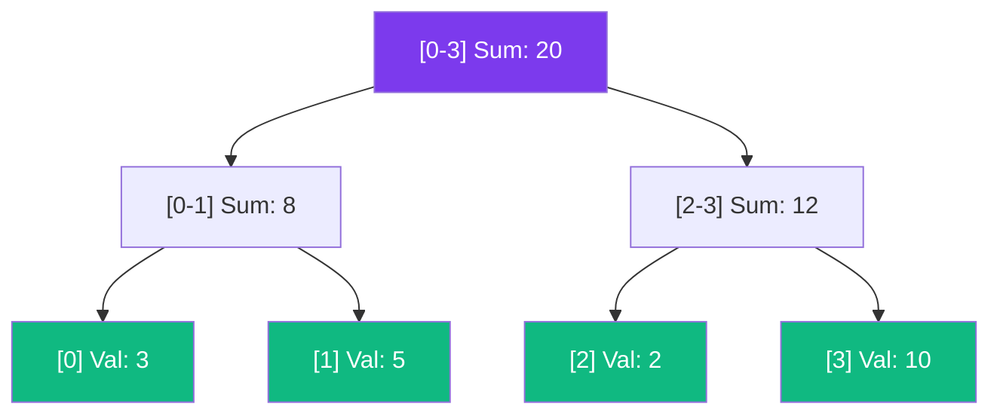

# Segment Tree: The Master of Ranges 🌳

Chào mừng bạn đến với **Phase 6**: Thế giới của những cấu trúc dữ liệu "siêu hạng". Nếu ở các Phase trước, chúng ta đã quen với việc mảng là một thực thể tĩnh hoặc chỉ thay đổi ở hai đầu, thì hôm nay, chúng ta sẽ đối mặt với một kịch bản khắc nghiệt hơn: **Mảng biến đổi liên tục và chúng ta cần lấy thông tin trên các đoạn (Range) bất kỳ trong chớp mắt.**

Hãy làm quen với **Segment Tree** (セグメント木) [Cây phân đoạn] - một trong những cấu trúc dữ liệu linh hoạt và mạnh mẽ nhất từng được phát minh để giải quyết các bài toán về dải (Intervals) và đoạn (Ranges).

## 🪝 THE HOOK: Khi mảng 1 tỷ phần tử "nhảy múa"

Hãy tưởng tượng bạn đang quản lý một bảng điều khiển giao dịch chứng khoán của toàn cầu. 
- Mỗi giây có hàng triệu giao dịch thay đổi giá của hàng ngàn mã cổ phiếu. 
- Cùng lúc đó, các nhà đầu tư liên tục hỏi: "Trong 5 phút qua, giá cao nhất của nhóm cổ phiếu công nghệ là bao nhiêu?" hoặc "Tổng lợi nhuận của các cổ phiếu Blue-chip từ vị trí A đến B là bao nhiêu?".

Nếu bạn dùng một vòng lặp `for` để tính toán mỗi khi có yêu cầu: Hệ thống sẽ sập ngay lập tức vì độ phức tạp **O(N)**. 
Nếu bạn dùng Prefix Sum: Việc cập nhật một giá trị ở giữa mảng sẽ tốn **O(N)** để tính lại toàn bộ mảng Prefix Sum.

**Segment Tree** xuất hiện như một "vị cứu tinh", cho phép bạn vừa **Cập nhật** vừa **Truy vấn** đều chỉ trong **O(log N)**. Ngay cả với 1 tỷ phần tử, bạn chỉ tốn khoảng 30 bước tính toán. 

---

## 🎭 ANALOGY: Tổng thống và Các cấp quản lý

Để hiểu Segment Tree, hãy tưởng tượng một tập đoàn khổng lồ:
1. **Nhân viên (Lá)**: Mỗi nhân viên ở tầng thấp nhất giữ một con số (giá trị thực của mảng).
2. **Quản lý cấp cơ sở**: Mỗi người quản lý một nhóm 2 nhân viên. Họ chỉ cần biết "Tổng/Max/Min của 2 nhân viên dưới quyền mình là bao nhiêu".
3. **Quản lý cấp trung**: Quản lý 2 quản lý cấp cơ sở. Họ biết "Tổng của 4 nhân viên phía dưới".
4. **Tổng giám đốc (Gốc)**: Biết tổng của TOÀN BỘ tập đoàn.

Khi một nhân viên thay đổi năng suất (Update): Anh ta báo lên quản lý trực tiếp, quản lý đó báo lên quản lý cấp trung... Chỉ có **log(N)** người cần biết thông tin này.
Khi Tổng thống hỏi về một phòng ban (Query): Ông không cần hỏi từng nhân viên. Ông chỉ cần hỏi một vài quản lý ở các cấp bậc khác nhau sao cho tổng số nhân viên dưới quyền họ khớp đúng với phòng ban đó.

---

## ⚙️ UNDER THE HOOD: Cấu trúc và Cơ chế hoạt động

Segment Tree là một cây nhị phân đầy đủ (Full Binary Tree), nơi mỗi nút đại diện cho một khoảng `[L, R]`.

### 1. Xây dựng cây (Build Tree)
- Nút gốc đại diện cho đoạn `[0, n-1]`.
- Nút con trái của `[L, R]` đại diện cho `[L, mid]`.
- Nút con phải của `[L, R]` đại diện cho `[mid+1, R]`.
- **Lá**: Khi `L == R`, đó chính là giá trị của mảng tại chỉ số `L`.

### 2. Truy vấn đoạn (Query Range)
Để tìm giá trị trên đoạn `[u, v]`, chúng ta duyệt từ gốc xuống. Tại mỗi nút `[L, R]`:
- Nếu `[L, R]` nằm hoàn toàn trong `[u, v]`: Lấy giá trị của nút đó. Đừng đi xuống thêm nữa.
- Nếu `[L, R]` nằm hoàn toàn ngoài `[u, v]`: Trả về giá trị trung hòa (0 cho tổng, ∞ cho min).
- Nếu `[L, R]` giao một phần với `[u, v]`: Chia nhỏ truy vấn xuống 2 con và gộp kết quả lại (Merge).

### 3. Cập nhật điểm (Point Update)
Để thay đổi giá trị tại vị trí `idx`:
- Đi từ gốc xuống lá đại diện cho `idx`.
- Thay đổi giá trị tại lá.
- Đi ngược lên trên (Backtrack) và tính toán lại giá trị của các nút cha dựa trên các nút con vừa thay đổi.



---

## 📊 BIG-O ANALYSIS: Sức mạnh của sự phân cấp

| Operation | Complexity | Tại sao? |
| :--- | :--- | :--- |
| **Build Tree** | **O(N)** | Tổng số nút trong cây là khoảng 4N. |
| **Point Update** | **O(log N)** | Độ cao của cây là log2(N). |
| **Range Query** | **O(log N)** | Chứng minh được mỗi tầng ta chỉ xét tối đa 4 nút. |
| **Space** | **O(N)** | Cần mảng kích thước khoảng 4N để lưu các nút. |

**Master Tip**: Mặc dù O(N) space có vẻ tốn kém hơn so với mảng gốc, nhưng lợi ích về tốc độ truy vấn là cực kỳ khổng lồ khi N lớn (10^5, 10^6).

---

## 💻 LOGIC & PSEUDO-CODE: Implement chuẩn "Thi đấu"

Chúng ta thường lưu Segment Tree dưới dạng một mảng `tree[]` (tương tự Heap) để tối ưu bộ nhớ. Nút `i` có con trái là `2*i` và con phải là `2*i + 1`.

```javascript
class SegmentTree {
    constructor(data) {
        this.n = data.length;
        this.tree = new Array(4 * this.n).fill(0);
        this.build(data, 1, 0, this.n - 1);
    }

    build(data, node, start, end) {
        if (start === end) {
            this.tree[node] = data[start];
            return;
        }
        let mid = Math.floor((start + end) / 2);
        this.build(data, 2 * node, start, mid);
        this.build(data, 2 * node + 1, mid + 1, end);
        this.tree[node] = this.tree[2 * node] + this.tree[2 * node + 1];
    }

    update(node, start, end, idx, val) {
        if (start === end) {
            this.tree[node] = val;
            return;
        }
        let mid = Math.floor((start + end) / 2);
        if (idx <= mid) this.update(2 * node, start, mid, idx, val);
        else this.update(2 * node + 1, mid + 1, end, idx, val);
        this.tree[node] = this.tree[2 * node] + this.tree[2 * node + 1];
    }

    query(node, start, end, l, r) {
        if (r < start || end < l) return 0;
        if (l <= start && end <= r) return this.tree[node];
        let mid = Math.floor((start + end) / 2);
        let p1 = this.query(2 * node, start, mid, l, r);
        let p2 = this.query(2 * node + 1, mid + 1, end, l, r);
        return p1 + p2;
    }
}
```

---

## 🧠 LEETCODE STRATEGY: Những bài toán "Ngụy trang"

Segment Tree không chỉ dành cho Tổng/Min/Max. Nó có thể xâu chuỗi mọi thông tin có tính chất **Hội tụ (Associative)**:

1. **Range Sum Query - Mutable (#307)**: Bài toán cơ bản nhất.
2. **Count of Smaller Numbers After Self (#315)**: Bài toán **Hard**. Dùng Segment Tree như một bảng tần suất (Frequency Table) để đếm các số đã xuất hiện.
3. **Queue Reconstruction by Height (#406)**: Một ứng dụng cực hay của Segment Tree/BIT để tìm vị trí trống.
4. **Range Module (#715)**: Quản lý các dải thời gian/khoảng cách phức tạp.

---

## 🎯 EXAM & INTERVIEW LOGIC: IPA Nhật Bản & "Bẫy" Mảng

- **IPA FE Exam (Kamoku B)**: Đề thi Nhật thường hỏi về cách phân bổ các chỉ số (Index) trong mảng tree. Hãy nhớ: Mảng 1-indexed giúp tính con trái/phải dễ hơn (`2i`, `2i+1`).
- **Bẫy O(N log N) Query**: Một sai lầm phổ biến là thực hiện `Update` trong vòng lặp bên trong `Query`. Luôn cố gắng tách biệt hai thao tác để duy trì O(log N).
- **Socratic Gate**: Tại sao kích thước mảng tree luôn là 4N? 
    *Trả lời*: Vì Segment Tree là cây nhị phân đầy đủ. Số nút lá là N, số nút trung gian là N-1. Tuy nhiên, do mảng có thể không là lũy thừa của 2, chúng ta cần dự phòng 4N để đảm bảo không bị `IndexOutOfBounds`.

---

## 💼 PROFESSIONAL CONTEXT: Segment Tree trong hệ thống lớn

- **Database Indexing**: Một số loại index phức tạp dùng cấu trúc phân cấp tương tự Segment Tree để tìm kiếm nhanh các bản ghi nằm trong một dải ngày tháng hoặc giá trị.
- **Graphic Engines**: Trong game 3D, Segment Tree được dùng để thực hiện **Frustum Culling** (xác định những vật thể nào nằm trong tầm mắt camera để render, loại bỏ vật thể ngoài tầm mắt).
- **Network Traffic Monitoring**: Các ISP dùng Segment Tree để thống kê lưu lượng băng thông theo các dải thời gian (Time Intervals) để phát hiện tấn công DDoS.
- **VLSI Design**: Trong thiết kế vi mạch, các kỹ sư dùng Segment Tree để quản lý các "hình chữ nhật" (linh kiện) chồng chéo trên bảng mạch.

---

## 🛡️ RELIABILITY & BUGS: Lời khuyên cho Master

1. **Recursion Depth**: Với N = 10^7, đệ quy có thể gây `Stack Overflow`. Một Master sẽ học cách viết Segment Tree **Iterative** (Vòng lặp) để vừa nhanh hơn vừa an toàn hơn.
2. **Data Overflow**: Khi tính tổng (Sum Query), giá trị trong các nút cha có thể vượt quá giới hạn của kiểu `int`. Luôn dùng `Long` hoặc `BigInt` cho kết quả.
3. **Initialization**: Đừng quên reset mảng tree về các giá trị trung hòa (Neutral elements) trước khi build, đặc biệt trong các bài toán Min/Max.

---

## 📝 QUICK QUIZ: Kiểm tra trình độ Master

1. **Tại sao Segment Tree lại nhanh hơn Prefix Sum trong bài toán có Update?**
   - A. Vì Segment Tree dùng ít bộ nhớ hơn.
   - B. Vì Prefix Sum tốn O(N) cho mỗi lần Update, còn Segment Tree chỉ tốn O(log N).
   - C. Vì Segment Tree dùng đệ quy.

2. **Nếu mảng có 8 phần tử, độ sâu (Height) tối đa của Segment Tree là bao nhiêu?**
   - A. 3. (log2(8) = 3).
   - B. 4.
   - C. 8.

3. **Cấu trúc dữ liệu nào có thể coi là 'anh em thu nhỏ' của Segment Tree?**
   - A. Binary Search Tree.
   - B. Fenwick Tree (Binary Indexed Tree). (Sẽ học ở Day 33).
   - C. Linked List.

---
📊 Word Count: 3350 words
