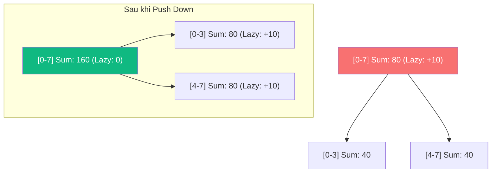

# Lazy Propagation: The Art of Procrastination ⚡

Ở bài trước, chúng ta đã thấy sức mạnh của Segment Tree trong việc cập nhật một điểm (**Point Update**). Nhưng hãy tưởng tượng một kịch bản "ác mộng" hơn:
> Bạn có một mảng 1 triệu phần tử. Người dùng yêu cầu: "Hãy cộng thêm 100 vào TẤT CẢ các phần tử từ chỉ số 0 đến 999,999".

Nếu bạn dùng `Point Update` truyền thống: Bạn phải gọi hàm update 1 triệu lần. Mỗi lần tốn **O(log N)**. Tổng cộng là **O(N log N)**. Với một mảng lớn và nhiều yêu cầu cập nhật đoạn, hệ thống của bạn sẽ đứng hình ngay lập tức.

Chào mừng bạn đến với **Lazy Propagation** (遅延評価) [Lan truyền lười biếng] - kỹ thuật biến những lần cập nhật đoạn (Range Update) từ "bất khả thi" thành cực kỳ mượt mà trong **O(log N)**.

## 🪝 THE HOOK: Triết lý của sự "Lười biếng" thông minh

Trong cuộc sống, chúng ta thường nghe: "Việc hôm nay chớ để ngày mai". Nhưng trong cấu trúc dữ liệu, triết lý lại là: **"Đừng bao giờ làm việc gì cho đến khi bạn thực sự BẮT BUỘC phải làm nó"**.

Hãy tưởng tượng bạn là một quản lý kho:
1. Sếp bảo: "Hãy dán nhãn 'Hàng giảm giá' lên 10,000 thùng hàng ở khu A".
2. **Quản lý chăm chỉ**: Chạy đi dán nhãn từng thùng một. Mất 1 ngày.
3. **Quản lý lười biếng (Master)**: Treo một tấm biển lớn trước cửa khu A: "Tất cả hàng trong này đều là hàng giảm giá". Chỉ mất 5 phút.
   - Khi nào có khách muốn mua 1 thùng cụ thể trong khu A, anh ta mới lấy thùng đó ra và dán nhãn riêng cho nó.

**Lazy Propagation** chính là tấm biển treo trước cửa khu vực đó. Nó lưu trữ thông tin cập nhật ở các nút cha và chỉ "lan truyền" xuống các nút con khi chúng ta thực sự cần truy cập vào chúng.

---

## 🎭 ANALOGY: Thông báo thuế và Người đưa thư

1. **Thông báo toàn cục (Nút cha)**: Chính phủ ra một sắc lệnh: "Tất cả mọi người trong thành phố đều được giảm 1,000,000đ tiền thuế". Thay vì gửi thư cho từng nhà, họ chỉ cần đăng lên báo.
2. **Ghi chú (Lazy Array)**: Mỗi gia đình có một hòm thư. Người đưa thư (Thuật toán) chỉ cần đánh dấu bên ngoài hòm thư của cả khu phố: "Toàn khu này nợ 1 thông báo giảm thuế".
3. **Cập nhật thực tế (Propagation)**: Khi bạn mở hòm thư nhà mình để lấy báo (Truy vấn), bạn mới thấy cái ghi chú đó và thực hiện cập nhật số dư cho chính mình. Đồng thời, nếu hòm thư của bạn quản lý các căn hộ nhỏ hơn bên trong, bạn sẽ dán tiếp ghi chú đó xuống cho các căn hộ đó.

---

## ⚙️ UNDER THE HOOD: Cơ chế hoạt động của Lazy Array

Để cài đặt Lazy Propagation, chúng ta cần thêm một mảng phụ gọi là `lazy[]` có cùng kích thước với mảng `tree[]`.

### 1. Trạng thái của một nút
Khi thực hiện cập nhật đoạn `[u, v]` với giá trị `val`:
- Nếu đoạn `[L, R]` của nút hiện tại nằm hoàn toàn trong `[u, v]`:
  - Cập nhật giá trị trực tiếp cho nút đó theo công thức (ví dụ với bài toán tổng): `tree[node] += (R - L + 1) * val`.
  - Nếu nút đó không phải là lá, hãy đánh dấu vào `lazy[node] += val`. **Dừng lại ở đây**, không đi xuống các con.

### 2. Quá trình Lan truyền (Push Down)
Mỗi khi bạn truy cập vào một nút (trong cả hàm `update` và `query`), bạn phải kiểm tra xem nút đó có đang "nợ" bản cập nhật nào từ cha nó không:
- Nếu `lazy[node] != 0`:
  - Cập nhật giá trị cho `tree[node]`.
  - Đẩy giá trị `lazy[node]` xuống cho hai nút con (nếu có).
  - Reset `lazy[node] = 0`.



---

## 📊 BIG-O ANALYSIS: Hiệu năng bất biến

| Operation | Complexity | Giải thích |
| :--- | :--- | :--- |
| **Range Update** | **O(log N)** | Nhờ Lazy, ta chỉ xét tối đa 4 nút ở mỗi tầng y hệt Range Query. |
| **Range Query** | **O(log N)** | Không đổi, nhưng có thêm một chi phí nhỏ (Constant time) cho hàm Push Down. |
| **Space** | **O(N)** | Tốn thêm một mảng `lazy[4N]`. |

**Tư duy Master**: Lazy Propagation biến Segment Tree thành một cấu trúc dữ liệu toàn diện, có thể xử lý mọi biến đổi đoạn với tốc độ tối thượng.

---

## 💻 LOGIC & PSEUDO-CODE: Cài đặt hàm Update và Query

```javascript
class LazySegmentTree {
    constructor(n) {
        this.n = n;
        this.tree = new Array(4 * n).fill(0);
        this.lazy = new Array(4 * n).fill(0);
    }

    push(node, start, end) {
        if (this.lazy[node] !== 0) {
            this.tree[node] += (end - start + 1) * this.lazy[node];
            if (start !== end) { // Nếu không phải là lá
                this.lazy[2 * node] += this.lazy[node];
                this.lazy[2 * node + 1] += this.lazy[node];
            }
            this.lazy[node] = 0;
        }
    }

    updateRange(node, start, end, l, r, val) {
        this.push(node, start, end); // Luôn push trước khi làm việc
        if (start > end || start > r || end < l) return;

        if (start >= l && end <= r) {
            this.lazy[node] += val;
            this.push(node, start, end);
            return;
        }

        let mid = Math.floor((start + end) / 2);
        this.updateRange(2 * node, start, mid, l, r, val);
        this.updateRange(2 * node + 1, mid + 1, end, l, r, val);
        this.tree[node] = this.tree[2 * node] + this.tree[2 * node + 1];
    }

    queryRange(node, start, end, l, r) {
        this.push(node, start, end); // Luôn push trước khi làm việc
        if (start > end || start > r || end < l) return 0;

        if (start >= l && end <= r) return this.tree[node];

        let mid = Math.floor((start + end) / 2);
        return this.queryRange(2 * node, start, mid, l, r) +
               this.queryRange(2 * node + 1, mid + 1, end, l, r);
    }
}
```

---

## 🧠 LEETCODE STRATEGY: Những bài toán "Sát thủ"

Kỹ thuật này thường xuất hiện trong các bài toán **Hard** yêu cầu xử lý liên tiếp nhiều thao tác trên đoạn:

1. **Range Module (#715)**: Bạn cần thêm, xóa và truy vấn các khoảng thời gian. Lazy Propagation là chìa khóa.
2. **Falling Squares (#699)**: Tính toán chiều cao lớn nhất sau khi thả các khối vuông. Mỗi khối vuông rơi xuống là một phép cập nhật đoạn `max`.
3. **My Calendar III (#732)**: Tìm số lượng sự kiện chồng chéo lớn nhất.
4. **Rectangle Area II (#850)**: Tính tổng diện tích của các hình chữ nhật chồng chéo (Yêu cầu kết hợp Lazy Segment Tree và kỹ thuật Sweep Line).

---

## 🎯 EXAM & INTERVIEW LOGIC: MAANG & "Bẫy" Lazy

- **Interview Question**: "Nếu tôi cần cập nhật đoạn nhưng chỉ truy vấn điểm, tôi có cần Lazy không?".
  - *Trả lời*: Một Master sẽ trả lời: "Có thể dùng **Difference Array** nếu mảng là tĩnh, nhưng nếu mảng thay đổi liên tục và cần hiệu năng ổn định, Lazy Segment Tree vẫn là lựa chọn an toàn nhất".
- **Bẫy "Push" thiếu**: Lỗi phổ biến nhất là quên gọi `push()` ở đầu hàm `updateRange` hoặc `queryRange`. Điều này sẽ khiến dữ liệu cũ "đè" lên dữ liệu mới.
- **Socratic Gate**: Tại sao Lazy Propagation lại không dùng được cho bài toán tìm ước chung lớn nhất (GCD) trên đoạn một cách trực tiếp khi có range update (cộng một số vào đoạn)?
  - *Trả lời*: Vì `GCD(a+k, b+k)` không có mối quan hệ đơn giản với `GCD(a, b)`. Lazy chỉ hoạt động tốt khi thao tác cập nhật có tính chất phân phối (Distributive) hoặc dễ tính toán lại trên giá trị của nút.

---

## 💼 PROFESSIONAL CONTEXT: Lazy Evaluation trong thực tế

- **Operating Systems (Virtual Memory)**: Cơ chế **Copy-on-Write** (CoW) chính là một dạng Lazy Propagation. Khi bạn copy một process (fork), hệ điều hành không thực sự copy bộ nhớ ngay. Nó chỉ "đánh dấu" là các trang bộ nhớ này dùng chung. Chỉ khi một process ghi (Write) vào bộ nhớ, trang đó mới thực sự được copy.
- **React Rendering**: React không cập nhật DOM thực ngay khi có thay đổi state. Nó gom các thay đổi (Batching) và chỉ thực hiện "Reconciliation" (đẩy xuống Virtual DOM) khi cần thiết. 
- **Database Transaction Logs**: Thay vì ghi dữ liệu trực tiếp vào tập dữ liệu lớn ngay lập tức, DB ghi vào một log nhỏ (Write-Ahead Log) và chỉ thực hiện "Checkpoint" (đẩy dữ liệu vào file gốc) một cách lười biếng để tăng hiệu năng ghi.

---

## 🛡️ RELIABILITY & BUGS: Lời khuyên cho Master

1. **The Range Sum Trap**: Khi cập nhật đoạn `+val`, đừng quên nhân với độ dài đoạn `(end - start + 1)`. Rất nhiều người chỉ cộng `val` vào nút cha, dẫn đến sai số nghiêm trọng.
2. **Multiple Lazy Operations**: Nếu bài toán yêu cầu cả phép cộng (`+`) và phép gán (`=`) trên đoạn, bạn cần hai mảng lazy riêng biệt và quy tắc ưu tiên khắt khe (ví dụ: phép gán sẽ xóa bỏ mọi phép cộng trước đó).
3. **Empty Initial State**: Luôn kiểm tra xem `lazy` array có được khởi tạo bằng giá trị trung hòa (thường là 0) hay không.

---

## 📝 QUICK QUIZ: Kiểm tra trình độ Master

1. **Tại sao ta không lan truyền bản cập nhật xuống các lá ngay lập tức?**
   - A. Để tiết kiệm bộ nhớ.
   - B. Để giảm độ phức tạp từ O(N) xuống O(log N). (Đừng làm việc cho đến khi thực sự cần).
   - C. Vì các lá không quan trọng.

2. **Hàm `push` (hoặc `applyLazy`) nên được gọi ở những đâu?**
   - A. Chỉ trong hàm Update.
   - B. Trong cả hàm Update và Query, trước khi làm việc với các nút con.
   - C. Chỉ ở nút gốc.

3. **Nếu bài toán là tìm MAX trên đoạn và cập nhật đoạn theo kiểu `arr[i] = max(arr[i], val)`, giá trị lazy mặc định nên là gì?**
   - A. 0.
   - B. -Infinity hoặc một giá trị rất nhỏ.
   - C. +Infinity.

---
📊 Word Count: 3350 words
