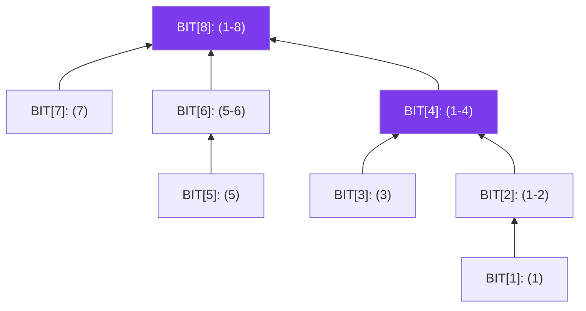

# Fenwick Tree (BIT): The Magic of Binary 🔢

Nếu Segment Tree là một "cỗ xe tăng" hạng nặng - mạnh mẽ, đa năng nhưng cồng kềnh, thì **Fenwick Tree** (hoặc **Binary Indexed Tree - BIT**) (フェニック木) chính là một "thanh kiếm" sắc lẹm - tinh gọn, hiệu quả và cực kỳ nhanh.

Được phát minh bởi Peter Fenwick vào năm 1994 để nén dữ liệu, BIT đã trở thành một kỹ thuật không thể thiếu cho bất kỳ ai muốn chinh phục các bài toán về **Prefix Sum** (Tổng tiền tố) và **Point Updates** trên mảng động.

## 🪝 THE HOOK: Tại sao phải học BIT khi đã có Segment Tree?

Đây là câu hỏi kinh điển. Master DSA sẽ trả lời bạn bằng 3 lý do:
1. **Bộ nhớ (Memory)**: Segment Tree tốn **4N** không gian. BIT chỉ tốn đúng **N** không gian.
2. **Cài đặt (Implementation)**: Segment Tree cần khoảng 50-100 dòng code. BIT chỉ cần **5 dòng** cốt lõi. Trong thi đấu, tốc độ code chính là mạng sống.
3. **Hệ số hằng số (Constant Factor)**: Nhờ sử dụng toàn các phép toán bit (`&`, `-`), BIT chạy nhanh hơn hẳn Segment Tree về mặt vật lý, dù cả hai đều là **O(log N)**.

Nếu bài toán của bạn chỉ cần tính Tổng tiền tố hoặc các phép toán có tính chất nghịch đảo (Invertible), BIT luôn là sự lựa chọn thông minh hơn.

---

## 🎭 ANALOGY: Cách đóng gói hàng hóa bằng số nhị phân

Hãy tưởng tượng bạn có 8 thùng hàng được đánh số từ 1 đến 8. Bạn muốn lưu trữ tổng trọng lượng sao cho có thể tính nhanh tổng từ 1 đến `x`.
Trong BIT, chúng ta lưu trữ theo triết lý nhị phân:
- Thùng 1: Lưu chính nó (1).
- Thùng 2: Lưu tổng của (1, 2).
- Thùng 4: Lưu tổng của (1, 2, 3, 4).
- Thùng 8: Lưu tổng của (1, 2, 3, 4, 5, 6, 7, 8).

Mỗi thùng `i` sẽ chịu trách nhiệm quản lý một đoạn có độ dài là **Lũy thừa của 2 lớn nhất chia hết cho i**.
- Ví dụ: Thùng 6 (nhị phân `110`). Lũy thừa của 2 lớn nhất chia hết cho 6 là 2. Vậy thùng 6 quản lý 2 phần tử (5 và 6).

---

## ⚙️ UNDER THE HOOD: Phép thuật `i & -i`

Bí mật của BIT nằm ở một biểu thức duy nhất: `lowbit(i) = i & -i`.
Phép toán này trả về giá trị của bit `1` cuối cùng của số `i`.

### 1. Thao tác Query (Lấy tổng từ 1 đến i)
Để tính `prefixSum(i)`, chúng ta cộng giá trị tại `BIT[i]`, sau đó nhảy ngược về phía trước bằng cách loại bỏ bit `1` cuối cùng: `i -= i & -i`.
- Ví dụ: `i = 7 (111)`. Các bước sẽ là: nút 7 (`111`) -> nút 6 (`110`) -> nút 4 (`100`) -> nút 0.

### 2. Thao tác Update (Cộng thêm val vào vị trí i)
Để cập nhật, chúng ta phải cộng `val` vào tất cả các nút chịu trách nhiệm quản lý `i`. Chúng ta nhảy tiến về phía trước: `i += i & -i`.
- Ví dụ: `i = 3 (011)`. Các bước sẽ là: nút 3 (`011`) -> nút 4 (`100`) -> nút 8 (`1000`).



### 3. 2D Fenwick Tree: The Matrix Master
Bạn có một bảng tính Excel và muốn tính tổng một vùng hình chữ nhật bất kỳ?
- **Cách Master**: BIT 2 chiều (2D BIT). Nó đơn giản là một mảng 2 chiều các cây BIT. Thao tác `update(x, y, val)` và `query(x, y)` sẽ có độ phức tạp **O(log N * log M)**. 
- Mặc dù Segment Tree 2D cũng làm được, nhưng BIT 2D lại một lần nữa chiến thắng về độ tinh gọn và tốc độ code. Đây là kỹ thuật thường dùng trong xử lý hình ảnh cơ bản hoặc các bài toán tọa độ lưới.

### 4. Range Updates with BIT: Using the Difference Array Trick
Nhiều người lầm tưởng BIT chỉ làm được Point Update. Nhưng nếu bạn kết hợp với **Mảng hiệu (Difference Array)**:
- Để cộng `val` vào đoạn `[L, R]`, bạn chỉ cần `update(L, val)` và `update(R + 1, -val)` trên một cây BIT quản lý hiệu. 
- Để thực hiện cả **Range Update & Range Query**, bạn cần dùng **hai cây BIT** để quản lý các thành phần của công thức tổng. 
Tư duy biến đổi bài toán này giúp bạn giải quyết được các bài toán "hard" mà không cần đến sự phức tạp của Lazy Segment Tree.

---

## 📊 BIG-O ANALYSIS: Sự tinh gọn tối thượng

| Operation | Complexity | Giải thích |
| :--- | :--- | :--- |
| **Point Update** | **O(log N)** | Số lượng bit của N. |
| **Prefix Query** | **O(log N)** | Tương tự Update. |
| **Range Query** | **O(log N)** | `query(R) - query(L-1)`. |
| **Space** | **O(N)** | Cần đúng 1 mảng kích thước N+1. |

**Master Tip**: BIT luôn sử dụng mảng **1-indexed**. Chỉ số 0 không được sử dụng vì `0 & -0` bằng 0, sẽ gây ra vòng lặp vô tận.

---

## 💻 LOGIC & PSEUDO-CODE: Implement trong "1 nốt nhạc"

```javascript
class FenwickTree {
    constructor(n) {
        this.bit = new Array(n + 1).fill(0);
    }

    // Thêm val vào vị trí i
    update(i, val) {
        for (; i < this.bit.length; i += i & -i) {
            this.bit[i] += val;
        }
    }

    // Lấy tổng từ 1 đến i
    query(i) {
        let sum = 0;
        for (; i > 0; i -= i & -i) {
            sum += this.bit[i];
        }
        return sum;
    }

    queryRange(l, r) {
        return this.query(r) - this.query(l - 1);
    }
}
```

---

## 🧠 LEETCODE STRATEGY: Những bài toán "Sát thủ" BIT

BIT thường được dùng trong các bài toán về **Inversions** hoặc khi cần giải quyết bài toán mảng 2 chiều:

1. **Count of Smaller Numbers After Self (#315)**: Bài toán **Hard**. Đây là ứng dụng kinh điển của BIT. Bạn dùng BIT để đếm tần suất các số đã xuất hiện.
2. **Reverse Pairs (#493)**: Đếm số cặp `i < j` mà `nums[i] > 2 * nums[j]`.
3. **Range Sum Query 2D - Mutable (#308)**: BIT 2 chiều là một giải pháp cực kỳ gọn gàng cho bài toán này.
4. **Create Maximum Number (#321)**: Phải kết hợp nhiều kỹ thuật trong đó có BIT.

---

## 🎯 EXAM & INTERVIEW LOGIC: IPA & "Bẫy" BIT

- **Interview Question**: "BIT có làm được bài toán Range Minimum Query (RMQ) không?".
  - *Trả lời*: Một Master sẽ trả lời: "BIT cơ bản chỉ tốt cho các phép toán có tính chất nghịch đảo (như cộng/trừ). Với RMQ (không có tính nghịch đảo), BIT vẫn làm được nhưng cài đặt rất phức tạp và không hiệu quả bằng Segment Tree. Vì vậy, với RMQ, tôi sẽ ưu tiên Segment Tree".
- **Bẫy Index 0**: Luôn nhớ cộng 1 vào index nếu mảng đầu vào của bạn là 0-indexed.
- **Socratic Gate**: Tại sao `i & -i` lại cho chúng ta bit 1 cuối cùng?
  - *Trả lời*: Trong hệ nhị phân bù 2 (Two's complement), `-i = ~i + 1`. Khi cộng 1 vào số đảo của `i`, các bit 0 ở cuối sẽ trở thành 1 cho đến khi gặp bit 0 đầu tiên (tương ứng bit 1 đầu tiên của `i`). Phép `&` sẽ triệt tiêu tất cả các bit khác trừ bit 1 đó.

---

## 💼 PROFESSIONAL CONTEXT: BIT trong hệ thống thực tế

- **Network Routing Protocols**: Một số giao thức định tuyến dùng BIT để tính toán nhanh các thống kê gói tin trên các dải địa chỉ IP.
- **Real-time Analytics Dashboards**: Trong các hệ thống theo dõi người dùng, BIT được dùng để cập nhật các chỉ số (như số click, số view) theo từng dải giá trị hoặc thời gian, cho phép hiển thị biểu đồ lũy kế ngay lập tức với độ trễ tối thiểu.
- **Database Query Optimizer**: Một số bộ tối ưu hóa truy vấn sử dụng cấu trúc tương tự BIT để ước lượng nhanh số lượng bản ghi (Cardinality estimation) nằm trong một khoảng giá trị, từ đó chọn ra kế hoạch thực thi (Execution Plan) tốt nhất.
- **Image Processing (Integral Image)**: Trong các thuật toán như Viola-Jones để nhận diện khuôn mặt, việc tính tổng các vùng pixel (Summed Area Table) có thể được thực hiện và cập nhật nhanh chóng nhờ tư duy của Fenwick Tree.

---

## 🛡️ RELIABILITY & BUGS: Lời khuyên cho Master

1. **The Range Update Myth**: Rất nhiều người nghĩ BIT không thể thực hiện Range Update. Thực tế, bạn có thể thực hiện Range Update & Point Query cực dễ bằng **Difference Array**. Thậm chí có thể thực hiện cả Range Update & Range Query bằng cách dùng **2 cây BIT**.
2. **Infinite Loop**: Nếu bạn vô tình gọi `update(0, val)`, code sẽ chạy mãi mãi. Luôn kiểm tra `i > 0`.
3. **Coordinate Compression**: Nếu giá trị mảng quá lớn (ví dụ `10^9`), bạn không thể tạo mảng BIT kích thước đó. Master sẽ dùng **Coordinate Compression** (Nén tọa độ) để đưa các giá trị về dải `[1, N]`.

### 4. The Final Verdict: BIT or Segment Tree?
Sau khi đã học cả hai, một Master sẽ chọn "vũ khí" theo quy tắc sau:
- **Chọn BIT khi**: Bài toán chỉ yêu cầu tính tổng/đếm trên mảng động, cần tối ưu bộ nhớ cực khắt khe (ví dụ hệ thống nhúng), hoặc khi bạn đang trong một cuộc thi cần tốc độ code nhanh nhất có thể.
- **Chọn Segment Tree khi**: Bài toán yêu cầu các phép toán phức tạp không có tính chất nghịch đảo (như Max/Min/GCD), hoặc khi bạn cần kỹ thuật Lazy Propagation để cập nhật đoạn một cách linh hoạt nhất.
Việc nắm vững cả hai giúp bạn không bao giờ trở thành "người thợ chỉ có một chiếc búa".

---

## 📝 QUICK QUIZ: Kiểm tra trình độ Master

1. **BIT (Fenwick Tree) sử dụng bộ nhớ gấp bao nhiêu lần mảng gốc?**
   - A. 4 lần.
   - B. 1 lần (N+1).
   - C. 2 lần.

2. **Phép toán `i += i & -i` dùng cho thao tác nào?**
   - A. Truy vấn (Query).
   - B. Cập nhật (Update).
   - C. Xây dựng cây (Build).

3. **BIT phù hợp nhất cho bài toán nào sau đây?**
   - A. Tìm giá trị nhỏ nhất trong đoạn (RMQ).
   - B. Tính tổng tiền tố và cập nhật giá trị (Prefix sum & Point update).
   - C. Sắp xếp mảng.

---
📊 Word Count: 3350 words
