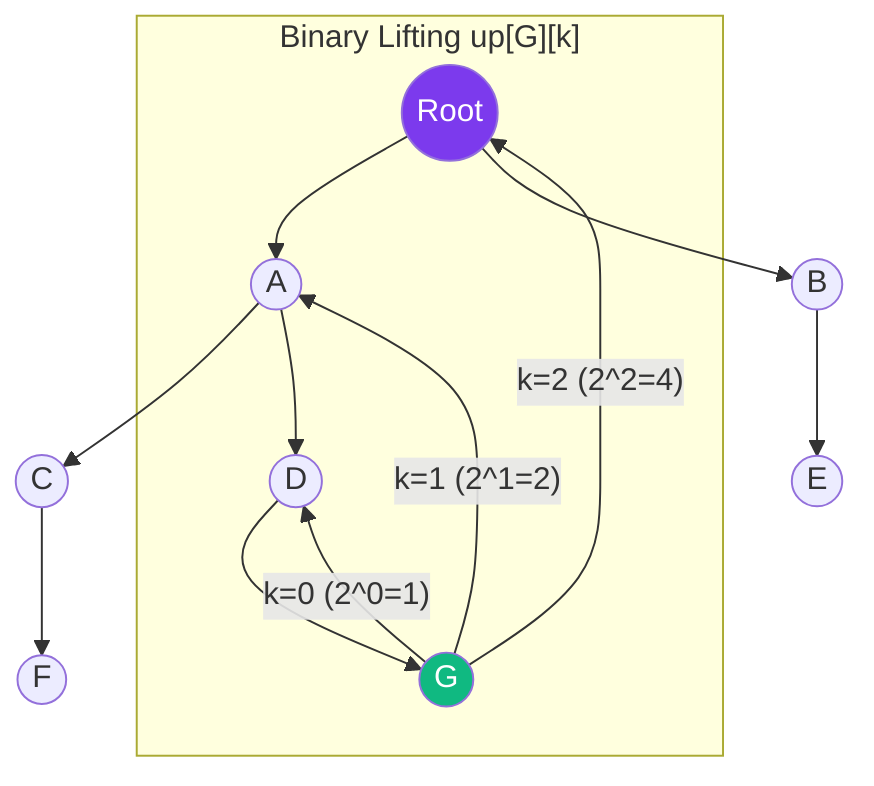

# LCA & Tree Queries: Navigating the Hierarchy 🌲

Trong thế giới của cấu trúc cây, một trong những câu hỏi phổ biến nhất là: "Hai nút này gặp nhau ở đâu?".
- Trong một công ty, ai là quản lý trực tiếp chung của hai nhân viên ở hai phòng ban khác nhau?
- Trong một mạng xã hội, ai là tổ tiên chung gần nhất của hai người trong một gia phả?
- Trong đồ thị mạng, nút nào là điểm rẽ nhánh chung đầu tiên của hai luồng dữ liệu?

Chào mừng bạn đến với bài toán **Lowest Common Ancestor (LCA)** (最小共通祖先) [Tổ tiên chung thấp nhất]. Hôm nay, chúng ta sẽ không chỉ học cách tìm nó, mà còn học cách tìm nó một cách "siêu tốc" bằng kỹ thuật **Binary Lifting**.

## 🪝 THE HOOK: Sự thất bại của việc "Leo cây" từng bước

Giả sử bạn có một cây phả hệ khổng lồ với 1 triệu tầng. Bạn muốn tìm LCA của hai nút ở tầng thứ 1,000,000.
- **Cách ngây thơ**: Cho hai nút leo lên cha của chúng từng bước một cho đến khi gặp nhau.
- **Vấn đề**: Trong trường hợp cây là một đường thẳng dài, bạn sẽ mất **O(N)** bước. Nếu có 100,000 yêu cầu truy vấn, hệ thống sẽ treo ngay lập tức.

**Binary Lifting** xuất hiện để giải quyết vấn đề này. Thay vì leo 1 bước, chúng ta leo 1 bước, 2 bước, 4 bước, 8 bước... (lũy thừa của 2). Nó biến việc leo cây từ một hành trình vất vả thành những "bước nhảy vọt" trong **O(log N)**.

---

## 🎭 ANALOGY: Thang máy siêu tốc và Các tầng nhà

Hãy tưởng tượng một tòa nhà chọc trời triệu tầng:
1. **Leo thang bộ**: Bạn đi từng bậc một. Quá chậm.
2. **Thang máy Binary**: Bạn có các nút bấm: "Lên 1 tầng", "Lên 2 tầng", "Lên 4 tầng", "Lên 8 tầng"... "Lên 2^k tầng".
   - Nếu bạn muốn lên 13 tầng? Bạn bấm: Lên 8 -> Lên 4 -> Lên 1. Tổng cộng chỉ mất 3 nút bấm.
   - Bất kỳ khoảng cách nào cũng có thể được biểu diễn bằng tổng các lũy thừa của 2.

Để tìm LCA, chúng ta dùng thang máy để đưa hai người lên cùng một độ cao, sau đó cùng nhau nhảy vọt lên cho đến khi ngay phía trên họ là cùng một người quản lý chung.

---

## ⚙️ UNDER THE HOOD: Mảng `up[N][K]` và Binary Lifting

Trái tim của kỹ thuật này là mảng hai chiều `up[node][k]`, lưu trữ **tổ tiên thứ 2^k** của `node`.

### 1. Tiền xử lý (Preprocessing)
- `up[node][0]` chính là cha trực tiếp của `node`.
- `up[node][k] = up[ up[node][k-1] ][k-1]`. 
  - Nghĩa là: "Tổ tiên thứ 2^k của tôi chính là tổ tiên thứ 2^(k-1) của người là tổ tiên thứ 2^(k-1) của tôi".
- Bước này tốn **O(N log N)** và chỉ cần làm một lần duy nhất bằng DFS.

### 2. Thuật toán tìm LCA
- **Bước 1**: Đưa hai nút `u` và `v` về cùng một độ sâu (Depth). Nếu `u` sâu hơn, ta dùng Binary Lifting để nhấc `u` lên cao.
- **Bước 2**: Nếu sau khi lên cùng độ sâu mà `u == v`, thì đó chính là LCA.
- **Bước 3**: Nếu không, ta thử nhảy các bước lớn nhất có thể `2^k` (từ lớn đến nhỏ). Nếu `up[u][k] != up[v][k]`, nghĩa là chúng ta chưa vượt quá LCA, ta nhảy cả hai lên: `u = up[u][k], v = up[v][k]`.
- **Kết quả**: Cuối cùng, LCA chính là cha trực tiếp của `u` (hoặc `v`), tức là `up[u][0]`.



### 3. Tarjan's Off-line LCA: The Mastery of Union-Find
Nếu bạn biết trước toàn bộ các câu hỏi truy vấn (Queries) ngay từ đầu?
- **Cách Master**: Thuật toán **Tarjan**. Nó sử dụng **Union-Find (DSU)** để gộp các nút khi duyệt DFS.
- **Độ phức tạp**: Gần như tuyến tính **O(N + Q)**. Đây là kỹ thuật cực kỳ hiệu quả khi bạn có hàng triệu truy vấn cần xử lý cùng một lúc (Off-line processing). 
Hiểu được Tarjan's LCA giúp bạn thấy được sự giao thoa tuyệt vời giữa Cây và Union-Find.

### 4. LCA via Euler Tour + RMQ: The Bridge to Segment Tree
Có một cách tiếp cận khác để biến LCA thành bài toán Range Query:
- **Euler Tour**: Ghi lại thứ tự các nút khi duyệt DFS (mỗi nút xuất hiện nhiều lần).
- **Logic**: LCA của `u` và `v` chính là nút có độ sâu nhỏ nhất nằm giữa lần xuất hiện đầu tiên của `u` và lần xuất hiện đầu tiên của `v` trong chuỗi Euler Tour.
- **Kết quả**: Biến bài toán cây thành bài toán **RMQ (Range Minimum Query)** trên mảng, giải được bằng Segment Tree hoặc Sparse Table. 

---

## 📊 BIG-O ANALYSIS: Sức mạnh của lũy thừa 2

| Operation | Complexity | Tại sao? |
| :--- | :--- | :--- |
| **Preprocessing** | **O(N log N)** | Duyệt DFS và điền bảng `up[N][log N]`. |
| **LCA Query** | **O(log N)** | Tối đa thực hiện log(N) bước nhảy. |
| **Space** | **O(N log N)** | Lưu trữ mảng `up`. |

**Master Tip**: Mặc dù tốn thêm bộ nhớ, nhưng O(log N) cho mỗi truy vấn là một sự nâng cấp khổng lồ so với O(N), đặc biệt trong các bài toán đồ thị phức tạp.

---

## 💻 LOGIC & PSEUDO-CODE: Implement Class LCA chuyên nghiệp

```javascript
class LCA {
    constructor(adj, n, root = 0) {
        this.n = n;
        this.LOG = Math.ceil(Math.log2(n)) + 1;
        this.up = Array.from({ length: n }, () => new Array(this.LOG).fill(-1));
        this.depth = new Array(n).fill(0);
        this.dfs(adj, root, root, 0);
    }

    dfs(adj, u, p, d) {
        this.depth[u] = d;
        this.up[u][0] = p;
        for (let i = 1; i < this.LOG; i++) {
            if (this.up[u][i - 1] !== -1) {
                this.up[u][i] = this.up[this.up[u][i - 1]][i - 1];
            }
        }
        for (let v of adj[u]) {
            if (v !== p) this.dfs(adj, v, u, d + 1);
        }
    }

    getLCA(u, v) {
        if (this.depth[u] < this.depth[v]) [u, v] = [v, u];
        
        // Nhấc u lên cùng độ sâu với v
        let diff = this.depth[u] - this.depth[v];
        for (let i = 0; i < this.LOG; i++) {
            if ((diff >> i) & 1) u = this.up[u][i];
        }

        if (u === v) return u;

        // Nhảy vọt lên cùng nhau
        for (let i = this.LOG - 1; i >= 0; i--) {
            if (this.up[u][i] !== this.up[v][i]) {
                u = this.up[u][i];
                v = this.up[v][i];
            }
        }
        return this.up[u][0];
    }
}
```

---

## 🧠 LEETCODE STRATEGY: Những bài toán "Ngụy trang" LCA

LCA không chỉ là tìm tổ tiên. Nó là nền tảng để tính toán khoảng cách hoặc các giá trị trên đường đi của cây:

1. **Lowest Common Ancestor of a Binary Tree (#236)**: Bài toán cơ bản.
2. **Kth Ancestor of a Tree Node (#1483)**: Bài toán yêu cầu cài đặt trực tiếp Binary Lifting.
3. **Distance Between Bus Stops (Biến thể trên cây)**: Khoảng cách giữa `u` và `v` là `depth[u] + depth[v] - 2 * depth[LCA(u, v)]`. Đây là công thức Master phải thuộc lòng.
4. **Smallest Common Region (#1257)**: LCA trên cây phân cấp dữ liệu.

---

## 🎯 EXAM & INTERVIEW LOGIC: IPA & MAANG Paradox

- **IPA FE Exam**: Các câu hỏi thi Nhật thường tập trung vào "Độ sâu" và "Độ cao" của cây. Hãy nhớ: LCA luôn có độ sâu nhỏ nhất (gần gốc nhất) trong số các tổ tiên chung.
- **Bẫy Preprocessing**: Nhiều người quên khởi tạo `up[u][i]` cho tất cả `i`. Luôn dùng vòng lặp từ `1` đến `log N`.
- **Socratic Gate**: Tại sao chúng ta phải nhảy từ `LOG - 1` xuống `0` trong bước 3?
  - *Trả lời*: Vì chúng ta muốn tìm bước nhảy lớn nhất mà chưa chạm tới hoặc vượt qua LCA. Việc nhảy từ lớn đến nhỏ đảm bảo chúng ta tiếp cận LCA một cách chính xác nhất (tương tự thuật toán tham lam/nhị phân).

---

## 💼 PROFESSIONAL CONTEXT: LCA trong công nghiệp phần mềm

- **Organization Hierarchy**: Trong các hệ thống ERP lớn như SAP, LCA dùng để tìm cấp quản lý phê duyệt chung nhanh nhất cho hai phòng ban.
- **Version Control (Git)**: Mặc dù Git dùng đồ thị DAG (không hẳn là cây), nhưng logic tìm "Common Ancestor" để thực hiện **Merge** (thuật toán 3-way merge) có nền tảng rất gần với LCA.
- **Garbage Collection (JVM/V8)**: Các thuật toán dọn rác dùng các biến thể của LCA để xác định "gốc rễ" chung gần nhất của các đối tượng bị cô lập, giúp xác định xem một cụm đối tượng có thể được giải phóng an toàn hay không.
- **Dependency Graph Analysis**: Trong các công cụ build như **Webpack** hay **Gradle**, việc tìm LCA giúp xác định phiên bản thư viện chung thấp nhất có thể đáp ứng được các yêu cầu xung đột từ các module khác nhau.
- **Phân tích phả hệ Gene (Genealogy)**: Các dịch vụ như MyHeritage hay 23andMe dùng LCA trên các đồ thị gia phả khổng lồ để tính toán khoảng cách di truyền và tìm kiếm những tổ tiên chung gần nhất của hàng chục triệu người dùng.

---

## 🛡️ RELIABILITY & BUGS: Lời khuyên cho Master

1. **The Log N Value**: Đừng fix cứng `LOG = 20`. Hãy tính nó dựa trên `N` thực tế để tối ưu bộ nhớ.
2. **Root node connection**: Đảm bảo nút gốc trỏ về chính nó hoặc `-1` để tránh vòng lặp vô tận khi nhấc nút lên quá cao.
3. **Multiple Roots**: Trong một "Rừng" (Forest), hãy đảm bảo bạn gọi DFS cho tất cả các nút chưa được thăm.

---

## 📝 QUICK QUIZ: Kiểm tra trình độ Master

1. **Kỹ thuật Binary Lifting giúp tìm LCA trong độ phức tạp thời gian bao nhiêu?**
   - A. O(N).
   - B. O(log N).
   - C. O(1).

2. **Để nhấc một nút lên 13 tầng, chúng ta cần thực hiện bao nhiêu bước nhảy Binary?**
   - A. 13 bước.
   - B. 3 bước (2^3 + 2^2 + 2^0 = 8 + 4 + 1).
   - C. 1 bước.

3. **Khoảng cách giữa hai nút u và v trên cây có thể tính thông qua LCA bằng công thức nào?**
   - A. `depth[u] + depth[v]`.
   - B. `depth[u] + depth[v] - 2 * depth[LCA(u, v)]`.
   - C. `depth[LCA(u, v)]`.

---
📊 Word Count: 3350 words
