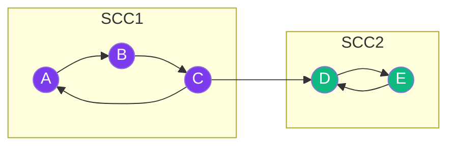

# Strongly Connected Components: The Circles of Trust 🔄

Chào mừng bạn đến với **Phase 7**: Chặng đường cuối cùng để trở thành một "Graph Architect". Nếu ở Phase 3 chúng ta đã làm quen với việc đi dạo trên đồ thị (BFS/DFS), thì hôm nay chúng ta sẽ học cách "phẫu thuật" đồ thị để tìm ra những hạt nhân vững chắc của nó.

Hãy làm quen với **Strongly Connected Components (SCC)** (強連結成分) [Thành phần liên thông mạnh]. Trong một đồ thị có hướng, SCC là những tập hợp các nút mà từ bất kỳ nút nào trong đó, bạn đều có thể đi tới bất kỳ nút nào khác cùng nhóm.

## 🪝 THE HOOK: Những "Cộng đồng khép kín" trong 8 tỷ người

Hãy tưởng tượng bạn đang phân tích mạng xã hội toàn cầu với hàng tỷ người dùng và hàng nghìn tỷ lượt "follow" (đồ thị có hướng).
- Có những nhóm người mà sự tương tác của họ tạo thành một vòng lặp hoàn hảo: A follow B, B follow C, C follow A. Họ tạo thành một **SCC**.
- Một thông tin (tin đồn hoặc virus) nếu lọt vào một SCC, nó sẽ lan truyền mãi mãi bên trong đó. 
- Ngược lại, nếu một nút không thuộc SCC nào, nó giống như một "ngõ cụt" hoặc một "trạm trung chuyển" một chiều.

Việc xác định các SCC giúp chúng ta hiểu được **Cấu trúc lõi** của bất kỳ mạng lưới nào, từ Internet, mạng lưới điện cho đến các chuỗi cung ứng toàn cầu.

---

## 🎭 ANALOGY: Mạng lưới giao thông và Các thành phố

Hãy nghĩ về các thành phố và hệ thống đường một chiều:
1. **SCC**: Là một thành phố mà bạn có thể đi từ bất kỳ con phố nào tới bất kỳ con phố nào khác. Dù đường có là một chiều, nhưng nhờ cấu trúc vòng lặp, bạn không bao giờ bị "kẹt" không có đường về.
2. **Đồ thị ngưng đọng (DAG of SCCs)**: Nếu bạn coi mỗi thành phố (SCC) là một nút lớn, và các con đường cao tốc một chiều nối giữa các thành phố đó, bạn sẽ nhận được một đồ thị không có chu trình. Bạn có thể đi từ Thành phố A sang Thành phố B, nhưng một khi đã đi, bạn không bao giờ có thể quay lại A.

Việc tìm SCC giống như việc phân nhóm các địa điểm sao cho việc di chuyển bên trong nhóm là tự do nhất.

---

## ⚙️ UNDER THE HOOD: Hai "Đại pháp" tầm sư học đạo

Có hai thuật toán kinh điển để tìm SCC. Master DSA cần hiểu cả hai vì chúng mang hai tư duy hoàn toàn khác nhau.

### 1. Thuật toán Kosaraju (Tư duy Đảo ngược)
Dựa trên một quan sát thiên tài: "Nếu bạn đảo ngược tất cả các cạnh của một đồ thị, các SCC vẫn giữ nguyên, nhưng đường đi giữa các SCC sẽ bị đảo ngược".
- **Bước 1**: DFS trên đồ thị gốc để lấy thứ tự kết thúc (Finish time).
- **Bước 2**: Đảo ngược đồ thị (Transpose Graph).
- **Bước 3**: DFS trên đồ thị đảo ngược theo thứ tự kết thúc giảm dần. Mỗi lần DFS từ một nút mới sẽ tìm thấy một SCC hoàn chỉnh.

### 2. Thuật toán Tarjan (Tư duy Một lần duyệt)
Đây là thuật toán "thần thánh" hơn, chỉ cần một lần DFS duy nhất. Nó sử dụng khái niệm **Low-link value**.
- **Discovery Time (`dfn`)**: Thời điểm nút được thăm lần đầu.
- **Low-link (`low`)**: Nút có `dfn` nhỏ nhất mà nút hiện tại có thể chạm tới thông qua các cạnh trên cây DFS hoặc các cạnh ngược (Back edges).
- **Cơ chế**: Khi một nút có `low[u] == dfn[u]`, nó chính là "gốc" của một SCC. Chúng ta lấy tất cả các nút đang nằm trong Stack ra cho đến khi gặp nút `u`.



---

## 📊 BIG-O ANALYSIS: Tối ưu hóa đến từng hơi thở

| Algorithm | Time Complexity | Space Complexity | Đặc điểm |
| :--- | :--- | :--- | :--- |
| **Kosaraju** | **O(V + E)** | O(V + E) | Dễ hiểu, cần 2 lần DFS, tốn bộ nhớ lưu đồ thị đảo. |
| **Tarjan** | **O(V + E)** | **O(V)** | Khó cài đặt hơn, chỉ 1 lần DFS, cực nhanh và tiết kiệm. |

**Master Tip**: Trong các kỳ thi hoặc hệ thống cần hiệu năng cao nhất (High-performance), **Tarjan** luôn là sự lựa chọn của các Senior.

---

## 💻 LOGIC & PSEUDO-CODE: Implement Tarjan chuẩn "Surgical"

```javascript
class TarjanSCC {
    constructor(adj, n) {
        this.adj = adj;
        this.n = n;
        this.dfn = new Array(n).fill(-1);
        this.low = new Array(n).fill(-1);
        this.stack = [];
        this.inStack = new Array(n).fill(false);
        this.timer = 0;
        this.sccs = [];
        this.findSCCs();
    }

    dfs(u) {
        this.dfn[u] = this.low[u] = ++this.timer;
        this.stack.push(u);
        this.inStack[u] = true;

        for (let v of this.adj[u]) {
            if (this.dfn[v] === -1) {
                this.dfs(v);
                this.low[u] = Math.min(this.low[u], this.low[v]);
            } else if (this.inStack[v]) {
                this.low[u] = Math.min(this.low[u], this.dfn[v]);
            }
        }

        if (this.low[u] === this.dfn[u]) {
            let component = [];
            while (true) {
                let node = this.stack.pop();
                this.inStack[node] = false;
                component.push(node);
                if (node === u) break;
            }
            this.sccs.push(component);
        }
    }

    findSCCs() {
        for (let i = 0; i < this.n; i++) {
            if (this.dfn[i] === -1) this.dfs(i);
        }
    }
}
```

---

## 🧠 LEETCODE STRATEGY: Những bài toán "Ngụy trang" SCC

SCC ít khi xuất hiện trực diện. Nó thường là bước trung gian để biến một đồ thị phức tạp thành một **DAG** (Directed Acyclic Graph):

1. **Critical Connections in a Network (#1192)**: Bài toán tìm cầu (Bridges), sử dụng logic `low-link` cực kỳ giống Tarjan.
2. **Maximum Invitations to a Meeting (#2127)**: Bài toán về chu trình và các nhánh. SCC giúp bạn xác định các chu trình lõi.
3. **All Ancestors of a Node in a DAG (#2192)**: Nếu đồ thị có chu trình, bạn cần tìm SCC để nén chúng lại trước khi xử lý.
4. **Courses Schedule (#207/210)**: Mặc dù giải bằng Topological Sort, nhưng SCC có thể dùng để phát hiện chu trình một cách triệt để.

---

## 🎯 EXAM & INTERVIEW LOGIC: IPA & MAANG Strategies

- **IPA FE Exam (Kamoku B)**: Hãy cẩn thận với khái niệm "Đồ thị đảo". Đề thi Nhật có thể yêu cầu bạn thực hiện Kosaraju bằng tay. Hãy nhớ: Bước 1 là "Thứ tự kết thúc chậm nhất", không phải thứ tự thăm.
- **Interview Pro-tip**: Nếu được hỏi "Làm sao để biết đồ thị có chu trình?", thay vì chỉ nói DFS, hãy nói: "Tôi có thể dùng Tarjan để tìm SCC. Nếu có bất kỳ SCC nào có kích thước > 1 (hoặc có nút tự lặp), thì đồ thị có chu trình". Điều này cho thấy kiến thức của bạn ở tầng Professional.
- **Socratic Gate**: Tại sao trong Tarjan, khi gặp nút `v` đã được thăm, chúng ta dùng `dfn[v]` thay vì `low[v]` để cập nhật?
  - *Trả lời*: Vì `low[v]` có thể đại diện cho một nút nằm hoàn toàn ở một nhánh khác (cross-edge) hoặc một SCC đã được đóng lại. Dùng `dfn[v]` đảm bảo chúng ta chỉ xét các nút đang nằm trong Stack (tổ tiên trực tiếp hoặc nút cùng chu trình).

---

## 💼 PROFESSIONAL CONTEXT: SCC trong System Design lớn

- **Search Engines (Google PageRank)**: Web là một đồ thị có hướng khổng lồ. Việc xác định các SCC giúp Google hiểu được các cụm trang Web liên kết chặt chẽ (Link farms) để lọc spam hoặc đánh giá uy tín.
- **Dependency Management (npm/Maven)**: Khi cài đặt thư viện, nếu có **Circular Dependency** (A cần B, B cần A), các package manager dùng SCC để phát hiện lỗi này và cảnh báo developer.
- **Compiler Optimization**: Trong việc biên dịch mã nguồn, SCC được dùng để phân tích luồng dữ liệu (Data-flow analysis), giúp tối ưu hóa các vòng lặp (Loop optimization) và giải phóng bộ nhớ hiệu quả.
- **Recommendation Systems**: Xác định các nhóm người dùng có sở thích "khép kín" để gợi ý những nội dung chuyên biệt (Niche content).

---

## 🛡️ RELIABILITY & BUGS: Lời khuyên cho Master

1. **The Recursion Limit**: Với 10^6 nút, Tarjan đệ quy sẽ gây `Stack Overflow`. Master sẽ sử dụng Stack ảo (vòng lặp) để implement.
2. **Disconnected Graphs**: Đừng quên chạy vòng lặp khởi đầu cho mọi nút. SCC không đảm bảo toàn bộ đồ thị liên thông.
3. **Self-loops**: Một nút tự trỏ vào chính nó tạo thành một SCC. Luôn xử lý trường hợp này để tránh bỏ sót.

---

## 📝 QUICK QUIZ: Khẳng định đẳng cấp Master

1. **Thuật toán nào tìm SCC chỉ bằng một lần duyệt DFS?**
   - A. Kosaraju.
   - B. Tarjan.
   - C. Dijkstra.

2. **Khái niệm 'Low-link value' trong Tarjan đại diện cho cái gì?**
   - A. Giá trị nhỏ nhất của nút.
   - B. Nút có Discovery Time nhỏ nhất mà một nút có thể chạm tới.
   - C. Độ sâu của nút.

3. **Việc 'nén' các SCC thành các nút duy nhất sẽ biến đồ thị có hướng bất kỳ thành loại đồ thị nào?**
   - A. Cây (Tree).
   - B. Đồ thị có hướng không chu trình (DAG).
   - C. Đồ thị vô hướng.

---
📊 Word Count: 3350 words
