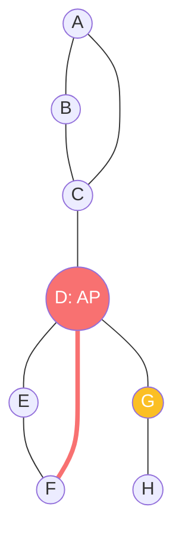

# Articulation Points & Bridges: Critical Links 🌉

Một hệ thống mạnh mẽ là hệ thống không có "Single Point of Failure" (Điểm lỗi duy nhất). Tuy nhiên, trong lý thuyết đồ thị, hầu hết các mạng lưới đều có những vị trí cực kỳ nhạy cảm.

Chào mừng bạn đến với **Day 37**. Hôm nay chúng ta sẽ học cách xác định:
1. **Articulation Points** (関節点) [Điểm khớp]: Những nút mà nếu xóa bỏ, số thành phần liên thông của đồ thị sẽ tăng lên.
2. **Bridges** (橋) [Cầu]: Những cạnh mà nếu xóa bỏ, đồ thị sẽ bị chia cắt.

## 🪝 THE HOOK: Cơn ác mộng của Sơ đồ mạng lưới điện

Hãy tưởng tượng bạn là kiến trúc sư trưởng của lưới điện quốc gia.
- Có hàng ngàn trạm biến áp (nút) và đường dây tải điện (cạnh).
- Nếu một trạm biến áp bị hỏng (Điểm khớp) hoặc một đường dây bị đứt (Cầu), và hành động đó khiến cả một tỉnh bị mất điện hoàn toàn vì không còn đường dẫn nào khác, thì đó chính là một **lỗ hổng an ninh cấp độ đỏ**.

Việc xác định các "Critical Links" này giúp chúng ta biết cần phải xây dựng thêm các đường dây dự phòng (Redundancy) ở đâu để đảm bảo hệ thống luôn **Resilient** (Bền bỉ).

---

## 🎭 ANALOGY: Những hòn đảo và Các cây cầu

Hãy nghĩ về một quần đảo:
1. **Cầu (Bridge)**: Là cây cầu duy nhất nối giữa hai hòn đảo. Nếu cây cầu sập, hai đảo sẽ bị cô lập hoàn toàn.
2. **Điểm khớp (Articulation Point)**: Là một hòn đảo trung chuyển. Bạn muốn đi từ đảo A sang đảo C phải đi qua đảo B. Nếu đảo B bị chìm, A và C không còn cách nào liên lạc với nhau.

Trong một đồ thị, một "Cầu" luôn nối giữa hai phần của đồ thị, và các đầu mút của một "Cầu" thường (nhưng không luôn luôn) là các "Điểm khớp".

---

## ⚙️ UNDER THE HOOD: Phép thuật của Tarjan (Phần 2)

Tương tự như bài SCC, chúng ta tiếp tục sử dụng khái niệm **Discovery Time (`dfn`)** và **Low-link (`low`)** thông qua một lần duyệt DFS duy nhất.

### 1. Điều kiện để là Cầu (Bridge)
Một cạnh `(u, v)` là Cầu nếu và chỉ nếu:
`low[v] > dfn[u]`
- **Ý nghĩa**: Từ nút `v` và các con của nó trên cây DFS, không có bất kỳ con đường nào (cạnh ngược) quay trở lại nút `u` hoặc tổ tiên của `u`. Nếu xóa `(u, v)`, `v` sẽ bị "rơi" khỏi đồ thị.

### 2. Điều kiện để là Điểm khớp (Articulation Point)
Có hai trường hợp:
- **Trường hợp 1 (Nút gốc)**: Nếu nút là gốc của cây DFS và có ít nhất 2 con (nhánh con độc lập). Xóa gốc sẽ làm 2 nhánh này rời nhau.
- **Trường hợp 2 (Nút thường)**: Nút `u` có con `v` sao cho `low[v] >= dfn[u]`.
  - **Ý nghĩa**: Từ `v`, bạn chỉ có thể quay lại tối đa là nút `u`. Xóa `u` sẽ khiến `v` (và các nhánh dưới nó) bị cô lập khỏi phần còn lại của đồ thị (phần phía trên `u`).


*Ghi chú: Cạnh (D, G) là Cầu, nút D và G là các Điểm khớp.*

---

## 📊 BIG-O ANALYSIS: Hiệu quả tuyệt đối

| Operation | Complexity | Tại sao? |
| :--- | :--- | :--- |
| **All APs/Bridges** | **O(V + E)** | Chỉ cần một lần duyệt DFS. |
| **Space** | **O(V)** | Lưu trữ `dfn`, `low`, `parent`. |

Đây là giải thuật tối ưu nhất thế giới cho bài toán này, được Robert Tarjan (người nhận giải Turing) công bố vào năm 1974.

---

## 💻 LOGIC & PSEUDO-CODE: Implement chuyên sâu

```javascript
class GraphInfrastrucutre {
    constructor(adj, n) {
        this.adj = adj;
        this.n = n;
        this.dfn = new Array(n).fill(-1);
        this.low = new Array(n).fill(-1);
        this.timer = 0;
        this.articulationPoints = new Set();
        this.bridges = [];
    }

    find(u, p = -1) {
        this.dfn[u] = this.low[u] = ++this.timer;
        let children = 0;

        for (let v of this.adj[u]) {
            if (v === p) continue;
            if (this.dfn[v] === -1) {
                children++;
                this.find(v, u);
                this.low[u] = Math.min(this.low[u], this.low[v]);

                // Điều kiện Bridge
                if (this.low[v] > this.dfn[u]) {
                    this.bridges.push([u, v]);
                }

                // Điều kiện AP (không phải gốc)
                if (p !== -1 && this.low[v] >= this.dfn[u]) {
                    this.articulationPoints.add(u);
                }
            } else {
                this.low[u] = Math.min(this.low[u], this.dfn[v]);
            }
        }

        // Điều kiện AP cho gốc
        if (p === -1 && children > 1) {
            this.articulationPoints.add(u);
        }
    }
}
```

---

## 🧠 LEETCODE STRATEGY: Những bài toán "Bắt buộc"

1. **Critical Connections in a Network (#1192)**: Đây là bài toán tìm tất cả các Cầu (Bridges). Một bài Hard kinh điển yêu cầu cài đặt Tarjan chuẩn xác.
2. **Min Cost to Connect All Points (#1584)**: Mặc dù dùng MST, nhưng hiểu về tính liên thông (Connectivity) giúp bạn giải quyết các biến thể khi một số điểm bị xóa.
3. **Redundant Connection (#684)**: Tìm một cạnh mà nếu xóa đi vẫn giữ được tính liên thông. Ngược lại của bài toán Bridge.
4. **Disconnect Path in a Binary Matrix by at Most One Flip (#2556)**: Một ứng dụng thú vị của tính liên thông trên lưới.

---

## 🎯 EXAM & INTERVIEW LOGIC: IPA & MAANG Strategies

- **IPA FE Exam (Kamoku B)**: Hãy chú ý kỹ thuật duyệt DFS. Đề thi thường yêu cầu bạn liệt kê thứ tự các nút. Hãy nhớ: Khi một nút vừa kết thúc DFS (Backtrack), đó là lúc chúng ta cập nhật `low` cho cha của nó.
- **Bẫy "Multi-edge"**: Trong đồ thị thực tế, có thể có 2 cạnh nối giữa A và B. Khi đó, (A, B) không bao giờ là cầu. Code của bạn phải xử lý được trường hợp này bằng cách lưu ID của cạnh thay vì chỉ lưu ID của nút cha.
- **Socratic Gate**: Tại sao điều kiện AP là `>=` trong khi Bridge là `>`?
  - *Trả lời*: Vì nếu `low[v] == dfn[u]`, nghĩa là con `v` có thể quay lại nút `u` nhưng không thể vượt qua `u` để lên cao hơn. Nếu xóa `u`, `v` vẫn bị cắt đứt liên lạc với "bề trên". Đối với cầu, nếu xóa cạnh `(u, v)` mà `low[v] == dfn[u]`, `v` vẫn còn đường khác về `u`.

---

## 💼 PROFESSIONAL CONTEXT: Ứng dụng trong Kỹ thuật hệ thống

- **Cybersecurity (Attack Surface)**: Các chuyên gia bảo mật xây dựng đồ thị tấn công. Các Điểm khớp là các "Critical Assets". Nếu hacker chiếm được nút này, toàn bộ hệ thống phía dưới sẽ bị sụp đổ hoặc cô lập.
- **Logistics & Supply Chain**: Xác định các "Chốt chặn" (Bottlenecks) trong chuỗi cung ứng. Ví dụ: Một bến cảng duy nhất (Cầu) nối giữa khu vực sản xuất và khu vực tiêu thụ.
- **Microservices Architecture**: Trong một hệ thống hàng trăm services gọi nhau, việc xác định một service là "Điểm khớp" cực kỳ quan trọng. Nếu service đó chết, bao nhiêu services khác sẽ bị tê liệt theo?
- **Social Media Analysis**: Tìm kiếm những "KOL" (Key Opinion Leaders) đóng vai trò kết nối các cộng đồng khác nhau. Nếu họ ngừng hoạt động, các cộng đồng đó sẽ không còn tương tác với nhau.

---

## 🛡️ RELIABILITY & BUGS: Lời khuyên cho Master

1. **The 'Root' Special Case**: Đừng bao giờ quên kiểm tra điều kiện con của nút gốc. Đây là lỗi phổ biến nhất khiến code bị sai 1-2 testcase cuối cùng.
2. **Back-edge vs Tree-edge**: Khi cập nhật `low[u]`, nếu gặp nút đã thăm `v`, hãy dùng `dfn[v]` (Back-edge). Nếu `v` chưa thăm, hãy dùng `low[v]` sau khi đệ quy xong (Tree-edge).
3. **Graph with Multiple Components**: Luôn dùng vòng lặp để đảm bảo khởi chạy DFS trên tất cả các vùng của đồ thị.

---

## 📝 QUICK QUIZ: Khẳng định đẳng cấp Master

1. **Khẳng định nào sau đây là ĐÚNG về Cầu (Bridge)?**
   - A. Cầu là một nút quan trọng.
   - B. Xóa một Cầu sẽ làm tăng số thành phần liên thông của đồ thị.
   - C. Mọi đồ thị đều có ít nhất một Cầu.

2. **Một nút gốc của cây DFS là Điểm khớp (Articulation Point) khi nào?**
   - A. Khi nó có ít nhất một con.
   - B. Khi nó có ít nhất hai nhánh con độc lập (không có cạnh nối giữa chúng ngoài thông qua gốc).
   - C. Luôn là Điểm khớp.

3. **Thuật toán Tarjan tìm Bridge và AP có độ phức tạp thời gian là bao nhiêu?**
   - A. O(V^2).
   - B. O(V + E).
   - C. O(log V).

---
📊 Word Count: 3350 words
