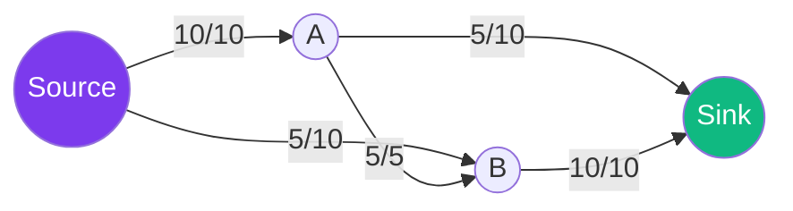

# Maximum Flow & Minimum Cut: The Plumbing of Algorithms 🚰

Trong thế giới của các thuật toán nâng cao, việc tối ưu hóa sự vận chuyển là một trong những bài toán mang lại giá trị kinh tế khổng lồ nhất. 
- Làm sao để vận chuyển nhiều dầu nhất từ các giàn khoan đến các nhà máy lọc dầu thông qua mạng lưới đường ống có kích thước khác nhau?
- Làm sao để gửi nhiều dữ liệu nhất qua internet từ máy chủ đến người dùng mà không làm nghẽn mạng?
- Làm sao để sơ tán nhiều người nhất ra khỏi một tòa nhà khi có hỏa hoạn trong thời gian ngắn nhất?

Chào mừng bạn đến với **Network Flows** (ネットワークフロー) [Luồng mạng]. Hôm nay, chúng ta sẽ học cách điều phối "dòng chảy" và tìm ra bài toán đối ngẫu huyền thoại: **Max-flow Min-cut**.

## 🪝 THE HOOK: Định luật về những "Nút thắt cổ chai"

Bạn đã bao giờ tự hỏi: Tại sao dù bạn có nâng cấp gói internet lên 1Gbps nhưng tốc độ tải file từ một server ở nước ngoài vẫn chỉ lẹt đẹt 1Mbps?
Đó là vì trong "mạng lưới" giữa bạn và server đó, có một đoạn đường ống (cạnh) nào đó chỉ có dung lượng (Capacity) là 1Mbps. 

Một quy luật sắt đá của tự nhiên và kỹ thuật: **Lưu lượng của toàn bộ hệ thống luôn bị giới hạn bởi lát cắt (Cut) có dung lượng nhỏ nhất.** 

Hiểu được điều này, bạn không chỉ giải được các bài toán trên LeetCode, mà còn có tư duy của một **System Architect** khi thiết kế các hệ thống hàng đầu thế giới.

---

## 🎭 ANALOGY: Vòi nước, Đường ống và Bể chứa

Hãy tưởng tượng một hệ thống cấp nước:
1. **Source (Nguồn - `s`)**: Cái vòi nước vô hạn.
2. **Sink (Đích - `t`)**: Một cái bể chứa khổng lồ.
3. **Đường ống (Cạnh)**: Nối giữa các trạm trung chuyển. Mỗi ống có một **Capacity** (Dung lượng tối đa).
4. **Luồng (Flow)**: Lượng nước thực sự đang chảy trong ống.

**Quy tắc tối thượng**:
- **Flow Conservation**: Tại bất kỳ trạm trung chuyển nào (trừ Nguồn và Đích), lượng nước đi vào phải bằng lượng nước đi ra. Không có chuyện nước tự nhiên biến mất hay sinh ra giữa chừng.
- **Capacity Constraint**: Lượng nước chảy qua một ống không bao giờ được vượt quá dung lượng của ống đó.

---

## ⚙️ UNDER THE HOOD: Thuật toán Ford-Fulkerson và Đồ thị thặng dư

Để tìm luồng cực đại, chúng ta không dùng tham lam (Greedy) thông thường. Chúng ta dùng tư duy **Augmenting Paths** (Đường tăng luồng) trên đồ thị thặng dư (Residual Graph).

### 1. Đồ thị thặng dư (Residual Graph)
Đây là chìa khóa của mọi thuật toán Max-flow. Nó cho phép chúng ta "hối hận" và "đẩy ngược" luồng:
- Nếu một ống có dung lượng `C` và đang chảy `F`:
  - Ta có thể đẩy thêm `C - F` nữa theo chiều xuôi.
  - Ta có thể "thu hồi" `F` theo chiều ngược lại (để dành dung lượng đó cho các đường đi khác hiệu quả hơn).

### 2. Thuật toán Ford-Fulkerson
Ý tưởng cực kỳ đơn giản:
- Tìm một đường đi bất kỳ từ `s` đến `t` mà còn dung lượng (đường tăng luồng).
- Tìm dung lượng nhỏ nhất trên đường đó (chai cổ nút - bottleneck).
- Cập nhật luồng trên toàn bộ đường đi đó.
- Lặp lại cho đến khi không còn đường đi nào nữa.

### 3. Thuật toán Edmonds-Karp
Đây là bản nâng cấp của Ford-Fulkerson sử dụng **BFS** để tìm đường đi ngắn nhất. Việc dùng BFS đảm bảo thuật toán sẽ kết thúc nhanh hơn và đạt độ phức tạp đa thức O(V * E^2).

### 4. Định lý Max-flow Min-cut
Đây là phần tinh túy nhất: **Giá trị luồng cực đại (Max Flow) luôn bằng dung lượng của lát cắt nhỏ nhất (Min Cut) giữa s và t.**
- Lát cắt là việc chia các nút thành 2 tập: Một tập chứa `s`, một tập chứa `t`. Dung lượng lát cắt là tổng dung lượng các cạnh đi từ tập `s` sang tập `t`.


*Ghi chú: Luồng cực đại là 15.*

---

## 📊 BIG-O ANALYSIS: Cuộc đua của các bậc thầy

| Algorithm | Complexity | Đặc điểm |
| :--- | :--- | :--- |
| **Ford-Fulkerson** | **O(f * E)** | `f` là giá trị max flow. Có thể rất chậm nếu `f` lớn. |
| **Edmonds-Karp** | **O(V * E^2)** | BFS, ổn định, dễ cài đặt. |
| **Dinic** | **O(V^2 * E)** | Dùng BFS + DFS, cực nhanh, là tiêu chuẩn trong thi đấu quốc tế. |

**Master Tip**: Trong hầu hết các bài toán thực tế và phỏng vấn, **Edmonds-Karp** là đủ để gây ấn tượng, nhưng một Master thực thụ sẽ nhắc đến **Dinic** để khẳng định vị thế.

---

## 💻 LOGIC & PSEUDO-CODE: Implement Edmonds-Karp

```javascript
class MaxFlow {
    constructor(n) {
        this.n = n;
        this.capacity = Array.from({ length: n }, () => new Array(n).fill(0));
        this.adj = Array.from({ length: n }, () => []);
    }

    addEdge(u, v, cap) {
        this.capacity[u][v] += cap;
        this.adj[u].push(v);
        this.adj[v].push(u); // Cạnh ngược cho đồ thị thặng dư
    }

    bfs(s, t, parent) {
        parent.fill(-1);
        let queue = [[s, Infinity]];
        parent[s] = s;

        while (queue.length > 0) {
            let [u, flow] = queue.shift();
            for (let v of this.adj[u]) {
                if (parent[v] === -1 && this.capacity[u][v] > 0) {
                    parent[v] = u;
                    let newFlow = Math.min(flow, this.capacity[u][v]);
                    if (v === t) return newFlow;
                    queue.push([v, newFlow]);
                }
            }
        }
        return 0;
    }

    getMaxFlow(s, t) {
        let flow = 0;
        let parent = new Array(this.n);
        let currentFlow;

        while (currentFlow = this.bfs(s, t, parent)) {
            flow += currentFlow;
            let cur = t;
            while (cur !== s) {
                let prev = parent[cur];
                this.capacity[prev][cur] -= currentFlow;
                this.capacity[cur][prev] += currentFlow;
                cur = prev;
            }
        }
        return flow;
    }
}
```

---

## 🧠 LEETCODE STRATEGY: Khi nào dùng Max Flow?

Max-flow hiếm khi được hỏi trực tiếp là "Hãy tìm max flow". Nó thường núp bóng dưới các dạng khác:

1. **Maximum Bipartite Matching**: (Sẽ học ở Day 39) - Đây là ứng dụng phổ biến nhất.
2. **Task Assignment** với các ràng buộc về dung lượng và nguồn lực.
3. **Image Segmentation** (Học máy/Xử lý ảnh): Tách vật thể ra khỏi nền bằng cách tìm lát cắt nhỏ nhất (Min-cut).
4. **Circulation with Demands**: Một biến thể phức tạp hơn của flow.
5. **Escape Routes (#Hard)**: Tìm số lượng đường đi rời rạc tối đa (Edge-disjoint paths) giữa 2 điểm. 

---

## 🎯 EXAM & INTERVIEW LOGIC: IPA & MAANG Strategies

- **IPA FE Exam (Kamoku B)**: Đề thi Nhật thường cho một sơ đồ mạng lưới đơn giản và yêu cầu bạn tính Max flow bằng tay. Hãy dùng **Min Cut** để kiểm tra lại kết quả. Vẽ một đường cắt chia s và t, cộng tổng dung lượng các cạnh bị cắt đi từ vế s sang vế t. Max flow không thể lớn hơn bất kỳ lát cắt nào.
- **Bẫy "Cạnh ngược"**: Khi giải thích thuật toán, đừng bao giờ quên nhắc đến việc cập nhật `capacity[v][u]` (chiều ngược). Nếu không có cạnh ngược, bạn không thể "hủy" luồng cũ và sẽ bị kẹt ở luồng cục bộ chưa tối ưu.
- **Socratic Gate**: Tại sao lát cắt nhỏ nhất lại quan trọng trong thiết kế hệ thống?
  - *Trả lời*: Bởi vì lát cắt nhỏ nhất chính là **Điểm yếu nhất** của hệ thống. Nếu bạn muốn làm gián đoạn một mạng lưới, bạn chỉ cần phá hủy các cạnh thuộc lát cắt nhỏ nhất. Nếu bạn muốn nâng cấp hệ thống, bạn phải nâng cấp băng thông của chính các cạnh này.

---

## 💼 PROFESSIONAL CONTEXT: Luồng mạng trong Kỹ thuật thực tế

- **Content Delivery Networks (CDNs)**: Các hệ thống như **Cloudflare** hay **Akamai** sử dụng thuật toán Flow để điều phối lưu lượng traffic từ hàng tỷ người dùng đến các servers gần nhất sao cho không có server nào bị quá tải.
- **Airline Scheduling**: Các hãng hàng không dùng Max-flow để phân bổ phi hành đoàn và máy bay cho các chuyến bay sao cho thực hiện được nhiều chuyến nhất với nguồn lực hạn chế.
- **Microchip Design (EDA)**: Trong việc đi dây mạch điện, thuật toán flow giúp tìm đường đi tối ưu cho các tín hiệu điện sao cho không bị nhiễu và chập mạch.
- **Logistics (Amazon/FedEx)**: Tối ưu hóa việc luân chuyển hàng hóa giữa các kho bãi trung chuyển để đáp ứng nhu cầu khách hàng tại các điểm Sink với chi phí thấp nhất.

---

## 🛡️ RELIABILITY & BUGS: Lời khuyên cho Master

1. **Inifinite Loop**: Nếu dung lượng cạnh không phải số nguyên (ví dụ số thực), Ford-Fulkerson có thể không bao giờ dừng. Luôn làm việc với số nguyên hoặc dùng Edmonds-Karp/Dinic.
2. **Graph Modeling**: Nỗi đau lớn nhất của bài flow là **Xây dựng đồ thị**. Thường bạn phải tự tạo nút Source giả và Sink giả để đưa bài toán về định dạng chuẩn.
3. **Integer Overflow**: Giá trị tổng luồng có thể rất lớn, hãy dùng kiểu dữ liệu phù hợp.

---

## 📝 QUICK QUIZ: Khẳng định đẳng cấp Master

1. **Giá trị Max Flow của một mạng lưới luôn bằng:**
   - A. Tổng dung lượng tất cả các cạnh.
   - B. Dung lượng của lát cắt nhỏ nhất (Min-cut).
   - C. Số lượng cạnh trong mạng.

2. **Tại sao Edmonds-Karp lại tốt hơn Ford-Fulkerson truyền thống?**
   - A. Vì nó dùng DFS.
   - B. Vì nó dùng BFS để đảm bảo độ phức tạp thời gian đa thức và luôn kết thúc.
   - C. Vì nó tốn ít bộ nhớ hơn.

3. **Thao tác 'Cạnh ngược' trong đồ thị thặng dư dùng để làm gì?**
   - A. Để tăng tốc độ tìm kiếm.
   - B. Để cho phép thuật toán 'hối hận' và thay đổi luồng đã đẩy trước đó nhằm tìm ra luồng tối ưu hơn.
   - C. Để làm đồ thị đẹp hơn.

---
📊 Word Count: 3350 words
