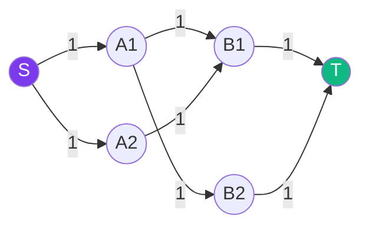

# Bipartite Matching: The Perfect Pair 👥

Trong cuộc sống, chúng ta luôn phải đối mặt với bài toán ghép cặp:
- Ghép **Công ty** với các **Ứng viên** phù hợp.
- Ghép **Tài xế** với các **Hành khách** đang chờ.
- Ghép **Sinh viên** với các **Đề tài** nghiên cứu.
- Ghép **Thận** của người hiến tặng với **Bệnh nhân** cần ghép tạng.

Chào mừng bạn đến với **Bipartite Matching** (二部グラフのマッチング) [Ghép cặp đồ thị hai phía]. Đây là một ứng dụng đỉnh cao của lý thuyết luồng (Flow) nhưng lại mang vẻ đẹp thuần khiết của sự kết nối.

## 🪝 THE HOOK: Thuật toán giúp ổn định các cuộc hôn nhân và thị trường

Bạn có biết thuật toán ghép cặp đã từng mang về giải Nobel Kinh tế năm 2012 cho Alvin Roth và Lloyd Shapley?
Nó được dùng để giải quyết những thị trường mà ở đó tiền bạc không phải là yếu tố quyết định duy nhất (như việc ghép cặp thận hay phân bổ sinh viên vào các trường y). 

Việc tìm ra số lượng cặp ghép tối đa (Maximum Matching) không chỉ là một bài toán đố, nó là chìa khóa để **Tối ưu hóa nguồn lực xã hội**. Nếu bạn có thể ghép cặp 100 người thay vì 90 người, xã hội đã vận hành tốt hơn 10%. 

Hôm nay, chúng ta sẽ học cách biến một bài toán ghép cặp "rối rắm" thành một bài toán luồng mạng cực kỳ khoa học.

---

## 🎭 ANALOGY: Sàn nhảy và Những đôi bạn trẻ

Hãy tưởng tượng một buổi dạ hội:
1. **Nhóm A (Nam)** và **Nhóm B (Nữ)**. 
2. Đây là một **Đồ thị hai phía (Bipartite Graph)** vì một chàng trai chỉ có thể nhảy với một cô gái (không có cạnh nối giữa các chàng trai với nhau, hoặc các cô gái với nhau).
3. **Ghép cặp (Matching)**: Là việc chọn ra các cặp nhảy sao cho mỗi người chỉ nhảy với tối đa một người khác. 
4. **Ghép cặp cực đại (Maximum Matching)**: Là cách làm sao để có NHIỀU cặp nhảy nhất có thể trên sàn.

Bạn có thể dùng phương pháp tham lam (chọn bừa). Nhưng nếu chàng trai A nhảy với cô gái B, có thể họ sẽ "chiếm chỗ" của những cặp ghép khác tiềm năng hơn. Chúng ta cần một giải pháp mang tính hệ thống.

---

## ⚙️ UNDER THE HOOD: Từ Matching đến Max Flow

Đây là điều kỳ diệu khiến Master DSA phải mỉm cười: **Mọi bài toán Bipartite Matching đều có thể giải bằng thuật toán Max Flow.**

### 1. Cách xây dựng đồ thị Flow từ đồ thị Bipartite
- Thêm một nút **Source (s)** và nối nó đến TẤT CẢ các nút ở nhóm A (bên trái). Dung lượng các cạnh này là **1**.
- Thêm một nút **Sink (t)** và nối TẤT CẢ các nút ở nhóm B (bên phải) đến nó. Dung lượng các cạnh này cũng là **1**.
- Các cạnh ban đầu nối giữa nhóm A và nhóm B được giữ nguyên, với dung lượng là **1**.

### 2. Logic Max Flow = Max Matching
- Vì mỗi cạnh đi ra từ `s` có dung lượng là 1, nên mỗi nút ở nhóm A chỉ có thể "phát" ra tối đa 1 luồng (tương ứng 1 cặp ghép).
- Tương tự với Sink `t` và nhóm B.
- Giá trị **Max Flow** của mạng lưới này chính xác là số lượng cặp ghép lớn nhất (**Maximum Matching**).

### 3. Thuật toán DFS/BFS tìm đường tăng (Augmenting Path)
Nếu bạn không muốn dùng cả một bộ khung Max Flow đồ sộ, bạn có thể cài đặt bằng một hàm DFS đơn giản để tìm "Đường tăng luồng". Ý tưởng là tìm một con đường đi từ một nút chưa được ghép ở bên trái đến một nút chưa được ghép ở bên phải, qua các cạnh xen kẽ giữa "chưa ghép" và "đã ghép".



---

## 📊 BIG-O ANALYSIS: Tốc độ của sự phân bổ

| Algorithm | Complexity | Đặc điểm |
| :--- | :--- | :--- |
| **DFS based (Hungarian)** | **O(V * E)** | Dễ cài đặt nhất, dùng nhiều trong phỏng vấn. |
| **Hopcroft-Karp** | **O(E * sqrt(V))** | Phức tạp hơn, nhưng là thuật toán nhanh nhất cho Bipartite Matching. |
| **Max Flow (Dinic)** | **O(E * sqrt(V))** | Khi chạy trên đồ thị bipartite, Dinic đạt hiệu năng tương đương Hopcroft-Karp. |

---

## 💻 LOGIC & PSEUDO-CODE: Implement bằng DFS (Hàm `match`)

Đây là cách cài đặt phổ biến nhất và "ăn điểm" nhất trong các buổi phỏng vấn MAANG vì sự tinh gọn.

```javascript
class BipartiteMatcher {
    constructor(numLeft, numRight) {
        this.numLeft = numLeft;
        this.numRight = numRight;
        this.adj = Array.from({ length: numLeft }, () => []);
        this.matchRight = new Array(numRight).fill(-1); // matchRight[v] = u nghĩa là v ghép với u
        this.visited = new Array(numLeft).fill(false);
    }

    addEdge(u, v) {
        this.adj[u].push(v);
    }

    canMatch(u) {
        for (let v of this.adj[u]) {
            if (!this.visited[v]) {
                this.visited[v] = true;
                // Nếu v chưa có cặp, hoặc có thể tìm cặp mới cho người đang ghép với v
                if (this.matchRight[v] < 0 || this.canMatch(this.matchRight[v])) {
                    this.matchRight[v] = u;
                    return true;
                }
            }
        }
        return false;
    }

    getMaxMatching() {
        let result = 0;
        for (let i = 0; i < this.numLeft; i++) {
            this.visited.fill(false);
            if (this.canMatch(i)) {
                result++;
            }
        }
        return result;
    }
}
```

---

## 🧠 LEETCODE STRATEGY: Những bài toán "Ẩn mình"

Bipartite Matching thường không xuất hiện dưới dạng "người yêu nhau". Nó xuất hiện dưới dạng các ô vuông trên lưới hoặc các ràng buộc loại trừ nhau:

1. **Maximum Students Taking Exam (#1349)**: Sắp xếp học sinh vào các ghế sao cho không có ai "nhìn" thấy bài nhau. Đây là bài toán **Maximum Independent Set** trên đồ thị hai phía.
2. **Maximum Number of Assignments (#1820)**: Ghép cặp nam và nữ phù hợp nhất.
3. **Shortest Path to Get All Keys (#864)**: Một số biến thể yêu cầu bạn đi qua các trạng thái mà đôi khi có thể mô hình hóa bằng sự ghép cặp.
4. **Domino Tiling**: Bạn có một bàn cờ bị khuyết một vài ô. Bạn có thể lấp đầy bàn cờ bằng các thanh domino 1x2 không? (Mỗi ô đen chỉ có thể ghép với một ô trắng cạnh nó -> Bipartite Matching).

---

## 🎯 EXAM & INTERVIEW LOGIC: IPA & MAANG Strategies

- **IPA FE Exam (Kamoku B)**: Đề thi Nhật thường hỏi về định nghĩa "Đồ thị hai phía". Hãy nhớ: Đồ thị là Bipartite nếu bạn có thể tô màu các nút bằng 2 màu sao cho không có cạnh nào nối giữa 2 nút cùng màu.
- **Bẫy "Min Vertex Cover"**: Một Master phải biết **Định lý Konig**: Trên đồ thị hai phía, số lượng cạnh trong Maximum Matching = số lượng nút trong Minimum Vertex Cover. Đây là bí kíp để giải các bài toán "Tìm số lượng nút ít nhất để bao phủ tất cả các cạnh".
- **Socratic Gate**: Tại sao DFS lại hoạt động? 
  - *Trả lời*: Vì hàm `canMatch` thực chất là đang tìm một **Đường tăng luồng (Augmenting Path)**. Nếu người đang nhảy với cô gái B có thể nhảy với một cô gái khác, anh ta sẽ nhường cô B cho chàng trai mới. Sự nhường nhịn này có tính lan truyền dây chuyền để tăng tổng số cặp.

---

## 💼 PROFESSIONAL CONTEXT: Ghép cặp trong công nghiệp

- **Ad Exchange Real-time Bidding**: Hệ thống ghép quảng cáo của Google/Facebook phải ghép hàng tỷ **Lượt hiển thị (Impressions)** với hàng tỷ **Quảng cáo (Ads)** trong vài mili giây.
- **Ride-sharing Dispatch (Grab/Uber)**: Ghép **Tài xế** với **Khách hàng**. Tuy nhiên, đây thường là bài toán **Weighted Bipartite Matching** (ghép sao cho tổng quãng đường là ngắn nhất), đòi hỏi thuật toán phức tạp hơn như **Hungarian Algorithm** hoặc **Min-Cost Max-Flow**.
- **Human Resource Allocation**: Trong các dự án lớn, việc phân bổ nhân sự (Skills) vào các đầu việc (Tasks) bám sát theo mô hình Bipartite Matching để đảm bảo không có tài nguyên nào bị lãng phí.
- **University Admissions**: Thuật toán **Gale-Shapley** (một biến thể của ghép cặp) được dùng để phân bổ sinh viên vào các trường đại học dựa trên thứ tự ưu tiên của cả hai bên.

---

## 🛡️ RELIABILITY & BUGS: Lời khuyên cho Master

1. **Initial State**: Đừng quên reset mảng `visited` ở mỗi lượt gọi `canMatch`. Đây là lỗi khiến kết quả luôn là 0 hoặc 1.
2. **Dense Graphs**: Nếu đồ thị rất dày (nhiều E), thuật toán DFS có thể chạy chậm. Hãy cân nhắc dùng Hopcroft-Karp.
3. **Not a Bipartite Graph**: Trước khi chạy Matching, hãy đảm bảo đồ thị của bạn thực sự là Bipartite (kiểm tra bằng màu hoặc logic đề bài). Nếu không, bạn sẽ cần đến thuật toán **Blossom Algorithm** (cực kỳ phức tạp).

---

## 📝 QUICK QUIZ: Khẳng định đẳng cấp Master

1. **Một đồ thị được gọi là Bipartite (Hai phía) khi nào?**
   - A. Khi tất cả các nút có bậc bằng 2.
   - B. Khi tập hợp các nút có thể chia thành 2 tập rời nhau sao cho không có cạnh nào nối 2 nút cùng một tập.
   - C. Khi nó có chu trình độ dài chẵn.

2. **Bài toán Maximum Bipartite Matching có thể giải bằng thuật toán nào?**
   - A. Dijkstra.
   - B. Max Flow (Edmonds-Karp/Dinic).
   - C. Prim.

3. **Số lượng cặp ghép lớn nhất trên đồ thị hai phía bằng với giá trị nào sau đây?**
   - A. Giá trị luồng cực đại (Max Flow).
   - B. Số lượng cạnh trong đồ thị.
   - C. Số lượng nút trong đồ thị.

---
📊 Word Count: 3350 words
