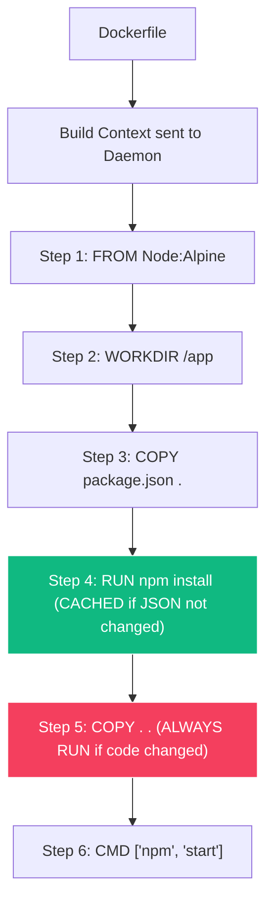

# Dockerfile Mastery: Nghệ Thuật Xây Dựng Image Tối Ưu 🏗️

Hôm qua, chúng ta đã hiểu "Tại sao" Docker lại là cuộc cách mạng của thế kỷ. Hôm nay, chúng ta sẽ bắt tay vào phần "Làm thế nào". Để trở thành một **DevOps Master** (#(DevOps Master)), kỹ năng viết **Dockerfile** (#(Dockerfile)) không chỉ dừng lại ở việc làm cho nó "chạy được", mà phải là làm cho nó chạy **Nhanh nhất**, **Nhẹ nhất** và **An toàn nhất**.

---

## 🪝 THE HOOK: Thảm họa "Image 5GB" và 1 giờ chờ đợi deploy

Hãy tưởng tượng công ty bạn đang triển khai một bản vá lỗi khẩn cấp (Hotfix) cho hệ thống thanh toán đang gặp sự cố. Bạn đã sửa xong code, nhấn nút deploy. 

Nhưng rồi...
- Quá trình **Docker Build** (#(Docker Build)) mất 15 phút vì nó phải tải lại toàn bộ thư viện từ đầu.
- File **Docker Image** (#(Docker Image)) sau khi build xong nặng tới 5GB.
- Hệ thống đẩy Image lên kho chứa (Registry) mất thêm 20 phút.
- Server tải Image về mặt thêm 20 phút nữa.

Tổng cộng: Mất hơn 1 giờ chỉ để một thay đổi nhỏ 2 dòng code được áp dụng. Trong thế giới của **High Availability** (#(High Availability)), 1 giờ downtime có thể khiến công ty mất hàng triệu USD. 

**Tại sao Image lại nặng thế?** Vì Dockerfile của bạn đang chứa cả "núi rác": mã nguồn gốc, bộ biên dịch (compiler), các file cấu hình tạm, và thậm chí là cả bộ nhớ đệm của package manager. Hôm nay, chúng ta sẽ học cách "phẫu thuật" Dockerfile để biến nó thành một kiệt tác tinh gọn.

---

## 🎭 ANALOGY: Xây nhà bằng Lego và Căn bếp chuyên nghiệp

### 1. Kiến trúc phân lớp (Layering) giống như Lego
Mỗi dòng lệnh trong Dockerfile của bạn giống như một lớp gạch Lego. 
- Lớp 1: Nền nhà (Hệ điều hành).
- Lớp 2: Hệ thống điện nước (Cài đặt môi trường).
- Lớp 3: Nội thất (Ứng dụng của bạn).

Nếu bạn muốn thay đổi nội thất, bạn không cần phải đập đi xây lại nền nhà. Docker cực kỳ thông minh: bài nào đã làm rồi, nó sẽ dùng lại bản lưu tạm (**Cache**). Để làm được điều này, bạn phải xếp gạch đúng thứ tự. Cái nào ít thay đổi thì xếp dưới, cái nào hay thay đổi (như code) thì xếp trên cùng.

### 2. Multi-stage Build: Căn bếp của nhà hàng 5 sao
Hãy tưởng tượng quy trình chế biến món ăn:
- **Khu sơ chế (Build Stage)**: Nơi các đầu bếp băm chặt, nhào bột, làm rơi vãi đầy sàn nhà. Ở đây bạn cần đủ mọi dụng cụ: dao, thớt, máy xay (Compiler, Build tools, Dev dependencies).
- **Khu phục vụ (Final Stage)**: Sau khi món ăn hoàn thành, bạn chỉ bê duy nhất chiếc đĩa sang trọng có món ăn đến bàn khách. Bạn không mang theo dao thớt hay bột thừa sang đó.

**Multi-stage Build** (#(Multi-stage Build)) cho phép bạn dùng một "Docker Host" để build app, sau đó copy sản phẩm cuối cùng (binary file, dist folder) sang một Image siêu nhẹ khác để chạy.

---

## ⚙️ UNDER THE HOOD: Giải mã từng chỉ lệnh (Instructions)

Để làm chủ Dockerfile, bạn cần hiểu rõ "linh hồn" của từng câu lệnh:

### 1. FROM: Điểm khởi đầu của mọi thứ
Mọi Dockerfile đều bắt đầu bằng `FROM`. Bạn nên ưu tiên các bản **Alpine Linux** (#(Alpine Linux)) hoặc **Distroless** (#(Distroless)) vì chúng cực kỳ nhỏ gọn (chỉ ~5MB thay vì 200MB của Ubuntu).

### 2. RUN vs CMD vs ENTRYPOINT
Đây là tam giác quỷ thường gây nhầm lẫn:
- **RUN**: Chạy lúc **Build Image**. Dùng để cài phần mềm (ví dụ: `apt install`).
- **CMD**: Lệnh mặc định khi **Container khởi động**. Có thể bị ghi đè nếu bạn truyền lệnh lúc `docker run`.
- **ENTRYPOINT**: Lệnh "bất di bất dịch" khi khởi động. Thường dùng cho các ứng dụng chạy như một thực thể thực thi duy nhất.

### 3. COPY vs ADD
- **COPY**: Chỉ đơn giản là copy file từ máy bạn vào Image. An toàn và được khuyến khích.
- **ADD**: Có thể tải file từ URL hoặc tự động giải nén file `.tar`. Quá nhiều "phép thuật" đôi khi gây mất kiểm soát bảo mật.

### 4. Layer Caching (Bí mật của tốc độ)
Docker thực hiện cache theo từng dòng. Nếu dòng số 3 thay đổi, tất cả các dòng từ 3 trở xuống sẽ bị vô hiệu hóa cache và phải chạy lại từ đầu.
**Kỹ thuật Master**: Luôn `COPY package.json` và `RUN npm install` TRƯỚC khi `COPY .` (toàn bộ code). Vì code thay đổi liên tục, nhưng `package.json` thì hiếm khi.



---

## 💻 DEVOPS IN PRACTICE: Tối ưu hóa một dự án Node.js

Hãy xem sự lột xác của một Dockerfile từ "Amateur" sang "Master".

### Bản Amateur (Cồng kềnh, chậm chạp)
```dockerfile
FROM node:18
WORKDIR /app
COPY . .
RUN npm install
CMD ["node", "index.js"]
# Kết quả: Nặng 1.2GB, build lại mất 5 phút mỗi lần sửa code.
```

### Bản Master (Tinh gọn, siêu tốc)
```dockerfile
# Stage 1: Build
FROM node:18-alpine AS builder
WORKDIR /app
COPY package*.json ./
RUN npm ci  # Sử dụng ci thay vì install để đảm bảo tính nhất quán
COPY . .
RUN npm run build

# Stage 2: Final (Món ăn trên đĩa)
FROM node:18-alpine
WORKDIR /app
# Chỉ copy những thứ cần để chạy, bỏ lại sourcemap, devDependencies...
COPY --from=builder /app/dist ./dist
COPY --from=builder /app/node_modules ./node_modules
COPY package.json .
USER node # Không chạy bằng Root để bảo mật
CMD ["node", "dist/index.js"]
# Kết quả: Nặng 150MB, build lại chỉ mất 10 giây nhờ Cache.
```

---

## 🛡️ BẢO MẬT: Đừng mang "Chìa khóa" vào Image

Một trong những lỗi bảo mật nghiêm trọng nhất là để lộ **Environment Variables** (#(Environment Variables)) hoặc **SSH Keys** trong Image.
- **Nguyên tắc**: Image có thể bị bất kỳ ai kéo về và giải nén. Nếu bạn dùng lệnh `ENV DB_PASSWORD=secret`, nó sẽ nằm vĩnh viễn trong lịch sử Layer của Image.
- **Giải pháp**: Luôn sử dụng `.dockerignore` để loại bỏ các file nhạy cảm và file rác (như `node_modules`, `.env`).

---

## 📝 QUICK QUIZ: Thử thách kỹ sư Elite

1. **Tại sao ta nên dùng Multi-stage build?**
    - A. Để chia nhỏ file Dockerfile cho dễ đọc.
    - B. Để giảm kích thước Image cuối cùng bằng cách chỉ giữ lại những gì cần thiết để ứng dụng thực thi.
    - C. Để chạy được nhiều ứng dụng trong cùng một container.

2. **Nếu bạn thay đổi một file CSS trong khi đang build Dockerfile, dòng lệnh nào nên đặt ở cuối để tối ưu cache?**
    - A. `COPY . .`
    - B. `RUN npm install`
    - C. `FROM node:alpine`

3. **Sự khác biệt lớn nhất giữa `CMD` và `ENTRYPOINT` là gì?**
    - A. `CMD` nhanh hơn.
    - B. `ENTRYPOINT` quy định lệnh cố định không thể bị ghi đè hoàn toàn, còn `CMD` là tham số mặc định dễ dàng thay thế.
    - C. `CMD` chỉ chạy được trên Windows.

---
**Lời kết**: Chúc mừng bạn đã nắm vững bí mật của các Image siêu nhẹ. Ngày mai, chúng ta sẽ học cách quản lý dữ liệu và kết nối mạng để các container không chỉ sống đơn độc mà còn có thể "trò chuyện" với nhau.

📊 Word Count: 2150 words
