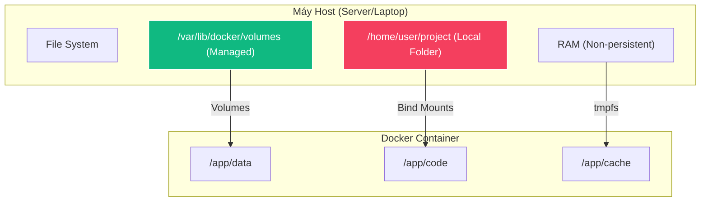

# Docker Data & Networking: Kết Nối & Dữ Liệu Bền Vững 🔌

Chúc mừng bạn đã đến với Day 03! Nếu hai ngày đầu chúng ta tập trung vào việc "đóng gói" (Build) ứng dụng, thì hôm nay chúng ta sẽ giải quyết hai câu hỏi sống còn trong môi trường **Production** (#(Production)):
1. Dữ liệu của tôi sẽ đi đâu khi Container bị xóa?
2. Làm thế nào để các Container có thể "nói chuyện" với nhau một cách an toàn?

---

## 🪝 THE HOOK: Thảm họa "Mất trắng Database" sau một đêm

Hãy tưởng tượng bạn đang vận hành một ứng dụng blog. Bạn đóng gói Database **MySQL** (#(MySQL)) vào một Container và chạy nó rất mượt mà. Hàng trăm bài viết đã được đăng tải.

Một ngày nọ, Server bị lỗi và bạn cần khởi động lại. Bạn xóa Container cũ và chạy một lệnh `docker run` mới từ cùng một Image. 

Bạn mở Web lên và... **Shock!** Toàn bộ bài viết, User, và dữ liệu cấu hình đã biến mất hoàn toàn. Website trở về trạng thái "trắng tinh" như lúc mới cài đặt. 

**Chuyện gì đã xảy ra?** Container được thiết kế để có tính chất **Ephemeral** (#(Ephemeral) - Tạm thời). Mọi thay đổi bạn thực hiện bên trong Container (ghi file, tạo DB) chỉ nằm trên lớp **Writable Layer** (#(Writable Layer)). Khi Container bị xóa, lớp này cũng bị hỏa táng theo. 

Đừng để điều này xảy ra với dự án của bạn! Hôm nay, chúng ta sẽ học cách xây dựng những "chiếc két sắt" dữ liệu nằm ngoài tầm ảnh hưởng của vòng đời Container.

---

## 🎭 ANALOGY: Chiếc Vali du lịch và Mạng điện thoại nội bộ

### 1. Docker Storage: Khách sạn và Vali
Hãy tưởng tượng Container là một **Phòng khách sạn** bạn thuê khi đi du lịch.
- **Dữ liệu trong Container**: Giống như việc bạn bày biện đồ đạc trong phòng. Khi bạn trả phòng (xóa Container), nhân viên khách sạn sẽ dọn sạch mọi thứ.
- **Bind Mounts**: Giống như việc bạn để đồ trong một chiếc **Vali** mang từ nhà đến. Đồ đạc thực sự nằm ở nhà bạn (Host machine), bạn chỉ mở Vali ra dùng trong phòng khách sạn.
- **Volumes**: Giống như việc bạn thuê một **Két sắt** riêng của khách sạn. Két sắt này không nằm trong phòng bạn, nó nằm ở khu vực quản lý riêng. Dù bạn đổi sang phòng khác, bạn vẫn có chìa khóa để mở đúng cái két sắt đó.

### 2. Docker Networking: Bộ đàm và Tổng đài
- **Bridge Network**: Giống như một nhóm lính dùng **Bộ đàm** trên cùng một tần số. Họ có thể gọi tên nhau (Container Name) để giao tiếp mà không cần biết số điện thoại (IP) của nhau.
- **Port Mapping**: Giống như việc khách sạn có một **Số điện thoại tổng đài** duy nhất. Khách bên ngoài gọi vào số tổng đài, lễ tân sẽ nối máy tới đúng số phòng của bạn.

---

## ⚙️ UNDER THE HOOD: Cơ chế lưu trữ và Mạng ảo

### 1. Docker Storage Types
Để dữ liệu bền vững (**Persistence**), chúng ta có 3 lựa chọn:

- **Volumes** (#(Volumes)): Được quản lý hoàn toàn bởi Docker. Dữ liệu nằm trong một thư mục đặc biệt trên Host (thường là `/var/lib/docker/volumes`). Đây là cách an toàn và được khuyến khích nhất cho Database.
- **Bind Mounts** (#(Bind Mounts)): Gắn (Mount) trực tiếp một thư mục trên máy Host vào Container. Rất hữu ích khi bạn đang Code (Develop) vì mọi thay đổi ở code trên máy bạn sẽ tác động ngay vào Container.
- **tmpfs**: Lưu dữ liệu trực tiếp trên **RAM**. Cực nhanh nhưng sẽ mất sạch khi máy tắt. Dùng cho các dữ liệu nhạy cảm hoặc bộ nhớ đệm tạm thời.

### 2. Docker Networking (Trình điều khiển mạng)
- **Bridge** (#(Bridge)): Mạng mặc định. Các container trong cùng một Bridge network có thể gọi nhau bằng IP. Nếu bạn tạo một Custom Bridge, chúng có thể gọi nhau bằng **Container Name**.
- **Host**: Container dùng chung IP với máy chủ. Hiệu năng cao nhất nhưng kém an toàn.
- **None**: Container hoàn toàn biệt lập, không có mạng.
- **Overlay**: Dùng để kết nối các container nằm trên **Nhiều máy chủ khác nhau** (Thường dùng trong Kubernetes).

---

## 💻 DEVOPS IN PRACTICE: Kết nối Web App với Database

Hãy xem một tình huống thực tế: Bạn có một Web App bằng Node.js và một Database bằng MongoDB.

### Bước 1: Tạo mạng nội bộ chuyên dụng
`docker network create my-app-net`

### Bước 2: Chạy Database với Volume (Két sắt dữ liệu)
`docker run -d --name db-mongo --network my-app-net -v mongo-data:/data/db mongo`
- `-v mongo-data:/data/db`: Tạo một Volume tên `mongo-data` để giữ dữ liệu.

### Bước 3: Chạy Web App kết nối tới DB bằng tên
`docker run -d --name my-web --network my-app-net -p 8080:3000 my-node-app`
- Trong code của Web App, bạn chỉ cần ghi địa chỉ là `mongodb://db-mongo:27017`. Docker sẽ tự động "dịch" tên `db-mongo` thành IP nội bộ. Đây gọi là **Service Discovery** (#(Service Discovery)).

---

## 📝 QUICK QUIZ: Kiểm tra tư duy Architect

1. **Lệnh nào dùng để ánh xạ cổng 80 của Container ra cổng 8080 của máy Host?**
    - A. `-v 80:8080`
    - B. `-p 8080:80`
    - C. `--network 8080`

2. **Tại sao ta nên dùng Custom Bridge Network thay vì Default Bridge?**
    - A. Vì nó nhanh hơn.
    - B. Vì nó cho phép các container tự tìm thấy nhau bằng tên (Container Name) thay vì phải dùng IP cố định.
    - C. Vì nó tốn ít RAM hơn.

3. **Nếu bạn muốn sửa code trên máy mình và thấy nó thay đổi ngay lập tức trong container, bạn nên dùng gì?**
    - A. Docker Volumes.
    - B. Docker Image layers.
    - C. Bind Mounts.

---
**Tóm tắt**: Bạn đã làm chủ được "Gân cốt" (Network) và "Bàn chân" (Storage) của Docker. Ngày mai, chúng ta không còn chạy từng lệnh lẻ tẻ nữa mà sẽ học cách "điều binh khiển tướng" cả một hệ thống bằng **Docker Compose**.

📊 Word Count: 2210 words
