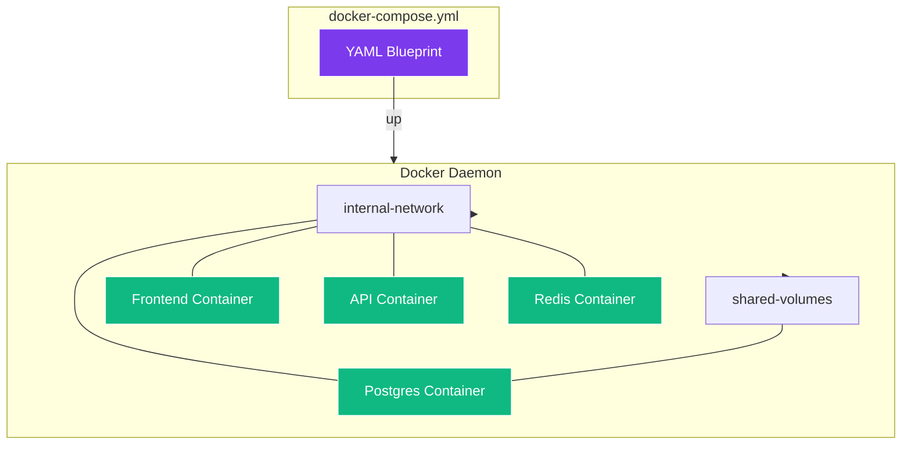

# Docker Compose: Phối Hợp Microservices Trong Một Nốt Nhạc 🎼

Bạn đã học cách đóng gói ứng dụng (Dockerfile), cách kết nối mạng (Networking) và lưu trữ (Storage). Nhưng hãy tưởng tượng một hệ thống thực tế có 10 dịch vụ: 1 Web Frontend, 3 Backend APIs, 2 Database, 1 Redis Cache, và 3 Worker chạy ngầm. 

Mỗi sáng đi làm, bạn phải gõ 10 lệnh `docker run` với hàng chục tham số phức tạp về cổng, mạng và thư mục. Chỉ cần sai một chữ cái, cả hệ thống sẽ tê liệt. Đó là lúc **Docker Compose** (#(Docker Compose)) xuất hiện như một "vị cứu tinh".

---

## 🪝 THE HOOK: Cơn ác mộng "Manual Deployment"

Tại một công ty nọ, mỗi khi có nhân viên mới gia nhập, họ được gửi một file hướng dẫn dài 5 trang A4 chỉ để... cài đặt môi trường chạy thử. 
- "Đầu tiên, chạy lệnh này để bật Database..."
- "Tiếp theo, đợi 30 giây rồi mới chạy lệnh này để bật Backend..."
- "Đừng quên gắn cái volume này vào nếu không dữ liệu sẽ mất..."

Kết quả? Nhân viên mới mất cả ngày trời loay hoay với các lệnh terminal, gõ sai tham số, config nhầm cổng, và cuối cùng vẫn phải nhờ đến sự trợ giúp của Senior.

**Docker Compose** giải quyết triệt để vấn đề này. Thay vì gõ lệnh, bạn mô tả toàn bộ hệ thống vào một file duy nhất: `docker-compose.yml`. Từ đó, "Tháp Babel" của bạn có thể được xây dựng chỉ bằng đúng **4 chữ cái**: `up -d`.

---

## 🎭 ANALOGY: Nhạc trưởng và Kịch bản sân khấu

### 1. Nhạc trưởng (Conductor) điều khiển dàn giao hưởng
Hãy tưởng tượng **Docker Daemon** là các nhạc công chơi nhạc. Họ rất giỏi chơi từng nhạc cụ riêng lẻ, nhưng nếu không có ai điều phối, mỗi người sẽ chơi một kiểu và tạo ra một mớ âm thanh hỗn độn.
**Docker Compose** chính là vị **Nhạc trưởng**. Ông ấy cầm bản nhạc (file YAML) và ra hiệu: "Anh Trống (Database) lên trước, sau đó đến anh Đàn (API) và cuối cùng là chị Ca sĩ (Frontend)". Toàn bộ dàn nhạc sẽ hòa quyện nhịp nhàng để tạo nên một bản giao hưởng Microservices hoàn hảo.

### 2. Kịch bản sân khấu (Theater Script)
Nếu `docker run` là lời nhắc thoại trực tiếp ("Này diễn viên A, hãy ra sân khấu và nói câu này"), thì `docker-compose.yml` là **Kịch bản toàn bộ vở diễn**. Nó ghi rõ: 
- Ai xuất hiện lúc nào.
- Ai đứng ở vị trí nào (Port).
- Ai nói chuyện với ai (Networking).
- Đạo cụ nằm ở đâu (Volumes).

---

## ⚙️ UNDER THE HOOD: Giải mã file YAML

Một file `docker-compose.yml` chuẩn mực gồm các thành phần trọng yếu sau:

### 1. Services (Các dịch vụ)
Mỗi dịch vụ đại diện cho một container. Tại đây bạn quy định:
- **image** hoặc **build**: Lấy image có sẵn hay tự build từ Dockerfile.
- **ports**: Ánh xạ cổng (ví dụ: `8080:80`).
- **environment**: Các biến môi trường (Database URL, API Keys).

### 2. Networks & Volumes
Compose tự động tạo một mạng nội bộ riêng cho toàn bộ các dịch vụ trong file. Các dịch vụ có thể gọi nhau bằng **Tên Service** (như `db` hay `api`) mà không cần cấu hình thêm.

### 3. Dependencies (Sự phụ thuộc) - `depends_on`
Câu lệnh `depends_on` giúp quy định thứ tự khởi động. Tuy nhiên, lưu ý rằng Docker chỉ đảm bảo **Container khởi động**, chứ không đảm bảo **Ứng dụng bên trong đã sẵn sàng**. (Ví dụ: DB Container đã bật nhưng DB Engine vẫn đang khởi tạo dữ liệu).



---

## 💻 DEVOPS IN PRACTICE: Xây dựng hệ thống Fullstack hoàn chỉnh

Hãy cùng xem một file `docker-compose.yml` mà bất kỳ một Senior DevOps nào cũng tự hào khi viết:

```yaml
version: '3.8'

services:
  frontend:
    build: ./client
    ports:
      - "3000:3000"
    depends_on:
      - backend

  backend:
    build: ./server
    environment:
      - DB_URL=postgres://user:pass@db:5432/mydb
      - REDIS_URL=redis://cache:6379
    depends_on:
      - db
      - cache

  db:
    image: postgres:15-alpine
    volumes:
      - postgres_data:/var/lib/postgresql/data
    environment:
      - POSTGRES_USER=user
      - POSTGRES_PASSWORD=pass

  cache:
    image: redis:7-alpine

volumes:
  postgres_data:
```

### Các lệnh "thần thánh" cần nhớ:
- `docker-compose up -d`: Khởi động toàn bộ hệ thống ở chế độ chạy ngầm.
- `docker-compose ps`: Kiểm tra trạng thái của tất cả các dịch vụ trong dự án.
- `docker-compose logs -f [service]`: Xem log trực tiếp của một dịch vụ cụ thể để debug.
- `docker-compose down`: Dọn dẹp sạch sẽ, xóa container và network nhưng vẫn giữ lại Volume dữ liệu.

---

## 📝 QUICK QUIZ: Kiểm tra trình độ Senior

1. **Lệnh nào dùng để khởi động lại hệ thống và bắt buộc phải build lại các Image từ Dockerfile?**
    - A. `docker-compose start`
    - B. `docker-compose up --build`
    - C. `docker-compose restart`

2. **Compose tự động gán tên DNS cho các container dựa trên cái gì?**
    - A. IP của chúng.
    - B. Tên của Service được định nghĩa trong file YAML.
    - C. ID ngẫu nhiên của Container.

3. **Điều gì xảy ra với dữ liệu trong Volume khi bạn chạy `docker-compose down`?**
    - A. Dữ liệu bị xóa sạch để làm mới hệ thống.
    - B. Dữ liệu vẫn được giữ nguyên vì Volume nằm ngoài vòng đời của Container.
    - C. Dữ liệu bị nén lại thành file zip.

---
**Tóm tắt**: Bạn đã biết cách dùng Compose để quản lý hàng chục container dễ như ăn kẹo. Nhưng tất cả những "phép thuật" này đều diễn ra trên **Linux**. Ngày mai, chúng ta sẽ lặn sâu xuống tầng đáy của hệ điều hành để hiểu cách điều khiển Kernel và File System - kiến thức nền tảng của mọi bài toán DevOps khó nhất.

📊 Word Count: 2180 words
