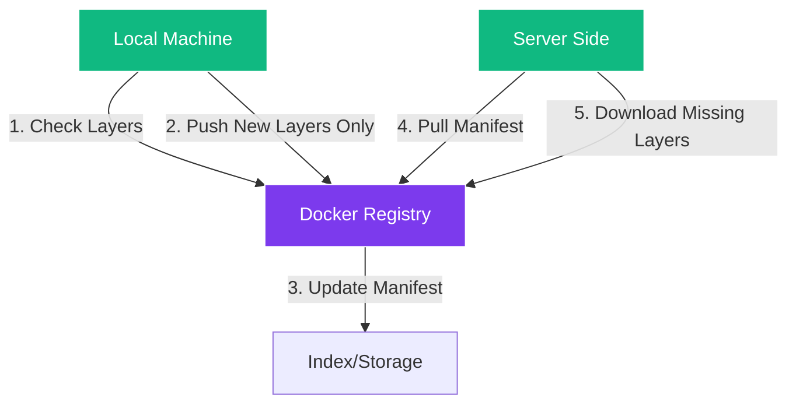

# Docker Registry & Image Distribution: Quản Lý & Phân Phối Image 🌐

Chào mừng bạn đến với Day 06! Sau một tuần làm quen với Linux và cách đóng gói Container, hôm nay chúng ta sẽ giải quyết bài toán "Logistics" của thế giới phần mềm. 

Nếu bạn đã build xong một Docker Image tuyệt vời trên máy mình, làm sao để Server của khách hàng ở Mỹ hay Singapore có thể tải về và chạy nó trong vài giây? Làm sao để đảm bảo phiên bản bạn vừa update là bản mới nhất và an toàn nhất? Đó chính là vai trò của **Docker Registry** (#(Docker Registry)).

---

## 🪝 THE HOOK: Thảm họa "Deployment Confusion" và Version 1.0 sai lầm

Hãy tưởng tượng một ngày thứ Sáu định mệnh. Bạn vừa sửa xong một lỗi nghiêm trọng. Bạn build Image và đánh tag là `latest`. Bạn chạy lệnh `docker push` lên Docker Hub.

Mười phút sau, toàn bộ hệ thống sập. Tại sao?
- Đội vận hành (Ops) tự động kéo Image `latest` về để deploy.
- Tuy nhiên, một đồng nghiệp khác cũng vừa push một cái `latest` khác (chưa kiểm thử kỹ) chỉ vài giây sau bạn. 
- Hệ thống của bạn đang chạy một phiên bản "hên xui" mà không ai biết chính xác nó là gì.

Nghiêm trọng hơn, nếu bạn lưu trữ Image chứa mã nguồn quan trọng của công ty trên một kho lưu trữ công khai (**Public Registry**) mà quên đặt chế độ riêng tư, đối thủ cạnh tranh có thể tải toàn bộ "chất xám" của bạn về chỉ bằng một lệnh `docker pull`. 

Làm chủ **Docker Registry** và **Tagging Strategy** (#(Tagging Strategy)) không chỉ là kỹ năng kỹ thuật, đó là kỹ năng sinh tồn của một DevOps Master. 

---

## 🎭 ANALOGY: Thư viện quốc gia và App Store

Để hiểu cách Docker phân phối Image, hãy nghĩ về hai mô hình quen thuộc:

### 1. Thư viện (Docker Hub)
**Docker Hub** giống như một **Thư viện Quốc gia**. 
- Ở đó có những "cuốn sách kinh điển" mà ai cũng cần (Ubuntu, Nginx, MySQL). Những cuốn sách này được kiểm duyệt và ký tên bởi các tổ chức uy tín (**Official Images**).
- Bạn cũng có thể viết sách và nộp vào thư viện. Nếu bạn để ở khu vực công cộng, ai cũng có mượn đọc. 
- Nếu bạn có những "bí kíp gia truyền", bạn phải thuê một chiếc **Két sắt riêng** (Private Repository) trong thư viện đó.

### 2. App Store (Image Versioning)
Hãy nhìn vào cách các ứng dụng trên điện thoại cập nhật.
- Bạn không bao giờ thấy ứng dụng tên là `Facebook-latest`. Bạn sẽ thấy phiên bản `v241.0.1`.
- Việc đánh số phiên bản này giúp bạn biết chắc chắn mình đang dùng bản nào. Nếu bản mới bị lỗi, bạn có thể dễ dàng "xóa đi cài lại" bản cũ (`Rollback`).
- **Lớp Image (Layer)** giống như các bản cập nhật. Thay vì tải lại toàn bộ App 500MB, điện thoại chỉ tải thêm 50MB tiền vá lỗi. Docker cũng vậy, nó chỉ phân phối những Layer bị thay đổi, giúp tiết kiệm băng thông cực độ.

---

## ⚙️ UNDER THE HOOD: Bên trong chiếc hộp chứa Image

### 1. Image Tagging (Nghệ thuật đặt tên)
Một cái tên Image đầy đủ (Full Image Name) có cấu trúc:
`[Registry_URL]/[Namespace]/[Repository_Name]:[Tag]`

Ví dụ: `ghcr.io/google/my-app:v1.2.3`
- `ghcr.io`: Địa chỉ kho chứa (Github Container Registry).
- `google`: Tên tổ chức/người dùng.
- `my-app`: Tên ứng dụng.
- `v1.2.3`: Phiên bản cụ thể.

**Nguyên tắc vàng**: Đừng bao giờ dùng `latest` cho môi trường Production. Hãy dùng **Semantic Versioning** (#(Semantic Versioning) - SemVer) như `v1.0.0` hoặc dùng chính mã hash của Git (**Git Commit SHA**) để đảm bảo tính duy nhất.

### 2. Content Addressable Storage (Lưu trữ theo nội dung)
Docker Registry không lưu Image theo tên file. Nó lưu theo **Digest** (#(Digest) - mã băm SHA256).
Dù bạn có đặt tên tag là gì đi nữa, nếu nội dung Image giống hệt nhau, chúng sẽ chia sẻ cùng một Digest. Điều này giúp ngăn chặn việc dữ liệu bị giả mạo.

### 3. Quy trình đẩy và kéo Image (Push & Pull Flow)
Khi bạn chạy lệnh `docker push`:
1. Client kiểm tra xem Layer nào đã có trên Registry chưa (bằng mã hash).
2. Chỉ những Layer "mới" chưa có mới được tải lên.
3. Registry cập nhật bản đồ (Manifest) để ghi nhận tag mới trỏ vào các Layer đó.

---

## 💻 DEVOPS IN PRACTICE: Tự xây dựng "Kho báu" riêng

### 1. Đăng nhập và đẩy Image lên Docker Hub
`docker login`
`docker tag my-app:local myuser/my-app:v1.0.1`
`docker push myuser/my-app:v1.0.1`

### 2. Triển khai Private Registry (Local)
Nếu công ty bạn không muốn đưa Image lên Internet vì lý do bảo mật, bạn có thể tự chạy một cái Registry ngay tại văn phòng bằng chính... Docker!

`docker run -d -p 5000:5000 --name my-local-registry registry:2`

Bây giờ bạn có thể đẩy Image vào "kho nội bộ" này:
`docker tag app:v1 localhost:5000/app:v1`
`docker push localhost:5000/app:v1`

### 3. Chiến lược Rollback thần tốc
Khi bản `v1.0.2` gặp lỗi, một DevOps Master sẽ không ngồi sửa code ngay lập tức. Hành động đầu tiên là:
`docker pull my-app:v1.0.1` (Phiên bản ổn định gần nhất)
`docker run ...`
Hệ thống quay lại trạng thái an toàn trong 30 giây. Sau đó mới ngồi thong thả tìm lỗi ở bản `v1.0.2`. Đây gọi là tư duy **Reliability First** (#(Reliability First)).

---

## 🛡️ BẢO MẬT: Quản lý Secret và Quét Image

Một lỗi chết người là push Image chứa file `.env` hoặc API Key lên Registry. 
- **Docker Scan**: Luôn chạy `docker scan [image_name]` để kiểm tra xem các thư viện trong Image của bạn có lỗ hổng bảo mật (CVE) nào không.
- **Image Signing**: Sử dụng **Docker Content Trust** (#(Docker Content Trust)) để ký tên điện tử vào Image. Server của bạn sẽ từ chối chạy bất kỳ Image nào không có chữ ký chính chủ, ngăn chặn việc Image bị "tráo hàng" bởi hacker.

---

## 📝 QUICK QUIZ: Thử thách Master Logistics

1. **Tại sao việc sử dụng tag 'latest' trong Production lại cực kỳ nguy hiểm?**
    - A. Vì nó tốn nhiều dung lượng ổ cứng hơn.
    - B. Vì nó không đảm bảo tính nhất quán; Image có tag là 'latest' có thể bị thay đổi nội dung bất cứ lúc nào mà hệ thống không biết.
    - C. Vì nó khiến Docker chạy chậm hơn.

2. **Một cái tên Image đầy đủ bao gồm những thành phần nào?**
    - A. Chỉ cần tên ứng dụng.
    - B. Tên ứng dụng và ngày tháng build.
    - C. Registry URL, Namespace, Repository Name và Tag.

3. **Lợi ích lớn nhất của việc lưu trữ Image theo các Layer là gì?**
    - A. Giúp Image trông đẹp hơn.
    - B. Tiết kiệm băng thông và dung lượng lưu trữ nhờ sử dụng lại các Layer chung giữa những Image khác nhau.
    - C. Giúp hacker khó xâm nhập hơn.

---
**Tóm tắt**: Bạn đã biết cách đóng gói và vận chuyển "hàng hóa" phần mềm đi khắp thế gian. Nhưng vận hành không bao giờ là màu hồng. Ngày mai, chúng ta sẽ học cách "điều tra dấu vết" (Troubleshooting) khi container đột tử giữa đêm.

📊 Word Count: 2050 words
