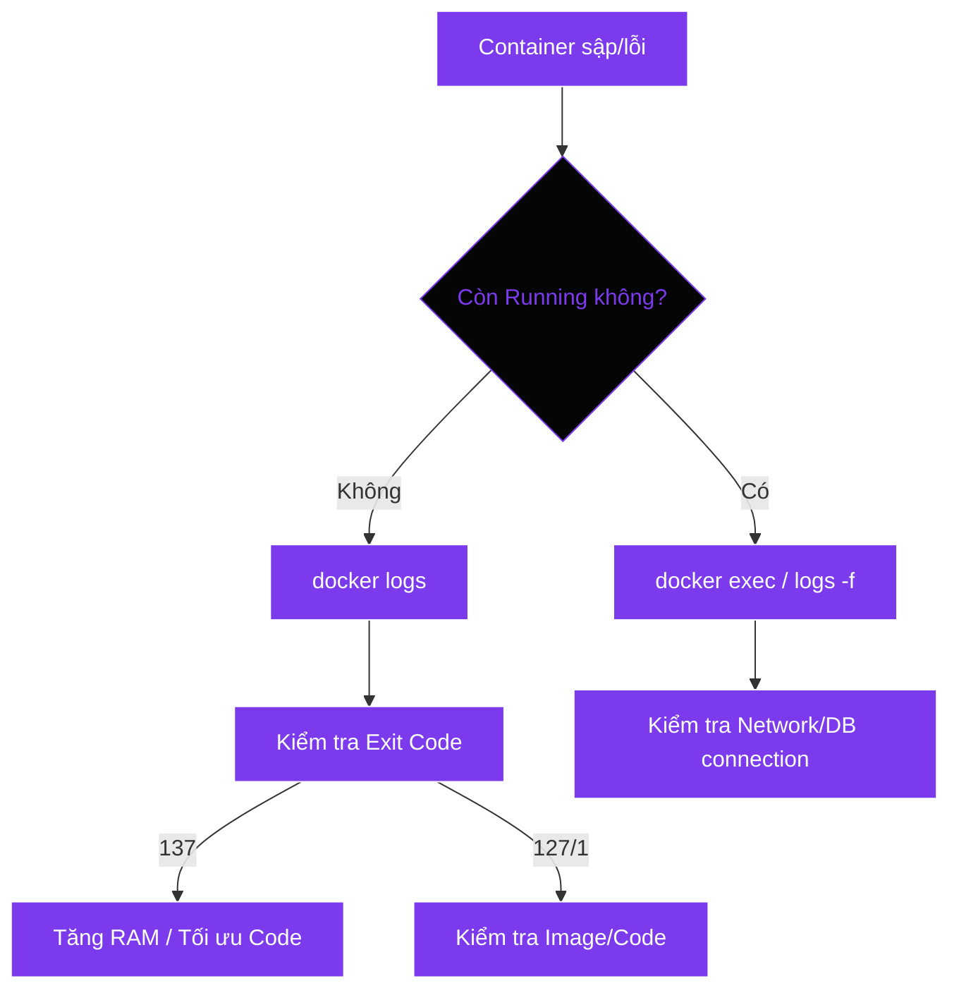

# Container Troubleshooting & Lifecycle: Gỡ Lỗi Thực Chiến 🔍

Chào mừng bạn đã đi được một nửa chặng đường của Phase 1! Hôm nay là một ngày "thực chiến" đúng nghĩa. Trong thế giới DevOps, công việc của bạn không chỉ là xây dựng (Build) mà còn là sửa chữa (Fix). 

Hàng ngàn container đang chạy trên Production, và bất cứ lúc nào một cái cũng có thể "đột tử". Nhiệm vụ của bạn là phải đóng vai một thám tử kỹ thuật, lần mò dấu vết (Log) để tìm ra nguồn cơn sự cố trong thời gian ngắn nhất.

---

## 🪝 THE HOOK: Sự cố "CrashLoopBackOff" giữa đêm

Hãy tưởng tượng bạn đang ngủ ngon thì nhận được thông báo từ hệ thống giám sát: "Ứng dụng thanh toán vừa sập!". Bạn bật máy tính lên, kiểm tra thì thấy container đang ở trạng thái **Exited**. Bạn cố gắng khởi động lại, nó chạy được 5 giây rồi lại... sập. 

Lại khởi động, lại sập. Hiện tượng này gọi là **CrashLoopBackOff** (#(CrashLoopBackOff)).
- Không có lỗi nào hiện ra trên console của bạn.
- Bạn không thể SSH vào trong container vì nó không chịu "sống" quá 5 giây.
- Sếp đang hỏi: "Bao giờ thì hệ thống chạy lại được?".

Nếu không biết cách sử dụng các công cụ chẩn đoán của Docker, bạn sẽ rơi vào vòng lặp tuyệt vọng: Thử - Sai - Thử lại - Lại sai. Hôm nay, chúng ta sẽ học cách "đọc thấu" tâm hồn của container.

---

## 🎭 ANALOGY: Bác sĩ gia đình và Hộp đen máy bay

### 1. Vòng đời Container: Từ sinh ra đến lúc hóa thân
Hãy nghĩ về Container như một **Vận động viên điền kinh**:
- **Created**: Đang đứng ở vạch xuất phát, đã sẵn sàng nhưng chưa có lệnh chạy.
- **Running**: Đang chạy bứt tốc trên đường đua (RAM).
- **Paused**: Đang tạm nghỉ uống nước, mọi trạng thái bị đóng băng tại chỗ.
- **Exited**: Đã hoàn thành cuộc đua (hoặc bị chấn thương nửa đường) và rời khỏi sân vận động.

### 2. Troubleshooting: Hộp đen máy bay (Logs)
Khi một vụ tai nạn máy bay xảy ra, thứ đầu tiên người ta tìm là **Hộp đen**. 
- **Docker Logs** chính là hộp đen đó. Nó ghi lại mọi hơi thở, mọi tiếng kêu cứu của ứng dụng trước khi nó "chết".
- **Docker Inspect** giống như bản chụp X-quang, cho bạn thấy cấu trúc bên trong, mạch máu (Network), xương khớp (Volumes) của container.

---

## ⚙️ UNDER THE HOOD: Exit Codes và Công cụ chẩn đoán

### 1. Giải mã mã lỗi (Exit Codes)
Khi một container sập, nó luôn để lại một con số bí ẩn. Đây là "lời trăng trối" cuối cùng:
- **Exit Code 0**: Chết vì... tuổi già (Hoàn thành nhiệm vụ thành công).
- **Exit Code 1**: Lỗi chung (App bị crash do lỗi code).
- **Exit Code 137**: Bị "ám sát" bởi hệ điều hành (**SIGKILL**). Thường là do ngốn quá nhiều RAM (**OOM Over Memory**).
- **Exit Code 127**: Lỗi "Không tìm thấy lệnh". Bạn bảo nó chạy `python` nhưng trong Image không có Python.

### 2. Bộ công cụ "Thám tử" Docker
Để điều tra, bạn cần nắm vững 4 lệnh sau:

- **docker logs -f [id]**: Theo dõi log thời gian thực. 99% nguyên nhân nằm ở đây (Lỗi kết nối DB, lỗi syntax, thiếu biến môi trường).
- **docker inspect [id]**: Xem chi tiết cấu hình JSON. Giúp kiểm tra xem IP có đúng không, Volume có được gắn đúng chỗ không.
- **docker stats**: Xem mức tiêu thụ tài nguyên thực tế (CPU, RAM). Giúp phát hiện các container đang "ăn tàn phá hại".
- **docker exec -it [id] /bin/sh**: "Nhảy" vào bên trong container đang chạy để kiểm tra file system. Lưu ý: Chỉ áp dụng được nếu container đang ở trạng thái Running.

### 3. Quy trình chẩn đoán chuẩn Master

---

## 💻 DEVOPS IN PRACTICE: Case Study "Container biến mất"

Tình huống: Bạn chạy một container Nginx, nhưng vừa chạy xong nó báo thành công rồi `Exit 0` ngay lập tức.
Lệnh chạy: `docker run -d nginx`
Kết quả: Container không chạy ngầm.

**Phân tích Master**: 
Docker Container chỉ sống khi tiến trình mà nó quản lý (PID 1) còn đang chạy. Nginx mặc định chạy ở chế độ nền (daemon). Khi Nginx tách ra chạy nền, tiến trình chính của Docker kết thúc và Container tự tắt.
**Giải pháp**: Bạn cần ra lệnh cho Nginx chạy ở chế độ tiền cảnh (foreground):
`docker run -d nginx nginx -g 'daemon off;'`

Đây là lỗi phổ biến nhất của những người mới bắt đầu: Không hiểu về **Foreground vs Background Processes** (#(Foreground vs Background Processes)).

---

## 🛡️ BEST PRACTICES: Sống sót qua mùa sự cố

1. **Health Checks**: Luôn định nghĩa một lệnh kiểm tra sức khỏe trong Dockerfile hoặc Compose. "Nếu trả về 200 OK thì mới coi là sống".
2. **Restart Policies**: Sử dụng `--restart unless-stopped`. Nếu container sập do lỗi tạm thời, Docker sẽ tự động hồi sinh nó.
3. **Log Rotation**: Đừng để file log phình to đến mức tràn ổ cứng. Hãy cấu hình `json-file` driver với giới hạn kích thước (ví dụ 10MB).

---

## 📝 QUICK QUIZ: Thử thách kỹ sư chẩn đoán

1. **Exit Code 137 thường ám chỉ điều gì?**
    - A. Ứng dụng đã hoàn thành công việc.
    - B. Container bị ép dừng bởi hệ điều hành, thường là do quá tải RAM (OutOfMemory).
    - C. Sai mật khẩu Database.

2. **Lệnh nào giúp bạn chui vào bên trong một container đang chạy để gõ lệnh?**
    - A. `docker inspect`
    - B. `docker exec -it`
    - C. `docker logs`

3. **Điều kiện để một Container tiếp tục ở trạng thái 'Running' là gì?**
    - A. Máy chủ phải có kết nối Internet.
    - B. Tiến trình chính (PID 1) bên trong container phải đang hoạt động.
    - C. Bạn phải thường xuyên click vào website.

---
**Tóm tắt**: Bạn đã làm chủ được kỹ năng "bắt bệnh" cho Container. Nhưng gỡ lỗi từng cái lẻ tẻ rất mệt. Ngày mai, chúng ta sẽ quay lại với **Docker Compose** nhưng ở một đẳng cấp cao hơn: Quản lý sức khỏe, biến môi trường và tính tự động hóa của cả một hệ thống lớn.

📊 Word Count: 2120 words
