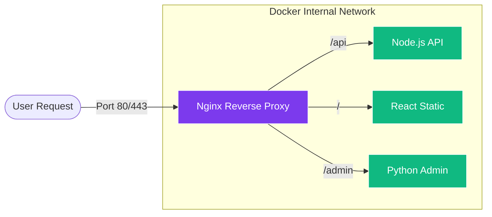

# Networking Deep Dive & Reverse Proxy: Điều Phối Lưu Thông 🌐

Chào mừng bạn đến với Day 09! Chúng ta đã biết cách kết nối các Container trong cùng một mạng. Nhưng thực tế phũ phàng là: Server của bạn chỉ có 1 địa chỉ IP công khai và thường chỉ mở 1-2 cổng (như 80 và 443).

Làm thế nào để bạn chạy đồng thời App A, App B và App C mà người dùng chỉ cần gõ `a.com`, `b.com` hay `c.com` là vào đúng chỗ? Đó là lúc chúng ta cần đến **Reverse Proxy** (#(Reverse Proxy)).

---

## 🪝 THE HOOK: Sự cố "Port Conflict" (Xung đột cổng)

Hãy tưởng tượng bạn đang triển khai 3 dự án cho khách hàng trên cùng một con VPS. 
- Dự án 1: Nginx chạy cổng 80.
- Dự án 2: Bạn cũng muốn dùng Nginx cổng 80.
- Dự án 3: Lại là một cái web khác cần cổng 80.

Bạn chạy lệnh `docker run -p 80:80 ...` cho dự án thứ 2 và nhận ngay một cái tát từ Docker:
`Error response from daemon: driver failed programming external connectivity on endpoint ... Bind for 0.0.0.0:80 failed: port is already allocated.`

Bạn đứng trước hai lựa chọn:
1. Mua thêm 3 con VPS (Tốn tiền).
2. Chạy cổng lẻ như `8081`, `8082` (Cực kỳ thiếu chuyên nghiệp, người dùng không ai muốn gõ `domain.com:8081`).

Một **DevOps Master** sẽ không chọn cả hai. Họ sẽ dựng một "Người gác cổng" duy nhất tại cổng 80 để phân luồng toàn bộ traffic.

---

## 🎭 ANALOGY: Lễ tân khách sạn và Công ty chuyển phát

### 1. Reverse Proxy: Lễ tân khách sạn
Hãy tưởng tượng khách sạn của bạn là một Server.
- Khách hàng (User) chỉ biết địa chỉ khách sạn. Họ đến quầy **Lễ tân** (Reverse Proxy - Nginx).
- Khách nói: "Tôi muốn gặp bộ phận kế toán". Lễ tân sẽ chỉ đường họ lên phòng 201 (Container Backend).
- Khách khác nói: "Tôi muốn xem menu nhà hàng". Lễ tân chỉ họ sang phòng 105 (Container Frontend).
Khách hàng không bao giờ cần biết số phòng cụ thể, họ chỉ cần nói chuyện với Lễ tân.

### 2. Docker DNS: Tên gọi nội bộ
Trong một công ty, nhân viên gọi nhau bằng tên ("Anh Nam", "Chị Lan") chứ không gọi bằng số CMND (IP). 
**Docker DNS** cho phép Container A gọi Container B bằng cái tên bạn đặt trong file Compose. Dù Container B có bị sập và khởi động lại với một IP mới hoàn toàn, cái tên đó vẫn không đổi.

---

## ⚙️ UNDER THE HOOD: Các loại Driver và Cơ chế Forwarding

### 1. Docker Network Drivers (Nhắc lại chuyên sâu)
- **Bridge**: Tạo một switch ảo. Các container có dải IP riêng (thường là `172.x.x.x`). Đây là nơi trú ngụ của hầu hết ứng dụng.
- **Host**: Xóa bỏ mọi rào cản. Container dùng chung IP và Port với máy chủ. Cực nhanh nhưng cực kỳ kém bảo mật (App của bạn có thể chiếm quyền điều khiển server).
- **Overlay**: Phép thuật kết nối các container ở các server vật lý khác nhau (Google Cloud kết nối với AWS).

### 2. Reverse Proxy vs Proxy
- **Proxy (Forward Proxy)**: Giúp bạn "vượt tường lửa" để ra Internet. (Che giấu danh tính người dùng).
- **Reverse Proxy**: Đứng trước Server để đón Client. (Che giấu cấu trúc bên trong của Server).

### 3. Nginx - Vị vua của Reverse Proxy
Nginx cực kỳ mạnh mẽ nhờ cơ chế **Event-driven** (#(Event-driven)). Nó có thể xử lý hàng chục nghìn kết nối cùng lúc mà tốn rất ít RAM.



---

## 💻 DEVOPS IN PRACTICE: Cấu hình Nginx phân luồng

Tình huống: Bạn có một app Frontend và một app Backend. Bạn muốn dùng Nginx để phân phối.

### 1. File cấu hình `nginx.conf`
```nginx
server {
    listen 80;
    server_name myapp.com;

    location / {
        proxy_pass http://frontend:3000; # Gọi tên service trong Docker
    }

    location /api {
        proxy_pass http://backend:5000; # Phân luồng các request có đầu /api
    }
}
```

### 2. File `docker-compose.yml` kết nối tất cả
```yaml
services:
  nginx:
    image: nginx:alpine
    volumes:
      - ./nginx.conf:/etc/nginx/conf.d/default.conf:ro
    ports:
      - "80:80"
    depends_on:
      - frontend
      - backend

  frontend:
    build: ./client
    # Không cần mở port ra ngoài (expose)

  backend:
    build: ./server
    # Không cần mở port ra ngoài (an toàn tuyệt đối)
```

**Lợi ích**: Backend của bạn giờ đây hoàn toàn nằm trong mạng nội bộ. Hacker không thể tấn công trực tiếp vào cổng 5000 của Backend vì nó không hề được mở ra Internet. Toàn bộ traffic phải đi qua bộ lọc của Nginx.

---

## 🛡️ NÂNG CAO: Load Balancing và SSL

- **Load Balancing**: Nếu App của bạn quá tải, bạn có thể chạy 3 cái Backend. Nginx sẽ tự động chia request cho 3 ông này theo kiểu vòng tròn (**Round Robin**).
- **SSL Termination**: Nginx sẽ lo việc giải mã HTTPS (cổng 443). Các service bên trong chỉ việc chạy HTTP thường cho nhẹ máy. Đây gọi là **Offloading** (#(Offloading)).

---

## 📝 QUICK QUIZ: Thử thách Kỹ sư mạng

1. **Tại sao ta nên đặt Backend đằng sau một Reverse Proxy thay vì mở trực tiếp cổng ra ngoài?**
    - A. Để app chạy nhanh hơn.
    - B. Để tăng cường bảo mật (hệ thống bên trong bị ẩn đi) và dễ dàng quản lý chứng chỉ SSL, Load Balancing tại một điểm duy nhất.
    - C. Vì Docker bắt buộc phải làm thế.

2. **Nếu Container A muốn gửi request tới Container B trong cùng một Docker Network, nó nên dùng địa chỉ nào?**
    - A. Địa chỉ IP công cộng của Server.
    - B. Tên của Service (Service Name) được đặt trong file cấu hình.
    - C. `localhost`.

3. **Tính năng nào của Nginx giúp xử lý được nhiều request cùng lúc mà không tốn nhiều tài nguyên?**
    - A. Multi-threading.
    - B. Event-driven architecture.
    - C. Machine Learning.

---
**Tóm tắt**: Bạn đã biết cách xây dựng một hệ thống mạng phức tạp và chuyên nghiệp. Ngày mai, ngày cuối cùng của Phase 1, chúng ta sẽ học về **Docker Security** - cách bảo vệ thành quả của bạn trước các cuộc tấn công và những lỗi ngớ ngẩn thường gặp nhất.

📊 Word Count: 2280 words
