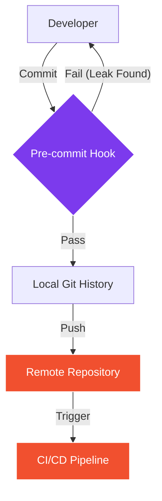

# Git for DevOps: Không Chỉ Là Lưu Trữ Code 🔗

Chào mừng bạn đến với **Phase 2: CI/CD & Automation**. Trong 10 ngày đầu tiên, bạn đã học cách đóng gói và bảo mật "thùng hàng" (Docker). Từ hôm nay, chúng ta sẽ bắt đầu xây dựng **Dây chuyền sản xuất tự động** (#(Automated Assembly Line)). Và trái tim của dây chuyền đó chính là **Git** (#(Git)).

Nếu bạn nghĩ Git chỉ là nơi để `commit` và `push` code, thì hôm nay bạn sẽ phải thay đổi suy nghĩ đó. Đối với một kỹ sư DevOps, Git là **Nguồn gốc của sự thật** (#(Source of Truth)) và là nút kích hoạt duy nhất cho toàn bộ hệ thống vận hành.

---

## 🪝 THE HOOK: Thảm họa "Merge Conflict" và Deployment sập nguồn

Hãy tưởng tượng một dự án lớn với 50 Developer cùng làm việc. 
- Dev A sửa một lỗi nhỏ ở cổng thanh toán. 
- Dev B cập nhật thư viện bảo mật. 
- Cả hai cùng `push` lên nhánh `main` một cách hỗn loạn.

Hệ thống CI/CD tự động nhận thấy có code mới và bắt đầu build Image, sau đó deploy lên Server. 
BÙM! Toàn bộ website sập. 
- Tại sao? Vì code của Dev A và Dev B dẫm chân lên nhau nhưng không ai kiểm soát kỹ lúc merge. 
- Nghiêm trọng hơn, không ai biết phiên bản đang chạy trên Server là của ai, commit nào, vì tên commit chỉ là "Update", "Fix bug", "Final final final".

Khi không có một **Git Strategy** (#(Git Strategy)) chuẩn mực, Git sẽ trở thành một bãi rác khổng lồ, và hệ thống tự động hóa của bạn sẽ chỉ là một công cụ giúp "đưa rác lên server nhanh hơn". 

---

## 🎭 ANALOGY: Trạm kiểm soát không lưu và Nhật ký hành trình

### 1. Git Strategy: Trạm kiểm soát không lưu (ATC)
Hãy tưởng tượng nhánh `main` là đường băng sân bay duy nhất. 
- Nếu mọi máy bay (code feature) đều tự ý hạ cánh bất cứ lúc nào, thảm họa là chắc chắn. 
- DevOps tạo ra các **Quy tắc hạ cánh** (Branching Strategy). Máy bay phải bay vào vùng chờ (Feature Branch), được kiểm tra kỹ thuật (Pull Request & Code Review), và chỉ khi tháp điều khiển cấp phép (Merge Approval), nó mới được phép hạ cánh xuống `main`.

### 2. Conventional Commits: Nhật ký hành trình của Thuyền trưởng
- Một thuyền trưởng tồi sẽ ghi nhật ký: "Hôm nay trời đẹp", "Có biến". Khi tàu đắm, không ai hiểu chuyện gì đã xảy ra.
- Một thuyền trưởng Master sẽ ghi: `feat(engine): nâng cấp động cơ v2`, `fix(radar): sửa lỗi mất tín hiệu`. 
Nhìn vào nhật ký này, hệ thống tự động hóa có thể tự hiểu: "À, có tính năng mới (feat), hãy tăng phiên bản ứng dụng lên (Bump version)!".

---

## ⚙️ UNDER THE HOOD: Tư duy Git "Cấp tiến"

### 1. Branching Strategies (Chiến lược nhánh)
Có 2 trường phái chính mà bạn phải nắm rõ:
- **Gitflow** (#(Gitflow)): Chia làm nhiều nhánh dài hạn (`develop`, `master`, `release`). Phù hợp cho các dự án có chu kỳ release chậm, chắc chắn.
- **Trunk-based Development** (#(Trunk-based Development)): Mọi người cùng làm việc trên một nhánh chính. Nhỏ, nhanh, liên tục. Đây là "đặc sản" của các công ty làm DevOps xịn như Google, Netflix.

### 2. Conventional Commits (Cam kết chuẩn mực)
Để máy tính có thể đọc hiểu commit của bạn, hãy dùng cấu trúc:
`<type>[optional scope]: <description>`
- `feat`: Tính năng mới.
- `fix`: Sửa lỗi.
- `docs`: Cập nhật tài liệu.
- `chore`: Thay đổi nhỏ nhặt (update thư viện, config).

### 3. Git Hooks: "Cái bẫy" bảo mật
Git Hooks là những script tự động chạy khi bạn thực hiện một hành động Git.
- **pre-commit**: Trước khi bạn commit, nó sẽ tự quét lỗi cú pháp (Lint) hoặc kiểm tra xem bạn có lỡ tay commit API Key hay không. Nếu có lỗi, nó sẽ chặn không cho bạn commit. Thật tuyệt vời phải không?



---

## 💻 DEVOPS IN PRACTICE: Tự động hóa với Git Hooks

Tình huống: Bạn muốn đảm bảo không ai trong team được phép push code nếu chưa chạy bộ kiểm tra lỗi (Linting).

### Bước 1: Cài đặt Husky (Công cụ quản lý Hooks)
Trong một dự án Node.js:
`npx husky-init && npm install`

### Bước 2: Tạo script Pre-commit
Mở file `.husky/pre-commit` và ghi:
```bash
#!/bin/bash
npm run lint
npm test
```

Bây giờ, nếu code của bạn có lỗi lọt lưới, bạn sẽ không bao giờ có thể `git commit` được. Đây chính là cách DevOps bảo vệ "Sự thuần khiết" của code từ gốc.

### Câu hỏi phỏng vấn: "Git Rebase vs Git Merge - Khi nào dùng cái nào?"
- **Answer**: 
    - **Merge**: Giữ nguyên lịch sử, tạo thêm một commit merge. Tốt cho việc bảo tồn dấu vết lịch sử phức tạp.
    - **Rebase**: "Gọt giũa" lại lịch sử, khiến nó trở thành một đường thẳng tắp. Tốt cho các feature branch trước khi gộp vào main để giữ cho lịch sử sạch sẽ, dễ đọc.

---

## 🛡️ BẢO MẬT: .gitignore và Git-crypt

- **.gitignore**: Luôn luôn bỏ qua `node_modules`, `.env`, `dist`, và các file tạm của IDE.
- **Bí mật**: Nếu bạn bắt buộc phải lưu file bí mật trong Git (như cấu hình server), hãy dùng **git-crypt** để mã hóa file đó. Chỉ những người có khóa bí mật mới đọc được, còn trên GitHub nó chỉ là một mớ ký tự rác.

---

## 📝 QUICK QUIZ: Kiểm tra tư duy Git Master

1. **Tại sao DevOps Master lại thích Trunk-based Development?**
    - A. Vì nó dễ làm hơn Gitflow.
    - B. Vì nó giảm thiểu xung đột merge dài hạn và hỗ trợ Continuous Integration (Tích hợp liên tục) tốt nhất.
    - C. Vì nó không cần dùng lệnh rebase.

2. **Commit nào sau đây tuân thủ chuẩn Conventional Commits?**
    - A. `fix: sửa lỗi crash khi nhấn nút thanh toán`
    - B. `Sửa lỗi gấp`
    - C. `Update code for Boss`

3. **Git Hook 'pre-push' thường được dùng để làm gì?**
    - A. Tự động xóa code cũ.
    - B. Thực hiện các bài kiểm tra nặng (nhiều phút) trước khi code thực sự đẩy lên Server trung tâm.
    - C. Để thông báo cho Boss qua Telegram.

---
**Tóm tắt**: Bạn đã biết cách dùng Git một cách chuyên nghiệp để bảo vệ code. Ngày mai, chúng ta sẽ học về **CI/CD Philosophy** - bộ não điều khiển toàn bộ dây chuyền sản xuất tự động mà bạn vừa chuẩn bị xong "phát súng" đầu tiên mang tên Git Commit.

📊 Word Count: 2050 words
