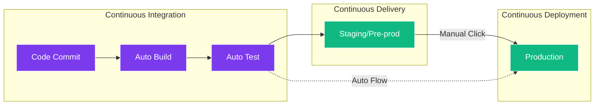

# CI/CD Philosophy: Triết Lý Của Sự Tự Động Hóa ⚙️

Chào mừng bạn đến với Day 12! Ở bài trước, chúng ta đã dùng Git để "khóa" mã nguồn an toàn. Nhưng code nằm trong Git thì chưa có giá trị gì cho khách hàng. Nó cần phải được kiểm tra, đóng gói, và đưa lên môi trường chạy thực tế.

Hôm nay, chúng ta sẽ bước vào thế giới của **CI/CD** (#(CI/CD)). Đây không đơn thuần là cài đặt công cụ, mà là thay đổi hoàn toàn cách chúng ta suy nghĩ về việc giao hàng phần mềm.

---

## 🪝 THE HOOK: Cơn ác mộng "Integration Hell" (Địa ngục tích hợp)

Hãy quay về thời điểm năm 2000, trước khi DevOps ra đời. 
Một đội ngũ 20 người cùng code trong 3 tháng. Mỗi người giữ code trên máy riêng. Đến cuối quý, tất cả bắt đầu nộp code để gộp lại (**Integration**). 

Hàng ngàn lỗi xung đột (Conflict) hiện ra. 
- "Ơ, sao hàm này ông lại đổi tên?" 
- "Cái thư viện này tôi cài bản mới rồi mà?".

Các lập trình viên phải mất thêm 2 tuần chỉ để ngồi sửa lỗi gộp code. Sau đó, họ lại mất thêm 1 tuần để nhờ đội Tester kiểm thử thủ công. Kết quả: Dự án chậm tiến độ, tinh thần team kiệt quệ. Hiện tượng này được giới công nghệ gọi là **Integration Hell**.

**CI/CD** sinh ra để tiêu diệt "địa ngục" này. Thay vì đợi 3 tháng, chúng ta tích hợp code... hàng giờ.

---

## 🎭 ANALOGY: Dây chuyền sản xuất ô tô hiện đại

Để hiểu CI/CD, hãy tưởng tượng một dây chuyền sản xuất xe hơi của Tesla:

### 1. CI (Continuous Integration): Kiểm tra linh kiện tự động
Mỗi khi một cánh tay robot lắp xong một chiếc ốc vít, có một cảm biến laser kiểm tra ngay lập tức xem ốc có chặt không (Unit Test). Nếu lỗi, dây chuyền dừng ngay tại đó và báo động đỏ. Bạn không bao giờ để một chiếc xe có lỗi đi đến cuối dây chuyền.

### 2. CD (Continuous Delivery): Xe đã sẵn sàng trong bãi đỗ
Đến cuối dây chuyền, chiếc xe được lái ra bãi đỗ, đổ đầy xăng, làm bóng loáng. Nó đã **Sẵn sàng để bán**. Chỉ cần sếp nhấn nút "Giao hàng", xe sẽ được chuyển đi. Nhưng việc nhấn nút này vẫn cần con người quyết định.

### 3. CD (Continuous Deployment): Chuyển thẳng đến nhà khách hàng
Vừa ra khỏi dây chuyền, chiếc xe tự động lái thẳng đến cửa nhà khách hàng. Không cần bất kỳ sự can thiệp hay phê duyệt thủ công nào từ con người. Đây là cấp độ cao nhất của tự động hóa.

---

## ⚙️ UNDER THE HOOD: Giải mã 3 chữ cái quyền năng

### 1. Continuous Integration (CI) - Tích hợp liên tục
Là quá trình tự động **Build** và **Test** code mỗi khi có ai đó push lên Git.
- **Mục tiêu**: Phát hiện lỗi càng sớm càng tốt (**Fail Fast**).
- **Công việc**: Chạy Unit Test, Kiểm tra bảo mật (Lint), Quét lỗ hổng Image.

### 2. Continuous Delivery (CD) - Giao hàng liên tục
Đảm bảo code sau khi qua bước CI luôn ở trạng thái **Sẵn sàng Deploy** lên môi trường Production bất cứ lúc nào.
- **Mục tiêu**: Giảm thiểu rủi ro khi release.
- **Điểm khác biệt**: Deployment lên Production vẫn cần một cái "nhấn nút" phê duyệt.

### 3. Continuous Deployment (CD) - Triển khai liên tục
Mọi commit vượt qua toàn bộ các bước kiểm tra tự động sẽ được đẩy thẳng lên môi trường thực tế cho người dùng cuối. 
- **Yêu cầu**: Hệ thống kiểm thử tự động phải cực kỳ đáng tin cậy. Nếu test dở, bạn sẽ tự động đẩy code lỗi cho hàng triệu khách hàng chỉ trong 5 phút.

---

## 💻 DEVOPS IN PRACTICE: Quy trình của một Master

Một Pipeline (đường ống) tiêu chuẩn sẽ trải qua các bước sau:

1. **Commit**: Developer push code lên nhánh Feature.
2. **Build**: Hệ thống (như GitHub Actions) kéo code về, cài đặt thư viện.
3. **Test**: Chạy bộ test. Nếu một test bị fail -> Dừng ngay lập tức và gửi mail chửi Developer (vừa đủ để họ sửa).
4. **Analysis**: Kiểm tra chất lượng code (SonarQube) để đảm bảo không có code "rác".
5. **Artifact**: Đóng gói thành Docker Image và đẩy lên Registry (đã học ở Day 06).
6. **Deploy**: Cập nhật Server để chạy Image mới.

### Tư duy "Fail Fast" (#(Fail Fast)):
Đừng sợ lỗi. Hãy sướng khi Pipeline báo lỗi ngay ở bước 3. Vì nếu nó không báo lỗi, cái lỗi đó sẽ đi đến tận túi tiền của khách hàng ở bước 6, và lúc đó cái giá phải trả sẽ gấp 100 lần.

---

## 🛡️ BEST PRACTICES: Quy tắc vàng của đường ống

- **Chạy nhanh**: Pipeline CI nên hoàn thành trong dưới 5-10 phút. Nếu lâu hơn, Developer sẽ nản lòng.
- **Môi trường giống hệt nhau**: Code chạy trên máy Dev, trên CI và trên Production phải nằm trong cùng một loại Docker Container.
- **Bất biến (Immutable)**: Một khi đã đóng gói Image ở bước 5, không bao giờ được sửa đổi nó nữa. Nếu muốn sửa code, hãy tạo Image mới.

---

## 📝 QUICK QUIZ: Thử thách triết lý DevOps

1. **Sự khác biệt chính giữa Continuous Delivery và Continuous Deployment là gì?**
    - A. Delivery dùng cho app di động, Deployment dùng cho web.
    - B. Delivery yêu cầu con người phê duyệt thủ công trước khi đẩy lên Production; Deployment hoàn toàn tự động từ đầu đến cuối.
    - C. Deployment nhanh hơn Delivery.

2. **Tại sao ta nên dùng Docker trong Pipeline CI/CD?**
    - A. Vì Docker làm cho code nhẹ hơn.
    - B. Để đảm bảo tính nhất quán (Consistency): Code chạy đúng trên CI thì chắc chắn sẽ chạy đúng trên các môi trường khác nhờ môi trường container không đổi.
    - C. Vì sếp yêu cầu thế.

3. **Thuật ngữ 'Artifact' trong CI/CD ám chỉ điều gì?**
    - A. Đống rác để lại sau khi build.
    - B. Sản phẩm cuối cùng (như file .bin, .jar, hoặc Docker Image) đã sẵn sàng để được deploy.
    - C. Một bức tranh nghệ thuật.

---
**Tóm tắt**: Bạn đã nắm giữ được linh hồn của DevOps - triết lý CI/CD. Nhưng "nói thì dễ, làm thì khó". Ngày mai, chúng ta sẽ bắt đầu "đổ mồ hôi" với **GitHub Actions** để biến những triết lý này thành những dòng code tự động hóa thực sự.

📊 Word Count: 2150 words
