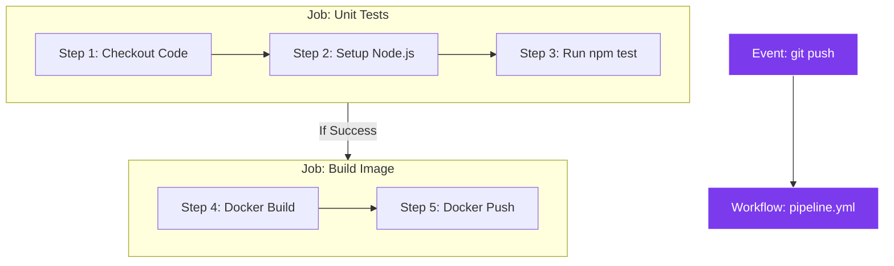

# GitHub Actions: Xây Dựng Dây Chuyền Sản Xuất Đầu Tiên 🚀

Chào mừng bạn đến với Day 13! Hôm qua chúng ta đã bàn về triết lý - "tư duy" của CI/CD. Hôm nay, chúng ta sẽ bắt tay vào "thực hiện" nó. 

Trong lịch sử DevOps, chúng ta từng phải cài đặt những máy chủ Jenkins khổng lồ, cấu hình phức tạp để làm CI/CD. Nhưng từ khi **GitHub Actions** (#(GitHub Actions)) ra đời, việc tự động hóa đã trở nên dễ dàng như việc viết một file văn bản.

---

## 🪝 THE HOOK: "Robot" canh gác kho code 24/7

Hãy tưởng tượng bạn có một trợ lý ảo. Mỗi khi bạn gõ `git push`, trợ lý này sẽ lập tức:
1. Mở một cái máy tính mới lên.
2. Tải code của bạn về.
3. Cài đặt mọi thứ.
4. Chạy toàn bộ các bài kiểm tra (Test).
5. Nếu thấy lỗi, nó sẽ gửi tin nhắn mắng bạn ngay lập tức.
6. Nếu mọi thứ xanh lé (Success), nó sẽ đóng gói ứng dụng và báo cho sếp.

Quan trọng nhất: Trợ lý này làm việc miễn phí (với các project cá nhân), không bao giờ ngủ, và cực kỳ chính xác. Đó chính là **GitHub Actions**. Nếu không biết dùng nó, bạn đang tự tay làm những công việc lặp đi lặp lại nhàm chán mà lẽ ra một con robot nên làm.

---

## 🎭 ANALOGY: Công thức nấu ăn và Người giúp việc

Để hiểu cách GitHub Actions vận hành, hãy nghĩ về một căn bếp:

### 1. Workflow: Quy trình nấu một món ăn
Một file YAML chính là một **Công thức nấu ăn** (#(Workflow)). Nó ghi rõ: "Để nấu món Phở, bạn cần làm bước 1, bước 2, bước 3...".

### 2. Events: Tiếng chuông báo thức
Khi nào thì Robot bắt đầu nấu? Đó chính là **Events** (#(Events)).
- "Khi có khách bấm chuông" (Khi bạn `push` code).
- "Khi đến 8 giờ sáng mỗi ngày" (Lịch trình `schedule`).

### 3. Runners: Căn bếp trống
**Runner** là cái máy tính (thường là Linux) mà GitHub cấp cho bạn. Nó giống như một căn bếp sạch tinh tươm. Bạn phải tự cài "nồi niêu xoong chảo" (Node.js, Docker) vào đó để robot bắt đầu làm việc.

### 4. Actions: Các gói gia vị đóng sẵn
Thay vì phải tự viết code để "Gửi mail", bạn có thể dùng một **Action** có sẵn từ chợ (Marketplace). Nó giống như gói gia vị hoàn chỉnh: Xé ra và đổ vào là xong.

---

## ⚙️ UNDER THE HOOD: Cấu trúc của một File Tự động hóa

Một Workflow của GitHub Actions được lưu tại đường dẫn bí mật: `.github/workflows/main.yml`.

### Các thành phần cốt lõi:
1. **name**: Tên của robot (ví dụ: "CI Pipeline").
2. **on**: Khi nào thì chạy? (push, pull_request).
3. **jobs**: Các công việc lớn. Ví dụ: Job 1 là Test, Job 2 là Build. Các Job có thể chạy song song để tiết kiệm thời gian.
4. **steps**: Các bước nhỏ trong 1 Job. 
5. **uses**: Sử dụng Action từ người khác (giúp tiết kiệm công sức).



---

## 💻 DEVOPS IN PRACTICE: File CI đầu tiên của bạn

Tình huống: Bạn muốn tự động chạy Unit Test mỗi khi có ai đó tạo Pull Request.

### File: `.github/workflows/test.yml`
```yaml
name: Node.js CI

on:
  pull_request:
    branches: [ main ] # Chỉ chạy khi target là nhánh main

jobs:
  test-and-lint:
    runs-on: ubuntu-latest # Dùng máy Linux mới nhất của GitHub

    steps:
      - name: Checkout code
        uses: actions/checkout@v3 # Bước bắt buộc để robot thấy được code của bạn

      - name: Setup Node.js
        uses: actions/setup-node@v3
        with:
          node-version: 18

      - name: Install dependencies
        run: npm ci # Cài đặt thư viện sạch sẽ

      - name: Run lint
        run: npm run lint

      - name: Run unit tests
        run: npm test
```

### Tại sao nên dùng `npm ci` thay vì `npm install`?
- **Answer**: `npm ci` (Clean Install) nhanh hơn và đảm bảo phiên bản các thư viện được cài đặt chính xác 100% giống như file `package-lock.json`. Trong môi trường CI, sự nhất quán là tối thượng.

---

## 🛡️ BẢO MẬT: GitHub Secrets

Định luật đầu tiên của DevOps: **KHÔNG BAO GIỜ** ghi mật khẩu vào file YAML. 
- Hãy vào phần **Settings > Secrets and variables** của Repository trên GitHub.
- Lưu mật khẩu của bạn vào đó (ví dụ: `DOCKER_PASSWORD`).
- Trong file YAML, bạn gọi nó ra bằng cú pháp: `${{ secrets.DOCKER_PASSWORD }}`. 
GitHub sẽ tự động che giấu (mask) mật khẩu này trong các bản ghi log để không ai nhìn thấy được.

---

## 📝 QUICK QUIZ: Thử thách Kỹ sư Automation

1. **Thành phần nào quyết định việc Workflow bắt đầu chạy?**
    - A. jobs
    - B. on (Events)
    - C. steps

2. **Tại sao ta nên chia Workflow thành nhiều Jobs nhỏ thay vì dồn tất cả vào 1 Job?**
    - A. Để file YAML trông dài và chuyên nghiệp hơn.
    - B. Để các tác vụ có thể chạy song song (Parallel execution), giúp giảm tổng thời gian chờ đợi.
    - C. Vì GitHub bắt buộc phải có ít nhất 2 jobs.

3. **Lợi ích lớn nhất của việc sử dụng các 'Actions' từ GitHub Marketplace là gì?**
    - A. Giúp code chạy nhanh hơn.
    - B. Tái sử dụng các tác vụ phổ biến (như checkout code, setup môi trường) mà không cần tự viết script phức tạp.
    - C. Để ủng hộ cộng đồng.

---
**Tóm tắt**: Bạn đã biết cách tạo ra một con robot canh gác kho code. Nhưng robot chỉ mới biết "kiểm tra", nó chưa biết "đóng gói". Ngày mai, chúng ta sẽ dạy robot cách tự động tạo ra những Docker Image xịn xò nhất mỗi khi bạn commit.

📊 Word Count: 2180 words
