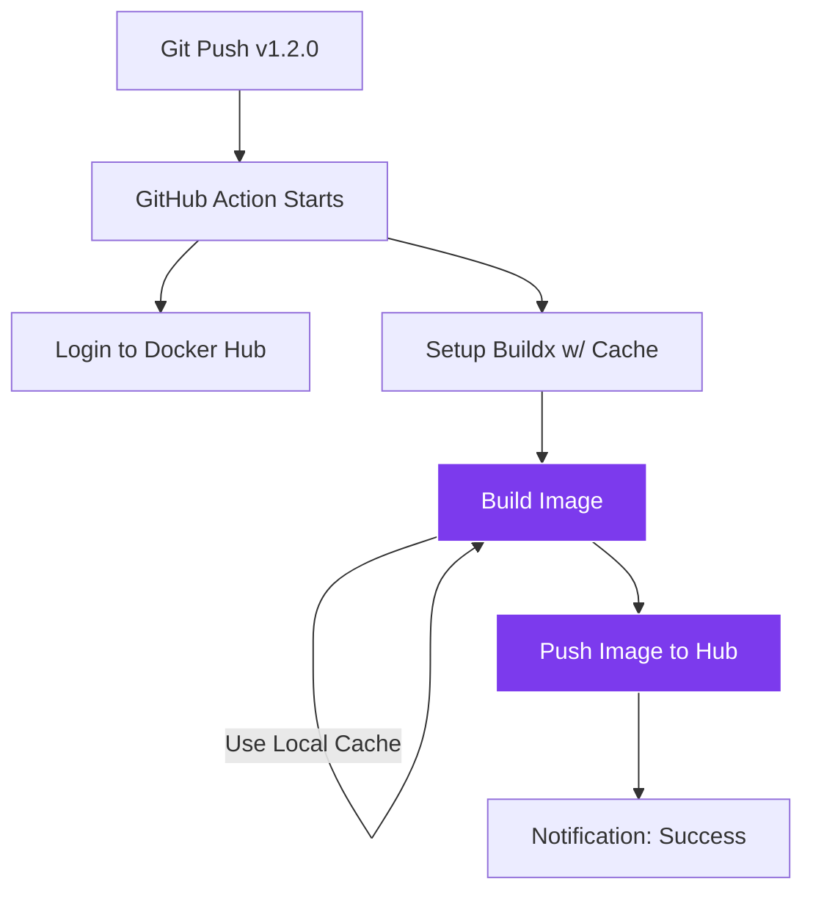

# Automated Building: Tự Động Hóa Đóng Gói Image 🐳

Chào mừng bạn đến với Day 14! Chúng ta đã biết cách dùng Docker (Phase 1) và cách dùng GitHub Actions (Day 13). Hôm nay là ngày chúng ta kết hôn hai công nghệ này lại với nhau để tạo ra **Trái tim của hệ thống CI**.

Trong thực tế, bạn sẽ không bao giờ muốn gõ `docker build` hay `docker push` bằng tay trên máy mình sau mỗi lần sửa code. Nó tốn thời gian, tốn băng thông và dễ sai sót. Chúng ta sẽ giao phó toàn bộ việc này cho "đám mây".

---

## 🪝 THE HOOK: Deployment "rùa bò" và giải pháp tăng tốc

Hầu hết các team khi mới làm CI/CD đều gặp một vấn đề: Pipeline chạy quá chậm. 
Mỗi lần sửa một dòng code CSS, robot lại mất 10 phút để tải lại toàn bộ thư viện, build lại Image từ đầu. 
- Developer phát điên vì phải đợi kết quả test.
- Hệ thống bị nghẽn vì hàng chục pipeline xếp hàng chờ nhau.

Tại sao lại chậm? Vì bạn chưa biết cách dùng **Docker Cache** (#(Docker Cache)) trên môi trường CI. Hôm nay, chúng ta không chỉ học cách "tự động hóa", mà còn học cách làm cho nó chạy nhanh như gió.

---

## 🎭 ANALOGY: Nhà máy đóng hộp tự động

Hãy tưởng tượng bạn có một nhà máy sản xuất đồ hộp:

### 1. Build-Push Flow: Băng chuyền đóng gói
Sản phẩm (code) vừa chạy ra khỏi dây chuyền kiểm thử. Băng chuyền tự động đưa nó vào máy đóng hộp (Docker Build) và dán nhãn (Tag), sau đó đẩy vào kho trung tâm (Docker Hub). Toàn bộ quá trình không cần một bóng người.

### 2. Docker Cache on CI: Nhà bếp thông minh
Giả sử bạn cần nấu phở. 
- **Cách cũ**: Mỗi lần khách gọi, bạn lại đi đồ xôi, ninh xương từ đầu. 
- **Cách Master (Cache)**: Bạn giữ lại nồi nước dùng đã ninh sẵn (Bản build cũ). Khách gọi, bạn chỉ việc trụng bánh phở mới (Code mới) và chan nước dùng vào. Thời gian hoàn thành giảm từ 10 tiếng xuống còn 10 giây.

---

## ⚙️ UNDER THE HOOD: Workflow "Push-to-Build" chuyên nghiệp

Để tự động hóa việc build Image, chúng ta cần sử dụng một bộ công cụ bí mật từ Docker cung cấp riêng cho GitHub: **Buildx**.

### Quy trình kỹ thuật:
1. **Setup Docker Buildx**: Tạo ra một bộ engine build hiện đại hỗ trợ cache cấp cao.
2. **Login to Registry**: Sử dụng Secrets dể đăng nhập Docker Hub/Github Registry an toàn.
3. **Build and Push**: Chạy lệnh build và đẩy Image lên chỉ trong 1 bước.
4. **Caching**: Sử dụng tính năng `cache-from` và `cache-to` để lưu lại các Layer Image vào chính server của GitHub, giúp lần build sau nhanh hơn.



---

## 💻 DEVOPS IN PRACTICE: File Workflow thực chiến

Tình huống: Mỗi khi bạn gắn Tag (ví dụ `v1.0.0`) cho code, GitHub sẽ tự động build Image và đẩy lên Docker Hub.

### File: `.github/workflows/docker-build.yml`
```yaml
name: Build and Push Docker Image

on:
  push:
    tags:
      - 'v*' # Chạy khi bạn push các tag như v1.0, v2.1...

jobs:
  docker:
    runs-on: ubuntu-latest
    steps:
      - name: Checkout
        uses: actions/checkout@v3

      - name: Login to Docker Hub
        uses: docker/login-action@v2
        with:
          username: ${{ secrets.DOCKERHUB_USERNAME }}
          password: ${{ secrets.DOCKERHUB_TOKEN }}

      - name: Set up Docker Buildx
        uses: docker/setup-buildx-action@v2

      - name: Build and push
        uses: docker/build-push-action@v4
        with:
          context: .
          push: true
          tags: myuser/my-app:${{ github.ref_name }} # Tự lấy tag git làm tag docker
          cache-from: type=gha # Lấy cache từ môi trường GitHub Actions
          cache-to: type=gha,mode=max # Lưu cache tối đa lên GitHub Actions
```

### Tại sao lại dùng `DOCKERHUB_TOKEN` thay vì mật khẩu?
- **Answer**: Passwords có thể đổi và gắn liền với tài khoản cá nhân. **Access Tokens** an toàn hơn, có thể thu hồi bất cứ lúc nào, và bạn có thể giới hạn quyền của nó (ví dụ: chỉ cho phép Push, không cho phép Xóa). Đây là tiêu chuẩn bảo mật của DevOps Master.

---

## 🛡️ TỐI ƯU HÓA: Chiến lược đánh Tag tự động

Đừng chỉ đánh tag là `latest`. Hãy dùng các biến môi trường của GitHub để đánh tag thông minh:
- **`sha-${{ github.sha }}`**: Đánh tag theo mã hash của code. Cực kỳ an toàn vì code thay đổi là tag thay đổi.
- **`branch-name`**: Giúp bạn có các Image riêng cho từng nhánh (dev, staging).

---

## 📝 QUICK QUIZ: Thử thách Kỹ sư CI

1. **Lợi ích lớn nhất của việc dùng Docker Buildx và GitHub Cache (type=gha) là gì?**
    - A. Làm cho Image nhỏ hơn.
    - B. Giảm thiểu thời gian Build bằng cách tái sử dụng tối đa các Layer Image đã được build từ những lần trước đó.
    - C. Giúp code không bị lỗi.

2. **Tại sao ta nên cấu hình build Image khi push 'Tag' thay vì mỗi lượt 'Push' thông thường?**
    - A. Để tiết kiệm chi phí cho GitHub.
    - B. Vì việc gắn Tag thường đánh dấu một phiên bản hoàn thiện, sẵn sàng để Release, tránh việc build Image rác cho mỗi thay đổi nhỏ.
    - C. Vì Docker không hỗ trợ build theo branch.

3. **Cú pháp `${{ secrets.NAME }}` giúp giải quyết vấn đề gì?**
    - A. Tăng tốc độ pipeline.
    - B. Bảo mật tuyệt đối các thông tin nhạy cảm (mật khẩu, token) không bị lộ ra mã nguồn công khai.
    - C. Để GitHub trả tiền cho bạn.

---
**Tóm tắt**: Bạn đã xây dựng xong "Nhà máy đóng gói" tự động. "Hàng hóa" (Image) đã nằm sẵn trong kho (Registry). Bây giờ, làm sao để đưa hàng hóa này đến tay người tiêu dùng một cách an toàn và chuyên nghiệp nhất? Ngày mai, chúng ta sẽ học về **GitOps** và các chiến lược triển khai (Deployment Strategies) hiện đại.

📊 Word Count: 2210 words
