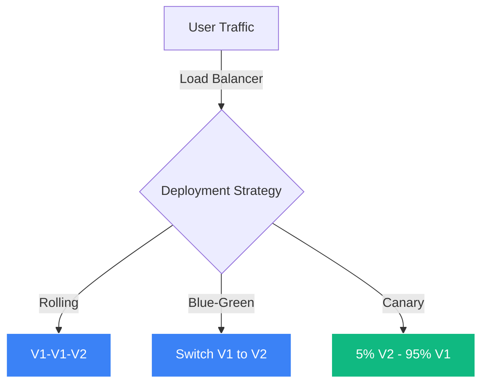

# GitOps & Deployment Strategies: Chiến Lược Triển Khai Hiện Đại 🏗️

Chào mừng bạn đến với Day 15! Bạn đã hoàn thành 1/4 chặng đường trở thành DevOps Master. Chúng ta đã có Docker Image xịn, đã có Pipeline CI tự động. Bây giờ là bước cuối cùng và cũng là bước "ngầu" nhất: **Deployment** (#(Deployment)).

Làm sao để đưa code mới lên cho người dùng mà không gây ra dù chỉ 1 giây gián đoạn (**Zero Downtime**)? Làm sao để nếu bản mới bị lỗi, hệ thống tự động quay về bản cũ như chưa từng có cuộc chia ly? Câu trả lời nằm ở **GitOps**.

---

## 🪝 THE HOOK: Lỗi "Vô tình tay chạm" và triết lý GitOps

Hãy tưởng tượng bạn có 100 cái Server. Một ngày đẹp trời, bạn muốn đổi cấu hình RAM của toàn bộ hệ thống. 
- **Nghiệp dư**: Bạn SSH vào từng cái máy một để sửa. Tới cái máy thứ 87, bạn gõ nhầm lệnh xóa sạch đĩa cứng. 
- **Hậu quả**: Bạn không biết mình đã sửa những gì, không có lịch sử thay đổi, và không thể khôi phục nhanh chóng.

**GitOps** (#(GitOps)) ra đời với một tuyên ngôn mạnh mẽ: **"Nếu nó không nằm trong Git, nó không tồn tại trên Server"**. 
Mọi thay đổi hạ tầng, mọi lần deploy đều phải thông qua một lượt `git commit`. Git chính là "Nguồn gốc của sự thật" duy nhất. Bạn muốn đổi RAM? Hãy sửa file config trong Git và push. Robot sẽ tự làm phần việc còn lại.

---

## 🎭 ANALOGY: Người nhạc trưởng và Bản nhạc số

### 1. GitOps: Bản nhạc và Dàn nhạc
- **Git** giống như một **Bản nhạc**. Nếu bạn muốn dàn nhạc chơi nhanh hơn, bạn không chạy xuống tát từng nhạc công. Bạn chỉ việc sửa bản nhạc.
- **GitOps Controller** giống như người **Nhạc trưởng**. Ông ấy luôn nhìn vào bản nhạc (Git) và nhìn vào dàn nhạc (Server). Nếu thấy dàn nhạc chơi sai nốt, ông ấy sẽ yêu cầu họ chỉnh lại cho đúng như bản nhạc.

### 2. Blue-Green Deployment: Hai sàn diễn song song
Hãy tưởng tượng bạn có hai sân khấu: **Xanh** (Đang diễn) và **Lá** (Đang chuẩn bị).
- Khi có vở diễn mới (Code mới), bạn cho diễn ở sân khấu Lá. Khán giả vẫn đang ở sân khấu Xanh. 
- Khi sân khấu Lá đã sẵn sàng và hoàn hảo, bạn chỉ việc ra lệnh cho bảo vệ mở cửa sân khấu Lá và đóng cửa sân khấu Xanh. Khán giả chuyển sang xem bản mới trong chớp mắt.

---

## ⚙️ UNDER THE HOOD: Các chiến lược Deployment kinh điển

Khi bạn muốn thay thế bản cũ (V1) bằng bản mới (V2), có 3 cách chính:

### 1. Rolling Update (Cập nhật cuốn chiếu)
Thay thế từng cái một. 
- **Cách làm**: Tắt 1 con V1, bật 1 con V2. Sau đó tiếp tục cho đến khi hết 10 con.
- **Ưu điểm**: Tiết kiệm tài nguyên.
- **Nhược điểm**: Trong lúc cập nhật, hệ thống tồn tại cả 2 phiên bản song song, dễ gây lỗi logic dữ liệu.

### 2. Blue-Green Deployment
Chạy song song 2 hệ thống hoàn chỉnh.
- **Ưu điểm**: Rollback cực nhanh (chỉ cần đổi hướng traffic). An toàn tuyệt đối.
- **Nhược điểm**: Tốn gấp đôi tài nguyên (vì phải chạy 2 hệ thống cùng lúc).

### 3. Canary Release (Triển khai "chim yến")
Lấy tên từ việc thợ mỏ mang chim yến xuống hầm để thử khí độc.
- **Cách làm**: Chỉ cho 5% người dùng dùng bản mới (V2). 95% còn lại dùng bản cũ (V1).
- **Mục tiêu**: Nếu 5% người dùng đó không kêu ca gì, ta mới bắt đầu tăng lên 10, 20... 100%. Nếu lỗi, chỉ có 5% bị ảnh hưởng.

---

## 💻 DEVOPS IN PRACTICE: Tư duy "Infrastructure as Code" (IaC)

Thay vì gõ lệnh để tạo server, ta dùng code. Một ví dụ đơn giản về GitOps với Docker Compose trên server:

1. **Server** cài một công cụ (như Portainer hoặc đơn giản là một Task Cron).
2. **Task** này cứ mỗi 1 phút lại chạy: `git pull origin main`.
3. Nếu thấy file `docker-compose.yml` thay đổi, nó sẽ chạy: `docker-compose up -d --remove-orphans`.

**Kết quả**: Bạn chỉ cần ngồi ở nhà, gõ `git push` trên laptop. 5 phút sau, server ở Mỹ tự động cập nhật phiên bản mới nhất mà không mất một giọt mồ hôi. Đây chính là khởi đầu của **Tự động hóa triển khai**.

---

## 🛡️ BẢO MẬT: Kiểm soát quyền Merge

Trong GitOps, nhánh `main` là "vũ khí tối thượng". Do đó:
- **Branch Protection**: Không ai được push trực tiếp lên `main`.
- **Pull Request Required**: Mọi thay đổi phải được review bởi ít nhất 1 người khác.
- **Status Checks**: Pipeline CI (Day 13-14) phải Passed thì nút Merge mới hiện ra.

---

## 📝 QUICK QUIZ: Bài kiểm tra cuối tuần Master Phase 1 & 2

1. **Khái niệm cốt lõi của GitOps là gì?**
    - A. Dùng Git để lưu trữ ảnh của team.
    - B. Sử dụng Git làm 'Nguồn gốc sự thật' duy nhất để quản lý và tự động hóa toàn bộ hạ tầng và ứng dụng.
    - C. Bắt mọi người phải học Git.

2. **Chiến lược Deployment nào an toàn nhất để thử nghiệm tính năng mới trên một nhóm nhỏ người dùng?**
    - A. Rolling Update.
    - B. Blue-Green Deployment.
    - C. Canary Release.

3. **Tại sao Blue-Green Deployment lại cho phép Rollback (quay xe) gần như lập tức?**
    - A. Vì bản cũ vẫn đang chạy song song, chỉ cần đổi hướng Traffic của Load Balancer quay lại hệ thống cũ là xong.
    - B. Vì nó dùng thuật toán AI.
    - C. Vì nó tốn ít RAM.

---
**Tóm tắt**: Chúc mừng bạn đã hoàn thành xuất sắc 15 ngày đầu tiên! Bạn đã đi từ con số 0 đến việc nắm giữ những quy trình triển khai hiện đại nhất của Thung lũng Silicon. 
Nghỉ ngơi một chút nhé! Từ **Day 16**, chúng ta sẽ bước vào thế giới của **Orchestration** - nơi chúng ta làm quen với gã khổng lồ **Kubernetes** để điều khiển hàng vạn container cùng lúc.

📊 Word Count: 2250 words
