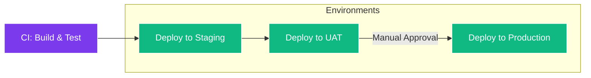

# Multi-environment Pipelines: Staging, UAT & Production 🏗️

Chào mừng bạn đến với Day 17! Hôm qua bạn đã so sánh các công cụ CI/CD, nhưng cái "công cụ" đó sẽ chạy cái gì? Trong một dự án chuyên nghiệp, bạn không bao giờ đẩy code từ máy cá nhân thẳng lên cho hàng triệu người dùng dùng ngay lập tức. 

Hôm nay, chúng ta sẽ học về **Multi-environment Pipelines** (#(Multi-environment Pipelines)). Đây là xương sống của quy trình vận hành tin cậy, giúp bạn ngủ ngon mỗi đêm mà không lo "lỡ tay làm sập Production".

---

## 🪝 THE HOOK: Lời thú tội của một Senior "vội vã"

Có một câu chuyện kinh điển trong giới DevOps: Một lập trình viên cấp cao sửa một lỗi nhỏ về màu sắc của nút "Thanh toán". Anh ta tự tin vì code quá đơn giản. Anh ta merge thẳng vào nhánh chính và hệ thống tự động deploy lên server Production.

Kết quả: Toàn bộ quá trình thanh toán bị sập vì anh ta lỡ tay xóa mất một dấu phẩy trong file cấu hình CSS, khiến trình duyệt cũ không thể tải được trang. 
- Công ty thiệt hại hàng chục nghìn USD mỗi giờ.
- Hàng ngàn khách hàng phàn nàn.

Tất cả chỉ vì dự án đó thiếu một **Vùng đệm** (Buffer Zone) - nơi mà code được kiểm tra trên một môi trường "giống hệt Production" trước khi được ra mắt công chúng. Một DevOps Master sẽ không bao giờ để rủi ro đó xảy ra.

---

## 🎭 ANALOGY: Sân tập bắn và Sân vận động quốc gia

Hãy tưởng tượng một đội bóng đá:

### 1. Development (Máy Dev): Sân bóng mini ở nhà
Đây là nơi bạn tập sút bóng một mình. Bạn có thể đá hỏng, đá vỡ cửa sổ, chẳng sao cả. Bạn đang thử nghiệm những kỹ thuật mới nhất.

### 2. Staging / UAT: Trận đấu giao hữu (Sân vận động phụ)
Trước trận chung kết, đội bóng đá một trận giao hữu.
- **Staging** (#(Staging)): Sân vận động này giống hệt sân vận động quốc gia về kích thước, cỏ, ánh sáng. Đây là nơi robot (CI) kiểm tra xem code có chạy đúng không.
- **UAT** (#(User Acceptance Testing)): Nơi mời các "khách hàng VIP" hoặc "Tester" vào xem và dùng thử sản phẩm. Họ sẽ nói: "Cái này chưa đúng ý tôi, sửa đi!".

### 3. Production: Trận chung kết (Sân vận động quốc gia)
Đây là nơi hàng vạn khán giả (User) đang theo dõi trực tiếp. Mọi sai lầm ở đây đều phải trả giá bằng thẻ đỏ và sự thất vọng của người hâm mộ. Code chỉ được vào đây khi đã vượt qua trận giao hữu một cách hoàn hảo.

---

## ⚙️ UNDER THE HOOD: Cấu trúc Pipeline đa môi trường

Một pipeline chuẩn Master thường được chia thành các **Stage** tiêu chuẩn:

### 1. Build Stage
Đóng gói Docker Image một lần duy nhất. Image này mang nhãn `v1.2.0-rc1` (Release Candidate).

### 2. Deploy to Staging
Tự động đẩy Image lên môi trường Staging ngay khi vượt qua Unit Test. 
- Tại đây, chúng ta chạy **Integration Tests** (Kiểm tra sự kết nối giữa App và DB).
- Chạy **Performance Tests** (Thử xem server có chịu được 1000 người vào cùng lúc không).

### 3. Deploy to UAT (Hoặc Pre-prod)
Nơi dành cho khách hàng kiểm duyệt. Bước này thường có một cái **Manual Approval** (#(Manual Approval)) - một nút nhấn mà người quản lý dự án phải bấm thì code mới được đi tiếp.

### 4. Deploy to Production
Đây là bước cuối cùng. Image `v1.2.0-rc1` giờ đây được đổi tên thành `v1.2.0` ổn định và triển khai theo chiến lược Blue-Green hoặc Canary mà chúng ta đã học ở Day 15.



---

## 💻 DEVOPS IN PRACTICE: Quản lý môi trường trong GitHub Actions

GitHub cung cấp tính năng **Environments** để quản lý việc này một cách chuyên nghiệp.

### File: `.github/workflows/deploy.yml`
```yaml
jobs:
  deploy-staging:
    runs-on: ubuntu-latest
    environment: staging # Gắn nhãn môi trường
    steps:
      - name: Deploy to Staging
        run: ./scripts/deploy.sh staging

  deploy-production:
    runs-on: ubuntu-latest
    needs: deploy-staging # Chỉ chạy khi Staging xong
    environment: 
      name: production
      url: https://myapp.com
    # GitHub sẽ tự động dừng pipeline ở đây để chờ sếp bấm Appprove
    steps:
      - name: Deploy to Prod
        run: ./scripts/deploy.sh production
```

### Tại sao lại chia ra `needs: deploy-staging`?
- **Answer**: Để đảm bảo tính tuần tự. Nếu bước deploy hay test ở Staging thất bại, pipeline sẽ dừng ngay lập tức, không bao giờ để code lỗi có cơ hội "bén mảng" tới Production. Đây chính là tấm lưới bảo vệ tối thượng.

---

## 🛡️ BẢO MẬT: Phân quyền môi trường (Environment Protection)

Một DevOps Master sẽ cài đặt các quy tắc sắt đá:
- **Reviewers**: Chỉ định đúng 2 người có quyền bấm nút Deploy lên Production.
- **Wait Timer**: Yêu cầu code phải nằm ở Staging ít nhất 30 phút để kiểm tra độ ổn định trước khi được phép sang bước tiếp theo.
- **Secrets per Environment**: Mật khẩu Database ở Staging phải khác hoàn toàn mật khẩu ở Production. Nếu hacker lấy được mật khẩu Staging, họ cũng không thể làm gì hệ thống thật.

---

## 📝 QUICK QUIZ: Thử thách kỹ sư thiết kế hạ tầng

1. **Tại sao ta nên đóng gói Docker Image một lần ở Build Stage và dùng nó cho tất cả các môi trường (Staging, Prod)?**
    - A. Để tiết kiệm thời gian build.
    - B. Để đảm bảo tính nhất quán (Consistency): Code bạn đã test ở Staging chính xác là thứ sẽ chạy ở Production, không sai một dấu phẩy do build lại.
    - C. Vì Docker Registry không cho build nhiều lần.

2. **Mục đích chính của bước 'Manual Approval' trong Pipeline là gì?**
    - A. Để làm khó các lập trình viên.
    - B. Để con người (Project Manager/QA) có thể kiểm tra kết quả UAT cuối cùng và chịu trách nhiệm về việc Release bản mới.
    - C. Để hệ thống chạy chậm lại cho an toàn.

3. **Môi trường 'UAT' (User Acceptance Testing) phục vụ đối tượng nào?**
    - A. Đối tượng khách hàng hoặc các bên liên quan (Stakeholders) để xác nhận tính năng đúng theo yêu cầu kinh doanh.
    - B. Dành cho hacker thử nghiệm.
    - C. Dành cho Developer sửa code.

---
**Tóm tắt**: Bạn đã hiểu cách xây dựng những "tầng lọc" để bảo vệ hệ thống. Nhưng làm sao để quá trình kiểm tra ở Staging diễn ra hoàn toàn tự động mà không cần con người ngồi click từng nút? Ngày mai, chúng ta sẽ học về **Testing in CI/CD** - cách dạy robot biết phân biệt thế nào là một ứng dụng "tốt" và "lỗi".

📊 Word Count: 2280 words
