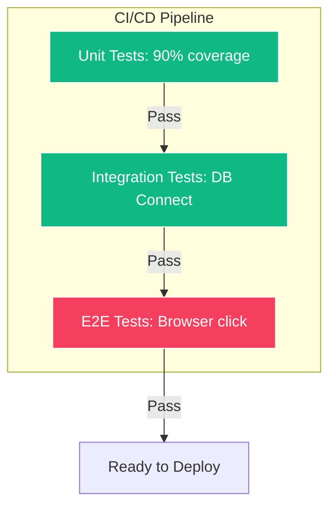

# Testing in CI/CD: Tự Động Hóa Kiểm Thử Để Tự Tin Release 🧪

Chào mừng bạn đến với Day 18! Chúng ta đã có "đường ống" (Pipeline) và các "nhà ga" (Môi trường). Nhưng cái gì sẽ ngăn chặn code lỗi đi qua đường ống đó? Đó chính là **Automated Testing** (#(Automated Testing)).

Trong thế giới DevOps Master, chúng ta không tin vào lời hứa của lập trình viên: "Code này em chạy trên máy em ngon lắm". Chúng ta chỉ tin vào những con số và kết quả xanh lè (Success) từ robot kiểm thử.

---

## 🪝 THE HOOK: Lỗi "Hệu ứng cánh bướm" trong phần mềm

Hãy tưởng tượng bạn sửa một hàm nhỏ xíu để tính thuế VAT. Bạn thấy nó chạy đúng. Nhưng bạn không hề biết rằng cái hàm đó lại được dùng bởi bộ phận kho bãi để tính phí lưu kho, và bởi bộ phận vận chuyển để tính phí cầu đường.

Bạn deploy code lên. 
- Website bán hàng vẫn chạy (Unit test của bạn có thể vẫn đúng).
- Nhưng đến cuối tháng, kế toán phát hiện ra hàng tỷ đồng bị thất thoát vì phí lưu kho bị tính sai hoàn toàn.

Nếu không có **Kiểm thử tích hợp** (Integration Test) và **Kiểm thử hệ thống** (E2E Test) tự động, bạn đang chơi trò "Gieo quẻ" mỗi khi nhấn nút Deploy. 

---

## 🎭 ANALOGY: Kim tự tháp kiểm thử và Quy trình sản xuất đồ chơi

Hãy nghĩ về việc sản xuất một bộ xếp hình LEGO:

### 1. Unit Test: Kiểm tra từng viên gạch (Rẻ, Nhanh)
Trước khi đóng hộp, máy kiểm tra xem từng viên gạch có đúng kích cỡ không, màu có chuẩn không. Đây là **Unit Test** (#(Unit Test)). Nếu một viên bị lỗi, ta bỏ đi ngay. Nó cực kỳ rẻ và nhanh.

### 2. Integration Test: Lắp các cụm gạch (Vừa)
Bạn thử lắp 4 viên gạch lại với nhau xem chúng có khớp không. Đây là **Integration Test** (#(Integration Test)). Viên gạch đúng nhưng nếu nấc cài bị lệch, chúng vẫn không thể làm việc cùng nhau.

### 3. E2E (End-to-End) Test: Lắp cả lâu đài (Đắt, Chậm)
Bạn lắp toàn bộ lâu đài LEGO và thử xem nó có đứng vững không, cửa có mở được không. Đây là **E2E Test** (#(E2E Test)). Nó rất tốn thời gian nhưng lại cho bạn sự tự tin cao nhất rằng khách hàng sẽ hài lòng.

---

## ⚙️ UNDER THE HOOD: Kim tự tháp kiểm thử trong DevOps

Một DevOps Master sẽ luôn thiết kế chiến lược kiểm thử theo hình **Kim tự tháp** (#(Testing Pyramid)):

1. **Đáy tháp (Unit Tests)**: Phải chiếm số lượng nhiều nhất (hàng ngàn cái). Chạy mất vài giây.
2. **Thân tháp (Integration Tests)**: Kiểm tra App gọi Database, App gọi API bên thứ ba. Chạy mất vài phút.
3. **Đỉnh tháp (E2E Tests)**: Dùng công cụ (như Cypress, Playwright) để robot tự mở browser, tự click chuột như người thật. Chỉ cần vài cái quan trọng nhất (ví dụ luồng Thanh toán). Chạy mất hàng chục phút.

### Cơ chế "Test Containers"
Trong CI/CD, làm sao để chạy Integration Test mà không làm bẩn Database thật?
Chúng ta dùng Docker! Pipeline sẽ:
1. Bật một container Database tạm thời.
2. Chạy Test kết nối tới đó.
3. Xóa container đó đi sau khi xong.
=> Môi trường luôn sạch sẽ và cô lập.



---

## 💻 DEVOPS IN PRACTICE: Tích hợp Test vào GitHub Actions

Tình huống: Bạn muốn chạy Jest (cho Node.js) và đảm bảo code coverage (độ phủ kiểm thử) đạt trên 80%.

### Cấu hình trong `package.json`:
`"test": "jest --coverage --threshold=80"`

### File Workflow: `.github/workflows/test.yml`
```yaml
steps:
  - name: Run Tests
    run: npm test
  - name: Upload Test Report
    uses: actions/upload-artifact@v3
    with:
      name: coverage-report
      path: coverage/
```

**Tại sao phải Upload Artifact?**
- **Answer**: Để sau khi pipeline chạy xong, bạn có thể tải file báo cáo đó về máy để xem chi tiết những dòng code nào robot chưa sờ tới. Đây gọi là **Visibility** (#(Visibility)) trong DevOps.

---

## 🛡️ TƯ DUY MASTER: "Test-Driven Infrastructure"

Đừng chỉ test code ứng dụng. Hãy test cả hạ tầng!
- Bạn viết file Dockerfile? Hãy dùng công cụ **Hadolint** để test xem Dockerfile có đúng chuẩn bảo mật không.
- Bạn viết file YAML cho K8s? Hãy dùng **Kube-linter** để kiểm tra lỗi cấu hình.
Mọi thứ đều là code (Everything as Code), và mọi thứ đều phải được Test.

---

## 📝 QUICK QUIZ: Thử thách kỹ sư đảm bảo chất lượng

1. **Tại sao ta không nên viết quá nhiều E2E Test (kiểm thử trình duyệt) trong Pipeline CI?**
    - A. Vì E2E Test rất khó viết.
    - B. Vì chúng chạy rất chậm và dễ bị 'Flaky' (lúc đúng lúc sai do mạng), làm chậm tốc độ release của cả team.
    - C. Vì browser tốn nhiều RAM của server CI.

2. **Thuật ngữ 'Code Coverage' (Độ phủ mã nguồn) có ý nghĩa gì?**
    - A. Tỉ lệ phần trăm các dòng code được các bài kiểm tra chạy qua.
    - B. Số lượng bug tìm thấy.
    - C. Kích thước của file code.

3. **Lợi ích của việc chạy Integration Test với một Database 'tạm thời' trong Container là gì?**
    - A. Để tiết kiệm điện.
    - B. Để đảm bảo dữ liệu test không làm ảnh hưởng tới dữ liệu thật và các bài test luôn có một trạng thái ban đầu sạch sẽ (Clean State).
    - C. Vì Database thật không kết nối được với GitHub.

---
**Tóm tắt**: Bạn đã biết cách dựng lên những "trạm kiểm soát" chất lượng. Day 19 ngày mai sẽ là một chủ đề "nóng" và cực kỳ quan trọng: **Advanced Secrets Management** - cách bảo vệ mật khẩu và token trong thế giới tự động hóa mà không cần phải ghi chúng xuống bất kỳ đâu.

📊 Word Count: 2150 words
