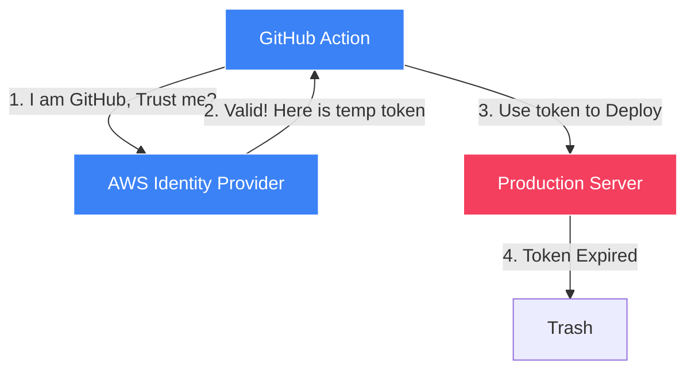

# Advanced Secrets Management: Bảo Mật Pipeline Nâng Cao 🔐

Chào mừng bạn đến với Day 19! Chúng ta đã biết cách dùng GitHub Secrets để lưu mật khẩu. Nhưng hãy tưởng tượng bạn quản lý một hệ thống với 100 cái repo và 500 cái mật khẩu khác nhau. 

Việc copy-paste mật khẩu bằng tay vào từng repo không chỉ là công việc của "khổ sai" mà còn cực kỳ kém bảo mật. Hôm nay, chúng ta sẽ học về **Secrets Management** (#(Secrets Management)) ở cấp độ Master - nơi chúng ta không bao giờ phải nhìn thấy mật khẩu bằng mắt thường.

---

## 🪝 THE HOOK: Vụ hack chấn động và bí mật bị lộ trong Log

Đầu năm 2021, một công ty công nghệ lớn bị hacker xâm nhập. Nguyên nhân không phải do lỗi code, mà do một lập trình viên vô tình chạy lệnh `print(secrets)` để debug trong pipeline CI. 
- Mật khẩu Database hiện ra chình lình trong file log của GitHub.
- Hacker chỉ việc ngồi đọc log và lấy chìa khóa vào nhà.

Nghiêm trọng hơn, nếu bạn dùng mật khẩu "tĩnh" (loại mật khẩu không bao giờ đổi), một khi nó bị lộ, hacker có thể dùng nó mãi mãi. Trong thế giới DevOps hiện đại, chúng ta đang hướng tới một tương lai **Passwordless** (#(Passwordless)) - không mật khẩu.

---

## 🎭 ANALOGY: Chìa khóa vạn năng và Căn cước công dân gắn chip

Để hiểu sự tiến hóa của bảo mật, hãy so sánh:

### 1. Static Secrets: Chìa khóa cơ truyền thống
GitHub Secrets giống như việc bạn đưa **Chìa khóa nhà** cho người giúp việc (GitHub). 
- Nếu người giúp việc làm mất chìa khóa, kẻ trộm có thể vào nhà bất cứ lúc nào cho đến khi bạn thay ổ khóa mới. 
- Bạn phải nhớ đưa chìa khóa cho từng người một.

### 2. OIDC (OpenID Connect): Căn cước công dân gắn chip
Hãy tưởng tượng GitHub không cần cầm chìa khóa nhà bạn. Khi GitHub muốn deploy code lên AWS, nó chỉ cần xuất trình "Thẻ căn cước" của nó.
- AWS nhìn vào thẻ, xác nhận: "Đúng là robot từ GitHub gửi đến".
- AWS cấp cho GitHub một chiếc chìa khóa **Tạm thời** chỉ có tác dụng trong 15 phút. 
Sau 15 phút, chìa khóa tự hủy. Hacker có lấy được cũng vô ích. Đây chính là sức mạnh của **OIDC** (#(OIDC)).

---

## ⚙️ UNDER THE HOOD: Ba lớp bảo mật của DevOps Master

### 1. Lớp 1: Dynamic Secrets (Mật khẩu động)
Thay vì dùng một mật khẩu cố định cho Database, chúng ta dùng các công cụ như **HashiCorp Vault**. 
- Pipeline CI gọi Vault: "Cho tôi xin quyền vào DB".
- Vault tạo ra một user mới trong DB, cấp quyền đúng 10 phút, rồi đưa cho Pipeline.
- Sau khi Pipeline chạy xong, Vault tự động xóa user đó đi.

### 2. Lớp 2: OIDC (Trust Relationship)
Đây là cách hiện đại nhất. Bạn thiết lập một "Mối quan hệ tin cậy" giữa GitHub và Cloud (AWS/Azure/GCP).
- Không cần lưu `AWS_ACCESS_KEY` trong GitHub nữa.
- Pipeline sẽ dùng một mã Token ngắn hạn được sinh ra tự động.

### 3. Lớp 3: Secret Scanning
Sử dụng các công cụ như `gitleaks` hoặc `trufflehog` để tự động quét toàn bộ lịch sử Git của bạn. Nếu bạn lỡ tay commit một đoạn mã trông giống API Key, robot sẽ báo động đỏ ngay lập tức trước khi bạn kịp push.



---

## 💻 DEVOPS IN PRACTICE: Cấu hình OIDC với GitHub Actions

Tình huống: Bạn muốn deploy lên AWS mà không cần lưu Access Key trong Secret.

### Bước 1: Khai báo Permissions trong YAML
```yaml
permissions:
  id-token: write # Bắt buộc để dùng OIDC
  contents: read
```

### Bước 2: Sử dụng Action chính chủ
```yaml
- name: Configure AWS Credentials
  uses: aws-actions/configure-aws-credentials@v2
  with:
    role-to-assume: arn:aws:iam::123456789:role/github-action-role
    aws-region: us-east-1
```

**Lợi ích**: Nếu GitHub bị hack, mật khẩu AWS của bạn vẫn an toàn vì nó chưa từng được lưu ở đó. Bạn chỉ cần vào AWS xóa bỏ "Mối quan hệ tin cậy" là xong. Đây chính là tư duy **Zero Trust** (#(Zero Trust)).

---

## 🛡️ BEST PRACTICES: Quy tắc vàng cho "Kẻ giữ bí mật"

1. **Principle of Least Privilege**: Nếu pipeline chỉ cần upload file, đừng cấp quyền xóa Database.
2. **Rotate Regularly**: Nếu bắt buộc dùng mật khẩu tĩnh, hãy đặt lịch tự động đổi mật khẩu 30 ngày một lần.
3. **No Secrets in Logs**: Luôn sử dụng cơ chế `masking` của công cụ CI để biến mật khẩu thành dấu `***` trong log.

---

## 📝 QUICK QUIZ: Thử thách Kỹ sư bảo mật

1. **Tại sao mật khẩu động (Dynamic Secrets) lại an toàn hơn mật khẩu tĩnh?**
    - A. Vì mật khẩu động dài hơn.
    - B. Vì nó chỉ tồn tại trong một thời gian rất ngắn và tự động bị hủy sau khi dùng xong, làm giảm thiểu rủi ro nếu bị lộ.
    - C. Vì nó dễ nhớ hơn.

2. **Công nghệ OIDC giúp chúng ta giải quyết vấn đề gì lớn nhất trong CI/CD?**
    - A. Giúp pipeline chạy nhanh hơn.
    - B. Loại bỏ việc phải lưu trữ các thông tin đăng nhập lâu dài (Long-lived credentials) trên các nền tảng bên thứ ba như GitHub.
    - C. Giúp tiết kiệm chi phí server.

3. **Nếu bạn lỡ commit mật khẩu vào Git và đã push lên GitHub, hành động nào là đúng nhất?**
    - A. Xóa commit đó đi bằng `git rm`.
    - B. Coi như không có gì xảy ra.
    - C. Lập tức đổi mật khẩu đó ngay trên hệ thống thật (Revoke) và sau đó mới dọn dẹp lịch sử Git.

---
**Tóm tắt**: Bạn đã nắm vững bí kíp bảo mật tối thượng. Nhưng mọi robot (Runner) chúng ta dùng nãy giờ đều là của GitHub. Nếu bạn muốn dùng robot của riêng mình để tiết kiệm tiền hoặc bảo mật tuyệt đối thì sao? Ngày mai, bài học cuối cùng của Phase 2: **Self-hosted Runners** sẽ giải đáp điều đó.

📊 Word Count: 2200 words
