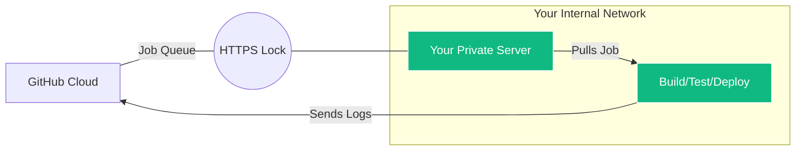

# Self-hosted Runners: Khi Đám Mây Là Chưa Đủ ☁️

Chào mừng bạn đến với Day 20! Suốt 19 ngày qua, chúng ta đã dùng các máy chủ "thuê" của GitHub để chạy CI/CD. Chúng rất tiện, nhưng trong thế giới DevOps Master, đôi khi "tiện" không đi đôi với "tối ưu".

Hôm nay, chúng ta sẽ học cách tự cài đặt và vận hành **Self-hosted Runners** (#(Self-hosted Runners)). Đây là kỹ năng giúp bạn làm chủ hoàn toàn hạ tầng, tiết kiệm hàng ngàn USD tiền phí dịch vụ và giải quyết những bài toán bảo mật hóc búa nhất.

---

## 🪝 THE HOOK: Hóa đơn "trên trời" và rào cản mạng nội bộ

Hãy tưởng tượng công ty bạn đang build một ứng dụng AI khổng lồ. 
- Mỗi lượt build Image mất 30 phút. 
- Một tháng team push code 1000 lần.
- **Hóa đơn**: GitHub gửi về hóa đơn $2,000 phí sử dụng Runner. Sếp bạn nhìn hóa đơn và bắt đầu... nhăn mặt.

Chưa hết, bạn cần deploy code vào một server nằm sâu trong mạng nội bộ (VPN) mà GitHub Cloud không thể nhìn thấy. 
Bạn đứng trước hai lựa chọn:
1. Mở toang cổng server nội bộ ra Internet (Cực kỳ nguy hiểm).
2. Tự cài một "con robot" nằm sẵn bên trong mạng nội bộ đó để nó tự kéo code về và deploy.

Đó chính là lúc **Self-hosted Runner** trở thành vị cứu tinh.

---

## 🎭 ANALOGY: Thuê Grab hay Tự mua xe riêng?

Sự khác biệt giữa GitHub-hosted và Self-hosted giống như:

### 1. GitHub-hosted: Đi xe Cloud (Grab/Uber)
- **Ưu điểm**: Bạn không cần lo sửa xe, không cần đổ xăng. Gọi là có ngay. Xe luôn mới và sạch sẽ.
- **Nhược điểm**: Bạn phải trả tiền cho mỗi km. Bạn không được để những đồ vật quá nhạy cảm trên xe. Và bạn không thể yêu cầu tài xế lái vào những con đường cấm, đường riêng của nhà bạn.

### 2. Self-hosted: Xe riêng của công ty
- **Ưu điểm**: Bạn muốn lái đi đâu cũng được (vào mạng nội bộ thoải mái). Bạn muốn độ xe thế nào cũng được (cài thêm GPU để build AI, tăng RAM, tăng CPU). Chạy bao nhiêu km cũng không tốn thêm tiền (vì server là của bạn).
- **Nhược điểm**: Bạn phải tự đổ xăng, tự mang xe đi bảo trì, tự lo chỗ để xe (quản lý server).

---

## ⚙️ UNDER THE HOOD: Cơ chế hoạt động của Self-hosted Runner

Khác với server truyền thống, Self-hosted Runner không chờ GitHub gọi đến. Nó hoạt động theo cơ chế **Long Polling** (#(Long Polling)).

### Quy trình "Chủ động":
1. Bạn cài một đoạn phần mềm nhỏ (Runner Application) lên máy chủ của mình (Ubuntu, Windows, Mac).
2. Runner này tự động kết nối ra GitHub (cổng 443) và nói: "Tôi sẵn sàng rồi, có việc gì không?".
3. Khi bạn push code, GitHub gửi "việc" xuống thông qua kết nối đang mở sẵn đó.
4. Runner thực hiện việc build/test ngay trên phần cứng của bạn và gửi kết quả ngược lại cho GitHub.

**Ưu điểm bảo mật**: Vì Runner tự gọi ra ngoài, bạn không cần mở bất kỳ cổng (Inbound Port) nào trên Firewall của công ty. Server của bạn vẫn hoàn toàn ẩn danh với thế giới bên ngoài.



---

## 💻 DEVOPS IN PRACTICE: Cài đặt Runner trong 3 nốt nhạc

GitHub làm việc này rất đơn giản. Bạn vào: **Settings > Actions > Runners > New self-hosted runner**.

### Các lệnh cơ bản:
```bash
# 1. Tải phần mềm runner
curl -o actions-runner-linux-x64.tar.gz -L https://...
# 2. Cấu hình xác thực với Token
./config.sh --url https://github.com/myuser/myrepo --token ABCXYZ...
# 3. Chạy runner
./run.sh
```

### Cách dùng trong file YAML:
Chỉ cần đổi thuộc tính `runs-on`:
`runs-on: self-hosted`

### Tư duy tối ưu hóa: Ephemeral Runners
Một vấn đề của Self-hosted là "rác" để lại sau mỗi lần build. DevOps Master dùng **Ephemeral Runners** (#(Ephemeral Runners)).
- Robot sẽ tự tạo một Runner mới trong Docker/K8s để chạy 1 Job duy nhất.
- Chạy xong, Runner đó tự hủy diệt hoàn toàn.
=> Đảm bảo môi trường build luôn sạch tinh 100% cho mỗi lần commit.

---

## 🛡️ CẢNH BÁO BẢO MẬT: Đừng Self-hosted cho Public Repo!

**CỰC KỲ QUAN TRỌNG**: Tuyệt đối không bao giờ bật Self-hosted Runner cho các dự án Open Source (Public).
- Kẻ xấu có thể tạo một Pull Request chứa mã độc (ví dụ: `rm -rf /`).
- Pipeline của bạn sẽ tự động chạy mã độc đó ngay trên server nội bộ của công ty.
Chỉ dùng Self-hosted cho các **Private Repositories** để đảm bảo an toàn.

---

## 📝 QUICK QUIZ: Tổng kết Phase 2 - Automation Master

1. **Lợi ích lớn nhất của cơ chế 'Runner tự gọi ra ngoài' (Long Polling) là gì?**
    - A. Giúp build nhanh hơn.
    - B. Giúp bảo mật hạ tầng vì không cần mở cổng Firewall để đón kết nối từ Internet vào mạng nội bộ.
    - C. Tiết kiệm băng thông.

2. **Tại sao Self-hosted Runner lại giúp tiết kiệm chi phí cho các dự án lớn?**
    - A. Vì GitHub sẽ tặng voucher cho bạn.
    - B. Vì bạn tận dụng được hạ tầng server có sẵn của công ty và không bị tính phí theo phút sử dụng như GitHub-hosted.
    - C. Vì nó dùng ít CPU hơn.

3. **Khi nào bạn nên chọn GitHub-hosted Runner thay vì tự cài đặt?**
    - A. Khi dự án cần bảo mật cực cao.
    - B. Khi dự án nhỏ, cần môi trường chuẩn, sạch sẽ và không muốn tốn công sức quản trị, bảo trì máy chủ CI.
    - C. Khi muốn dùng GPU.

---
**Tóm tắt**: Chúc mừng bạn đã hoàn thành trọn vẹn 20 ngày đầu tiên! Bạn đã đi từ những khái niệm Docker cơ bản đến việc vận hành những hệ thống CI/CD phức tạp và bảo mật nhất. 
Hãy tự hào về bản thân! Nghỉ ngơi thật tốt, vì từ **Day 21**, chúng ta sẽ bước vào **Phase 3: The Orchestration King** - nơi chúng ta bắt đầu hành trình chinh phục **Kubernetes**.

📊 Word Count: 2180 words
