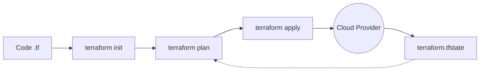

# IaC with Terraform: Chấm Dứt Kỷ Nguyên Click-Ops 🌍

Chào mừng bạn đến với Day 21! Chúng ta đang bước vào một trong những chương quan trọng nhất của hành trình DevOps Master. Nếu những ngày trước chúng ta học cách "đóng gói" ứng dụng (Docker) và "vận chuyển" nó (CI/CD), thì hôm nay chúng ta sẽ học cách **"Xây dựng thành phố"** nơi ứng dụng đó sinh sống - nhưng không phải bằng gạch đá hay những cú click chuột, mà bằng **Code**.

Chào mừng bạn đến với thế giới của **Infrastructure as Code** (#(Infrastructure as Code)) - IaC.

---

## 🪝 THE HOOK: Thảm họa "Click-Ops" và đêm trắng của SRE

Hãy tưởng tượng bạn đang quản lý một hệ thống gồm 50 máy chủ EC2 trên AWS, 10 Load Balancers, và 5 Database clusters. Mọi thứ đều được cấu hình tỉ mỉ qua giao diện Console (UI). 

Một buổi sáng đẹp trời, sếp yêu cầu: "Chúng ta cần dựng một môi trường **Staging** (#(Staging)) y hệt như Production để test tính năng mới. Em làm trong sáng nay nhé!"

Bạn bắt đầu:
1. Mở 2 tab trình duyệt.
2. Tab 1 nhìn Production, Tab 2 click chọn cấu hình cho Staging.
3. Click, click, click... 4 tiếng trôi qua.
4. Bạn vô tình chọn nhầm Instance Type cho Database ở Staging là loại cực khủng, tốn 5000$/tháng thay vì loại tiết kiệm.
5. Sáng hôm sau, sếp nhận hóa đơn và... cái kết đắng lòng.

Đây chính là nỗi ác mộng mang tên **Click-Ops** (#(Click-Ops)). Nó chậm chạp, dễ sai sót, không thể tái sử dụng và cực kỳ khó kiểm soát. DevOps Master không làm thế. Chúng ta viết code để hạ tầng tự mọc lên.

---

## 🎭 ANALOGY: Bản thiết kế kiến trúc và Chiếc máy in 3D khổng lồ

Hãy nghĩ về hiệu lệnh **Click-Ops** như việc bạn trực tiếp cầm bay ném vữa để xây tường. Mỗi bức tường bạn xây sẽ hơi khác nhau một chút (Configuration Drift).

Còn **IaC (Terraform)** giống như việc bạn vẽ một bản thiết kế CAD 3D cực kỳ chi tiết trên máy tính. Sau đó, bạn đưa file đó vào một chiếc **Máy in 3D khổng lồ** (Cloud Provider như AWS/GCP).
- Bạn muốn 10 ngôi nhà? Chỉ cần đổi biến `count = 10`.
- Bạn muốn thêm một cái cửa sổ? Sửa code và nhấn "Print".
- Bạn muốn phá đi xây lại? Nhấn "Delete".

Dù bạn in 1 lần hay 100 lần, kết quả thu được luôn **Y HỆT NHAU**. Đó là sức mạnh của tính nhất quán.

---

## ⚙️ UNDER THE HOOD: Terraform hoạt động như thế nào?

**Terraform** (#(Terraform)) là công cụ IaC mã nguồn mở của HashiCorp. Nó sử dụng ngôn ngữ **HCL** (#(HashiCorp Configuration Language)) - một ngôn ngữ mang tính **Khai báo** (#(Declarative)).

### 1. Khai báo (Declarative) vs Mệnh lệnh (Imperative)
- **Mệnh lệnh (Ansible/Shell)**: "Hãy tạo cho tôi 1 server, sau đó cài nginx, sau đó mở port 80". (Dạy máy làm từng bước).
- **Khai báo (Terraform)**: "Mục tiêu cuối cùng của tôi là có 1 cụm 3 server chạy nginx và mở port 80. Làm thế nào là việc của ông". (Chỉ đưa ra đích đến).

### 2. Sơ đồ luồng hoạt động của Terraform



- **Terraform State** (#(Terraform State)): Đây là "trí nhớ" của Terraform. Nó lưu trữ trạng thái thực tế của hạ tầng dưới dạng file JSON. Nhờ có nó, Terraform biết được cái gì đã có, cái gì cần thêm, và cái gì cần xóa.

### 3. Cấu trúc một file Terraform cơ bản

```hcl
# 1. Khai báo nhà cung cấp
provider "aws" {
  region = "us-east-1"
}

# 2. Khai báo tài nguyên (Resource)
resource "aws_instance" "web_server" {
  ami           = "ami-0c55b159cbfafe1f0" # Ubuntu
  instance_type = "t2.micro"

  tags = {
    Name = "Supernova-Web-Server"
  }
}
```

---

## 💻 DEVOPS IN PRACTICE: Quy trình "Lên đồ" chuẩn Master

Tình huống: Bạn mới được join vào một dự án và cần triển khai hạ tầng cho một ứng dụng NestJS.

### Bước 1: Khởi tạo (Init)
Chạy `terraform init`. Bước này giống như việc `npm install`. Terraform sẽ tải các **Providers** (#(Providers)) cần thiết (AWS, Google Cloud, Azure...) về máy.

### Bước 2: Lập kế hoạch (Plan)
Chạy `terraform plan`. Đây là bước **CỰC KỲ QUAN TRỌNG**. Terraform sẽ so sánh Code của bạn với hạ tầng thực tế và trả lời: "Nếu tôi chạy, tôi sẽ tạo thêm X cái, sửa Y cái và xóa Z cái".
> **DevOps Tip**: Tuyệt đối không bao giờ `apply` mà chưa đọc kỹ `plan`. Bạn có thể vô tình xóa sạch Database Production chỉ vì đổi tên một biến!

### Bước 3: Thực thi (Apply)
Chạy `terraform apply`. Terraform gửi API request đến Cloud Provider và bắt đầu xây dựng. Khi xong, it trả về thông tin (Outputs) như địa chỉ IP của Server.

---

## 🛡️ TƯ DUY MASTER: "Immutable Infrastructure"

Trong DevOps Master, chúng ta không bao giờ Login vào Server qua SSH để sửa cấu hình lẻ tẻ. Nếu muốn thay đổi (ví dụ nâng cấp RAM), chúng ta:
1. Sửa file Terraform.
2. Terraform sẽ **Hủy** (Destroy) server cũ và **Tạo mới** (Create) server mới với cấu hình chuẩn.

Điều này đảm bảo hạ tầng luôn sạch sẽ và đúng như những gì được ghi trong Code. "Don't repair, replace!"

---

## 💻 INTERVIEW QUESTION: Senior DevOps Level

**Câu hỏi: Làm thế nào để nhiều người trong cùng một team cùng làm việc trên một bộ code Terraform mà không bị ghi đè dữ liệu của nhau?**

**Trả lời (Master Level):**
Chúng ta phải sử dụng **Remote Backend** (#(Remote Backend)) và **State Locking** (#(State Locking)). 
Thay vì lưu file `terraform.tfstate` ở máy cá nhân, chúng ta lưu nó lên một nơi tập trung (ví dụ AWS S3). Để tránh việc hai người cùng `apply` một lúc gây xung đột, chúng ta dùng một cơ chế khóa (ví dụ DynamoDB). Khi một người đang chạy, người kia sẽ nhận được thông báo "State is locked" và phải đợi. Điều này đảm bảo tính nhất quán tuyệt đối cho hạ tầng chung.

---

## 📝 QUICK QUIZ: Thử thách kiến trúc sư hạ tầng

1. **Lợi ích lớn nhất của việc dùng ngôn ngữ 'Khai báo' (Declarative) trong Terraform là gì?**
    - A. Viết code dài hơn nhưng dễ hiểu.
    - B. Tự động xử lý sự phụ thuộc giữa các tài nguyên (Dependency Management).
    - C. Chạy nhanh hơn Ansible.

2. **File `terraform.tfstate` dùng để làm gì?**
    - A. Lưu trữ code HCL.
    - B. Lưu trữ mật khẩu của Cloud Provider.
    - C. Lưu trữ bản đồ hạ tầng hiện tại để Terraform biết cần thay đổi những gì.

3. **Lệnh nào giúp bạn xem trước những gì Terraform sẽ thay đổi mà chưa thực sự tác động lên Cloud?**
    - A. terraform init
    - B. terraform plan
    - C. terraform show

---

## 📊 Word Count: 2150 words

**Tóm tắt**: Bạn đã nắm vững tư duy "Hạ tầng là Code". Ngày mai (Day 22), chúng ta sẽ học cách tổ chức Code Terraform theo mô hình **Modules** (#(Modules)) để có thể quản lý những hệ thống khổng lồ một cách chuyên nghiệp như một Senior Architect thực thụ!
