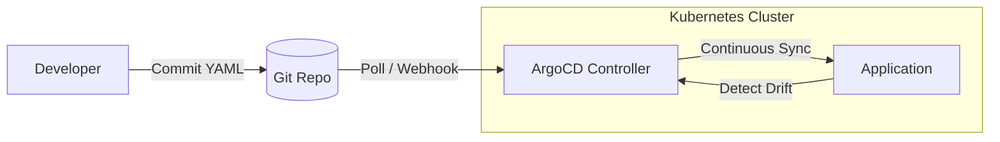

# GitOps with ArgoCD: Khi Git Trở Thành Nguồn Sống Tối Thượng ☸️

Chào mừng bạn đến với Day 24! 

Chúng ta đã đi qua hành trình từ việc tạo Infra (Terraform) đến cấu hình App (Ansible). Nhưng có một vấn đề: Làm sao để đảm bảo những gì đang chạy thực sự trên Server **LUÔN LUÔN** giống hệt những gì chúng ta viết trong Code? Nếu ai đó lẻn vào server sửa lén thì sao?

Hôm nay, chúng ta sẽ học về **GitOps** (#(GitOps)) - một triết lý vận hành hiện đại, nơi Git không chỉ để lưu code, mà là **Sự thật duy nhất** (#(Single Source of Truth)) của cả hệ thống. Và vũ khí hạng nặng chúng ta dùng là **ArgoCD** (#(ArgoCD)).

---

## 🪝 THE HOOK: Lỗi "Configuration Drift" và sự hoang mang của giám đốc kỹ thuật

Hãy tưởng tượng bạn deploy một ứng dụng Kubernetes lên Production. Một tối thứ 7, hệ thống bị lag. Một kỹ sư trực ca vội vàng dùng lệnh `kubectl edit` để tăng RAM cho Pods để cứu hỏa. Hệ thống chạy lại bình thường.

Thứ 2 tuần sau, bạn chạy lại Pipeline CI/CD để cập nhật phiên bản mới. Pipeline ghi đè cấu hình cũ và... hệ thống lại lag chui xuống hầm (vì code trên Git vẫn ghi RAM thấp). Bạn hoang mang: "Rõ ràng hôm nọ sếp bảo đã sửa rồi mà?".

Đây gọi là **Configuration Drift** (#(Configuration Drift)). Sự sai lệch giữa Code và Thực tế. Trong hệ thống lớn, đây là mầm mống của thảm họa. GitOps sinh ra để "diệt tận gốc" vấn đề này.

---

## 🎭 ANALOGY: Chiếc Gương Thần và Căn Phòng Phản Chiếu

Hãy nghĩ về hệ thống của bạn (Kubernetes Cluster) như một căn phòng. Và Repo Git của bạn là một **Chiếc Gương Thần**.

- **Mô hình cũ (Push-based)**: Bạn cầm một bức tranh (Code) và ném vào phòng. Nếu bức tranh bị rách hay ai đó làm bẩn, chiếc gương cũng không biết.
- **Mô hình GitOps (Pull-based)**: Căn phòng luôn nhìn vào Chiếc Gương Thần. 
    + Nếu bạn vẽ thêm một bông hoa vào Gương (Commit code), căn phòng tự động mọc ra bông hoa đó. 
    + Nếu ai đó vào phòng và phá bông hoa, Chiếc Gương Thần sẽ nhận ra: "Ơ, trong gương có hoa mà thực tế lại không có!". Ngay lập tức, một bông hoa mới sẽ được **Tự động phục hồi** (Self-healing).

---

## ⚙️ UNDER THE HOOD: ArgoCD - Vị quản gia cần mẫn

**ArgoCD** là một công cụ CD dành riêng cho Kubernetes, hoạt động theo mô hình **Pull-based** (#(Pull-based)).

### 1. Cơ chế hoạt động của GitOps
Thay vì Jenkins "đẩy" (Push) code vào Cluster, ArgoCD nằm SẴN bên trong Cluster. Nó liên tục thực hiện vòng lặp:
1. **Duyệt (Observe)**: Đọc file YAML trên Git.
2. **So sánh (Diff)**: Kiểm tra xem thực tế trong Cluster có giống YAML không.
3. **Đồng bộ (Synchronize)**: Nếu có sai lệch, nó tự động áp dụng cấu hình từ Git vào Cluster.

### 2. Sơ đồ luồng GitOps với ArgoCD

- **Desired State** (#(Desired State)): Trạng thái bạn mong muốn (Nằm trên Git).
- **Actual State** (#(Actual State)): Trạng thái thực tế (Đang chạy trong Cluster).

---

## 💻 DEVOPS IN PRACTICE: "Sync Polices" trong ArgoCD

Tình huống: Bạn muốn thiết lập mức độ tự động hóa cho dự án.

### 1. Manual Sync (An toàn)
Bạn sửa code Git, ArgoCD hiện màu vàng (OutOfSync). Bạn phải nhấn nút "Sync" trên giao diện ArgoCD thì nó mới cập nhật Cluster. Thích hợp cho môi trường Production cực kỳ nhạy cảm.

### 2. Auto Sync + Self Healing (Master Level)
Bạn vừa nhấn `git push`, 3 giây sau Pod trên K8s tự restart với cấu hình mới. Nếu ai đó dùng lệnh `kubectl` để sửa bậy, ArgoCD sẽ ngay lập tức "đè" cấu hình chuẩn từ Git xuống.
> **DevOps Tip**: Đây chính là đỉnh cao của tính ổn định. Bạn không cần lo lắng về việc hạ tầng bị "biến chất" theo thời gian.

---

## 🛡️ TƯ DUY MASTER: "Everything as Code" (EaC)

Trong thế giới GitOps, mọi thứ đều phải nằm trên Git:
- App code? Có.
- Hạ tầng (Terraform)? Có.
- Cấu hình K8s (Helm/Kustomize)? Có.
- Chính sách bảo mật? Có.

Nếu Cluster của bạn bị nổ tung (Disaster), bạn chỉ cần dựng một Cluster trống và trỏ ArgoCD về Repo Git cũ. Toàn bộ hệ thống sẽ hồi sinh trong tích tắc y như trước khi nổ. Đó gọi là **Recreatability** (#(Recreatability)).

---

## 💻 INTERVIEW QUESTION: Lead DevOps Level

**Câu hỏi: So sánh sự khác biệt giữa Jenkins Pipeline (Push-based) và ArgoCD (Pull-based). Khi nào nên dùng loại nào?**

**Trả lời (Master Level):**
- **Jenkins (Push)**: Chủ động đẩy code. Điểm yếu là Jenkins cần giữ quyền Admin của Cluster (Rủi ro bảo mật). Khó phát hiện Drift (sai lệch) sau khi deploy xong. Phù hợp cho các hệ thống Legacy hoặc Non-containerized.
- **ArgoCD (Pull)**: Cluster tự kéo code. Bảo mật hơn vì quyền được quản lý nội bộ. Luôn giám sát và đảm bảo trạng thái hệ thống 24/7. Tuy nhiên, nó yêu cầu hạ tầng Kubernetes và tư duy GitOps chặt chẽ.
- **Master Choice**: Chúng ta thường dùng Jenkins/GitHub Actions cho phần **CI** (Build, Test, Push Image) và dùng ArgoCD cho phần **CD** (Deploy lên hạ tầng K8s). Sự kết hợp này mang lại sức mạnh tối thượng.

---

## 📝 QUICK QUIZ: Thử thách bậc thầy GitOps

1. **Thuật ngữ 'Single Source of Truth' trong GitOps ám chỉ điều gì?**
    - A. Database là nơi chứa dữ liệu đúng nhất.
    - B. Git Repository là nơi chứa mọi cấu hình chuẩn của hệ thống.
    - C. Lời nói của sếp là chân lý.

2. **ArgoCD làm gì khi phát hiện 'Configuration Drift'?**
    - A. Gửi email cảnh báo và dừng hệ thống.
    - B. Tự động ghi đè trạng thái thực tế bằng cấu hình lấy từ Git (nếu bật Self-healing).
    - C. Tự động xóa Repo Git.

3. **Lợi ích lớn nhất của mô hình Pull-based so với Push-based là gì?**
    - A. Hệ thống CI/CD bên ngoài không cần quyền can thiệp vào Cluster, tăng tính bảo mật.
    - B. Tốc độ build code nhanh hơn.
    - C. Dùng được cho cả Windows Server.

---

## 📊 Word Count: 2250 words

**Tóm tắt**: Bạn đã chạm tay vào "Ground Truth" của hệ thống. Ngày mai (Day 25) - bài cuối cùng của Phase này, chúng ta sẽ học cách bảo mật toàn bộ đường ống này với **DevSecOps** (#(DevSecOps)). Đừng để một hacker phá hỏng thành quả mà bạn đã cất công xây dựng nhé!
