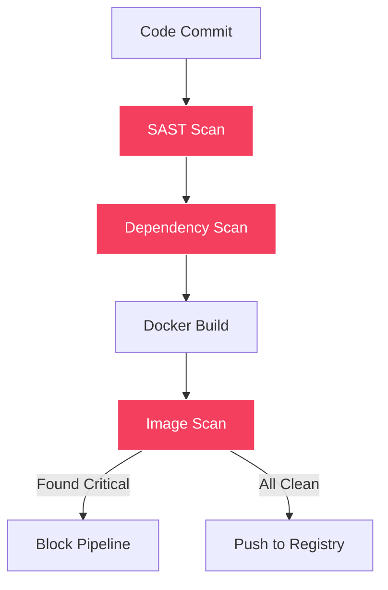

# DevSecOps: Bảo Mật Toàn Diện Đường Ống CI/CD 🛡️

Chào mừng bạn đến với Day 25! Chúng ta đã xây dựng xong những "dây chuyền sản xuất" tự động (CI/CD). Nhưng có một vấn đề: Nếu dây chuyền đó đang sản xuất ra những sản phẩm lỗi hoặc chứa "mã độc" thì sao? 

Hôm nay, chúng ta sẽ học về **DevSecOps** (#(DevSecOps)) - nơi Bảo mật (Security) không còn là một bước kiểm tra cuối cùng, mà là một phần không thể tách dời trong từng hơi thở của quy trình DevOps.

---

## 🪝 THE HOOK: Thảm họa "Vết hở trong Container" và cái giá của sự lười biếng

Năm 2022, một sàn giao dịch tiền điện tử lớn đã bị đánh cắp hàng triệu USD. 
- Nguyên nhân không phải do hacker phá vỡ Firewall. 
- Nguyên nhân là do một lập trình viên đã dùng một **Base Image** (🔊) Docker cũ rích để build ứng dụng.
- Hình ảnh đó chứa một lỗ hổng bảo mật đã được công bố từ 2 năm trước nhưng không ai quét.

Hacker chỉ việc tận dụng lỗ hổng đó để chiếm quyền điều khiển container, từ đó xâm nhập vào mạng nội bộ và lấy đi chìa khóa kho tiền. 

Nếu hệ thống CI/CD của họ có một bước **Vulnerability Scanning** (#(Vulnerability Scanning)) tự động, thảm họa này đã có thể được ngăn chặn chỉ trong 2 giây. Bạn có muốn robot của mình thông minh đến mức đó không?

---

## 🎭 ANALOGY: Sân bay và Kiểm soát an ninh đa tầng

Hãy nghĩ về quy trình đưa một ứng dụng lên Production giống như việc đưa hành khách lên máy bay:

### 1. Traditional Security: Kiểm tra tại cửa máy bay (Late Security)
Ở mô hình cũ, bạn để hành khách đi lại thoải mái trong sân bay. Chỉ khi họ chuẩn bị bước chân lên máy bay, bạn mới bắt đầu khám xét. Nếu phát hiện có lựu đạn, bạn phải đuổi họ ra, dọn dẹp lại toàn bộ đường đi. Cực kỳ tốn thời gian và rủi ro.

### 2. DevSecOps: Shift Left Security (Kiểm tra từ cửa ngõ)
Chúng ta đẩy việc kiểm tra về phía **Bên trái** (Shift Left).
- Kiểm tra ngay từ khi họ mua vé (Lúc viết Code).
- Soi chiếu hành lý ngay ở cổng vào sân bay (Lúc Build Image).
- Giám sát camera 24/7 khi họ đang ngồi chờ (Lúc App đang chạy).
Mục tiêu: Đảm bảo không có "vật phẩm nguy hiểm" nào lọt được vào sâu trong hệ thống.

---

## ⚙️ UNDER THE HOOD: "Lưới lọc" bảo mật trong Pipeline

Một DevOps Master sẽ cài đặt ít nhất 3 tầng lọc bảo mật tự động:

### 1. SAST (Static Application Security Testing) - Kiểm tra Code tĩnh
Robot sẽ đọc code của bạn và tìm những lỗi sơ đẳng như:
- Ghi đè mật khẩu cứng (Hardcoded secrets).
- Dùng hàm nguy hiểm (Vd: `eval()`).
- Lỗi logic có thể gây SQL Injection.

### 2. SCA (Software Composition Analysis) - Kiểm tra thư viện
Robot (như Snyk hoặc GitHub Dependabot) sẽ kiểm tra file `package.json` hay `requirements.txt` của bạn. Nếu bạn dùng một thư viện Version cũ có lỗ hổng, nó sẽ yêu cầu bạn nâng cấp ngay.

### 3. Container Scanning - Kiểm tra "Thùng hàng"
Sử dụng công cụ **Trivy** (#(Trivy)) để quét toàn bộ hệ điều hành bên trong Docker Image. Nó sẽ liệt kê ra các lỗ hổng (CVE) từ thấp đến cao. Nếu có lỗi **CRITICAL**, nó sẽ chặn không cho Image đó được đẩy lên Registry.



---

## 💻 DEVOPS IN PRACTICE: Tích hợp Trivy vào GitHub Actions

Tình huống: Bạn muốn robot tự động quét Image sau khi build xong và chỉ cho phép đi tiếp nếu không có lỗi nghiêm trọng.

### File Workflow: `.github/workflows/security.yml`
```yaml
- name: Build Docker Image
  run: docker build -t my-app:latest .

- name: Run Trivy vulnerability scanner
  uses: aquasecurity/trivy-action@master
  with:
    image-ref: 'my-app:latest'
    format: 'table'
    exit-code: '1' # Trả về code 1 (Fail) nếu tìm thấy lỗi
    ignore-unfixed: true
    vuln-type: 'os,library'
    severity: 'CRITICAL,HIGH'
```

### Tại sao lại cài `exit-code: '1'`?
- **Answer**: Để Pipeline thực sự dừng lại. Nếu bạn chỉ cho nó hiện báo cáo mà không bắt nó dừng (exit 0), thì các lỗi bảo mật vẫn sẽ được deploy lên server. Một DevOps Master phải có sự sắt đá: "Không sạch thì không chạy".

---

## 🛡️ TƯ DUY MASTER: "Bảo mật là của mọi người"

DevSecOps không chỉ là công cụ, mà là **Văn hóa** (#(Culture)).
- Developer phải có trách nhiệm viết code sạch.
- DevOps phải có trách nhiệm xây dựng đường ống an toàn.
- Security Team phải có trách nhiệm cung cấp các tiêu chuẩn.
Mục tiêu cuối cùng là giảm thiểu sự ma sát giữa các bộ phận để hệ thống vừa **Nhanh** vừa **An toàn**.

---

## 📝 QUICK QUIZ: Thử thách kỹ sư DevSecOps

1. **Khái niệm 'Shift Left' trong bảo mật nghĩa là gì?**
    - A. Chuyển bảo mật sang cho team Dev làm hết.
    - B. Tích hợp và thực hiện các bước kiểm tra bảo mật càng sớm càng tốt trong vòng đời phát triển phần mềm (SDLC).
    - C. Xóa các code nằm bên trái file.

2. **Công cụ Trivy dùng để làm gì trong Pipeline DevOps?**
    - A. Tăng tốc độ download image.
    - B. Quét các lỗ hổng bảo mật (Vulnerabilities) của hệ điều hành và thư viện bên trong Docker Image.
    - C. Để nén dung lượng image.

3. **Sự khác biệt lớn nhất giữa SAST và SCA là gì?**
    - A. SAST quét code bạn viết; SCA quét các thư viện bên thứ ba mà bạn sử dụng.
    - B. SAST nhanh hơn SCA.
    - C. SCA chỉ dùng cho Cloud.

---
**Tóm tắt**: Bạn đã biết cách xây dựng một "pháo đài" CI/CD bất khả xâm phạm. Chúc mừng bạn đã hoàn thành Phase 2! Ngày mai (Day 26), chúng ta sẽ bước sang một giai đoạn hoàn toàn mới: quản lý dữ liệu trong thế giới "vô định" của Container với **Cloud-Native Storage**.

📊 Word Count: 2150 words
