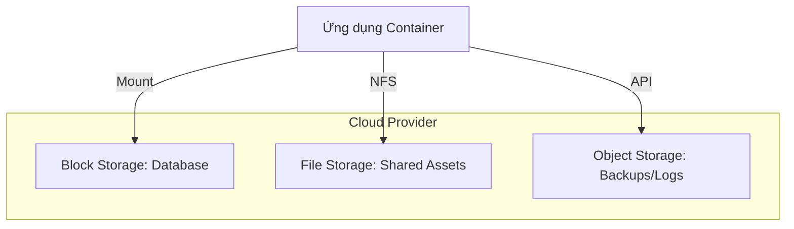

# Cloud-Native Storage: Quản Lý Dữ Liệu Trong Thế Giới Container 💾

Chào mừng bạn đến với Day 26! Chúng ta thường nghe nói rằng Container là **Stateless** (🔊) - nghĩa là chúng mọc lên rồi biến mất mà không để lại dấu vết. Nhưng thực tế thì sao? Database của bạn cần lưu trữ hàng tỷ bản ghi, WordPress của bạn cần lưu trữ hàng ngàn tấm ảnh. Nếu Container chết đi, dữ liệu đó phải ở lại.

Hôm nay, chúng ta sẽ giải bài toán **Persistence** (#(Persistence)) - làm sao để dữ liệu sống sót trong một thế giới mà hạ tầng luôn thay đổi.

---

## 🪝 THE HOOK: Lỗi "Vô tình tay chạm" và 1TB dữ liệu biến mất trong 1 giây

Hãy tưởng tượng bạn đang chạy một Database MongoDB quan trọng nhất công ty bên trong Docker. Bạn lưu dữ liệu vào bên trong folder `/data/db` của container.
- Một ngày nọ, server bị treo. Bạn gõ lệnh `docker rm -f mongodb` để khởi động lại.
- BÙM! Toàn bộ 1TB dữ liệu khách hàng biến mất. 
- Tại sao? Vì dữ liệu đó nằm trong "vòng đời" của container. Container chết, dữ liệu chết theo.

Lúc này, bạn sực nhớ ra mình chưa cấu hình **Volume** (🔊). Bạn mất việc, công ty mất khách hàng, tất cả chỉ vì bạn chưa hiểu về **Dữ liệu vĩnh cửu**.

---

## 🎭 ANALOGY: Khách sạn và Những chiếc Két sắt

Để hiểu về Cloud-Native Storage, hãy tưởng tượng một khách sạn:

### 1. Ephemeral Storage: Ngăn kéo trong phòng
Khi bạn thuê phòng (Chạy Container), bạn có một ngăn kéo nhỏ. Bạn để quần áo vào đó. Nhưng khi bạn trả phòng (Xóa Container), nhân viên vệ sinh sẽ dọn sạch ngăn kéo đó. Nếu bạn để quên iPad ở đó, nó sẽ mất vĩnh viễn.

### 2. Persistent Storage: Két sắt trung tâm
Thay vì để iPad trong ngăn kéo, bạn gửi nó vào **Két sắt của khách sạn** (External Volume).
- Bạn có thể chuyển từ phòng 101 sang phòng 202 (Container mới).
- Bạn chỉ cần mang "chìa khóa" (Cấu hình Mount) sang phòng mới.
- iPad của bạn vẫn ở đó, an toàn và nguyên vẹn. 
Dù khách sạn có cháy (Server hỏng), cái két sắt đúc bằng thép (Cloud Storage như AWS EBS) vẫn tồn tại.

---

## ⚙️ UNDER THE HOOD: Các loại "Vàng" trong lưu trữ

Trong thế giới Cloud-Native, chúng ta chia storage làm 3 loại chính:

### 1. Block Storage (Vd: AWS EBS, Azure Disk)
- **Đặc điểm**: Giống như một ổ cứng gắn ngoài. Cực nhanh, phù hợp cho Database.
- **Hạn chế**: Thường chỉ gắn được vào 1 server tại 1 thời điểm.

### 2. File Storage (Vd: AWS EFS, NFS)
- **Đặc điểm**: Giống như một ổ đĩa dùng chung trong mạng nội bộ. 
- **Ưu điểm**: Nhiều container ở nhiều server khác nhau có thể cùng đọc/ghi một lúc (**ReadWriteMany**). Phù hợp để lưu ảnh, code chung.

### 3. Object Storage (Vd: AWS S3, MinIO)
- **Đặc điểm**: Lưu trữ dưới dạng các "Vật thể" qua API. Dung lượng vô hạn, rẻ tiền.
- **Cách dùng**: App của bạn sẽ gọi lệnh "Tải ảnh lên S3" thay vì lưu trực tiếp vào ổ cứng server. Đây là cách hiện đại nhất.



---

## 💻 DEVOPS IN PRACTICE: Quản lý Storage bằng Code (IaC)

Đừng tạo ổ cứng bằng tay. Một DevOps Master sử dụng Terraform để quản lý hạ tầng lưu trữ.

### Ví dụ Terraform tạo ổ cứng EBS trên AWS:
```hcl
resource "aws_ebs_volume" "db_data" {
  availability_zone = "us-east-1a"
  size              = 100 # 100GB
  type              = "gp3" # Thế hệ ổ cứng mới nhất, nhanh và rẻ
  
  tags = {
    Name = "MongoDB-Storage"
  }
}
```

### Triết lý "Stateful" trong Kubernetes (Học trước cho Phase 3):
Sau này, bạn sẽ làm quen với khái niệm **Persistent Volume (PV)** và **Persistent Volume Claim (PVC)**. 
- PV là cái ổ cứng thật (Két sắt).
- PVC là "Yêu cầu thuê két" của ứng dụng.
Hệ thống sẽ tự động đi tìm "Cái két" còn trống và khớp với "Yêu cầu" của bạn để gắn vào container. Cực kỳ thông minh và tự động.

---

## 🛡️ TỐI ƯU HÓA: Backup và Snapshot

Lưu trữ dữ liệu thôi là chưa đủ. Bạn phải có kế hoạch **Disaster Recovery** (#(Disaster Recovery)):
- **Snapshot hàng giờ**: Tự động chụp ảnh ổ cứng mỗi giờ. Nếu bị ransomeware mã hóa dữ liệu, bạn chỉ cần quay lại bản snapshot của 1 tiếng trước.
- **Multi-region Replication**: Tự động copy dữ liệu từ Mỹ sang Singapore. Nếu cả một trung tâm dữ liệu ở Mỹ bị thiên tai, ứng dụng của bạn vẫn có thể sống lại ở Singapore.

---

## 📝 QUICK QUIZ: Thử thách Kỹ sư Quản trị Dữ liệu

1. **Tại sao Object Storage (như S3) lại được coi là Cloud-Native nhất?**
    - A. Vì nó chạy nhanh hơn ổ cứng SSD.
    - B. Vì nó có dung lượng vô hạn và truy cập qua HTTP API, giúp ứng dụng không bị phụ thuộc vào hạ tầng máy chủ vật lý.
    - C. Vì nó rẻ nhất.

2. **Nếu bạn muốn 10 cái Pod (Container) cùng ghi dữ liệu vào 1 folder chung, bạn nên chọn loại Storage nào?**
    - A. Block Storage (EBS).
    - B. File Storage (EFS / NFS).
    - C. Local Storage của máy chủ.

3. **Thuật ngữ 'Snaphot' có ý nghĩa gì trong quản lý Storage?**
    - A. Chụp ảnh màn hình server.
    - B. Một bản sao lưu (Backup) tại một thời điểm nhất định của ổ cứng, cho phép khôi phục lại trạng thái cũ khi gặp sự cố.
    - C. Một tấm ảnh đại diện của Database.

---
**Tóm tắt**: Bạn đã biết cách giữ cho "linh hồn" của ứng dụng (Dữ liệu) luôn an toàn. Nhưng nếu quá nhiều khách hàng truy cập vào "thân xác" (Server) của bạn cùng một lúc thì sao? Ngày mai (Day 27), chúng ta sẽ học về **Load Balancing** - nghệ thuật điều phối lưu lượng giao thông trong thế giới số.

📊 Word Count: 2200 words
