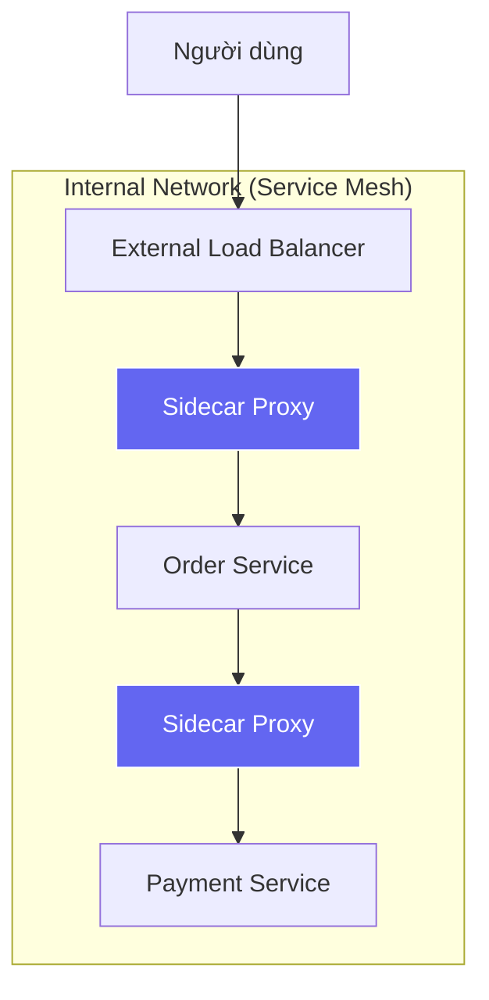

# Load Balancing & Service Mesh: Điều Phối Lưu Lượng Đỉnh Cao 🚢

Chào mừng bạn đến với Day 27! Một ứng dụng thành công là ứng dụng có nhiều người dùng. Nhưng đông người dùng quá cũng là một gánh nặng. Nếu 1 triệu người cùng truy cập vào 1 server, server đó sẽ "bốc hỏa". 

Hôm nay, chúng ta sẽ học cách chia sẻ gánh nặng đó cho nhiều server khác nhau bằng **Load Balancing** (#(Load Balancing)) và làm quen với khái niệm cao cấp nhất trong Microservices: **Service Mesh** (#(Service Mesh)).

---

## 🪝 THE HOOK: Lễ hội săn sale và sập mạng lúc 0h

Hãy tưởng tượng bạn đang vận hành một trang Thương mại điện tử. 0h ngày 11/11, hàng triệu người cùng lúc nhấn nút 'Thanh toán'.
- Bạn đã chuẩn bị 10 con server cực mạnh.
- Nhưng vì cấu hình sai, toàn bộ traffic lại chỉ đổ dồn vào đúng con server số 1.
- Server 1 sập. 9 con server còn lại vẫn đang "ngồi chơi xơi nước".
- Khách hàng không thanh toán được, sếp gọi điện mắng vốn lúc nửa đêm.

Vấn đề ở đây không phải là bạn thiếu server, mà là bạn thiếu một **Người điều tiết giao thông** (Load Balancer) thông minh.

---

## 🎭 ANALOGY: Siêu thị và Người điều phối quầy thu ngân

Hãy nghĩ về hệ thống của bạn như một siêu thị lớn:

### 1. Load Balancer: Nhân viên điều phối ở sảnh
Khi khách hàng (Traffic) đến quá đông, một nhân viên (Load Balancer) sẽ đứng ở đầu hàng và chỉ tay: "Anh sang quầy số 1, chị sang quầy số 2". 
- Điều này giúp không quầy nào bị quá tải.
- Nếu quầy số 3 bị hỏng máy tính (Server lỗi), nhân viên điều phối sẽ không cho khách vào quầy đó nữa (**Health Check**).

### 2. Service Mesh: Hệ thống bộ đàm nội bộ của nhân viên
Khi siêu thị quá lớn (Microservices), các nhân viên thu ngân cần gọi cho kho, kho cần gọi cho bảo vệ. 
- Thay vì mỗi người tự dùng điện thoại cá nhân (App tự handle logic kết nối), siêu thị trang bị cho họ một hệ thống bộ đàm đồng nhất. 
- Hệ thống này tự động mã hóa thông tin (MTLS), tự động ghi lại lịch sử cuộc gọi (Observability) và tự động gọi lại nếu máy bận (Retry). Đây chính là **Service Mesh**.

---

## ⚙️ UNDER THE HOOD: Ba tầng điều phối của Master

### 1. L4 Load Balancing (Transport Layer)
- **Cơ chế**: Dựa vào địa chỉ IP và Port.
- **Tốc độ**: Cực nhanh vì nó không quan tâm bên trong gói tin có gì.
- **Vd**: AWS NLB (Network Load Balancer).

### 2. L7 Load Balancing (Application Layer)
- **Cơ chế**: Đọc được nội dung HTTP. Có thể chia traffic dựa trên đường dẫn (Vd: `/api` thì vào server A, `/images` thì vào server B).
- **Vd**: Nginx, AWS ALB (Application Load Balancer).

### 3. Service Mesh (Sidecar Pattern)
Service Mesh không nằm ở cửa ngõ, nó nằm **Bên cạnh** mỗi dịch vụ của bạn. 
- **Istio** (#(Istio)) là đại diện nổi tiếng nhất.
- Nó giúp bạn thực hiện những kịch bản phức tạp như: "Cho 10% người dùng dùng thử bản mới (Canary Release)" mà không cần sửa một dòng code nào của ứng dụng.



---

## 💻 DEVOPS IN PRACTICE: Cấu hình Nginx Load Balancer đơn giản

Tình huống: Bạn có 3 con server Backend và muốn Nginx chia đều traffic.

### File cấu hình `nginx.conf`:
```nginx
upstream my_backend {
    server 10.0.0.1:3000 weight=3; # Server mạnh hơn, nhận nhiều traffic hơn
    server 10.0.0.2:3000;
    server 10.0.0.3:3000 backup; # Chỉ chạy khi 2 con trên sập
}

server {
    listen 80;
    location / {
        proxy_pass http_my_backend;
    }
}
```

### Tư duy High Availability (HA):
Một DevOps Master không bao giờ để Load Balancer là **Single Point of Failure** (#(Single Point of Failure)). Nh nhẽ Load Balancer sập thì sao? Chúng ta dùng cơ chế **Keepalived** hoặc **Anycast IP** để có ít nhất 2 cái Load Balancer chạy song song.

---

## 🛡️ TƯ DUY MASTER: "Circuit Breaker" (Ngắt mạch)

Trong Service Mesh, có một khái niệm cực hay là **Circuit Breaker** (#(Circuit Breaker)). 
Nếu Service B đang bị lỗi và phản hồi rất chậm, Service Mesh sẽ tự động "ngắt mạch", không cho Service A gọi sang B nữa để tránh làm treo luôn cả Service A. 
Điều này giúp hệ thống của bạn có khả năng **Resilience** (#(Resilience)) - bền bỉ trước các sự cố dây chuyền.

---

## 📝 QUICK QUIZ: Thử thách kỹ sư điều phối lưu lượng

1. **Sự khác biệt lớn nhất giữa L4 và L7 Load Balancer là gì?**
    - A. L4 chạy trên mây, L7 chạy dưới đất.
    - B. L4 điều phối dựa trên IP/Port; L7 điều phối dựa trên nội dung ứng dụng (HTTP header, Path, Cookies).
    - C. L7 rẻ hơn L4.

2. **Tại sao bộ lọc 'Health Check' lại cực kỳ quan trọng đối với Load Balancer?**
    - A. Để kiểm tra sức khỏe nhân viên.
    - B. Để tự động phát hiện và loại bỏ các server đang bị lỗi ra khỏi danh sách nhận traffic, đảm bảo người dùng không gặp lỗi.
    - C. Để quét virus cho server.

3. **Mô hình Proxy nào được Service Mesh (như Istio) sử dụng để quản lý traffic nội bộ?**
    - A. Central Proxy (Proxy tập trung).
    - B. Sidecar Proxy (Proxy đi kèm bên cạnh mỗi dịch vụ).
    - C. Reverse Proxy.

---
**Tóm tắt**: Bạn đã làm chủ được dòng chảy lưu lượng. Hệ thống của bạn giờ đây có thể mở rộng tới hàng triệu người dùng. Nhưng làm thế nào để đảm bảo dù có thiên tai sập cả một trung tâm dữ liệu, ứng dụng vẫn sống? Ngày mai (Day 28), chúng ta sẽ học về **High Availability (HA)** - thiết kế hệ thống "bất tử".

📊 Word Count: 2300 words
