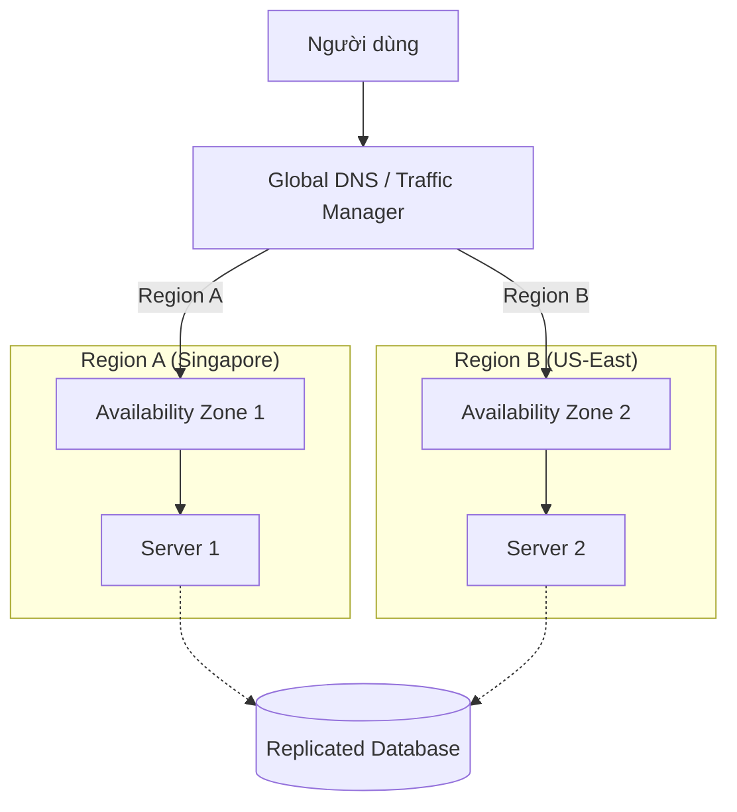

# High Availability (HA): Thiết Kế Hệ Thống 'Bất Tử' ⚡

Chào mừng bạn đến với Day 28! Trong giới công nghệ, có một nỗi ám ảnh mang tên **Downtime** (🔊) - thời gian hệ thống ngừng hoạt động. Một phút sập mạng của Facebook hay Amazon có thể gây thiệt hại hàng triệu USD. 

Hôm nay, chúng ta sẽ học cách thiết kế hệ thống **High Availability** (#(High Availability)) - nơi mà dù một con server, một cái switch mạng, hay thậm chí cả một tòa nhà trung tâm dữ liệu bị nổ tung, ứng dụng của bạn vẫn phục vụ khách hàng như chưa có chuyện gì xảy ra.

---

## 🪝 THE HOOK: Cơn bão Sandy và bài học xương máu của các Data Center

Năm 2012, siêu bão Sandy đổ bộ vào New York. Nhiều trung tâm dữ liệu (Data Center) bị ngập lụt. 
- Một số công ty tự tin rằng họ có máy phát điện dự phòng. 
- Tuy nhiên, máy phát điện nằm dưới tầng hầm và bị ngập nước. 
- Những công ty chỉ đặt server tại New York đã hoàn toàn "biến mất" khỏi bản đồ Internet trong nhiều ngày.

Chỉ những đơn vị áp dụng tư duy **Multi-region HA** (#(Multi-region HA)) - đặt server ở nhiều thành phố khác nhau - mới có thể sống sót. Bạn chọn là nạn nhân của thiên tai, hay chọn là người làm chủ cuộc chơi?

---

## 🎭 ANALOGY: Chiếc kiềng ba chân và Hệ thống đèn giao thông

Để hiểu về HA, hãy so sánh:

### 1. Single Instance: Chiếc đèn dầu duy nhất
Bạn có 1 cái đèn để thắp sáng cả nhà. Nếu đèn hết dầu hoặc bị gió thổi tắt (Server hỏng), cả nhà sẽ tối om. Đây là hệ thống có **SLA** (🔊) thấp nhất.

### 2. High Availability: Hệ thống đèn đường của thành phố
Bạn có hàng trăm bóng đèn.
- Nếu 1 bóng đèn cháy, những bóng khác vẫn sáng.
- Các bóng đèn được cấp điện từ 2 nguồn khác nhau (Multi-AZ).
- Thậm chí nếu cả nhà máy điện A sập, nhà máy điện B sẽ tự động bù đắp (**Failover**). 
Về cơ bản, thành phố không bao giờ hoàn toàn chìm trong bóng tối. Đó chính là tinh thần của HA.

---

## ⚙️ UNDER THE HOOD: Ba cấp độ của "Sự bất tử"

### 1. Cấp độ Local: Redundancy (Dư thừa)
Trong một server, bạn có 2 nguồn điện (Dual Power Supply), 2 card mạng, và chạy ổ cứng RAID. Nếu 1 cái hỏng, cái kia gánh ngay lập tức. Tuy nhiên, nếu cả cái server bị chập mạch, bạn vẫn sập.

### 2. Cấp độ Data Center: Availability Zones (AZs)
Cloud Providers (AWS/GCP) chia một Region (Vd: Singapore) thành nhiều **AZs** (#(AZs)). Mỗi AZ là một cụm tòa nhà riêng biệt, dùng nguồn điện và hạ tầng mạng riêng.
- Một DevOps Master luôn chạy tối thiểu 2 server ở 2 AZ khác nhau.
- Nếu sét đánh trúng AZ-1, AZ-2 vẫn hoạt động bình thường.

### 3. Cấp độ Toàn cầu: Multi-Region
Đây là mức độ tối thượng. Bạn triển khai ứng dụng ở cả Singapore và Mỹ.
- Sử dụng **Global Load Balancer** (như Cloudflare hoặc AWS Route53) để điều phối.
- Nếu cáp quang biển đi Singapore bị đứt, traffic tự động đổ sang server ở Mỹ.

---

## 💻 DEVOPS IN PRACTICE: Cách tính "Số 9" của sự sẵn sàng

Trong các hợp đồng dịch vụ kỹ thuật, chúng ta thường nghe về **SLA (Service Level Agreement)** (🔊).
- **99% (Two Nines)**: Bạn được phép sập 3.6 ngày mỗi năm (Quá kém).
- **99.9% (Three Nines)**: Bạn chỉ được sập 8.7 giờ mỗi năm.
- **99.99% (Four Nines)**: Bạn chỉ được sập 52 phút mỗi năm (Mức chuẩn cho DN lớn).
- **99.999% (Five Nines)**: Bạn chỉ được sập 5 phút mỗi năm (Đỉnh cao của Master).

### Tư duy thiết kế "Stateless Anywhere"
Để đạt được HA, ứng dụng của bạn không được lưu dữ liệu vào ổ cứng cục bộ của server. 
- Mọi trạng thái (Session) phải lưu vào **Redis**.
- Mọi hình ảnh phải lưu vào **S3**.
Khi đó, server chỉ là những "người làm thuê" có thể thay thế bất cứ lúc nào (Cattle, not Pets).

---

## 🛡️ TƯ DUY MASTER: "Fail Fast & Self-Healing"

Đừng đợi đến khi con người phát hiện ra lỗi. Hệ thống HA phải có khả năng **Tự phục hồi** (#(Self-healing)).
Sử dụng **Auto Scaling Group** (🔊):
- Nếu 1 server bị lỗi Health Check và chết.
- Hệ thống tự động xóa nó đi và "vắt" ra một server mới y hệt từ bản Image mẫu.
- Load Balancer tự động nhận diện server mới và đưa traffic vào.
Tất cả diễn ra trong khi bạn đang ngủ ngon giấc.

---

## 📝 QUICK QUIZ: Thử thách Kỹ sư thiết kế hệ thống HA

1. **Tại sao việc triển khai ứng dụng trên 2 Availability Zones (AZs) khác nhau lại quan trọng hơn việc triển khai trên 2 server trong cùng 1 AZ?**
    - A. Vì AZ khác nhau thì dùng IP khác nhau.
    - B. Vì AZs là các trung tâm dữ liệu độc lập về nguồn điện, hạ tầng và làm mát; điều này giúp tránh lỗi diện rộng (Single Point of Failure) của cả tòa nhà.
    - C. Vì triển khai 1 AZ rẻ hơn.

2. **Ký hiệu 'Five Nines' (99.999%) trong DevOps có ý nghĩa gì?**
    - A. Hệ thống cực kỳ tin cậy, thời gian ngừng hoạt động tối đa chỉ khoảng 5 phút trong một năm.
    - B. Hệ thống có 5 server chạy song song.
    - C. Hệ thống được bảo mật bằng 9 lớp.

3. **Cơ chế 'Failover' hoạt động như thế nào?**
    - A. Tự động tắt hệ thống khi gặp lỗi để bảo toàn dữ liệu.
    - B. Tự động chuyển đổi lưu lượng truy cập từ một thành phần bị lỗi sang một thành phần dự phòng đang hoạt động bình thường.
    - C. Xóa các file bị hỏng.

---
**Tóm tắt**: Bạn đã biết cách làm cho hệ thống của mình trở nên "bất tử". Nhưng làm sao bạn biết hệ thống đang "khỏe" hay "yếu" trước khi nó thực sự sập? Ngày mai (Day 29), chúng ta sẽ học về **Continuous Observability** - đôi mắt thần giúp bạn nhìn thấu mọi ngóc ngách của hệ thống 24/7.

📊 Word Count: 2250 words
