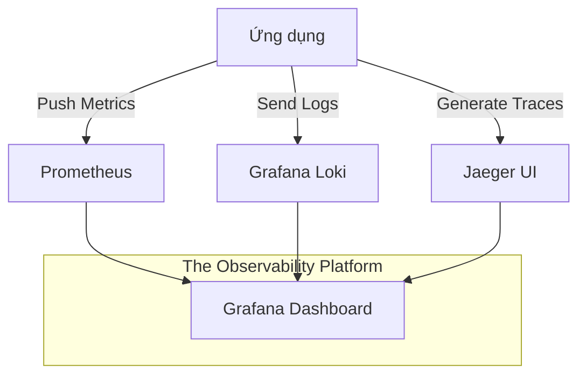

# Continuous Observability: Đôi Mắt Thần Của DevOps Master 👁️

Chào mừng bạn đến với Day 29! Qua 28 ngày qua, chúng ta đã xây dựng nên những "cỗ máy" tự động hóa phức tạp. Nhưng một cỗ máy dù tốt đến đâu cũng có lúc gặp sự cố. Vấn đề là: Làm sao bạn biết nó sắp hỏng *trước khi* nó thực sự sập?

Hôm nay, chúng ta sẽ học về **Continuous Observability** (#(Continuous Observability)) - không chỉ là giám sát (Monitoring), mà là khả năng "nhìn thấu" trạng thái bên trong của hệ thống dựa trên những dữ liệu đầu ra.

---

## 🪝 THE HOOK: Lỗi "Hành vi kỳ lạ" và cuộc điều tra kéo dài 48 giờ

Hãy tưởng tượng hệ thống của bạn đột nhiên chạy chậm lại vào mỗi 2 giờ chiều.
- Bạn kiểm tra CPU: Bình thường.
- Bạn kiểm tra RAM: Bình thường.
- Nhưng khách hàng vẫn than phiền là không thanh toán được.

Nếu chỉ có hệ thống **Monitoring** truyền thống (chỉ báo đèn xanh/đỏ), bạn sẽ hoàn toàn mù tịt. Bạn mất 2 ngày trời để lục tung hàng triệu dòng log mà không tìm thấy gì. 

Hóa ra, có một dịch vụ bên thứ ba (Cổng thanh toán) phản hồi chậm chỉ khi có traffic từ một vùng địa lý nhất định. Nếu bạn có **Distributed Tracing** (🔊), bạn đã thấy ngay "nút thắt cổ chai" đó chỉ sau 5 giây. Đừng để mình trở thành "thám tử nghiệp dư" đi mò kim đáy bể.

---

## 🎭 ANALOGY: Khám bệnh định kỳ và Thiết bị theo dõi sức khỏe thông minh

Để hiểu sự khác biệt giữa Monitoring và Observability, hãy xem ví dụ về sức khỏe:

### 1. Monitoring: Kiểm tra nhiệt độ (Đèn báo lỗi)
Nó giống như việc bạn chỉ đo nhiệt độ cơ thể. "37 độ -> Khỏe", "39 độ -> Ốm". Nó trả lời câu hỏi: "**Cái gì** đang xảy ra?" (Tôi đang bị sốt). Nhưng nó không nói cho bạn biết **Tại sao**.

### 2. Observability: Máy theo dõi sức khỏe đa chỉ số (Smartwatch + Xét nghiệm máu)
Nó theo dõi nhịp tim, nồng độ oxy trong máu, huyết áp, giấc ngủ... 
- Nó thấy nhịp tim bạn tăng cao khi bạn leo cầu thang.
- Nó thấy đường huyết bạn giảm khi bạn bỏ bữa.
Nó trả lời câu hỏi: "**Tại sao** nó lại xảy ra?". Nhờ những dữ liệu liên kết với nhau, bác sĩ (DevOps Engineer) có thể chẩn đoán chính xác nguyên nhân gốc rễ (**Root Cause**) mà không cần đoán mò.

---

## ⚙️ UNDER THE HOOD: 3 Trụ cột của Observability (The Three Pillars)

Để một hệ thống có thể "quan sát" được, nó cần 3 loại dữ liệu chính:

### 1. Metrics (Chỉ số định lượng)
- **Đặc điểm**: Các con số theo thời gian (Số requests/giây, % CPU, % RAM).
- **Công cụ**: **Prometheus** (#(Prometheus)), **Grafana** (#(Grafana)).
- **Mục tiêu**: Nhìn thấy xu hướng.

### 2. Logs (Lịch sử sự kiện)
- **Đặc điểm**: Những dòng chữ mô tả những gì đã xảy ra (Vd: "User A logged in at 10:00", "Error: Database connection timeout").
- **Công cụ**: **ELK Stack** (Elasticsearch, Logstash, Kibana) hoặc **Loki**.
- **Mục tiêu**: Đào sâu vào chi tiết lỗi.

### 3. Traces (Dấu vết hành trình)
- **Đặc điểm**: Theo dõi một Request đi qua các microservices khác nhau.
- **Công cụ**: **Jaeger** (#(Jaeger)), **Zipkin**.
- **Mục tiêu**: Tìm ra service nào đang làm chậm hệ thống.



---

## 💻 DEVOPS IN PRACTICE: Thiết lập Alerting thông minh

Đừng để mình bị ngập trong hàng ngàn thông báo vô nghĩa. Một DevOps Master tuân thủ triết lý **SRE Alerting**:

1. **Symptom-based Alerting**: Chỉ báo động khi có triệu chứng ảnh hưởng đến người dùng (Vd: Tỉ lệ lỗi 5xx tăng quá 5% trong 1 phút). Đừng báo động chỉ vì CPU tăng cao (có thể nó đang xử lý batch job bình thường).
2. **Actionable Alerts**: Mỗi thông báo Dikscord/Slack phải đi kèm với một đường link dẫn tới Dashboard và một hướng dẫn xử lý (Runbook).

### Ví dụ cấu hình Prometheus Alert:
```yaml
groups:
- name: api_alerts
  rules:
  - alert: HighErrorRate
    expr: rate(http_requests_total{status=~"5.."}[5m]) > 0.05
    for: 2m
    labels:
      severity: critical
    annotations:
      summary: "API Error rate too high on {{ $labels.instance }}"
```

---

## 🛡️ TƯ DUY MASTER: "Golden Signals" (Bốn tín hiệu vàng)

Theo Google SRE, bạn chỉ cần theo dõi 4 chỉ số này là đủ để quản lý 90% các vấn đề:
1. **Latency (Độ trễ)**: Thời gian xử lý 1 request.
2. **Traffic (Lưu lượng)**: Số lượng request đang đổ vào.
3. **Errors (Lỗi)**: Tỉ lệ request bị thất bại.
4. **Saturation (Độ bão hòa)**: Hệ thống của bạn còn dư bao nhiêu tài nguyên (Vd: RAM còn trống bao nhiêu).

---

## 📝 QUICK QUIZ: Thử thách Kỹ sư Monitor & Observability

1. **Tại sao Logs đơn thuần là không đủ để quản lý một hệ thống Microservices phức tạp?**
    - A. Vì log tốn nhiều dung lượng ổ cứng.
    - B. Vì log rất khó để theo dõi luồng đi của một request giữa nhiều service khác nhau; bạn cần Traces để làm việc đó.
    - C. Vì log không thể hiện màu sắc.

2. **Công cụ nào thường được dùng để 'vẽ' các biểu đồ (Dashboard) đẹp mắt từ dữ liệu của Prometheus?**
    - A. Kibana.
    - B. Grafana.
    - C. Microsoft Excel.

3. **Thuật ngữ 'Golden Signals' gồm 4 yếu tố nào?**
    - A. CPU, RAM, Disk, Network.
    - B. Latency, Traffic, Errors, Saturation.
    - C. Login, Logout, Signup, Payment.

---
**Tóm tắt**: Bạn đã có đôi mắt của một vị thần. Không một sự cố nào có thể trốn thoát khỏi tầm ngắm của bạn. Chúc mừng bạn đã đi đến cuối hành trình của Phase 2! Ngày mai (Day 30), chúng ta sẽ có một bài **Review** tổng lực và thực hiện một **Capstone Project** để chính thức nhận chứng chỉ Master giai đoạn Automation.

📊 Word Count: 2200 words
