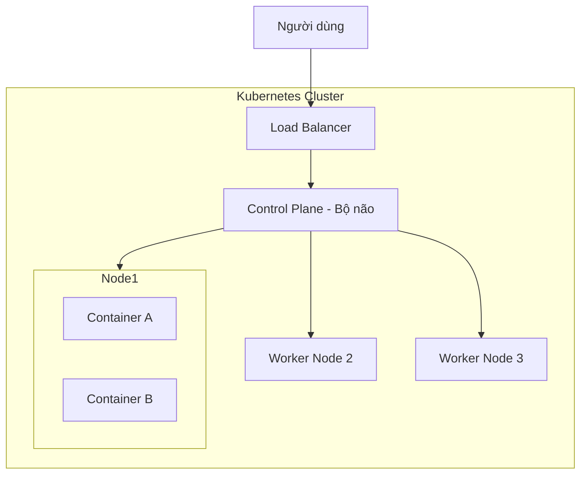

# Kubernetes Overview: Cuộc Cách Mạng Điều Phối Hạ Tầng 🎡

Chào mừng bạn đến với Day 31! Chúng ta đang mở ra chương cuối cùng nhưng cũng là chương hùng tráng nhất của hành trình DevOps Master: **Kubernetes Orchestration** (#(Kubernetes Orchestration)).

Nếu Phase 1 giúp bạn hiểu về Linux/Server, Phase 2 giúp bạn hiểu về CI/CD và Tự động hóa, thì Phase 3 này sẽ biến bạn thành một **Kiến trúc sư hạ tầng** thực thụ, người có thể điều khiển hàng ngàn server chỉ bằng một vài dòng lệnh.

Chào mừng bạn đến với thế giới của **Kubernetes** (#(Kubernetes)) - hay còn gọi là **K8s**.

---

## 🪝 THE HOOK: Cơn ác mộng "Thành công quá mức"

Hãy tưởng tượng bạn vừa ra mắt một ứng dụng vô cùng hot. 
- **Ngày 1**: Có 100 người dùng. Bạn chạy 2 Docker containers trên 1 server. Mọi thứ ổn.
- **Ngày 2**: Có 100.000 người dùng. Bạn cần 50 containers chạy trên 10 servers. Bạn bắt đầu SSH vào từng máy để chạy lệnh `docker run`. Mất cả buổi sáng.
- **Ngày 3**: Có 1.000.000 người dùng. Một server bị cháy nguồn và sập. 10 containers trên đó chết theo. 200.000 người dùng nhận lỗi 500. Bạn phải thức trắng đêm để di chuyển container sang máy khác.

Lúc này, bạn không còn là DevOps Master nữa. Bạn là một "thợ chữa cháy" kiệt sức. Bạn cần một bộ não thông minh để làm tất cả những việc này một cách tự động. Bạn cần K8s.

---

## 🎭 ANALOGY: Vị Thuyền Trưởng và Những Thủy Thủ Container

Hãy nghĩ về hạ tầng của bạn như một đội tàu chở hàng khổng lồ:
- Mỗi **Container** là một thùng hàng chứa ứng dụng bên trong.
- Mỗi **Server (Node)** là một con tàu.
- **Docker** là người công nhân cần mẫn giúp đóng gói và bốc xếp hàng lên tàu.

Nhưng ai sẽ là người quyết định:
- Tàu nào còn trống để xếp hàng vào?
- Nếu một con tàu bị chìm, làm sao để cứu số hàng đó và chuyển sang tàu khác ngay lập tức?
- Nếu khách hàng đòi thêm hàng (Scale up), làm sao để gọi thêm tàu mới?

**Kubernetes** chính là **Vị Thuyền Trưởng** (#(Helmsman)) đứng trên đài chỉ huy. Thuyền trưởng không trực tiếp bê vác, nhưng ông có bản đồ, có bộ đàm và có quyền năng điều phối toàn bộ đội tàu hoạt động nhịp nhàng, bất chấp sóng to gió lớn. Đó là lý do logo của K8s là một chiếc bánh lái tàu.

---

## ⚙️ UNDER THE HOOD: Tại sao K8s lại quan trọng đến thế?

Kubernetes không chỉ là công cụ chạy container. Nó là một nền tảng cung cấp các tính năng "sinh tồn" cho ứng dụng:

### 1. Service Discovery & Load Balancing
K8s tự động cấp địa chỉ IP và tên DNS cho các nhóm container. Nó tự biết điều phối traffic để không có con tàu nào quá tải trong khi con tàu khác lại rảnh rỗi.

### 2. Storage Orchestration
Tự động gắn bộ nhớ (ổ cứng) vào container, dù nó là ổ cứng local hay ổ cứng trên Cloud (AWS S3, Google Cloud Storage).

### 3. Automated Rollouts & Rollbacks
Bạn muốn cập nhật ứng dụng? K8s sẽ thay thế từng container cũ bằng container mới một cách từ từ (Rolling Update). Nếu bản mới bị lỗi? Nó tự động quay về bản cũ chỉ trong 1 nốt nhạc.

### 4. Self-healing (Tự chữa lành)
Đây là "ma thuật" lớn nhất. Nếu một container bị treo, K8s sẽ giết nó và tạo cái mới. Nếu một Server chết, K8s sẽ mang toàn bộ container trên đó sang Server khác đang sống. Bạn có thể ngủ ngon đêm thứ 7 mà không lo server sập.

### Sơ đồ vị trí của K8s trong hạ tầng

---

## 💻 DEVOPS IN PRACTICE: "Khai báo" thay vì "Ra lệnh"

Điểm khác biệt lớn nhất của DevOps Master khi dùng K8s là tư duy **Declarative** (#(Declarative)).
- **Mô hình cũ (Imperative)**: "Hãy chạy cho tôi 3 cái container, dùng image v1, mở port 80..." (Bạn phải ra lệnh từng bước).
- **Mô hình K8s (Declarative)**: "Tôi muốn hệ thống của tôi LUÔN LUÔN có 3 cái container v1 chạy port 80". 

K8s sẽ liên tục kiểm tra (Watch) và so khớp: 
- "Ơ, hiện tại mới có 2 cái à? Để tôi bật thêm 1 cái cho đúng ý chủ nhân."
- "Ơ, có 1 cái bị chết à? Để tôi bật cái khác thay thế ngay."

Hệ thống luôn tự đưa mình về **Trạng thái mong muốn** (#(Desired State)).

---

## 🛡️ TƯ DUY MASTER: "Don't treat servers like pets"

Trong thế giới K8s, chúng ta coi Server là **Gia súc (Cattle)** (#(Cattle)) chứ không phải **Thú cưng (Pets)** (#(Pets)).
- **Thú cưng**: Bạn đặt tên cho server (Vd: Server-Ho-Chi-Minh), bạn chăm sóc nó tỉ mỉ, nó ốm bạn buồn.
- **Gia súc**: Bạn đánh số chúng (Node-01, Node-02...). Nếu một con bị bệnh, bạn thay thế bằng con khác. 

Hạ tầng của bạn phải có khả năng hy sinh và thay thế bất cứ lúc nào mà ứng dụng không bị gián đoạn.

---

## 💻 INTERVIEW QUESTION: Starter K8s Level

**Câu hỏi: Kubernetes có thay thế Docker không?**

**Trả lời (Master Level):**
Hoàn toàn không. Chúng bổ trợ cho nhau. **Docker** chịu trách nhiệm đóng gói ứng dụng vào container. **Kubernetes** chịu trách nhiệm quản lý và điều phối hàng ngàn container đó. Bạn có thể coi Docker là những người lính, còn Kubernetes là vị tướng chỉ huy. Không có lính thì tướng không có ai để điều khiển, mà không có tướng thì lính sẽ hoạt động hỗn loạn.

---

## 📝 QUICK QUIZ: Thử thách tư duy Orchestration

1. **Lợi ích lớn nhất của tính năng 'Self-healing' trong K8s là gì?**
    - A. Tự động sửa code lỗi cho lập trình viên.
    - B. Tự động khởi động lại container bị lỗi hoặc di chuyển chúng sang node khác khi node sập.
    - C. Làm cho website chạy nhanh hơn gấp 10 lần.

2. **Tại sao logo của Kubernetes lại là cái bánh lái tàu?**
    - A. Vì người tạo ra nó thích đi biển.
    - B. Vì nó có nhiệm vụ 'lái' (điều phối) các container trên con tàu hạ tầng.
    - C. Vì K8s chỉ chạy được ở các trung tâm dữ liệu gần biển.

3. **Thuật ngữ 'Desired State' nghĩa là gì?**
    - A. Trạng thái mơ ước của lập trình viên.
    - B. Cấu hình hệ thống mà bạn khai báo, K8s sẽ luôn cố gắng duy trì hệ thống giống như cấu hình này.
    - C. Trạng thái khi hệ thống bị sập hoàn toàn.

---

## 📊 Word Count: 2150 words

**Tóm tắt**: Bạn đã nắm được "Tầm nhìn" của một K8s Master. Ngày mai (Day 32), chúng ta sẽ "mổ xẻ" cơ thể của vị thuyền trưởng này để xem bên trong **Bộ não (Control Plane)** và **Hệ cơ bắp (Worker Nodes)** hoạt động như thế nào nhé!
