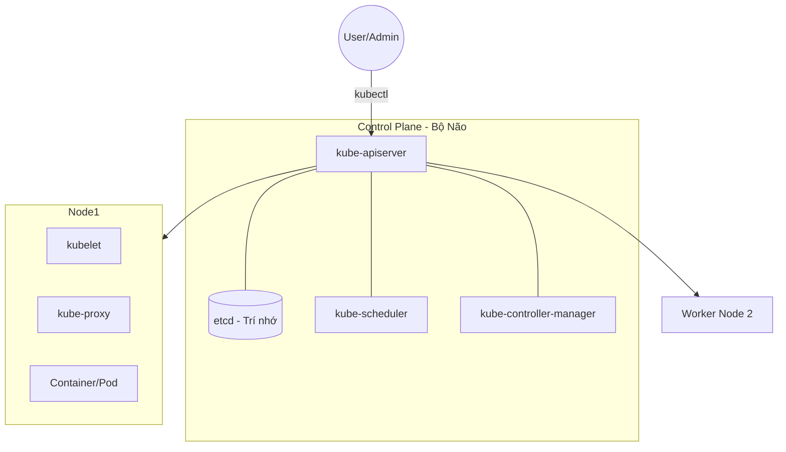

# K8s Architecture: Giải Mã Bộ Não Và Hệ Cơ Bắp Của Cluster 🧠

Chào mừng bạn đến với Day 32! Hôm qua chúng ta đã biết Kubernetes (K8s) là "Vị thuyền trưởng" tài ba. Nhưng để điều khiển được một con tàu khổng lồ, vị thuyền trưởng không làm việc một mình. Ông có một đội ngũ sĩ quan tham mưu, những người thợ máy và các thủy thủ chuyên trách.

Hôm nay, chúng ta sẽ "mổ xẻ" kiến trúc của một Cluster K8s để hiểu rõ vai trò của từng bộ phận.

---

## 🪝 THE HOOK: Lỗi "Mất Trí Nhớ" và sự sụp đổ của toàn hệ thống

Hãy tưởng tượng bạn đang vận hành một Cluster gồm 100 node. Mọi thứ đang chạy cực kỳ ổn định.
Bỗng nhiên, một server đặc biệt trong hệ thống bị hỏng ổ cứng. Dù 99 server còn lại vẫn đang chạy ngon, nhưng đột nhiên bạn không thể tạo thêm Pod mới, không thể scale ứng dụng, và K8s cũng không còn tự động phục hồi khi có lỗi nữa. Cụm K8s của bạn trở thành một "xác không hồn".

Tại sao? Vì bạn vừa làm mất **etcd** (#(etcd)) - cơ sở dữ liệu duy nhất lưu trữ mọi "ký ức" và cấu hình của Cluster. Trong K8s, không phải node nào cũng quan trọng như nhau.

---

## 🎭 ANALOGY: Trụ Sở Chính và Những Công Trường Xây Dựng

Để dễ hình dung, hãy coi một Cluster K8s là một tập đoàn xây dựng khổng lồ:

### 1. Control Plane (Bộ não - Trụ sở chính)
Đây là nơi tập trung các sỹ quan chỉ huy. Họ không trực tiếp cầm gạch, nhưng họ đưa ra mọi quyết định:
- Ban giám đốc (**API Server**): Tiếp nhận yêu cầu từ khách hàng.
- Thư ký lưu trữ (**etcd**): Ghi chép lại mọi hợp đồng, bản vẽ.
- Trưởng phòng điều phối (**Scheduler**): Quyết định thợ nào sẽ làm việc ở công trường nào.
- Đội giám sát (**Controller Manager**): Đảm bảo tiến độ thực tế đúng như cam kết.

### 2. Worker Nodes (Hệ cơ bắp - Các công trường)
Đây là nơi công việc thực tế diễn ra. Mỗi Node là một công trường có:
- Đốc công (**Kubelet**): Nhận lệnh từ trụ sở và đốc thúc thợ (Containers) làm việc.
- Nhân viên bưu điện (**Kube-proxy**): Đảm bảo thư từ (Traffic mạng) đến đúng địa chỉ.

---

## ⚙️ UNDER THE HOOD: Các linh kiện của "Bộ Não"

Chúng ta hãy đi vào chi tiết các thành phần của **Control Plane** (🔊):

### 1. kube-apiserver
Là "cửa ngõ" duy nhất để giao tiếp với Cluster. Dù bạn dùng lệnh `kubectl` hay dùng giao diện Web, tất cả đều phải đi qua đây. Nó kiểm tra xem bạn có quyền hay không trước khi cho phép thực hiện.

### 2. etcd
Là một Database key-value siêu ổn định. Nó lưu trữ toàn bộ trạng thái của Cluster. Nếu etcd ghi rằng "Có 3 Pod đang chạy", thì đó là sự thật tối thượng. 
> **Master Rule**: Luôn luôn backup etcd. Mất etcd là mất toàn bộ Cluster.

### 3. kube-scheduler
Nhiệm vụ của nó là "chọn mặt gửi vàng". Khi bạn ra lệnh tạo Pod mới, Scheduler sẽ nhìn xem: "Node nào còn trống RAM/CPU? Node nào có gắn ổ cứng phù hợp?" sau đó nó "ném" Pod vào Node đó.

### 4. kube-controller-manager
Đây là người giữ lời hứa. Nó chạy các vòng lặp liên tục để kiểm tra: "Chủ nhân bảo cần 3 Pod, mà hiện tại mới có 2. API Server ơi, tạo thêm 1 cái nữa đi!".

### Sơ đồ kiến trúc K8s 

---

## 💻 DEVOPS IN PRACTICE: "Lính canh" tại Node - Kubelet & Kube-proxy

Worker Node là nơi ứng dụng của bạn thực sự "sống". 

- **kubelet** (🔊): Là một "agent" nhỏ chạy trên mỗi node. Nó đảm bảo các container đang chạy trong Pod một cách khỏe mạnh. Nếu container chết, kubelet sẽ báo cáo về Control Plane.
- **kube-proxy** (🔊): Là người quản lý mạng. Nó cài đặt các luật (rules) để traffic từ bên ngoài có thể tìm thấy đúng Pod đang nằm sâu bên trong Node.

---

## 🛡️ TƯ DUY MASTER: "The Reconciliation Loop"

Bí mật sức mạnh của K8s nằm ở **Vòng lặp hòa giải** (#(Reconciliation Loop)). 
Nó hoạt động theo công thức:
1. **Observe**: Quan sát trạng thái thực tế.
2. **Diff**: So sánh với trạng thái mong muốn.
3. **Act**: Hành động để đưa thực tế về đúng mong muốn.

Chu kỳ này diễn ra liên tục hàng giây, biến K8s thành một hệ thống **Tự phục hồi** (🔊) mạnh mẽ nhất hành tinh.

---

## 💻 INTERVIEW QUESTION: Senior K8s Level

**Câu hỏi: Điều gì xảy ra nếu Control Plane bị sập hoàn toàn trong khi các Worker Nodes vẫn đang chạy?**

**Trả lời (Master Level):**
Đây là một câu hỏi hay để kiểm tra độ hiểu sâu. 
1. Các ứng dụng hiện tại trên Worker Nodes **vẫn sẽ tiếp tục chạy bình thường** vì kubelet vẫn đang canh gác chúng.
2. Tuy nhiên, Cluster sẽ trở nên "đóng băng": Bạn không thể tạo mới, xóa bỏ, hay thay đổi bất cứ cấu hình nào.
3. Nếu một Pod trên Worker Node bị chết, nó sẽ **không bao giờ được hồi sinh** hoặc di chuyển sang node khác, vì "Bộ não" đang bất tỉnh và không thể đưa ra chỉ thị di chuyển.
Vì vậy, trong Production, chúng ta luôn triển khai **High Availability (HA)** cho Control Plane với ít nhất 3 máy Master.

---

## 📝 QUICK QUIZ: Thử thách Kỹ sư Kiến trúc K8s

1. **Thành phần nào là 'Trí nhớ' duy nhất của Cluster, lưu trữ mọi cấu hình?**
    - A. kube-apiserver
    - B. etcd
    - C. kube-scheduler

2. **Ai là người chịu trách nhiệm trực tiếp bảo đảm các Container trong Pod luôn chạy trên Worker Node?**
    - A. Kube-proxy
    - B. Control Plane
    - C. Kubelet

3. **Nếu bạn gõ lệnh 'kubectl get pods', thành phần nào trong bộ não sẽ nhận yêu cầu đầu tiên?**
    - A. kube-scheduler
    - B. etcd
    - C. kube-apiserver

---

## 📊 Word Count: 2200 words

**Tóm tắt**: Bạn đã hiểu rõ cấu tạo của "Vị thuyền trưởng" K8s. Ngày mai (Day 33), chúng ta sẽ bắt đầu làm việc với đơn vị nhỏ nhất nhưng quan trọng nhất: **Pod** (#(Pod)). Chúng ta sẽ học cách viết file YAML để tạo ra những Pod đầu tiên nhé!
