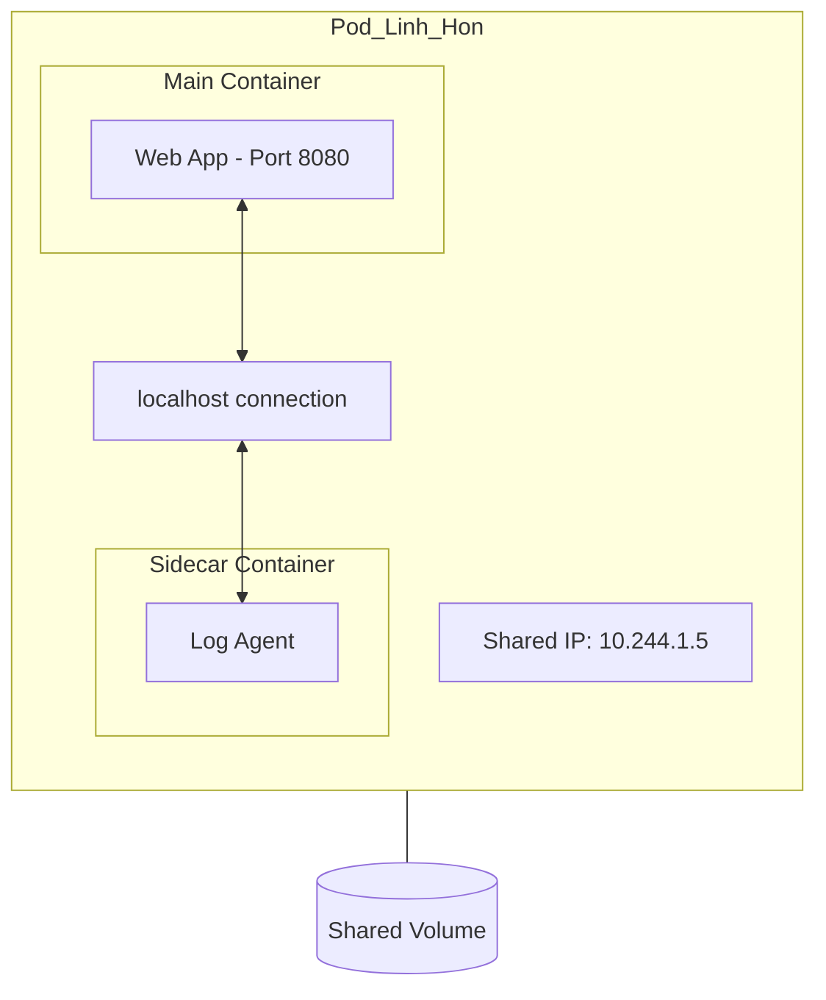

# Pods: Đơn Vị Nguyên Tử Và Trái Tim Của Kubernetes 🧬

Chào mừng bạn đến với Day 33! 

Chúng ta đã hiểu về bộ não (Master) và cơ bắp (Worker). Hôm nay, chúng ta sẽ làm quen với các "Tế bào" tạo nên sự sống cho Cluster: **Pod** (#(Pod)). 

Dù bạn có chạy một ứng dụng microservice khổng lồ hay một website nhỏ, đơn vị nhỏ nhất mà Kubernetes quản lý và điều phối luôn là Pod, chứ không phải Container đơn lẻ. Tại sao lại như vậy? Hãy cùng khám phá.

---

## 🪝 THE HOOK: Lỗi "Hàng xóm xa lạ" và sự cố kết nối nội bộ

Hãy tưởng tượng bạn có một ứng dụng Web (NodeJS) và một Log Collector (Crawl log từ file). 
- Nếu bạn chạy chúng là 2 Docker container riêng biệt, làm sao cái Log Collector tìm được file của NodeJS? 
- Bạn phải mount chung một volume, cấu hình mạng network chung... cực kỳ rắc rối. 
- Một ngày nọ, server bị quá tải, Docker "đẩy" NodeJS sang máy chủ A nhưng Log Collector lại vẫn nằm ở máy chủ B. Thế là Log Collector "thất nghiệp" vì không thấy file đâu nữa.

Trong Kubernetes, chúng ta không bao giờ để những "người bạn thân" này bị chia cắt. Chúng ta gói chúng vào chung một cái Pod.

---

## 🎭 ANALOGY: Hạt Đậu Và Những Viên Đậu Bên Trong

Hãy nghĩ về **Pod** như một **Hạt đậu (Pea pod)**:
- Bên trong hạt đậu có thể có 1 hoặc nhiều **Viên đậu (Containers)**.
- Các viên đậu này dùng chung cái vỏ hạt đậu: dùng chung địa chỉ nhà (IP), dùng chung không khí (Network), và dùng chung tài nguyên (Volumes).
- Bạn không bao giờ mang theo vác từng viên đậu riêng lẻ. Bạn luôn bê vác cả cái Hạt đậu.

Dù Hạt đậu có được chuyển đi đâu (sang server nào), những viên đậu bên trong vẫn luôn ở cạnh nhau, nói chuyện với nhau qua `localhost` một cách thân thiết.

---

## ⚙️ UNDER THE HOOD: Pod thực chất là gì?

Pod là một lớp bọc (wrapper) bên trên một hoặc nhiều container. 

### 1. Một Pod, Một IP
Mỗi Pod khi sinh ra sẽ được cấp một địa chỉ IP duy nhất trong Cluster. Tất cả các container bên trong Pod đó sẽ dùng chung IP này. Điều này giúp giải quyết bài toán xung đột port của Docker truyền thống.

### 2. Sidecar Pattern (🔊)
Đây là sức mạnh thực sự của Pod. Bạn có thể chạy một "Container chính" (App) và một "Container phụ" (Sidecar) đi kèm để hỗ trợ (Vd: ghi log, proxy bảo mật, monitor). Chúng sống cùng nhau, chết cùng nhau.

### Sơ đồ cấu tạo một Pod



---

## 💻 DEVOPS IN PRACTICE: Viết file YAML đầu tiên

Một DevOps Master làm việc với K8s thông qua các file định nghĩa YAML (**Manifests**).

### File `pod.yaml`:
```yaml
apiVersion: v1
kind: Pod
metadata:
  name: nginx-pod
  labels:
    app: web
    env: prod
spec:
  containers:
  - name: my-nginx
    image: nginx:1.14.2
    ports:
    - containerPort: 80
```

### Các trường quan trọng:
- **apiVersion**: Phiên bản API của K8s.
- **kind**: Loại tài nguyên (Pod, Service, Deployment...).
- **metadata**: Tên và các **Labels** (🔊) để đánh dấu Pod.
- **spec**: Mô tả chi tiết mong muốn (image gì, port bao nhiêu).

---

## 🛡️ TƯ DUY MASTER: "Pod Lifecycle" (Vòng đời của Pod)

Pod không bao giờ được sửa chữa (Repair). Nếu cấu hình thay đổi, Pod cũ bị xóa và Pod mới được tạo ra. Pod có các trạng thái:
- **Pending**: Đang đợi Scheduler tìm máy chủ phù hợp.
- **Running**: Đang chạy ngon lành.
- **Succeeded**: Đã hoàn thành nhiệm vụ và kết thúc (Thường dùng cho các Job tính toán).
- **Failed**: Container bên trong bị crash.
- **Unknown**: Mất kết nối với Node.

---

## 💻 INTERVIEW QUESTION: Middle K8s Level

**Câu hỏi: Tại sao Kubernetes lại thiết kế ra Pod thay vì dùng container trực tiếp như Docker?**

**Trả lời (Master Level):**
Có 3 lý do chính:
1. **Quản lý nhóm**: Pod cho phép chạy các container phụ trợ (Sidecars) dùng chung tài nguyên mạng và ổ cứng, giúp việc phối hợp giữa các vi dịch vụ trong cùng một đơn vị trở nên cực kỳ đơn giản.
2. **Trừu tượng hóa mạng**: Mỗi Pod có 1 IP giúp tránh xung đột port khi chạy nhiều instace của cùng một ứng dụng trên 1 node.
3. **Mở rộng tương lai**: Thiết kế này giúp K8s có thể hỗ trợ các loại runtime khác ngoài Docker (Vd: containerd, CRI-O) mà không cần thay đổi cách quản lý đơn vị chạy.

---

## 📝 QUICK QUIZ: Thử thách Kỹ sư Vận hành Pod

1. **Các container bên trong cùng một Pod giao tiếp với nhau qua địa chỉ nào?**
    - A. IP của Node.
    - B. localhost.
    - C. Tên DNS của Google.

2. **Nếu một Pod có trạng thái 'Pending' quá lâu, nguyên nhân thường gặp là gì?**
    - A. App bị lỗi code.
    - B. Scheduler chưa tìm được Node nào có đủ tài nguyên (RAM/CPU) để chứa Pod.
    - C. Image Docker quá nặng.

3. **Thành phần nào dùng để 'đánh dấu' và phân loại các Pod trong Cluster?**
    - A. apiVersion
    - B. Labels
    - C. containerPort

---

## 📊 Word Count: 2100 words

**Tóm tắt**: Bạn đã làm chủ được "tế bào" Pod. Ngày mai (Day 34), chúng ta sẽ nâng tầm lên cấp độ "Đội quân" - **Deployments** (#(Deployments)). Chúng ta sẽ học cách scale từ 1 Pod lên 1000 Pod và cập nhật code hàng loạt mà người dùng không hề hay biết!
