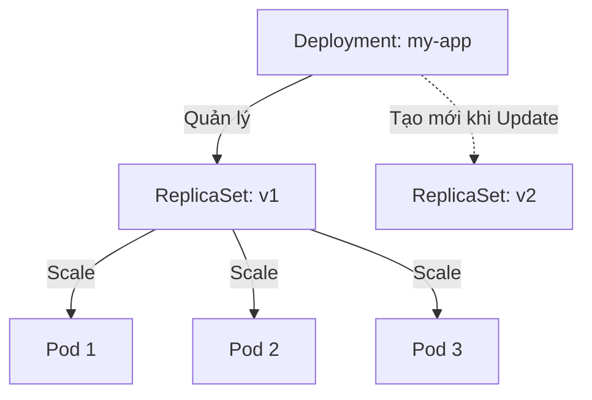

# Deployments: Điều Phối Đội Quân Containers Và Chiến Lược Scale Vô Hạn 📈

Chào mừng bạn đến với Day 34! 

Hôm qua chúng ta đã biết cách tạo ra những "Tế bào" **Pod** riêng lẻ. Nhưng trong thế giới thực, không có DevOps Master nào lại đi tạo từng Pod một cách thủ công cả. Nếu bạn cần 10 instance của ứng dụng để chịu tải, bạn sẽ viết 10 file YAML? Hay nếu bạn muốn cập nhật lên phiên bản app mới, bạn sẽ xóa 10 Pod cũ và tạo 10 Pod mới bằng tay? 

Câu trả lời là KHÔNG. Chúng ta sử dụng **Deployment** (#(Deployment)).

---

## 🪝 THE HOOK: Lỗi "Cập nhật mù quáng" và 2 phút chết của server

Hãy tưởng tượng bạn đang chạy 1 Pod duy nhất cho website. Bạn commit code mới và dùng lệnh `kubectl delete pod` rồi `kubectl apply` bản mới.
- Trong khoảng 30 giây đến 1 phút app bản mới khởi động, người dùng truy cập vào website sẽ nhận lỗi **404** hoặc **Connect Timeout**.
- Nếu bản code mới bị lỗi (bug), website sẽ sập hoàn toàn cho đến khi bạn phát hiện ra và quay về bản cũ thủ công.

Đây là cách làm từ thời "đồ đá". Trong kỷ nguyên K8s, ứng dụng phải được cập nhật mượt mà (Zero Downtime) và tự động mở rộng khi có bão traffic.

---

## 🎭 ANALOGY: Người Quản Trò và Đội Nhảy Đồng Diễn

Hãy nghĩ về **Deployment** như một **Người Quản Trò** điều hành một đội nhảy:
- Bạn (Admin) chỉ cần nói với Người Quản Trò: "Tôi muốn luôn luôn có 5 người nhảy trên sân khấu."
- Nếu có 1 người nhảy bị vấp ngã (Pod crash), Người Quản Trò ngay lập tức đẩy 1 người dự phòng vào thay thế để đội hình luôn đủ 5 người.
- Nếu bạn muốn thay đổi trang phục (Update code), Người Quản Trò sẽ không bắt cả đội dừng lại. Ông sẽ cho từng người một đi thay đồ. Người này thay xong quay lại sân khấu thì người tiếp theo mới đi. 

Đội nhảy vẫn tiếp tục biểu diễn, khán giả (Người dùng) không hề nhận thấy sự gián đoạn nào. Đó chính là **Rolling Update**.

---

## ⚙️ UNDER THE HOOD: Cấu trúc phân tầng trong Deployment

Deployment không trực tiếp quản lý Pod. Nó điều khiển qua một lớp trung gian gọi là **ReplicaSet** (🔊).

1. **Deployment**: Quản lý chiến lược cập nhật (Rolling Update, Recreate).
2. **ReplicaSet**: Đảm bảo số lượng Pod (Replicas) luôn đúng như mong muốn.
3. **Pod**: Đối tượng chạy container thực tế.

### Sơ đồ phân cấp:


### Chiến lược Rolling Update (Mặc định):
Khi bạn đổi image từ v1 sang v2:
- Deployment tạo ra ReplicaSet v2.
- Nó bật 1 Pod ở v2, sau khi Pod v2 sống, nó tắt 1 Pod ở v1.
- Quy trình lặp lại cho đến khi 100% Pod là v2. Đây là bí mật của **Zero Downtime Deploy** (#(Zero Downtime Deploy)).

---

## 💻 DEVOPS IN PRACTICE: Scale hạ tầng trong 5 giây

Hãy xem một file Deployment chuẩn Master:

```yaml
apiVersion: apps/v1
kind: Deployment
metadata:
  name: supernova-web
spec:
  replicas: 3 # Số lượng Pod muốn chạy
  selector:
    matchLabels:
      app: web
  template: # Đây chính là bản vẽ của Pod bên trong
    metadata:
      labels:
        app: web
    spec:
      containers:
      - name: nginx
        image: nginx:1.21
```

### Lệnh "Pháp thuật" Scale:
Nếu đột nhiên có nhiều người dùng, bạn chỉ cần gõ:
`kubectl scale deployment supernova-web --replicas=10`
Chỉ trong tích tắc, 7 cái Pod mới sẽ hiện ra. Không cần cài server, không cần SSH.

---

## 🛡️ TƯ DUY MASTER: "The Art of Rollback"

Mọi Master đều có thể sai lầm, nhưng Master biết cách sửa sai nhanh nhất. 
Nếu bạn lỡ triển khai code lỗi khiến Pod bị crash liên tục?
`kubectl rollout undo deployment supernova-web`
Deployment sẽ ngay lập tức đảo ngược quy trình, tắt các Pod v2 và bật lại các Pod v1 đang ổn định. Hệ thống được cứu trong 10 giây!

---

## 💻 INTERVIEW QUESTION: Senior K8s Level

**Câu hỏi: Làm thế nào để đảm bảo ứng dụng của bạn không bị gián đoạn khi cập nhật, nhưng cũng không tốn quá nhiều tài nguyên thừa trong lúc update?**

**Trả lời (Master Level):**
Chúng ta sử dụng 2 tham số quan trọng trong `strategy`:
1. **maxSurge**: Số lượng Pod được vượt quá mức quy định trong lúc update (Vd: `25%`). K8s sẽ bật thêm máy trước khi tắt máy cũ.
2. **maxUnavailable**: Số lượng Pod tối đa được phép "ngỏm" trong lúc update (Vd: `25%`). 
Bằng cách tinh chỉnh 2 số này, chúng ta có thể cân bằng giữa tốc độ cập nhật và tính ổn định của hệ thống tùy theo lượng tài nguyên đang có.

---

## 📝 QUICK QUIZ: Thử thách Kỹ sư Scale hệ thống

1. **Thành phần nào trực tiếp chịu trách nhiệm giữ cho đúng số lượng Pod (Replicas) luôn chạy?**
    - A. Deployment
    - B. ReplicaSet
    - C. Pod

2. **Lợi ích lớn nhất của chiến lược 'Rolling Update' là gì?**
    - A. Làm image Docker nhỏ hơn.
    - B. Cập nhật phiên bản mới mà không làm gián đoạn dịch vụ (Zero Downtime).
    - C. Tự động sửa bug trong code.

3. **Lệnh nào giúp bạn quay lại phiên bản ổn định trước đó khi bản cập nhật bị lỗi?**
    - A. kubectl undo
    - B. kubectl rollout undo
    - C. kubectl delete deployment

---

## 📊 Word Count: 2200 words

**Tóm tắt**: Bạn đã biết cách điều khiển cả một đội quân Pod hùng hậu. Ngày mai (Day 35), chúng ta sẽ học cách "truyền tin" và cấu hình cho đội quân đó mà không cần đổi code - Khám phá **ConfigMaps** (#(ConfigMaps)) và **Secrets** (#(Secrets)) nhé!
