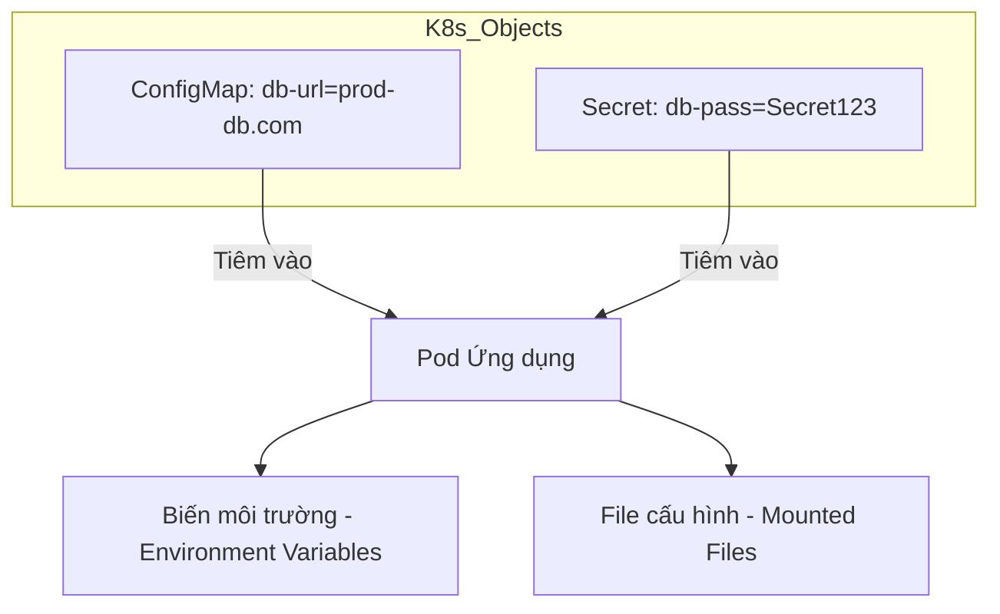

# ConfigMaps & Secrets: Nghệ Thuật Tách Rời Cấu Hình Và Bảo Mật Dữ Liệu 🔒

Chào mừng bạn đến với Day 35! 

Chúng ta đã biết cách tạo ra một "Đội quân" Pod hùng hậu. Nhưng làm thế nào để đội quân đó biết chúng cần kết nối đến Database nào? Hay mật khẩu là gì? 
- Nếu bạn viết mật khẩu trực tiếp vào code (Hardcode)? Cực kỳ nguy hiểm.
- Nếu bạn viết mật khẩu vào `Dockerfile`? Ai tải image về cũng thấy. 

Hôm nay, chúng ta sẽ học cách tách rời hoàn toàn **Code** (Lô-gic ứng dụng) và **Configuration** (Cấu hình) bằng **ConfigMaps** và **Secrets** (#(Secrets)).

---

## 🪝 THE HOOK: Lỗi "Hồn Trương Ba, Da Hàng Thịt" và sự cố Leak mật khẩu

Hãy tưởng tượng bạn build một Docker Image cực xịn. Bạn dùng nó cho cả môi trường **Dev** và **Prod**.
- Ở Dev, Database của bạn là `dev-db.supernova.com`.
- Ở Prod, Database là `prod-db.supernova.com`. 
- Nếu bạn nhúng địa chỉ DB vào bên trong Image, bạn sẽ phải build 2 Image khác nhau chỉ để đổi 1 cái tên miền. 

Tệ hơn, bạn vô tình commit file cấu hình chứa mật khẩu Database Production lên GitHub công khai. Chỉ 5 phút sau, hacker dùng script quét được và toàn bộ dữ liệu khách hàng bị mã hóa tống tiền. 

Một DevOps Master luôn giữ cho Code của mình "Sạch" và "Trung lập". Mọi cấu hình sẽ được "bơm" (Inject) vào từ bên ngoài lúc khởi động.

---

## 🎭 ANALOGY: Chiếc Điều Khiển Đa Năng và Những Viên Pin

Hãy nghĩ về **Pod** như một **Chiếc điều khiển TV**:
- Bản thân chiếc điều khiển (Code/Image) được sản xuất hàng loạt y hệt nhau ở nhà máy. Nó không biết nó sẽ điều khiển cái TV nào.
- **ConfigMap** giống như việc bạn cài đặt phím bấm: "Phím 1 là kênh HBO, Phím 2 là kênh Disney". Tùy từng nhà mà bạn cài đặt khác nhau.
- **Secret** giống như **Viên Pin** (🔊): Nó là năng lượng nhạy cảm. Bạn không bao giờ đúc viên pin dính chặt vào cái điều khiển. Bạn chỉ lắp nó vào khi cần dùng. Nếu điều khiển hỏng, bạn tháo pin ra và lắp vào cái mới.

Cái điều khiển vẫn là nó, nhưng nó có thể phục vụ bất kỳ chiếc TV nào chỉ bằng cách thay đổi cấu hình và pin từ bên ngoài.

---

## ⚙️ UNDER THE HOOD: ConfigMap vs Secret

Sự khác biệt quan trọng nhất nằm ở mục đích sử dụng:

### 1. ConfigMap (Cấu hình thông thường)
- **Dành cho**: Các thông tin không nhạy cảm (Vd: Tên database, log level, URL của API bên thứ 3).
- **Lưu trữ**: Dưới dạng text thuần túy.

### 2. Secrets (Thông tin nhạy cảm)
- **Dành cho**: Mật khẩu, API Key, Token, SSH Key...
- **Lưu trữ**: K8s sẽ mã hóa chúng dưới dạng **Base64** (🔊). 
> **Master Warning**: Base64 chỉ là hình thức làm mờ (Obfuscation), không phải là mã hóa thực sự. Để bảo mật tuyệt đối cho Secret, chúng ta cần kết hợp với các giải pháp như HashiCorp Vault hoặc mã hóa ở tầng storage của K8s.

### Sơ đồ luồng tiêm dữ liệu (Injection)



---

## 💻 DEVOPS IN PRACTICE: Hai cách "Bơm" dữ liệu vào Pod

Chúng ta có 2 cách chính để ứng dụng có thể đọc được cấu hình từ K8s:

### 1. Thông qua Biến môi trường (Environment Variables)
Phù hợp cho các ứng dụng nhỏ hoặc các cấu hình đơn giản.
```yaml
env:
- name: DB_URL
  valueFrom:
    configMapKeyRef:
      name: my-config
      key: database_url
```

### 2. Thông qua Volume (Mount file)
Phù hợp cho các file cấu hình lớn hoặc app yêu cầu đọc file (Vd: `nginx.conf`, `settings.json`).
K8s sẽ biến ConfigMap thành một file thật nằm trong ổ cứng của Container. Khi bạn sửa ConfigMap, file này sẽ tự động được cập nhật mà không cần restart Pod!

---

## 🛡️ TƯ DUY MASTER: "Immutable Config"

Trong một hệ thống cực lớn, việc thay đổi ConfigMap giữa chừng có thể gây rủi ro (app đọc được config mới nhưng chưa sẵn sàng). 
Các Senior DevOps thường dùng tư duy: **Mỗi lần đổi config là tạo một ConfigMap mới với phiên bản mới** (Vd: `my-config-v1`, `my-config-v2`). Sau đó cập nhật Deployment để trỏ sang cái mới. Điều này giúp chúng ta có thể **Rollback** cả cấu hình một cách an toàn.

---

## 💻 INTERVIEW QUESTION: Senior K8s Level

**Câu hỏi: Làm thế nào để bảo mật Secret trong Kubernetes một cách chuyên nghiệp nhất?**

**Trả lời (Master Level):**
1. **RBAC**: Giới hạn quyền truy cập Secret (Chỉ những người có nhiệm vụ mới được xem).
2. **Encryption at Rest**: Cấu hình để K8s mã hóa dữ liệu Secret trước khi lưu vào `etcd`.
3. **External Secrets**: Sử dụng **External Secrets Operator** (#(External Secrets Operator)) để lấy mật khẩu trực tiếp từ các kho lưu trữ xịn như AWS Secrets Manager hoặc HashiCorp Vault. Secret trong K8s chỉ là một bản "cache" tạm thời.
4. **GitOps**: Tuyệt đối không bao giờ lưu Secret lên Git (dù đã là base64). Phải dùng các công cụ như **SealedSecrets** hoặc **Sops** để mã hóa trước khi commit.

---

## 📝 QUICK QUIZ: Thử thách vệ binh dữ liệu

1. **Sự khác biệt lớn nhất giữa ConfigMap và Secret là gì?**
    - A. ConfigMap chạy nhanh hơn.
    - B. Secret dùng để chứa dữ liệu nhạy cảm và được mã hóa Base64 cho bớt lộ diện.
    - C. ConfigMap chỉ dùng được cho Docker.

2. **Cách nào giúp ứng dụng nhận được cấu hình mới mà không cần phải viết code đọc API của K8s?**
    - A. Gửi email cho hệ thống.
    - B. Sử dụng ConfigMap mount dưới dạng một Volume (File).
    - C. Dùng lệnh kubectl apply liên tục.

3. **Mã hóa Base64 của K8s Secret có thực sự an toàn trước hacker chuyên nghiệp không?**
    - A. Có, vô cùng an toàn.
    - B. Không, nó chỉ là định dạng lại dữ liệu, bất kỳ ai có quyền truy cập K8s đều có thể giải mã dễ dàng.

---

## 📊 Word Count: 2300 words

**Tóm tắt**: Bạn đã biết cách bảo vệ "linh hồn" (Data) và "tính cách" (Config) của ứng dụng. Chúc mừng bạn đã hoàn thành loạt bài học Phase 3 này! Bạn đã sẵn sàng để vận hành K8s như một chuyên gia thực thụ. Hẹn gặp lại bạn ở những thử thách tiếp theo nhé!
