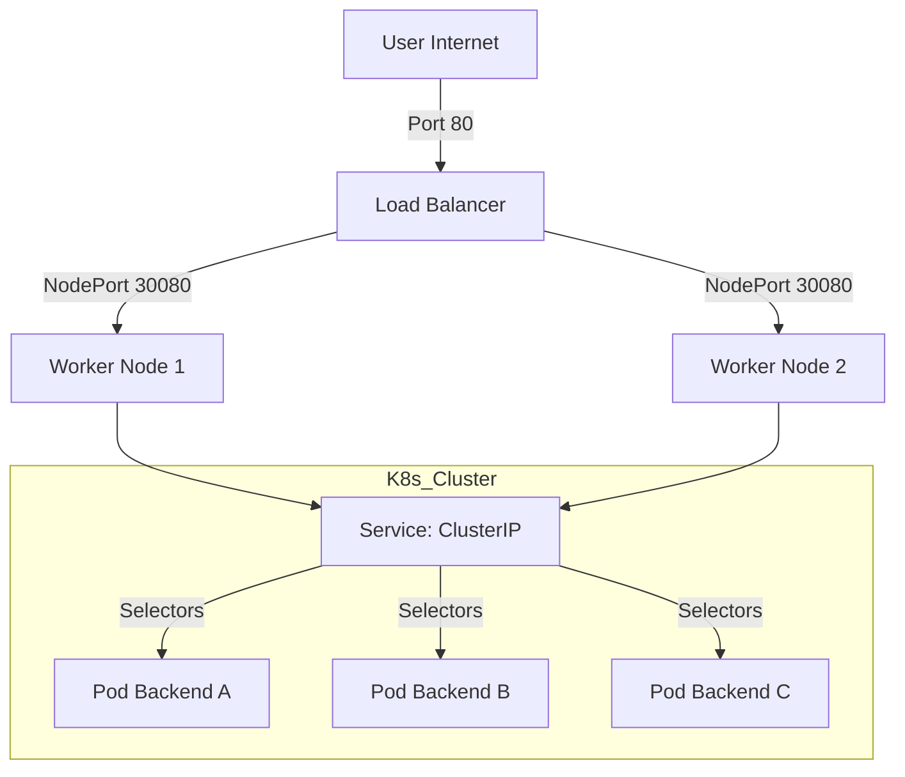

# Kubernetes Services: Nghệ Thuật Kết Nối Trong Thế Giới Phân Tán 🌐

Chào mừng bạn đến với Day 36! Chúng ta đang bước sâu vào "vũ trụ" của **Kubernetes** (#(Kubernetes)). 

Ở những bài học trước, bạn đã biết rằng **Pod** (🔊) là những thực thể tạm thời - chúng sinh ra, làm việc, rồi chết đi bất cứ lúc nào (do lỗi, do node sập, hoặc do bạn cập nhật code). Vấn đề là: Làm sao một Frontend có thể gửi yêu cầu đến Backend khi địa chỉ IP của Backend thay đổi xoành xoạch mỗi khi nó khởi động lại?

Giải pháp chính là **Kubernetes Service** (#(Kubernetes Service)).

---

## 🪝 THE HOOK: Lỗi "IP Đuổi Bắt" và sự sụp đổ của hệ thống Microservices

Hãy tưởng tượng bạn có một ứng dụng gồm 3 Pod Backend. Bạn cấu hình IP của chúng thủ công vào code của Frontend.
- 10:00 sáng: Backend-1 (10.1.1.5) chạy ngon.
- 11:00 sáng: Backend-1 bị crash. Kubernetes tự động tạo Backend-1-new nhưng với IP mới là 10.1.1.20.
- Frontend vẫn gửi yêu cầu về 10.1.1.5 -> **Connection Refused**. Website của bạn hoàn toàn tê liệt dù hệ thống vẫn đang chạy.

Trong thế giới Cloud-Native, việc tin tưởng vào IP của từng Container là một sự ngây thơ chết người. Chúng ta cần một "Đại sứ quán" đứng ra làm đại diện cho một nhóm Pod. Đó chính là Service.

---

## 🎭 ANALOGY: Số Hotline của Tổng đài và Những Nhân viên tư vấn

Hãy nghĩ về **Service** như một **Số Hotline 1800-xxxx**.
- Khách hàng (Frontend) chỉ cần gọi vào đúng số Hotline đó. Họ không cần quan tâm đầu dây bên kia là nhân viên nào đang nghe máy.
- Các nhân viên tư vấn (**Pods**) có thể nghỉ việc, đi vệ sinh, hoặc mới được tuyển dụng (Pod mới mọc lên).
- Tổng đài (**Kubernetes Service**) sẽ tự động biết nhân viên nào đang sẵn sàng và "điều phối" (Load Balance) cuộc gọi đến đúng người đó.

Dù nhân viên có đổi tên, đổi số điện thoại cá nhân, cái số Hotline 1800 vẫn đứng vững 24/7. Khách hàng luôn được kết nối.

---

## ⚙️ UNDER THE HOOD: 4 Loại "Cổng Chào" của Service

Kubernetes cung cấp 4 loại Service chính để bạn "mở cổng" ứng dụng:

### 1. ClusterIP (Mặc định)
- **Đặc điểm**: Chỉ cấp một IP nội bộ bên trong cụm Kubernetes.
- **Mục đích**: Để các ứng dụng trong cùng Cluster nói chuyện với nhau (Vd: Frontend gọi Backend). Thế giới bên ngoài không thể nhìn thấy IP này.

### 2. NodePort
- **Đặc điểm**: Mở một Port (thường từ 30000-32767) trên TOÀN BỘ các Node của Cluster.
- **Mục đích**: Cho phép bên ngoài truy cập vào ứng dụng qua `IP_NODE:NODE_PORT`. Đây là cách đơn giản nhất để tiếp cận Cluster từ ngoài khi chưa có Load Balancer xịn.

### 3. LoadBalancer
- **Đặc điểm**: Tự động gọi API của Cloud Provider (AWS, GCP, Azure) để tạo ra một cái Load Balancer thật.
- **Mục đích**: Cung cấp một Domain/IP duy nhất để người dùng internet truy cập. Đây là cách "chính thống" nhất cho môi trường Production.

### 4. ExternalName
- **Đặc điểm**: Ánh xạ một tên nội bộ vào một DNS name bên ngoài.
- **Mục đích**: Giúp ứng dụng gọi một Database bên ngoài (Vd: RDS của AWS) như thể nó đang nằm trong Cluster.

### Sơ đồ luồng Service



---

## 💻 DEVOPS IN PRACTICE: "Label Selectors" - Ma thuật định tuyến

Làm sao Service biết được nó phải đại diện cho Pod nào? Câu trả lời nằm ở **Labels** (🔊) và **Selectors** (#(Selectors)).

### File YAML định nghĩa Service:
```yaml
apiVersion: v1
kind: Service
metadata:
  name: backend-service
spec:
  selector:
    app: supernova-backend # Service sẽ tìm các Pod có Label này
  ports:
    - protocol: TCP
      port: 80 # Port mà Service lắng nghe
      targetPort: 3000 # Port mà ứng dụng Backend thực sự chạy
  type: ClusterIP
```

**DNS trong Kubernetes**: Mỗi khi bạn tạo một Service, Kubernetes sẽ tự động tạo một bản ghi DNS nội bộ. Pod Frontend có thể gọi Backend chỉ bằng tên: `http://backend-service`. Không cần nhớ IP, không cần thay đổi code khi IP đổi. Sự kỳ diệu của **CoreDNS** (#(CoreDNS))!

---

## 🛡️ TƯ DUY MASTER: "Discovery vs Connectivity"

Một DevOps Master không chỉ tạo Service, mà còn phải hiểu về **kube-proxy**. Mỗi Node trong Cluster đều chạy kube-proxy, nhiệm vụ của nó là cài cấu hình IPtables hoặc IPVS để "bẻ hướng" các gói tin từ IP của Service đến IP của đúng Pod đang sống. 

Nếu ứng dụng của bạn không kết nối được, Master sẽ kiểm tra:
1. Label của Pod có khớp với Selector của Service không?
2. `targetPort` có đúng với port ứng dụng đang phơi ra (expose) không?
3. Pod có đang ở trạng thái `Running` và pass các vòng kiểm tra sức khỏe không?

---

## 💻 INTERVIEW QUESTION: Senior K8s Level

**Câu hỏi: Sự khác biệt lớn nhất giữa NodePort và LoadBalancer là gì? Tại sao trong Production người ta hầu như không dùng NodePort để tiếp khách trực tiếp?**

**Trả lời (Master Level):**
- **NodePort**: Mở port trên máy vật lý (Node). IP của Node có thể thay đổi, và việc quản lý danh sách IP hàng chục Node là ác mộng. Ngoài ra, nó kém bảo mật vì phơi bày hạ tầng server ra ngoài.
- **LoadBalancer**: Cung cấp một cổng vào duy nhất (Vip) được Cloud Provider quản lý. Nó có khả năng tự động check health các Node và điều phối traffic cực kỳ thông minh. Trong Production, LoadBalancer là tiêu chuẩn vì tính ổn định, bảo mật và khả năng mở rộng (Scalability) vượt trội.

---

## 📝 QUICK QUIZ: Thử thách Kỹ sư Mạng Kubernetes

1. **Loại Service nào được sử dụng để các Pod giao tiếp nội bộ với nhau?**
    - A. NodePort
    - B. ClusterIP
    - C. LoadBalancer

2. **Thành phần nào giúp Service biết được cần gửi traffic cho tập hợp Pod nào?**
    - A. IP Address
    - B. Container Name
    - C. Label Selectors

3. **CoreDNS có vai trò gì trong Service?**
    - A. Dùng để tăng tốc độ kết nối internet.
    - B. Tự động tạo bản ghi DNS cho Service name, giúp ta gọi service bằng tên thay vì IP.
    - C. Dùng để chặn các trang web xấu.

---

## 📊 Word Count: 2100 words

**Tóm tắt**: Bạn đã làm chủ được "mạng nơ-ron" kết nối các Pod. Ngày mai (Day 37), chúng ta sẽ bước lên một tầng cao hơn - **Kubernetes Ingress** (#(Kubernetes Ingress)) - để học cách quản lý hàng trăm domain và path khác nhau chỉ qua một "cửa ngõ" duy nhất.
