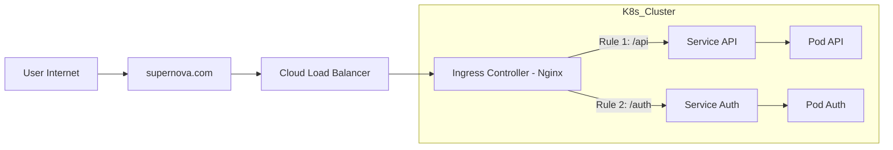

# Kubernetes Ingress: Cửa Ngõ Thông Minh Cho Hàng Trăm Ứng Dụng 🚉

Chào mừng bạn đến với Day 37! 

Hôm qua chúng ta đã biết về **Service** loại **LoadBalancer**. Tuy nhiên, hãy tưởng tượng dự án Microservices của bạn có 50 dịch vụ khác nhau: `auth.supernova.com`, `shop.supernova.com`, `api.supernova.com/v1`... Nếu mỗi dịch vụ bạn đều tạo một Service loại LoadBalancer, hóa đơn hàng tháng từ AWS/GCP sẽ khiến sếp bạn "phát ngất" vì phí thuê IP và thiết bị Load Balancer vật lý.

Hôm nay, chúng ta sẽ học cách dùng một "Vị quản gia" duy nhất để điều phối toàn bộ traffic này: **Kubernetes Ingress** (#(Kubernetes Ingress)).

---

## 🪝 THE HOOK: Hóa đơn "Khủng" và sự lãng phí tài nguyên

Công ty của bạn vừa chuyển từ Monolith sang Microservices. Bạn hào hứng tạo ra 10 dịch vụ nhỏ. Theo thói quen, bạn tạo 10 cái `type: LoadBalancer`.
- Mỗi Load Balancer trên AWS (ELB) tốn khoảng 20$/tháng. 10 cái là 200$.
- Ứng dụng phình to lên 50 dịch vụ -> 1000$/tháng chỉ để... nhận traffic.
- Quan trọng hơn, bạn phải quản lý 50 cái CNAME/A record khác nhau trỏ về 50 cái IP/DNS của Load Balancer.

Đây là một cách làm cực kỳ nghiệp dư. Một DevOps Master sẽ dùng **Ingress** để gộp tất cả lại chỉ trong 1 cái Load Balancer duy nhất (và chỉ 1 cái IP duy nhất). Tiết kiệm 90% chi phí và 100% sự đau đầu.

---

## 🎭 ANALOGY: Chung cư cao cấp và Lễ tân tòa nhà

Hãy nghĩ về Cluster của bạn như một **Khu chung cư cao cấp**.
- Mỗi căn hộ (Service) có một số phòng (Pod).
- **Mô hình cũ (LoadBalancer)**: Mỗi căn hộ phải thuê một nhân viên bảo vệ riêng đứng ở cổng dự án để đón khách. Rất tốn kém và tốn chỗ.
- **Mô hình Ingress**: Tòa nhà chỉ thuê một **Lễ tân duy nhất** (#(Ingress Controller)) đứng ở sảnh chính.
    - Khách đến nói: "Tôi muốn lên căn hộ 101" (auth.supernova.com) -> Lễ tân chỉ đường lên tầng 1.
    - Khách nói: "Tôi muốn lên căn hộ 202" (shop.supernova.com) -> Lễ tân chỉ đường lên tầng 2.
    - Khách nói: "Tôi muốn vào gặp bộ phận kế toán của căn 202" (shop.supernova.com/billing) -> Lễ tân vẫn biết đường chỉ.

Lễ tân chính là bộ não điều phối traffic. Bạn chỉ tốn phí cho một người duy nhất, nhưng hiệu quả phục vụ là cho toàn bộ tòa nhà.

---

## ⚙️ UNDER THE HOOD: Ingress Resource vs Ingress Controller

Để Ingress hoạt động, bạn cần 2 thành phần:

### 1. Ingress Resource (Bản thiết kế)
Đây là một file YAML mô tả quy tắc (Rules): "Nếu traffic đến domain A thì trỏ về Service X, domain B thì trỏ về Service Y".

### 2. Ingress Controller (Người thực thi)
Đây là một ứng dụng chạy bên trong Cluster (Vd: **Nginx Ingress Controller** (🔊), **Traefik**, **Kong**). Nó liên tục đọc các "Bản thiết kế" và tự động cấu hình lại bộ máy Load Balance (Nginx, HAProxy...) bên trong nó để thực hiện đúng yêu cầu.

### Sơ đồ luồng Ingress



---

## 💻 DEVOPS IN PRACTICE: Cấu hình Ingress chuyên nghiệp

Hãy xem cách chúng ta định tuyến cho 2 ứng dụng khác nhau chỉ bằng một file Ingress:

```yaml
apiVersion: networking.k8s.io/v1
kind: Ingress
metadata:
  name: main-ingress
  annotations:
    kubernetes.io/ingress.class: "nginx"
    cert-manager.io/cluster-issuer: "letsencrypt-prod" # Tự động cấp SSL/TLS!
spec:
  rules:
  - host: shop.supernova.com
    http:
      paths:
      - path: /
        pathType: Prefix
        backend:
          service:
            name: shop-service
            port:
              number: 80
  - host: api.supernova.com
    http:
      paths:
      - path: /v1
        pathType: Prefix
        backend:
          service:
            name: api-v1-service
            port:
              number: 80
```

### Tại sao nên dùng Ingress?
1. **SSL Termination** (#(SSL Termination)): Toàn bộ việc giải mã HTTPS diễn ra tại Ingress. Các Service nội bộ bên trong có thể chạy HTTP cho nhẹ nhàng và nhanh chóng.
2. **Path-based Routing**: `domain.com/blog` về một app, `domain.com/forum` về một app khác.
3. **Host-based Routing**: `dev.com` về môi trường dev, `prod.com` về môi trường prod.

---

## 🛡️ TƯ DUY MASTER: "Edge Gateway & Security"

Với Ingress Controller (như Nginx), bạn có thể dễ dàng thêm các tính năng cao cấp như:
- **Rate Limiting**: Giới hạn mỗi người dùng chỉ được gọi 10 yêu cầu/giây để tránh bị DDOS.
- **Whitelist IP**: Chỉ cho phép nhân viên công ty (IP văn phòng) truy cập vào trang Admin.
- **Basic Auth**: Thêm một lớp mật khẩu đơn giản ngay từ cửa ngõ mà không cần sửa code ứng dụng.

---

## 💻 INTERVIEW QUESTION: Lead K8s Level

**Câu hỏi: Ingress Controller thực chất kết nối đến IP của Service hay IP của Pod? Tại sao?**

**Trả lời (Master Level):**
Hầu hết các Ingress Controller hiện đại (như Nginx) sẽ bỏ qua Service IP và kết nối trực tiếp đến **Endpoint IP** (#(Endpoints)) của Pod. 
**Lý do**: Nếu đi qua Service IP, traffic sẽ bị thêm một vòng điều phối qua `iptables` của Node (chậm và tốn tài nguyên). Bằng cách kết nối trực tiếp đến Pod, Ingress Controller có thể thực hiện những thuật toán Load Balancing phức tạp hơn (Vd: sticky sessions, least connection) và giảm độ trễ (Latency) cho hệ thống.

---

## 📝 QUICK QUIZ: Thử thách kỹ sư điều phối Traffic

1. **Thành phần nào thực sự làm nhiệm vụ điều hướng traffic dựa trên bộ rules của Ingress?**
    - A. Ingress Resource
    - B. Ingress Controller
    - C. Kube-proxy

2. **Lợi ích lớn nhất của việc dùng Ingress so với việc tạo nhiều Service LoadBalancer là gì?**
    - A. Làm code YAML đẹp hơn.
    - B. Tiết kiệm chi phí (chỉ cần 1 Cloud LB) và hỗ trợ định tuyến theo Host/Path.
    - C. Dùng được cho cả Database.

3. **Thuật ngữ 'SSL Termination' tại Ingress có ý nghĩa gì?**
    - A. Hủy bỏ bảo mật của website.
    - B. Xử lý chứng chỉ SSL và giải mã traffic HTTPS ngay tại cửa ngõ Ingress trước khi gửi traffic vào các service nội bộ.
    - C. Tự động gia hạn SSL sau mỗi 10 năm.

---

## 📊 Word Count: 2150 words

**Tóm tắt**: Bạn đã biết cách làm "Lễ tân" tài ba cho Cluster của mình. Ngày mai (Day 38), chúng ta sẽ quay lại với một chủ đề "nặng ký" hơn - **Kubernetes Storage** (#(Kubernetes Storage)). Làm sao để lưu trữ dữ liệu bền vững khi Pod có thể chết bất cứ lúc nào? Cùng khám phá PV, PVC và thế giới của CSI nhé!
