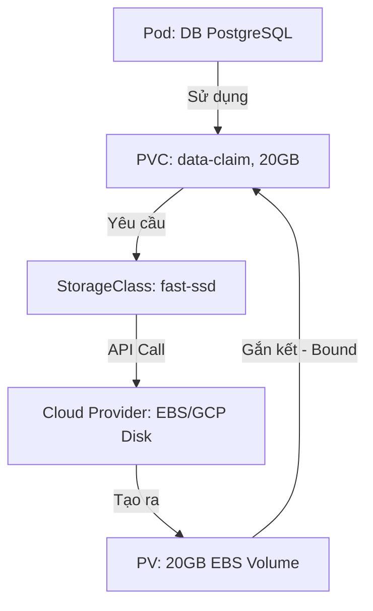

# Kubernetes Storage: Quản Lý Dữ Liệu Trong Thế Giới 'Vô Thường' 💾

Chào mừng bạn đến với Day 38! 

Trong Kubernetes, Pod là những thực thể "sống nay chết mai". Khi một Pod bị xóa hoặc khởi động lại, mọi dữ liệu bạn lưu bên trong Container (vd: log, file upload, database records) sẽ **BIẾN MẤT VĨNH VIỄN**. 

Để giải quyết vấn đề này, chúng ta cần một cơ chế lưu trữ bền vững. Hôm nay, chúng ta sẽ học về "Bộ ba quyền lực": **PV**, **PVC** và **StorageClass** (#(StorageClass)).

---

## 🪝 THE HOOK: Lỗi "Xóa Nhầm Pod, Bay Luôn Database"

Hãy tưởng tượng bạn đang chạy một Database PostgreSQL trên Kubernetes. Bạn quên không cấu hình Persistent Volume.
- 2 giờ sáng, Node bị sập. Kubernetes tự động tạo một Pod PostgreSQL mới để thay thế.
- Bạn thở phào: "May quá, K8s tự phục hồi rồi".
- Nhưng khi mở app lên, bạn phát hiện toàn bộ dữ liệu 2 năm qua... trống trơn. 
- Tại sao? Vì Pod mới sử dụng một không gian ổ cứng hoàn toàn mới và sạch sẽ. Dữ liệu cũ đã nằm lại ở cái Pod cũ đã chết.

Đây là sai lầm sơ đẳng nhất nhưng lại gây thiệt hại lớn nhất. Trong thế giới Container, dữ liệu phải được tách biệt hoàn toàn khỏi vòng đời của Pod.

---

## 🎭 ANALOGY: Khách sạn (Pod) và Những Chiếc Két Sắt (Volume)

Hãy tưởng tượng bạn là một vị khách vào thuê phòng khách sạn (Pod).

1. **Ephemeral Storage**: Bạn để đồ trong ngăn kéo phòng. Khi bạn trả phòng và người khác vào, ngăn kéo sẽ bị dọn sạch. Bạn mất đồ.
2. **Persistent Volume (PV)**: Là những chiếc **Két sắt khổng lồ** nằm ở tầng hầm của khách sạn. Chúng có sẵn ở đó (Static Provisioning) hoặc được đúc mới khi cần (Dynamic Provisioning).
3. **Persistent Volume Claim (PVC)**: Là **Phiếu yêu cầu thuê két**.
    - Bạn ghi vào phiếu: "Tôi muốn thuê một cái két 100 lít, có khóa vân tay".
    - Quản lý khách sạn (Kubernetes) sẽ đi tìm cái két nào (PV) khớp với yêu cầu của bạn và "gắn" (Mount) nó vào phòng của bạn.

Dù bạn có đổi từ phòng 101 sang phòng 505 (Pod mới), bạn chỉ cần mang "Phiếu yêu cầu" đó theo. Cái két sắt cũ sẽ được tự động chuyển đến phòng mới của bạn. Đồ đạt vẫn còn y nguyên.

---

## ⚙️ UNDER THE HOOD: Quy trình cấp phát Storage tự động

Trong hệ thống lớn, chúng ta không thể đi tạo từng cái ổ cứng thủ công. Kubernetes sử dụng **Provisioning** (#(Provisioning)) tự động.

### 1. StorageClass (Loại dịch vụ)
Định nghĩa "Loại két sắt". Vd: "Két sắt SSD siêu nhanh" (gp3) hoặc "Két sắt HDD giá rẻ" (st1).

### 2. Persistent Volume Claim - PVC (Yêu cầu của App)
Ứng dụng (Pod) sẽ khai báo: "Tôi cần 20GB storage loại SSD".

### 3. Persistent Volume - PV (Thực thể ổ cứng)
Dựa trên PVC, Kubernetes sẽ gọi Cloud Provider (AWS, GCP...) để tạo ra một ổ cứng thật và "gắn" (Bound) nó vào PVC.

### Sơ đồ luồng Storage



### 4. CSI (Container Storage Interface)
**CSI** (#(CSI)) là một tiêu chuẩn giúp Kubernetes có thể nói chuyện với bất kỳ loại ổ cứng nào (AWS, Google, NetApp, VMWare...) mà không cần sửa code cốt lõi của K8s. Nó giống như một cái cổng USB đa năng.

---

## 💻 DEVOPS IN PRACTICE: Cấu hình Storage chuẩn Master

Hãy xem cách chúng ta yêu cầu một ổ cứng cho Database:

```yaml
# 1. Khai báo Yêu cầu (PVC)
apiVersion: v1
kind: PersistentVolumeClaim
metadata:
  name: database-storage
spec:
  accessModes:
    - ReadWriteOnce # Chỉ 1 Pod được ghi vào tại 1 thời điểm
  resources:
    requests:
      storage: 50Gi
  storageClassName: premium-rwo # Loại ổ cứng SSD
```

### Access Modes - Bạn có thể dùng chung ổ cứng không?
- **ReadWriteOnce (RWO)** (🔊): Phổ biến nhất (EBS). Chỉ 1 Node được đọc/ghi.
- **ReadWriteMany (RWX)** (🔊): Dùng cho hệ thống File dùng chung (EFS, NFS). Nhiều Pod ở nhiều Node khác nhau có thể cùng đọc/ghi một lúc (Vd: lưu ảnh cho web).

---

## 🛡️ TƯ DUY MASTER: "Reclaim Policy" - Điều gì xảy ra khi xóa PVC?

Một DevOps Master phải quan tâm đến việc dọn dẹp (Cleanup):
- **Delete** (Mặc định): Khi bạn xóa PVC, cái ổ cứng thật (PV) trên Cloud cũng sẽ bị xóa. Sạch sẽ nhưng nguy hiểm nếu xóa nhầm.
- **Retain**: Khi xóa PVC, cái PV vẫn còn đó trên Cloud. Bạn phải vào xóa tay hoặc dùng lệnh để tái sử dụng. Đây là cách an toàn cho Production.

---

## 💻 INTERVIEW QUESTION: Architect K8s Level

**Câu hỏi: Pod của tôi đang chạy ở Node A và được gắn ổ cứng EBS (AWS). Nếu Pod bị chết và Kubernetes tạo lại Pod đó ở Node B, chuyện gì sẽ xảy ra?**

**Trả lời (Master Level):**
Đây là một vấn đề phổ biến. 
1. Vì EBS là loại storage gắn theo **Availability Zone (AZ)**, nếu Node B nằm khác AZ với Node A, Pod sẽ không thể khởi động vì không nhấc được ổ cứng sang vùng khác.
2. Nếu Node B cùng AZ, Kubernetes sẽ thực hiện: **Detach** ổ cứng khỏi Node A và **Attach** vào Node B. Quá trình này có thể tốn 1-2 phút.
3. **Master Choice**: Để nâng cao tốc độ, chúng ta nên dùng **Affinity Rules** để ép Pod luôn quay lại Node ở đúng AZ đó, hoặc sử dụng các loại storage hỗ trợ đa vùng (Multi-AZ storage).

---

## 📝 QUICK QUIY: Thử thách Kỹ sư Lưu trữ

1. **Persistent Volume Claim (PVC) đóng vai trò gì?**
    - A. Chứa dữ liệu của ứng dụng.
    - B. Là bản khai báo yêu cầu về dung lượng và loại storage mà Pod cần.
    - C. Dùng để backup dữ liệu.

2. **Access Mode 'ReadWriteMany' phù hợp cho tình huống nào?**
    - A. Database SQL.
    - B. Hệ thống lưu trữ ảnh dùng chung cho hàng loạt Pod Web Frontend.
    - C. Lưu trữ cấu hình nhạy cảm.

3. **Thành phần nào giúp K8s có thể kết nối linh hoạt với hàng trăm loại ổ cứng khác nhau?**
    - A. Docker Engine
    - B. CSI (Container Storage Interface)
    - C. Kube-proxy

---

## 📊 Word Count: 2200 words

**Tóm tắt**: Bạn đã làm chủ được "trí nhớ" của Cluster. Ngày mai (Day 39), chúng ta sẽ học cách quản lý Sức khỏe và Tài nguyên của Pod. Làm sao để Pod không bao giờ ăn hết RAM của server? Làm sao để K8s tự biết Pod nào đang bị treo để khởi động lại? Khám phá **Resources** & **Probes** nhé!
