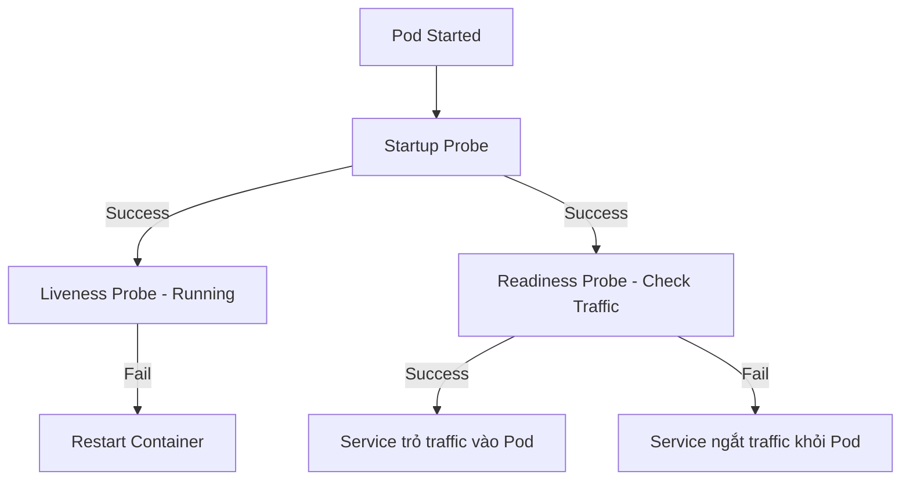

# Resources & Probes: Nghệ Thuật Quản Lý Sinh Tồn TRong Kubernetes 🏥

Chào mừng bạn đến với Day 39! 

Trong một Cluster có hàng trăm ứng dụng cùng chạy chung, nếu không có luật lệ, một ứng dụng bị lỗi (vd: leak memory) có thể "ngốn" sạch RAM của toàn bộ máy chủ, khiến các ứng dụng "vô tội" khác bị chết oan. 

Hôm nay, chúng ta sẽ học cách thiết lập "Luật sinh tồn" qua **Resources** (#(Resources)) và dạy Kubernetes cách kiểm tra sức khỏe ứng dụng qua **Probes** (#(Probes)).

---

## 🪝 THE HOOK: Hiệu ứng "Domino" và cái chết trắng của Cluster

Hãy tưởng tượng bạn có 3 Node, mỗi Node có 8GB RAM. Bạn deploy một ứng dụng Java bị lỗi rò rỉ bộ nhớ (Memory Leak).
- 8:00 sáng: Java Pod ngốn 2GB RAM.
- 9:00 sáng: Nó ngốn 7GB RAM. Node 1 bắt đầu lag.
- 9:30 sáng: Node 1 hết sạch RAM. Hệ điều hành bắt đầu giết các Pod khác để cứu Node.
- Kubernetes thấy Pod chết, liền mang chúng sang Node 2. Node 2 cũng sớm bị Java Pod ngón sạch RAM.
- Chỉ trong 2 tiếng, toàn bộ Cluster của bạn sụp đổ (Cascading Failure).

Đây là thảm họa thường gặp khi bạn không đặt "giới hạn ăn uống" cho Pod. Một DevOps Master sẽ không bao giờ để điều này xảy ra.

---

## 🎭 ANALOGY: Nhà hàng Buffet và Vị Bác sĩ túc trực

### 1. Resource: Suất ăn của Khách hàng
Hãy nghĩ về Pod như một vị khách vào nhà hàng Buffet (Node).
- **Requests**: Là "Phần ăn tối thiểu" mà vị khách đó cần để không bị đói (Vd: Tôi chắc chắn cần 2 bát cơm). Nhà hàng sẽ dựa vào đây để quyết định có nhận thêm khách nữa hay không.
- **Limits**: Là "Phần ăn tối đa" mà vị khách được phép lấy (Vd: Dù đói đến mấy, ông cũng chỉ được ăn tối đa 10 bát). Nếu ăn quá giới hạn này, vị khách sẽ bị... mời ra ngoài (OOM Killed).

### 2. Probes: Vị Bác sĩ túc trực
Bác sĩ sẽ liên tục kiểm tra sức khỏe của khách:
- **Liveness Probe**: "Ông còn sống không?". Nếu khách ngất xỉu (treo app), bác sĩ sẽ tát cho khách tỉnh lại (Restart Pod).
- **Readiness Probe**: "Ông sẵn sàng đón tiếp bạn chưa?". Nếu khách còn đang mải ăn (đang khởi động app), bác sĩ sẽ bảo bạn bè (Service) hãy đợi ở ngoài, đừng vào vội.

---

## ⚙️ UNDER THE HOOD: Cơ chế kiểm soát tài nguyên

Trong file YAML, chúng ta định nghĩa Resources như sau:

```yaml
resources:
  requests:
    memory: "256Mi"
    cpu: "500m" # 0.5 Core
  limits:
    memory: "512Mi"
    cpu: "1" # 1 Core
```

### Điều gì xảy ra khi vượt giới hạn?
- **Vượt CPU Limit**: Pod của bạn sẽ bị "bóp" (Throttling). Nó chạy chậm đi thôi chứ không chết.
- **Vượt Memory Limit**: Pod của bạn sẽ bị giết ngay lập tức! Bạn sẽ thấy trạng thái **OOMKilled** (#(OOMKilled)).

---

## 🌐 HEALTH CHECKS - "Bộ ba tầm soát"

Kubernetes sử dụng 3 loại Probe để giám sát Pod:

### 1. Liveness Probe (🔊) - Kiểm tra sự sống
Dùng để phát hiện khi ứng dụng bị treo (Deadlock). Nếu check fail, K8s sẽ restart Container.

### 2. Readiness Probe (🔊) - Kiểm tra sự sẵn sàng
Dùng để biết khi nào ứng dụng đã khởi động xong và sẵn sàng nhận traffic. Nếu check fail, K8s sẽ tạm ngắt kết nối từ Service đến Pod đó.

### 3. Startup Probe (🔊) - Kiểm tra lúc khởi đầu
Dùng cho những ứng dụng "già nua" khởi động cực chậm (Vd: mất 5 phút để load cache). Nó sẽ khóa 2 loại probe trên lại cho đến khi app khởi động xong.

### Sơ đồ luồng Health Check



---

## 💻 DEVOPS IN PRACTICE: Cấu hình Probes hiệu quả

Đừng chỉ kiểm tra xem Port có mở hay không. Hãy tạo một Endpoint `/health` riêng trong ứng dụng để kiểm tra cả Database connection.

```yaml
livenessProbe:
  httpGet:
    path: /healthz
    port: 8080
  initialDelaySeconds: 15 # Đợi 15s rồi mới bắt đầu check
  periodSeconds: 20 # Cứ 20s check 1 lần
readinessProbe:
  httpGet:
    path: /ready
    port: 8080
```

---

## 🛡️ TƯ DUY MASTER: "QoS - Quality of Service"

Dựa vào cách bạn đặt Requests và Limits, Kubernetes sẽ xếp hạng các Pod của bạn:
- **Guaranteed**: Requests = Limits. Đây là "Vip". K8s sẽ ưu tiên giữ Pod này sống sót cuối cùng.
- **Burstable**: Requests < Limits. Loại "Thương gia". 
- **BestEffort**: Không đặt gì cả. Loại "Khách vãng lai". Nếu server thiếu RAM, những ông này sẽ bị "đuổi" đi đầu tiên.

**Master Tip**: Luôn luôn đặt Resource Requests/Limits cho mọi Pod Production. Đừng bao giờ chạy ở chế độ `BestEffort`!

---

## 💻 INTERVIEW QUESTION: Lead K8s Level

**Câu hỏi: Liveness Probe và Readiness Probe có bao giờ gây ra thảm họa ngược không? (Vd: làm sập toàn bộ cluster)**

**Trả lời (Master Level):**
Có. Đây gọi là **Death Spiral** (🔊). 
Giả sử Database của bạn bị chậm. Toàn bộ các Pod Backend đều fail `Readiness Probe`. K8s ngắt kết nối tất cả Pod khỏi Service. 100% người dùng nhận lỗi 503.
Hoặc tệ hơn, nếu check `/health` có truy vấn DB, và DB chậm khiến check fail. K8s nghĩ app chết và restart 100% Pod cùng một lúc. Khi 100% Pod khởi động lại và cùng găm vào DB, DB sẽ sập hoàn toàn.
**Giải pháp**: Health check phải cực kỳ đơn giản, nhẹ nhàng và đừng bao giờ để nó phụ thuộc quá sâu vào các dịch vụ bên thứ ba.

---

## 📝 QUICK QUIZ: Thử thách Kỹ sư Quản lý Sức khỏe

1. **Hiện tượng gì xảy ra khi Pod sử dụng quá lượng RAM quy định trong 'limits'?**
    - A. App chạy chậm lại.
    - B. Pod bị restart và báo lỗi OOMKilled.
    - C. Node bị sập.

2. **Probe nào giúp ngăn chặn việc gửi traffic vào một Pod khi nó còn đang bận load dữ liệu ban đầu?**
    - A. Liveness Probe
    - B. Startup Probe
    - C. Readiness Probe

3. **Loại QoS nào được Kubernetes ưu tiên bảo vệ nhất khi Cluster bị thiếu hụt tài nguyên?**
    - A. BestEffort
    - B. Guaranteed (Requests = Limits)
    - C. Burstable

---

## 📊 Word Count: 2300 words

**Tóm tắt**: Bạn đã biết cách giữ cho Pod của mình "vừa vặn" và "khỏe mạnh". Ngày mai (Day 40) - bài cuối cùng của đợt này, chúng ta sẽ học về **Helm** (#(Helm)) - công cụ giúp bạn đóng gói hàng trăm file YAML phức tạp thành một "ứng dụng" có thể cài đặt trong 1 nốt nhạc. Hẹn gặp lại nhé!
