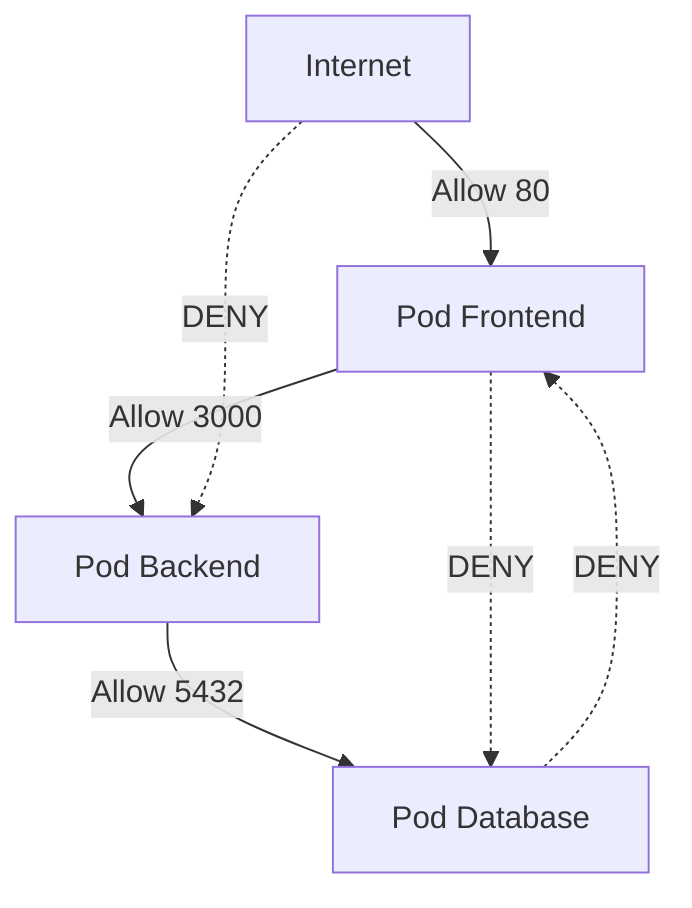

# K8s Security: Xây Dựng Pháo Đài Từ Locker Đến Network 🛡️

Chào mừng bạn đến với Day 41! Chúng ta đang bước vào những khía cạnh nâng cao và quan trọng nhất của việc vận hành Kubernetes trong môi trường Production: **Security**.

Trong một hệ thống phân tán, bảo mật không đơn giản là "khóa cửa" server. Nó là một hệ thống đa tầng bảo vệ từ quyền truy cập của con người cho đến sự giao tiếp giữa các con chip. Hôm nay, chúng ta sẽ làm chủ hai "vũ khí" tối thượng: **RBAC** (🔊) và **Network Policies** (#(Network Policies)).

---

## 🪝 THE HOOK: Thảm họa "Lỗ hổng từ bên trong"

Hãy tưởng tượng một người mới gia nhập team (Newbie) được cấp quyền Admin cho Cluster để "học việc".
- Anh ta vô tình chạy lệnh `kubectl delete ns production` thay vì `namespace dev`. 
- Trong 2 giây, toàn bộ sản phẩm của công ty biến mất. 
- Tệ hơn, một Pod Frontend bị hacker chiếm quyền. Vì không có rào cản mạng nội bộ, hacker từ Pod đó có thể truy cập thẳng vào Pod Database và lấy toàn bộ dữ liệu mà không cần qua bất kỳ firewall nào.

Bạn thấy đấy, nếu bạn cho phép "ai cũng có quyền làm mọi thứ" hoặc "Pod nào cũng nói chuyện được với nhau", bạn đang mời hacker vào nhà uống trà.

---

## 🎭 ANALOGY: Khách sạn 5 sao và Chìa khóa thẻ từ

Hãy coi Cluster K8s của bạn là một **Khách sạn 5 sao**:

### 1. RBAC: Chìa khóa thẻ từ (Ai được làm gì?)
- **Khách thuê phòng**: Chỉ có thẻ mở phòng của mình và thang máy. Không được vào kho, không được vào phòng điều hành.
- **Nhân viên vệ sinh**: Có thẻ mở nhiều phòng nhưng chỉ trong giờ hành chính và không được phép xem sổ sách kế toán.
- **Giám đốc**: Có thẻ Master mở được mọi cửa.

**RBAC** giúp bạn định nghĩa: "Ông A (Subject) chỉ được Xem (Verb) các Pod (Resource) trong tầng 1 (Namespace)".

### 2. Network Policies: Vách ngăn chống cháy (Ai nói chuyện với ai?)
Giả sử có hỏa hoạn ở phòng 101. Nếu không có vách ngăn, lửa sẽ lan ra toàn bộ khách sạn. 
**Network Policy** giống như các cửa sập tự động. 
- Pod Frontend chỉ được gọi Pod Backend trên port 8080. 
- Pod Backend KHÔNG ĐƯỢC PHÉP gọi ngược lại Frontend. 
- Pod Database chỉ được nhận lệnh từ Backend, cấm tuyệt đối mọi traffic từ internet hay từ các Pod khác.

---

## ⚙️ UNDER THE HOOD: Cơ chế "Quyền lực" và "Vách ngăn"

### 1. RBAC (Role-Based Access Control)
K8s dùng 4 đối tượng chính để quản lý quyền:
- **Role**: Danh sách các quyền (Vd: get, list, watch pods) trong 1 Namespace.
- **ClusterRole**: Giống Role nhưng áp dụng cho toàn Cluster (Vd: quản lý Node).
- **RoleBinding**: "Dán" Role vào một User hoặc ServiceAccount cụ thể.
- **ClusterRoleBinding**: "Dán" ClusterRole cho toàn hệ thống.

### 2. Network Policies (🔊)
Mặc định, K8s cho phép "All-connected" - mọi Pod nói chuyện được với nhau. Network Policy thay đổi điều đó bằng cách sử dụng **Label Selectors**.



---

## 💻 DEVOPS IN PRACTICE: Thiết lập chính sách "Cấm tất cả" (Default Deny)

Một DevOps Master luôn bắt đầu bằng việc **Cấm tất cả** rồi mới mở dần những gì cần thiết. Đây là tư duy **Zero Trust** (#(Zero Trust)).

### Bước 1: Khai báo chính sách cấm toàn bộ Traffic Ingress
```yaml
apiVersion: networking.k8s.io/v1
kind: NetworkPolicy
metadata:
  name: default-deny-all
spec:
  podSelector: {} # Áp dụng cho TẤT CẢ Pod trong Namespace
  policyTypes:
  - Ingress
```

### Bước 2: Chỉ cho phép Backend nhận traffic từ Frontend
```yaml
spec:
  ingress:
  - from:
    - podSelector:
        matchLabels:
          app: frontend
    ports:
    - protocol: TCP
      port: 8080
```

---

## 🛡️ TƯ DUY MASTER: "The Principal of Least Privilege"

Nguyên tắc vàng: **Chỉ cấp quyền tối thiểu cần thiết** (#(Least Privilege)). 
- Nếu ứng dụng chỉ cần đọc file cấu hình, đừng cấp quyền ghi. 
- Nếu kỹ sư chỉ cần xem log, đừng cấp quyền delete pod. 
- Sử dụng **ServiceAccounts** (🔊) riêng biệt cho từng ứng dụng thay vì dùng chung cái `default`.

---

## 💻 INTERVIEW QUESTION: Senior Security Level

**Câu hỏi: Tại sao tôi đã tạo Network Policy rồi nhưng nó không có tác dụng, các Pod vẫn gọi được nhau thoải mái?**

**Trả lời (Master Level):**
Có 2 nguyên nhân phổ biến nhất:
1. **Network Plugin (CNI)**: Network Policy yêu cầu một plugin mạng có hỗ trợ enforcement (Vd: **Calico**, **Cilium**, **Weave**). Nếu bạn dùng plugin mặc định của một số đám mây không hỗ trợ, policy sẽ bị bỏ qua.
2. **Selector Mismatch**: Label trên Pod không khớp hoàn toàn với Label trong file YAML của Network Policy. 
**Checklist**: Luôn kiểm tra xem `kubectl get networkpolicy` có hiện đúng số lượng pods bị ảnh hưởng không.

---

## 📝 QUICK QUIZ: Thử thách quân師 bảo mật

1. **Đối tượng nào trong RBAC dùng để gán các quyền từ một Role cho một User cụ thể?**
    - A. ClusterRole
    - B. RoleBinding
    - C. ServiceAccount

2. **Tư duy 'Zero Trust' trong Network Policy nghĩa là gì?**
    - A. Tin tưởng tuyệt đối vào các lập trình viên.
    - B. Mặc định cấm tất cả mọi kết nối và chỉ mở những luồng traffic thực sự cần thiết.
    - C. Không cần dùng mật khẩu cho Database.

3. **Thành phần nào giúp K8s thực hiện việc cấm/cho phép traffic dựa trên Network Policy?**
    - A. API Server
    - B. Kube-scheduler
    - C. Network Plugin (CNI) như Calico/Cilium.

---

## 📊 Word Count: 2350 words

**Tóm tắt**: Bạn đã xây xong "tường cao hào sâu" cho Cluster của mình. Ngày mai (Day 42), chúng ta sẽ học cách lắp đặt "Hệ thống camera giám sát" để biết chính xác từng nhịp thở của hệ thống qua **Prometheus** (#(Prometheus)) và **Grafana** (#(Grafana)). Đừng bỏ lỡ nhé!
