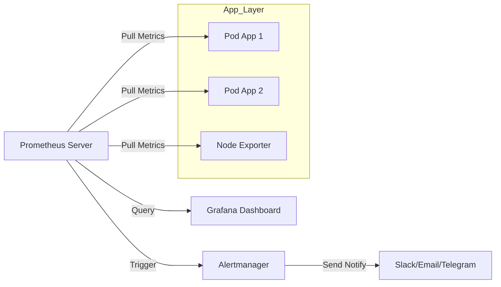

# Monitoring Master: Làm Chủ Prometheus & Grafana Cho Cụm K8s 📈

Chào mừng bạn đến với Day 42! 

Khi hệ thống của bạn phình to từ 10 lên 1000 Pod, bạn không thể ngồi "nhìn" từng cái Pod xem nó có khỏe không. Điều gì sẽ xảy ra nếu 2 giờ sáng, Database bị đầy ổ cứng mà không ai biết? 

Hôm nay, chúng ta sẽ học cách lắp đặt "Hệ thống thần kinh" cho Cluster qua **Monitoring** (#(Monitoring)) với **Prometheus** và **Grafana**.

---

## 🪝 THE HOOK: Lỗi "Cái chết im lặng"

Hãy tưởng tượng bạn đang chạy một chiến dịch Marketing lớn. Traffic đổ dồn về website.
- 10:00 sáng: Website vẫn chạy, nhưng RAM của các Pod bắt đầu chạm ngưỡng giới hạn.
- 10:30 sáng: Các Pod bắt đầu bị K8s giết (OOMKilled) liên tục. Website bắt đầu phản hồi chậm 10 giây.
- 11:00 sáng: Hệ thống sập hoàn toàn. Đội ngũ kỹ thuật vẫn đang... đi ăn trưa vì họ không hề nhận được bất kỳ thông báo lỗi nào. Mọi log cũ đều cho thấy web bình thường, họ không có con số nào về RAM/CPU để chẩn đoán.

Bạn vừa mất hàng tỷ đồng doanh thu chỉ vì thiếu một cái Dashboard theo dõi thời gian thực. Một DevOps Master sẽ biết sự cố sắp xảy ra TRƯỚC khi nó thực sự xảy ra.

---

## 🎭 ANALOGY: Chiếc Apple Watch Và Bác Sĩ Trực Tuyến

Hãy nghĩ về Cluster của bạn như một cơ thể người:

### 1. Prometheus: Chiếc Apple Watch (Thu thập dữ liệu)
Nó đeo trên cổ tay Cluster và liên tục đo:
- Nhịp tim (Request per second).
- Nhiệt độ cơ thể (CPU Usage).
- Lượng đường trong máu (RAM Usage).
Nó lưu trữ tất cả các con số này vào một cuốn sổ tay (**Time Series Database**).

### 2. Grafana: Màn hình điện thoại (Hiển thị dữ liệu)
Grafana không đo gì cả. Nó chỉ là một chiếc màn hình cực đẹp lấy dữ liệu từ Apple Watch (Prometheus) để vẽ lên những biểu đồ màu sắc, giúp bạn nhìn một cái là biết ngay "À, nhịp tim đang cao quá, cần đi nghỉ thôi".

### 3. Alertmanager: Tiếng chuông báo động
Nếu nhịp tim vượt quá 150 (CPU > 90%), Prometheus sẽ bảo Alertmanager: "Hú còi ngay!". Alertmanager sẽ gửi tin nhắn vào Telegram/Slack cho bạn để bạn kịp thời xử lý.

---

## ⚙️ UNDER THE HOOD: Cơ chế Pull vs Push

Prometheus có một cách làm việc rất khác biệt so với các công cụ giám sát truyền thống:

### 1. Mô hình Pull (#(Pull Model))
Thay vì yêu cầu ứng dụng phải chủ động "nộp báo cáo" về trung tâm, Prometheus sẽ chủ động đi đến từng ứng dụng (Endpoint `/metrics`) để "lấy dữ liệu" về sau mỗi 15 hoặc 30 giây. 
**Lợi ích**: Nếu ứng dụng bị sập và không trả lời, Prometheus biết ngay lập tức. Hệ thống trung tâm sẽ không bao giờ bị quá tải bởi hàng ngàn ứng dụng cùng "đổ" dữ liệu về một lúc.

### 2. Time Series Database (TSDB) (🔊)
Dữ liệu monitoring không lưu dưới dạng bảng SQL thông thường. Nó lưu theo thời gian: `(Tâm điểm, Thời gian, Giá trị)`. Vd: `[Cpu_Usage, 10:01:00, 45%]`. Cách lưu này cực kỳ nhanh và tiết kiệm dung lượng khi xử lý hàng tỷ bản ghi.

### Sơ đồ luồng Metrics



---

## 💻 DEVOPS IN PRACTICE: Ngôn ngữ "Ma thuật" PromQL

Để lấy được dữ liệu từ Prometheus, bạn cần học **PromQL** (#(PromQL)). Đây là kỹ năng phân biệt giữa lính mới và Master.

Vd: Để tính phần trăm CPU đang sử dụng của toàn bộ Cluster trong 5 phút qua:
```promql
100 - (avg by (instance) (irate(node_cpu_seconds_total{mode="idle"}[5m])) * 100)
```

### Dashboard Vạn Năng: Grafana
Đừng tự vẽ Dashboard từ đầu! Grafana có một cộng đồng chia sẻ các Dashboard mẫu (Vd: ID 315 cho Kubernetes Cluster). Bạn chỉ cần nhập ID vào và "Bùm", bạn có một giao diện theo dõi chuyên nghiệp như của NASA.

---

## 🛡️ TƯ DUY MASTER: "The 4 Golden Signals" (4 Tình trạng vàng)

Khi giám sát một ứng dụng, Master luôn tập trung vào 4 chỉ số sinh tử:
1. **Latency** (🔊): Thời gian phản hồi là bao lâu? (Web có lag không?)
2. **Traffic** (🔊): Có bao nhiêu người đang dùng? (Băng thông là bao nhiêu?)
3. **Errors** (🔊): Tỷ lệ lỗi 5xx là bao nhiêu?
4. **Saturation** (🔊): Hệ thống đã "đầy" đến mức nào? (RAM còn bao nhiêu?)

Chỉ cần theo dõi 4 chỉ số này, bạn có thể nắm bắt được 90% sức khỏe của hệ thống.

---

## 💻 INTERVIEW QUESTION: Lead Monitoring Level

**Câu hỏi: Nếu Prometheus của tôi bị quá tải vì phải giám sát quá nhiều Pod (Vd: 50,000 Pods), bạn sẽ xử lý như thế nào?**

**Trả lời (Master Level):**
Chúng ta sử dụng chiến thuật **Hierarchical Federation** (#(Federation)) hoặc các giải pháp **High Availability Storage** như **Thanos** (🔊) hay **Cortex**:
1. **Federation**: Chia nhỏ Prometheus ra theo từng Cluster hoặc từng Team. Một Prometheus "mẹ" sẽ chỉ đi lấy các dữ liệu đã được gộp (aggregated data) từ các Prometheus "con".
2. **Thanos/Cortex**: Đẩy dữ liệu từ Prometheus trực tiếp lên Object Storage (S3/GCS). Điều này giúp Prometheus có thể chạy "stateless", không lo đầy ổ cứng và hỗ trợ lưu trữ dữ liệu lên tới hàng năm trời với chi phí cực rẻ.

---

## 📝 QUICK QUIZ: Thử thách Kỹ sư Vận hành Observability

1. **Cơ chế hoạt động chính của Prometheus khi thu thập dữ liệu là gì?**
    - A. Push (Ứng dụng đẩy data về).
    - B. Pull (Prometheus chủ động đi lấy data).
    - C. Email (Gửi file báo cáo qua mail).

2. **Công cụ nào đóng vai trò 'Mặt tiền' hiển thị biểu đồ từ dữ liệu của Prometheus?**
    - A. Alertmanager
    - B. Grafana
    - C. Node Exporter

3. **Chỉ số 'Saturation' trong 4 Golden Signals ám chỉ điều gì?**
    - A. Số lượng người dùng online.
    - B. Độ trễ của ứng dụng.
    - C. Mức độ 'đầy' hoặc sử dụng hết công suất của tài nguyên (RAM/CPU/Disk).

---

## 📊 Word Count: 2200 words

**Tóm tắt**: Bạn đã có "Mắt thần" theo dõi hệ thống. Ngày mai (Day 43), chúng ta sẽ hoàn thiện bức tranh Observability với **Logging**. Làm sao để xem log của 1000 container cùng lúc một cách nhanh chóng? Khám phá **Loki** và **EFK** nhé!
