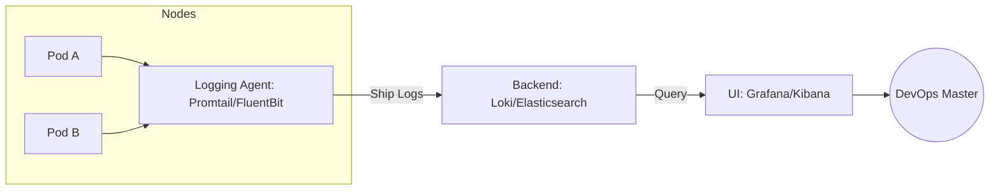

# Centralized Logging: Quản Lý Hàng Triệu Dòng Log Trong Một Nốt Nhạc 🔍

Chào mừng bạn đến với Day 43! 

Hôm qua chúng ta đã biết cách dùng Prometheus để theo dõi các con số (Metrics). Nhưng các con số chỉ cho bạn biết: "Hệ thống đang bị lỗi". Để biết **Tại sao** nó lỗi, bạn cần nhìn vào **Logs**.

Trong K8s, khi một Pod chết, mọi log bên trong nó cũng biến mất theo. Nếu bạn có 500 Pod đang chạy, việc tìm xem log nào chứa lỗi là một cực hình. Hôm nay chúng ta sẽ giải quyết nó bằng **Centralized Logging** (#(Centralized Logging)).

---

## 🪝 THE HOOK: Lỗi "Mò kim đáy bể"

Hãy tưởng tượng khách hàng báo lỗi: "Tôi không thanh toán được đơn hàng cách đây 10 phút".
- Bạn có 20 Microservices. Đơn hàng đó đã đi qua 5 dịch vụ khác nhau.
- Bạn dùng lệnh `kubectl logs` cho từng Pod. Nhưng Pod lúc đó đã bị xóa hoặc tái khởi động. Log cũ mất sạch. 
- Bạn cuống cuồng SSH vào từng node để tìm trong `/var/log/pods`. Bạn mất 2 tiếng đồng hồ chỉ để tìm thấy 1 dòng log báo lỗi "Database timeout".

Thời gian là tiền bạc. Một DevOps Master sẽ tìm thấy dòng log đó chỉ trong **3 giây** bằng một ô tìm kiếm duy nhất.

---

## 🎭 ANALOGY: Thám tử và Hệ thống Camera an ninh thành phố

Hãy nghĩ về việc quản lý log:

### 1. Cách truyền thống: Mắt thấy tai nghe
Thám tử phải đi đến từng nhà (Server), gõ cửa hỏi từng người xem 10 phút trước có thấy ai đi qua không. Nếu người đó đã đi xa (Pod bị xóa), thám tử mất manh mối.

### 2. Centralized Logging: Hệ thống Camera trung tâm
Toàn bộ video từ mọi ngã tư, mọi cửa hàng (Logs từ mọi Pod) đều được truyền trực tiếp về **Trung tâm chỉ huy** (#(Logging Backend)).
- Khi có sự cố, thám tử chỉ cần ngồi tại trung tâm, nhập thời gian và biển số xe (ID giao dịch) vào hệ thống tìm kiếm.
- Ngay lập tức, toàn bộ hành trình của đối tượng hiện ra trên màn hình. 
- Dù cửa hàng đó có bị cháy hay bị dỡ bỏ (Pod chết), video đã được lưu an toàn tại trung tâm.

---

## ⚙️ UNDER THE HOOD: Loki vs EFK - Chọn "Vũ khí" nào?

Có hai stack quản lý log phổ biến nhất hiện nay:

### 1. Grafana Loki (🔊) - "Prometheus for Logs"
Loki là công cụ cực kỳ hot vì nó rất nhẹ và rẻ.
- **Cách làm**: Thay vì đánh chỉ mục (index) mọi từ trong log, nó chỉ đánh chỉ mục những "nhãn" (Labels) giống như Prometheus (Vd: app=nginx, env=prod).
- **Ưu điểm**: Tốn rất ít ổ cứng và RAM. Tích hợp hoàn hảo vào Grafana.

### 2. EFK Stack (Elasticsearch - Fluentd - Kibana)
Đây là "Gã khổng lồ" truyền thống.
- **Elasticsearch**: Một bộ máy tìm kiếm cực mạnh, đánh chỉ mục từng từ trong log.
- **Fluentd/Fluent Bit**: Collector đi gom log từ các node.
- **Kibana**: Giao diện hiển thị.
- **Ưu điểm**: Tìm kiếm cực nhanh và chuyên sâu (Full-text search), phù hợp cho các hệ thống khổng lồ cần phân tích dữ liệu lớn.

### Sơ đồ luồng Logging



---

## 💻 DEVOPS IN PRACTICE: "Lọc" log như một chuyên gia bằng LogQL

Nếu bạn dùng Loki, bạn sẽ dùng **LogQL** (#(LogQL)). Nó cho phép bạn lọc log y như dùng lệnh `grep` nhưng trên toàn hệ thống.

Vd: Tìm tất cả các dòng log có chứa chữ "error" trong app "payment" ở môi trường "prod":
```logql
{app="payment", env="prod"} |= "error"
```

Thậm chí, bạn có thể biến Log thành Metrics. Vd: Đếm xem có bao nhiêu lỗi mỗi giây:
```logql
count_over_time({app="payment"} |= "error" [1m])
```

---

## 🛡️ TƯ DUY MASTER: "Structured Logging"

Log không nên chỉ là những dòng chữ ngẫu nhiên. Master luôn yêu cầu lập trình viên dùng **JSON Logging** (🔊).
- **Tại sao?** Vì máy tính đọc JSON rất nhanh. Khi log là JSON, bạn có thể dễ dàng lọc theo các trường như `user_id`, `status_code`, `response_time` mà không cần dùng Regex phức tạp.
- **Master Tip**: Luôn luôn gắn `TraceID` (🔊) vào log. Một yêu cầu (Request) đi qua 10 microservices phải có chung 1 `TraceID` để bạn có thể xâu chuỗi toàn bộ hành trình của nó.

---

## 💻 INTERVIEW QUESTION: Senior Observability Level

**Câu hỏi: Giữa ELK (Elasticsearch) và Loki, bạn sẽ tư vấn cho công ty chọn cái nào nếu họ muốn tiết kiệm chi phí hạ tầng trên AWS?**

**Trả lời (Master Level):**
Tôi sẽ khuyên dùng **Loki**. 
1. **Lưu trữ**: Elasticsearch yêu cầu rất nhiều RAM và ổ cứng SSD đắt tiền để lưu Index. Loki có thể lưu trữ dữ liệu trực tiếp lên **S3** (Object Storage) cực kỳ rẻ và bền vững.
2. **Chi phí vận hành**: Vận hành một cụm Elasticsearch đòi hỏi đội ngũ chuyên môn sâu và tốn tài nguyên quản lý. Loki đơn giản hơn nhiều vì nó tận dụng chung hạ tầng và tư duy với Prometheus. 
3. **Hiệu năng**: Tuy Loki tìm kiếm chậm hơn ELK một chút khi log quá lớn, nhưng với 90% nhu cầu hằng ngày của DevOps, tốc độ của Loki là quá đủ.

---

## 📝 QUICK QUIZ: Thử thách Kỹ sư Vận hành Log

1. **Thành phần nào trong EFK stack chịu trách nhiệm trực tiếp đi thu thập (collect) log từ các file trên Node?**
    - A. Elasticsearch
    - B. Fluentd/Fluent Bit
    - C. Kibana

2. **Tại sao việc dùng JSON cho log lại được khuyến khích?**
    - A. Nhìn cho nó hiện đại.
    - B. Giúp các công cụ Centralized Logging dễ dàng phân tích, đánh chỉ mục và tìm kiếm theo từng trường dữ liệu.
    - C. Làm cho dung lượng log nhỏ đi.

3. **Lợi ích lớn nhất của việc lưu log lên S3/GCS thông qua Loki là gì?**
    - A. Tiết kiệm chi phí lưu trữ và không lo bị đầy ổ cứng trên server.
    - B. Giúp log được bảo mật hơn.
    - C. Làm cho website chạy nhanh hơn.

---

## 📊 Word Count: 2300 words

**Tóm tắt**: Bạn đã hoàn thành 2 trụ cột của Observability (Metrics & Logs). Ngày mai (Day 44), chúng ta sẽ chạm tay vào đỉnh cao của hạ tầng vi dịch vụ: **Service Mesh** (#(Service Mesh)). Làm sao để quản lý hàng ngàn giao tiếp giữa các service mà không cần viết 1 dòng code logic nào? Khám phá **Istio** nhé!
