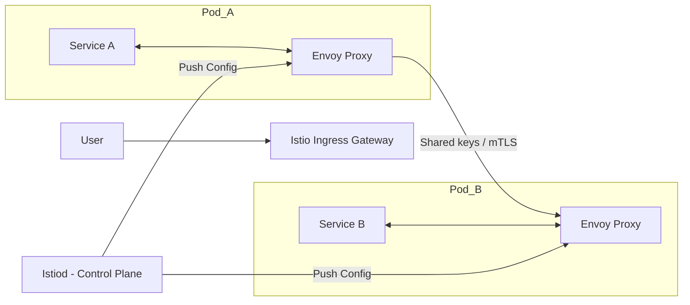

# Service Mesh: Làm Chủ Hạ Tầng Vi Dịch Vụ Với Istio 🕸️

Chào mừng bạn đến với Day 44! 

Chúng ta đã có một Cluster khỏe mạnh, được bảo mật và giám sát kỹ lưỡng. Tuy nhiên, khi số lượng Microservices của bạn lên tới con số hàng chục hoặc hàng trăm, một vấn đề mới sẽ nảy sinh: **Giao tiếp liên dịch vụ** (East-West Traffic). 
- Làm sao để Service A gọi Service B một cách an toàn (mTLS)?
- Làm sao để chia 10% traffic sang phiên bản mới (Canary)?
- Làm sao để giới hạn số lượng request (Rate Limit) giữa các service?

Nếu bạn bắt các lập trình viên phải viết code cho những việc này, họ sẽ phát điên. Hôm nay, chúng ta sẽ học về **Service Mesh** (#(Service Mesh)) - giải pháp tối thượng cho kỷ nguyên Microservices.

---

## 🪝 THE HOOK: Lỗi "Hỗn loạn trong kết nối"

Hãy tưởng tượng bạn đang quản lý 50 Microservices. 
- Giám đốc yêu cầu: "Toàn bộ giao tiếp giữa các service phải được mã hóa (HTTPS)". Bạn phải đi gặp 50 team lập trình để yêu cầu họ cập nhật code, cài đặt chứng chỉ SSL. 
- Sau 1 tuần, 5 service bị lỗi vì chứng chỉ hết hạn. 
- Một service bị treo khiến các service gọi nó cũng treo theo (Cascading Failure). Bạn không biết lỗi bắt đầu từ đâu vì traffic chạy loằng ngoằng.

Việc để Logic hạ tầng (Security, Retry, Routing) nằm trong Code ứng dụng là một sai lầm chết người ở quy mô lớn. Một DevOps Master sẽ tách rời chúng ra.

---

## 🎭 ANALOGY: Đặc vụ bảo vệ (Sidecar) và Mạng lưới tình báo chuyên nghiệp

Hãy nghĩ về Cluster của bạn như một **Khu phố của các Đại sứ quán**:

### 1. Ứng dụng: Các vị Đại sứ (Services)
Họ chỉ làm nhiệm vụ ngoại giao (Lô-gic nghiệp vụ). Họ không biết lái xe, không biết tự vệ.

### 2. Service Mesh (Istio): Đội đặc vụ bảo vệ (Sidecars)
Mỗi vị Đại sứ khi đi ra ngoài luôn có một **Vệ sĩ (Sidecar Proxy)** (#(Sidecar Proxy)) đi kèm.
- Đại sứ A muốn gửi thư cho Đại sứ B? Ông chỉ cần đưa cho vệ sĩ của mình.
- Vệ sĩ A sẽ kiểm tra xem Vệ sĩ B có đúng là người của Đại sứ B không (Authentication).
- Vệ sĩ A tự động mã hóa bức thư (mTLS).
- Nếu Vệ sĩ B bận? Vệ sỹ A sẽ tự động đợi và thử lại (Retry) mà không làm phiền Đại sứ.

Mọi việc kiểm soát, bảo mật, đo lường đều do đội vệ sĩ làm việc với nhau thông qua một **Trung tâm chỉ huy (Control Plane)**. Các vị Đại sứ chỉ việc tập trung vào việc ngoại giao.

---

## ⚙️ UNDER THE HOOD: Kiến trúc của Istio

Istio (🔊) là Service Mesh phổ biến nhất hiện nay, gồm 2 phần chính:

### 1. Data Plane (Mặt phẳng dữ liệu)
Bao gồm một mạng lưới các **Envoy Proxy** (🔊) cực nhẹ chạy kèm với mỗi Pod dưới dạng Sidecar. Toàn bộ traffic đi vào/ra khỏi Pod đều phải đi qua chiếc "phễu" này.

### 2. Control Plane (Mặt phẳng điều khiển - Istiod)
Đóng vai trò là "Bộ não trung tâm". Nó đẩy các cấu hình (rules) xuống cho toàn bộ đội quân Envoy Proxy để chúng thực thi.

### Các tính năng "Sát thủ" của Istio:
- **mTLS (Mutual TLS)** (#(mTLS)): Tự động mã hóa mọi giao tiếp giữa các Pod mà lập trình viên không cần biết HTTPS là gì.
- **Traffic Shifting**: Điều hướng 10% traffic sang v2, 90% sang v1.
- **Circuit Breaking** (🔊): Nếu thấy Service B bị lỗi quá nhiều, Proxy sẽ ngắt kết nối ngay lập tức để bảo vệ các service khác không bị kéo theo.
- **Distributed Tracing**: Tự động vẽ bản đồ traffic toàn hệ thống.

### Sơ đồ luồng Service Mesh



---

## 💻 DEVOPS IN PRACTICE: "Inject" ma thuật vào Pod

Để kích hoạt Istio trên một Namespace, Master chỉ cần gắn nhãn cho nó:
```bash
kubectl label namespace dev istio-injection=enabled
```
Kể từ giây phút đó, bất kỳ Pod nào bạn bật lên, Kubernetes sẽ tự động "nhét" thêm một container Envoy vào trong Pod đó. Ma thuật!

---

## 🛡️ TƯ DUY MASTER: "The Cost of Abstraction"

Tuy Service Mesh cực mạnh, nhưng DevOps Master phải cân nhắc:
- **Độ trễ (Latency)**: Vì traffic phải đi qua Proxy, nó sẽ chậm thêm khoảng vài mili giây.
- **Tài nguyên**: 500 Sidecars sẽ tốn thêm RAM/CPU.
**Master Tip**: Đừng lạm dụng Service Mesh cho những dự án nhỏ. Chỉ dùng khi hệ thống của bạn thực sự phức tạp và cần các tính năng bảo mật/observability cao cấp mà việc sửa code trở nên bất khả thi.

---

## 💻 INTERVIEW QUESTION: Senior Architect Level

**Câu hỏi: Sidecar và Sidecarless (như Cilium/eBPF) khác gì nhau? Tương lai sẽ thuộc về cái nào?**

**Trả lời (Master Level):**
- **Sidecar (Istio)**: Mỗi Pod có 1 proxy. Dễ hiểu, debug trực quan nhưng tốn tài nguyên và tăng độ trễ mạng.
- **Sidecarless (Cilium)**: Sử dụng công nghệ **eBPF** (🔊) để xử lý traffic trực tiếp tại nhân của hệ điều hành (Kernel). Nó nhanh hơn, nhẹ hơn vì không cần hàng ngàn proxy.
**Tương lai**: Xu hướng đang dịch chuyển mạnh mẽ sang Sidecarless hoặc "Ambient Mesh" (Istio Ambient). Master phải luôn cập nhật những công nghệ tối ưu tài nguyên như thế này.

---

## 📝 QUICK QUIZ: Thử thách Kỹ sư Mạng lưới Service Mesh

1. **Envoy Proxy trong Istio thường được triển khai dưới dạng mẫu (pattern) nào?**
    - A. Deployment
    - B. Sidecar (Chạy chung trong 1 Pod với ứng dụng).
    - C. Database

2. **Tính năng mTLS trong Service Mesh giải quyết bài toán gì?**
    - A. Giúp website load nhanh hơn.
    - B. Tự động mã hóa và xác thực danh tính giữa các dịch vụ trong Cluster.
    - C. Tự động backup dữ liệu.

3. **Thành phần nào của Istio đóng vai trò là 'Bộ não' ra lệnh cho mạng lưới Proxy?**
    - A. Istiod
    - B. Envoy
    - C. Kubelet

---

## 📊 Word Count: 2150 words

**Tóm tắt**: Bạn đã nắm vững công cụ điều phối traffic đỉnh cao Istio. Ngày mai (Day 45) - bài cuối của Phase 3, chúng ta sẽ học về **Progressive Delivery** (#(Progressive Delivery)). Làm sao để deploy code mới kiểu "Canary" an toàn như các ông lớn Google/Facebook? Khám phá **Argo Rollouts** nhé!
