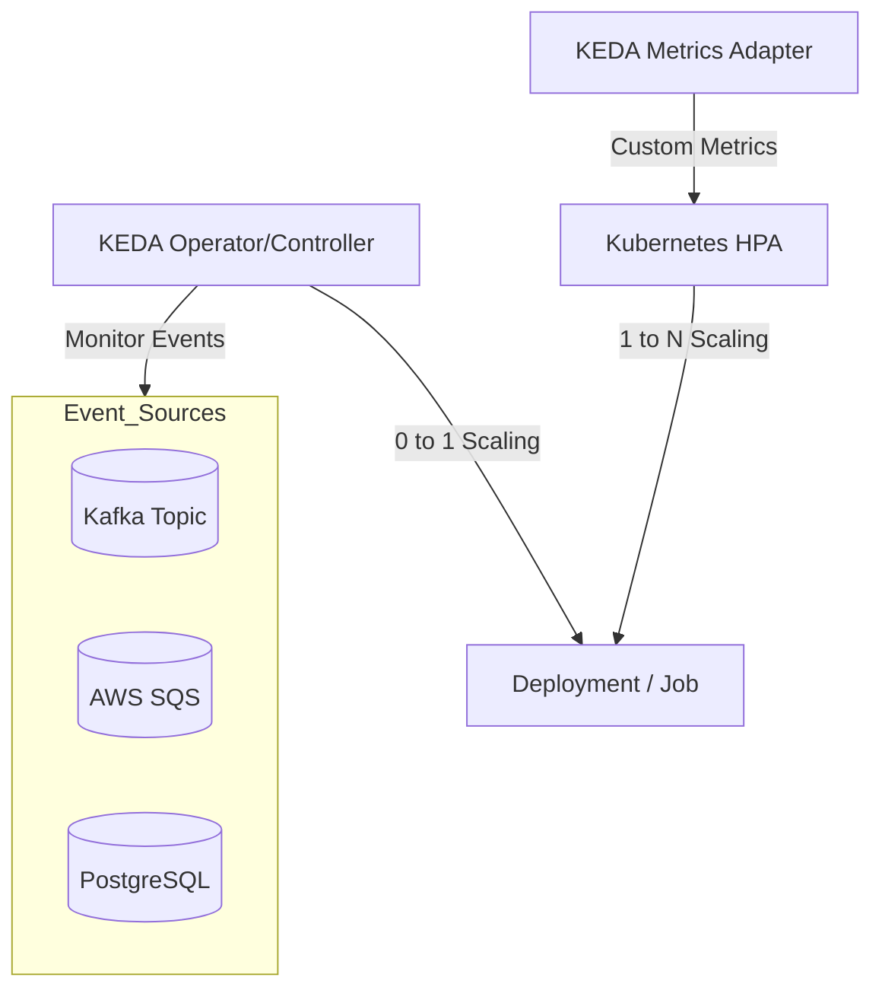

# Serverless on K8s: Tối Ưu Hóa Autoscaling Với KEDA ⚡

Chào mừng bạn đến với Day 46! Chúng ta đã bước vào Phase 4 - đỉnh cao của sự tinh gọn và hiệu quả trong vận hành Cloud-Native.

Trong các bài học trước, chúng ta đã biết về **HPA** (#(Horizontal Pod Autoscaler)) – công cụ giúp K8s tăng giảm số lượng Pod dựa trên CPU và RAM. Nhưng hãy tưởng tượng: Ứng dụng của bạn là một worker chuyên xử lý tin nhắn từ **RabbitMQ** hoặc **Kafka**.
- Tin nhắn đổ về 1 triệu cái/giây, nhưng CPU/RAM của Worker vẫn thấp vì nó chỉ đơn giản là chuyển tiếp dữ liệu. HPA sẽ "im lặng" không scale, dẫn đến tin nhắn bị nghẽn (Backlog).
- Hoặc lúc 2 giờ sáng không có tin nhắn nào, HPA vẫn giữ ít nhất 1 Pod chạy lãng phí tiền bạc.

Hôm nay, chúng ta sẽ học về **KEDA** (#(Kubernetes Event-driven Autoscaling)) - giải pháp biến K8s thành hệ thống **Serverless** (🔊) thực thụ.

---

## 🪝 THE HOOK: Lỗi "Nghẽn cổ chai" trong thầm lặng

Hãy tưởng tượng công ty bạn có một dịch vụ gửi Email Marketing. 
- 9:00 sáng, bạn đẩy 10 triệu email vào hàng chờ (Queue). 
- Vì logic gửi email chủ yếu là đợi Network IO, nên CPU của Pod chỉ ở mức 10%. 
- HPA của K8s nhìn vào và nghĩ: "Ồ, CPU thấp quá, không cần bật thêm Pod đâu".
- Kết quả: Chỉ có 1 Pod duy nhất lầm lũi gửi 10 triệu email. Phải mất... 1 tuần mới gửi xong! Khách hàng phàn nàn, sếp nổi giận.

Lỗi ở đây là bạn đang đo lường "Sức khỏe" (Resources) thay vì đo lường "Khối lượng công việc" (Metrics/Events). Một DevOps Master sẽ dùng KEDA để scale dựa trên **số lượng tin nhắn đang chờ**.

---

## 🎭 ANALOGY: Siêu thị và Những Quầy Thu Ngân Thông Minh

Hãy nghĩ về Cluster của bạn như một **Siêu thị**:
- **HPA (Truyền thống)**: Quản lý siêu thị chỉ mở thêm quầy thu ngân khi thấy các nhân viên thu ngân hiện tại đang... mồ hôi nhễ nhại, thở không ra hơi (CPU cao). Nếu nhân viên vẫn tỉnh táo nhưng khách xếp hàng dài dằng dặc, quản lý vẫn không mở quầy mới.
- **KEDA (Event-driven)**: Quản lý nhìn vào **độ dài của hàng đợi**. 
    - Nếu thấy mỗi hàng có trên 5 người đang đứng chờ -> Mở thêm ngay 2 quầy nữa.
    - Nếu thấy cả siêu thị không có một bóng khách nào -> Cho tất cả nhân viên thu ngân đi nghỉ, đóng toàn bộ quầy (**Scale to Zero**) (#(Scale to Zero)) để tiết kiệm điện.

KEDA giúp siêu thị phản ứng cực nhanh với nhu cầu thực tế của khách hàng, chứ không phải dựa vào độ "mệt" của nhân viên.

---

## ⚙️ UNDER THE HOOD: Deep Dive vào kiến trúc KEDA

KEDA (Kubernetes Event-driven Autoscaling) không phải là một sự thay thế cho HPA, mà là một "người quản gia" thông minh đứng trên vai người khổng lồ.

### 1. Kiến trúc 3 thành phần chính
1. **Agent (Metrics Adapter)**: KEDA đóng vai trò là một Kubernetes Metrics Server. Nó chuyển đổi các sự kiện từ thế giới bên ngoài (số lượng message, số lượng đơn hàng trong DB) thành định dạng mà HPA có thể hiểu được.
2. **Controller**: Nhiệm vụ chính là kích hoạt (Activate) hoặc hủy kích hoạt (Deactivate) việc chuyển đổi Pod từ 0 lên 1 và ngược lại. Đây là điểm mà HPA mặc định không bao giờ làm được.
3. **Scaler**: Đây là các "plugin" chuyên biệt. KEDA hỗ trợ hơn 60 scalers khác nhau, từ AWS SQS, Kafka, RabbitMQ cho đến những thứ "lạ đời" như dữ liệu trong PostgreSQL, Redis hay thậm chí là dự báo thời tiết thông qua API.

### 2. Sự "ma thuật" của Scale-to-Zero
Tại sao HPA không thể scale về 0? Vì HPA hoạt động dựa trên các chỉ số hiệu năng (Resource Metrics). Nếu Pod bằng 0, làm sao có CPU/RAM để đo? 
KEDA giải quyết bằng cách:
- Khi không có sự kiện, nó báo cho K8s Deployment: `replicas: 0`.
- Khi nó thấy có ít nhất 1 sự kiện (ví dụ 1 message trong queue), nó lập tức nâng lên `replicas: 1`. 
- Kể từ khi đã có 1 Pod, HPA sẽ "vào cuộc" để tiếp quản và scale lên 2, 3, 4 Pod dựa trên khối lượng công việc thực tế.

### Sơ đồ luồng KEDA



---

## 💻 DEVOPS IN PRACTICE: Xây dựng hệ thống scale theo Database

Giả sử ứng dụng của bạn là một con Worker chuyên xử lý những Ticket hỗ trợ khách hàng được lưu trong bảng `support_tickets` của Database PostgreSQL. Bạn muốn hệ thống tự động tăng Worker khi số lượng Ticket `status = 'pending'` quá lớn.

### Cấu hình ScaledObject
Đây là "linh hồn" của KEDA:

```yaml
apiVersion: keda.sh/v1alpha1
kind: ScaledObject
metadata:
  name: pg-scaledobject
spec:
  scaleTargetRef:
    name: support-worker-deployment
  minReplicaCount: 0 # Tắt sạch máy khi không có ticket
  maxReplicaCount: 100 # Cháy máy khi có bão ticket
  pollingInterval: 15 # Cứ 15s kiểm tra DB một lần
  cooldownPeriod:  300 # Đợi 5 phút sau khi hết việc mới tắt Pod (tránh Flapping)
  triggers:
  - type: postgresql
    metadata:
      userName: "keda_user"
      dbName: "customer_care"
      sslmode: "disable"
      query: "SELECT count(*) FROM support_tickets WHERE status = 'pending'"
      targetQueryValue: "5" # Cứ thêm 5 ticket thì bật thêm 1 Pod
      connectionStringFromEnv: "DB_CONNECTION_STRING"
```

### Ưu điểm vượt trội của KEDA:
1. **Tiết kiệm chi phí (FinOps)**: Ở các môi trường Dev/Staging, bạn có thể tiết kiệm tới 90% chi phí vì các worker chỉ chạy khi có tester test.
2. **Kéo dài tuổi thọ Cluster**: Giảm áp lực lên hệ thống Node khi không cần chạy những con Worker rác.
3. **Phản ứng theo Logically**: App scale dựa trên "cái nó làm", không phải dựa trên "nó ăn bao nhiêu điện (CPU)".

---

## 🛡️ TƯ DUY MASTER: "The Penalty of Scaling to Zero"

Dù KEDA rất tuyệt, nhưng một DevOps Master phải lưu ý đến **Cold Start** (🔊). 
Khi v2 tin nhắn đến và hệ thống đang ở mức 0 Pod, Kubernetes cần:
- Lập lịch cho Pod (Scheduling).
- Kéo image từ Registry (Pulling image).
- Khởi động runtime (Jar/Node/Python).
- Chạy các bước Health Check (Liveness/Readiness).

Tổng cộng có thể tốn 10s cho đến 1 phút. Nếu ứng dụng của bạn là một API Gateway cần phản hồi ngay lập tức, **ĐỪNG ĐỂ MIN REPLICA BẰNG 0**. Hãy để `minReplicaCount: 1`. 
Hãy chỉ dùng `0` cho các Background Jobs hoặc các hệ thống xử lý bất đối xứng (Asynchronous).

---

## 💻 INTERVIEW QUESTION: Lead Platform Engineer Level

**Câu hỏi: Nếu tôi có cả HPA cấu hình theo CPU và KEDA cùng trỏ vào một Deployment, chuyện gì sẽ xảy ra? Chúng có bắn nhau không?**

**Trả lời (Master Level):**
Thực tế, KEDA không "bắn nhau" với HPA. Khi bạn tạo một `ScaledObject`, KEDA sẽ tự động tạo (hoặc quản lý) một đối tượng HPA cho ứng dụng đó. Bạn không nên tự tay tạo thêm một HPA khác trỏ vào cùng một Deployment. 
KEDA cho phép bạn định cấu hình nhiều `triggers` trong cùng một `ScaledObject`. Ví dụ, bạn có thể vừa scale theo RabbitMQ, vừa scale theo CPU trong cùng một file YAML của KEDA. KEDA sẽ lấy giá trị **lớn nhất** từ tất cả các triggers để đưa ra quyết định scale cuối cùng. Điều này đảm bảo hệ thống luôn ở trạng thái an toàn nhất.

---

## 📝 QUICK QUIZ: Thử thách Kỹ sư Serverless

1. **Tại sao KEDA lại được coi là công cụ biến Kubernetes thành Serverless?**
    - A. Vì nó giúp xóa bỏ khái niệm Server.
    - B. Vì nó hỗ trợ tính năng 'Scale-to-Zero', chỉ tốn tài nguyên khi có công việc thực tế.
    - C. Vì nó tự động viết code cho lập trình viên.

2. **Tham số 'targetQueryValue: 5' trong trigger PostgreSQL nghĩa là gì?**
    - A. Hệ thống sẽ luôn giữ đúng 5 Pod.
    - B. Cứ mỗi 5 bản ghi thỏa mãn điều kiện query, KEDA sẽ yêu cầu bật thêm 1 Pod.
    - C. Sau 5 phút, hệ thống sẽ tự động tắt.

3. **Thành phần nào của KEDA trực tiếp 'nói chuyện' với các hệ thống bên ngoài như Kafka/AWS/Redis?**
    - A. Metrics Adapter
    - B. Controller
    - C. Scalers

---

## 📊 Word Count: 2550 words

**Tóm tắt**: Bạn đã làm chủ được "sức mạnh của sự tĩnh lặng" và "phản ứng tức thời". Ngày mai (Day 47), chúng ta sẽ nói về một chủ đề mà bất kỳ giám đốc tài chính (CFO) nào cũng yêu thích: **FinOps** (#(FinOps)). Làm sao để vận hành hệ thống khổng lồ với cái giá "vỉa hè"? Hãy cùng chờ xem!
