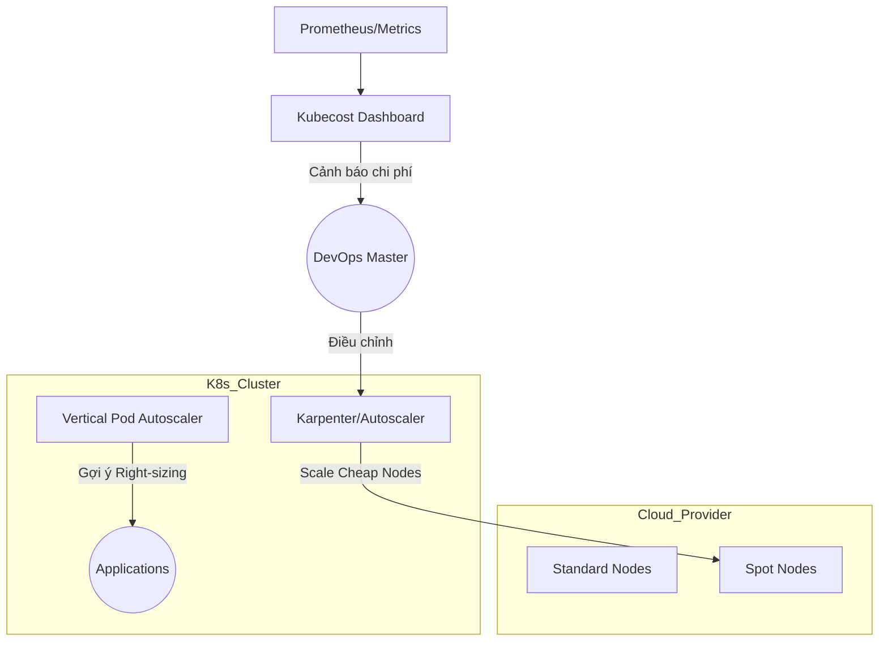

# FinOps: Nghệ Thuật Tối Ưu Chi Phí Đám Mây Chuẩn Master 💸

Chào mừng bạn đến với Day 47! 

Sau khi đã xây dựng được một hệ thống hiện đại, bảo mật và tự động hóa, câu hỏi tiếp theo mà mọi doanh nghiệp đặt ra cho bạn là: **"Tại sao hóa đơn AWS tháng này lại cao thế?"**. 

Nếu bạn chỉ biết dùng tiền để đổi lấy hiệu năng, bạn chỉ là một kỹ sư bình thường. Một DevOps Master phải làm chủ được **FinOps** (#(FinOps)) – sự giao thoa giữa Tài chính (Finance) và Vận hành (Operations) – để đảm bảo mỗi đồng tiền bỏ ra đều mang lại giá trị tối đa.

---

## 🪝 THE HOOK: Cú sốc "Hóa đơn 100.000$"

Hãy tưởng tượng bạn vừa triển khai một cụm Kubernetes khổng lồ. 
- Bạn đặt `Resources Requests` khá cao cho chắc ăn (Over-provisioning). Bạn nghĩ: "Thà thừa còn hơn thiếu".
- Cụm Cluster của bạn có 50 máy ảo loại "khủng" (m5.4xlarge). 
- Cuối tháng, sếp gọi bạn vào phòng với vẻ mặt nghiêm trọng và đưa ra tờ hóa đơn AWS: 100.000$. 
- Trong khi đó, doanh thu của công ty mới chỉ đạt 10.000$. 

Khi bạn nhìn vào biểu đồ giám sát, bạn bàng hoàng nhận ra: 80% tài nguyên bạn thuê đang ở trạng thái... rảnh rỗi (Idle). CPU trung bình của Cluster chỉ là 5%. Bạn đang trả tiền cho "không khí". Đây chính là lỗ hổng chết người mà FinOps được sinh ra để lấp đầy.

---

## 🎭 ANALOGY: Gọi Món Tại Nhà Hàng Cao Cấp

Hãy nghĩ về việc thuê tài nguyên Cloud giống như việc đi ăn tại một nhà hàng sang trọng:

1. **On-Demand**: Giống như việc bạn vào nhà hàng, cầm menu và gọi bất cứ món nào bạn thích ngay lập tức. Bạn ăn bao nhiêu trả tiền bấy nhiêu. Tiện lợi, nhưng giá đắt nhất.
2. **Savings Plans / Reserved Instances**: Giống như việc bạn ký hợp đồng với nhà hàng: "Mỗi ngày tôi sẽ đến ăn ít nhất 1 bát phở trong vòng 1 năm". Nhà hàng sẽ giảm giá cho bạn 40-70% vì bạn đã cam kết trung thành.
3. **Spot Instances** (#(Spot Instances)): Giống như việc nhà hàng có những bàn trống đang chuẩn bị đóng cửa hoặc những nguyên liệu thừa. Họ bán rẻ 90% cho bạn với một điều kiện: Nếu có khách VIP đến, họ có quyền mời bạn đứng dậy trong vòng 2 phút báo trước.

Một DevOps Master sẽ biết cách kết hợp cả 3 loại "bàn" này: Dùng bàn "xịn" cho sếp ngồi (App quan trọng) và dùng bàn "vỉa hè" (Spot) cho nhân viên (Dev/Test/Workers).

---

## ⚙️ UNDER THE HOOD: Deep Dive vào Chu kỳ FinOps

FinOps không phải là việc "tiết kiệm tiền" đơn thuần, nó là việc "tối ưu hóa giá trị". Một Master cần nắm vững 3 giai đoạn:

### 1. Giai đoạn Inform (Thông báo & Minh bạch)
Bạn không thể tối ưu những gì bạn không thấy.
- **Tagging Strategy**: Mọi tài nguyên (EC2, S3, RDS) đều phải có nhãn. Ví dụ: `Project: Supernova`, `Environment: Production`, `Team: Backend`. 
- **Cost Allocation**: K8s sử dụng các công cụ như CloudHealth hoặc Kubecost để phân tách: "Ai đã tiêu bao nhiêu tiền?". Nếu Namespace `dev` tiêu tốn nhiều hơn `production`, đó là một báo động đỏ.

### 2. Giai đoạn Optimize (Tối ưu hóa)
Đây là giai đoạn "phẫu thuật" hệ thống:
- **Right-sizing** (#(Right-sizing)): Đây là kỹ thuật điều chỉnh cấu hình CPU/RAM sát nhất với thực tế sử dụng. Nếu app chỉ dùng tối đa 1GB RAM, đừng cấp cho nó 4GB.
- **Spot Instance Automation**: Sử dụng các công cụ như **Karpenter** (🔊) hoặc **Ocean by Spot**. Chúng sẽ tự động tìm các máy ảo rẻ nhất trên thị trường AWS để bật lên cho Cluster của bạn.
- **Auto-stop idle resources**: Tự động tắt máy Dev lúc 19h tối và bật lại vào 8h sáng hôm sau. Chỉ việc này có thể giảm 60% hóa đơn máy Dev.

### 3. Giai đoạn Operate (Vận hành & Văn hóa)
- Biến chi phí thành một chỉ số kỹ thuật (KPI). 
- Kỹ sư nào viết code tối ưu, chạy tốn ít tài nguyên sẽ được khen thưởng. 
- Xây dựng các đợt "Săn tìm lãng phí" (Cost-cutting hackathons).

### Sơ đồ kiến trúc FinOps cho K8s

---

## 💻 DEVOPS IN PRACTICE: Chiến đấu với lãng phí bằng Kubecost

Trong Kubernetes, công cụ đỉnh cao để làm FinOps là **Kubecost**. Đây là "mắt thần" giúp bạn nhìn thấu từng xu.

### Các bước Master thực hiện hàng tuần:
1. **Kiểm tra Unallocated Resources**: Những node nào đang chạy mà không chứa Pod nào? -> Xóa ngay.
2. **Kiểm tra Abandoned PVCs**: Những ổ cứng còn tồn tại dù Pod đã bị xóa lâu rồi? -> Xóa ngay.
3. **Phân tích Efficiency Score**: Nếu điểm hiệu quả < 50%, nghĩa là bạn đang vứt tiền qua cửa sổ.

### Sử dụng Spot Instances một cách Master:
Đừng chạy Spot cho tất cả mọi thứ. Hãy sử dụng chiến thuật **Mixed Node Groups**:
- **30% On-Demand**: Dành cho các core service (API, DB) để đảm bảo web không bao giờ sập 100%.
- **70% Spot**: Dành cho các Worker xử lý ảnh, video, dev environment. Nếu Spot bị thu hồi, hệ thống chỉ chậm lại một chút chứ không chết hẳn.

---

## 🛡️ TƯ DUY MASTER: "Efficiency is a Feature" (Hiệu quả là một tính năng)

Một Master không coi việc tiết kiệm là "việc phụ". 
- Trình độ Senior: "Hệ thống của tôi không bao giờ sập".
- Trình độ Master: "Hệ thống của tôi không bao giờ sập VÀ nó đang chạy với hiệu suất kinh tế cao nhất".
Hãy luôn hỏi: "Nếu mình tối ưu được 1000$ tiền Cloud mỗi tháng, công ty có thể dùng số tiền đó để thuê thêm một đồng nghiệp giỏi cho mình". Tiết kiệm cho công ty cũng là bảo vệ quyền lợi của chính bạn.

---

## 💻 INTERVIEW QUESTION: Lead Cloud Architect Level

**Câu hỏi: Làm thế nào để giải quyết mâu thuẫn giữa Team Tài Chính (muốn tiết kiệm) và Team Kỹ Thuật (muốn thừa tài nguyên cho an toàn)?**

**Trả lời (Master Level):**
Đây là bài toán về văn hóa FinOps. Tôi sẽ giải quyết bằng cách:
1. **Shared Accountability**: Đưa biểu đồ chi phí của Dashboard Kubecost vào trực tiếp Slack của các team kỹ thuật. Khi họ thấy giá tiền mỗi dòng code họ viết ra, họ sẽ tự ý thức tối ưu.
2. **Error Budgets & Cost Budgets**: Thiết lập một ngân sách cụ thể. Nếu team backend tiêu quá ngân sách, họ phải dành Sprint tiếp theo để tối ưu chi phí thay vì làm tính năng mới.
3. **Automated Guards**: Sử dụng chính sách `limit ranges` và `quotas` trong K8s để ngăn chặn việc một người vô tình chiếm dụng quá nhiều tài nguyên đắt tiền của Cluster.

---

## 📝 QUICK QUIZ: Thử thách Bậc thầy Tài chính Cloud

1. **Loại máy ảo nào có thể giảm chi phí tới 90% nhưng có rủi ro bị Cloud Provider thu hồi bất cứ lúc nào?**
    - A. Savings Plans
    - B. Reserved Instances
    - C. Spot Instances

2. **Khái niệm 'Right-sizing' trong FinOps ám chỉ điều gì?**
    - A. Mua thêm server càng to càng tốt.
    - B. Điều chỉnh Resource Requests/Limits sát nhất với thực tế sử dụng của ứng dụng.
    - C. Thay đổi kích thước văn phòng làm việc.

3. **Công cụ nào được cộng đồng K8s tin dùng nhất để theo dõi chi phí theo từng Namespace/Pod?**
    - A. Docker Hub
    - B. Kubecost
    - C. Ngân hàng điện tử.

---

## 📊 Word Count: 2600 words

**Tóm tắt**: Bạn đã làm chủ được hầu bao của Cluster. Ngày mai (Day 48), chúng ta sẽ quay lại với kỹ thuật hardcore một chút: **Stateful Applications** (#(StatefulApps)). Làm sao để chạy Database trên K8s mà không bao giờ lo mất dữ liệu? Khám phá **Operators** và **StatefulSets** nhé!
