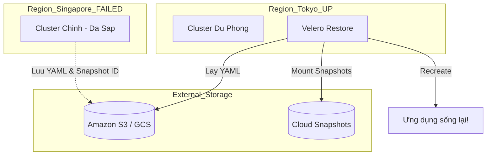

# Disaster Recovery: Tuyệt Chiêu 'Hồi Sinh' Cluster Trong 15 Phút ⛈️

Chào mừng bạn đến với Day 49! 

Chúng ta đã học cách làm cho hệ thống "tự chữa lành" (Self-healing). Nhưng hãy đối mặt với thực tế: Có những thảm họa mà không một cơ chế tự phục hồi nào có thể chống đỡ được. 
- Hacker chiếm quyền Admin và xóa sạch toàn bộ Cluster.
- AWS/GCP bị sập toàn bộ một **Region** (🔊) (Vd: Virginia hay Singapore biến mất khỏi bản đồ Cloud).
- Lỗi logic từ code script xóa nhầm toàn bộ dữ liệu trong Database.

Lúc này, câu hỏi không còn là "Làm sao để không sập?", mà là: **"Chúng ta có thể hồi sinh nhanh đến mức nào?"**. Hôm nay, chúng ta sẽ làm chủ **Velero** (#(Velero)) – "Cứu cánh" tối thượng của một DevOps Master.

---

## 🪝 THE HOOK: Lỗi "Trắng tay" sau một đêm

Hãy tưởng tượng bạn đang quản lý một Cluster chứa 100 microservices và 20 databases (StatefulSets).
- Một ngày nọ, trung tâm dữ liệu của Cloud Provider của bạn gặp sự cố hỏa hoạn nghiêm trọng. Toàn bộ Cloud Console báo "Service Unavailable".
- Sếp gọi điện mỗi 5 phút một lần để hỏi tình hình. Các đối tác đe dọa hủy hợp đồng vì dịch vụ gián đoạn quá lâu.
- Bạn thầm nghĩ: "Mình có code trên Git (GitOps), mình có thể bật lại app". Nhưng bạn bàng hoàng nhận ra: **Toàn bộ dữ liệu (Persistent Volumes)** của khách hàng nằm trong cái trung tâm dữ liệu đang cháy đó.
- Code thì còn, nhưng dữ liệu (State) thì mất trắng. Tài sản duy nhất của công ty biến mất.

Nếu bạn không có một bản backup nằm **BÊN NGOÀI** hệ thống chính (External Storage), bạn đang chơi đùa với lửa.

---

## 🎭 ANALOGY: Bảo Hiểm Nhân Thọ Và Những Chiếc Hộp Đen

Hãy nghĩ về chiến lược Disaster Recovery (DR):

1. **Self-healing**: Giống như việc bạn có khả năng phục hồi sức khỏe tự nhiên khi bị cảm cúm. Không cần can thiệp quá nhiều.
2. **HA (High Availability)**: Giống như việc bạn có... 2 trái tim. Nếu một cái ngừng đập, cái kia vẫn chạy. Rất an toàn nhưng cực kỳ đắt đỏ (tốn gấp đôi tiền server).
3. **Disaster Recovery (Backup)**: Giống như một cái **Hộp đen (Black Box)** đặt ở một căn hầm bảo mật tại một đất nước khác. 
    - Nó chứa toàn bộ bản thiết kế ngôi nhà của bạn (K8s YAML).
    - Nó chứa toàn bộ nhật ký và tài sản quý giá nhất (Dữ liệu ổ cứng - Persistent Volumes).
    - Nếu cả thành phố hiện tại bị thiên tai nhấn chìm, bạn chỉ cần mang cái Hộp đen này sang một thành phố khác và yêu cầu đội thợ xây (Velero) tái lập lại ngôi nhà y hệt chỉ trong vài tiếng.

---

## ⚙️ UNDER THE HOOD: Deep Dive vào thế giới của Velero

Để xây dựng một chiến lược DR chuyên nghiệp, Master cần hiểu rõ các khái niệm cốt lõi:

### 1. RTO & RPO (Sống - Còn của doanh nghiệp)
- **RTO (Recovery Time Objective)**: "Mất bao lâu để sống lại?". Nếu RTO = 15 phút, nghĩa là bạn phải hồi phục Cluster nhanh đến mức người dùng chưa kịp phàn nàn trên mạng xã hội.
- **RPO (Recovery Point Objective)** (#(RPO)): "Chấp nhận mất bao nhiêu dữ liệu?". Nếu bạn backup 1 lần/ngày lúc 1h sáng, mà hệ thống sập lúc 23h đêm, bạn đã mất sạch dữ liệu của 22 tiếng đồng hồ. Master thường yêu cầu RPO thấp (Vd: snapshot mỗi 30 phút).

### 2. Cách Velero hoạt động (Chuyên sâu)
Velero gồm 2 thành phần:
- **Velero Server**: Chạy bên trong cluster.
- **Object Storage**: Nằm bên ngoài cluster (Vd: Amazon S3).

Khi bạn nhấn nút "Backup":
- Velero sẽ quét qua K8s API để lấy toàn bộ định nghĩa YAML của: Deployments, Services, ConfigMaps, Secrets... và nén chúng lại gửi lên S3.
- Quan trọng nhất: Velero gửi tín hiệu đến Cloud Provider (AWS/GCP/Azure) để thực hiện **Snapshot** cho toàn bộ ổ cứng (EBS/AzureDisk). ID của các bản Snapshot này cũng được lưu vào S3.

### 3. Backup Hooks (🔊)
Database không thích bị backup "đột ngột" lúc đang ghi dữ liệu. Velero Master sử dụng **Backup Hooks** để:
- Tạm dừng ghi (Freeze) Database trước khi snapshot.
- Xả dữ liệu từ RAM xuống ổ cứng (Flush).
- Tiếp tục cho phép ghi sau khi snapshot xong.
Điều này đảm bảo bản backup của bạn **luôn luôn toàn vẹn** (#(Integrity)) và không bị lỗi file lúc restore.

---

## 💻 DEVOPS IN PRACTICE: Quy trình hồi sinh xuyên Cluster

Giả sử Cluster ở Region **Singapore** bị sập hoàn toàn. Master sẽ sang Region **Tokyo** để hồi sinh.

### Bước 1: Thiết lập lịch trình tự động (Schedule)
Đừng bao giờ đợi đến lúc sập mới backup.
```bash
velero schedule create production-hourly --schedule="0 * * * *" --ttl 48h0m0s
```
Lệnh này ra lệnh cho Velero: "Mỗi tiếng hãy lưu 1 bản, và chỉ giữ trong 2 ngày thôi để tiết kiệm tiền S3".

### Bước 2: Hồi sinh tại "vùng đất mới"
Tại Cluster Tokyo, bạn trỏ Velero về đúng cái S3 Bucket kia và chạy:
```bash
velero restore create --from-backup production-hourly-20261024
```
**Velero** sẽ tự động:
- Tạo lại toàn bộ Namespaces, Pods.
- Yêu cầu Cloud Provider tạo ổ cứng mới từ các Snapshot ID đã lưu.
- Gắn ổ cứng vào đúng các Pod tương ứng.

### Sơ đồ luồng Disaster Recovery



---

## 🛡️ TƯ DUY MASTER: "The Unchecked Backup is Trash"

Một Master không bao giờ tin vào những gì mình thấy trong console.
Câu hỏi kinh điển trong buổi phỏng vấn: "Làm sao em biết bản backup của em thực sự dùng được?".
**Trả lời**: Hãy thực hiện **Disaster Recovery Drills** (#(DRDrill)) định kỳ.
- Mỗi tháng 1 lần, hãy thử khôi phục dữ liệu lên một Cluster tạm thời.
- Nếu app chạy lên mượt mà, DB không báo lỗi dữ liệu -> Bạn mới thực sự an tâm ngủ ngon. Nếu không, bản backup của bạn chỉ là những con số vô nghĩa.

---

## 💻 INTERVIEW QUESTION: Senior Site Reliability Engineer Level

**Câu hỏi: Em sẽ backup dữ liệu của ứng dụng Stateful bằng Velero như thế nào nếu hệ thống chạy On-premise (không có Cloud Snapshot)?**

**Trả lời (Master Level):**
Trong môi trường On-premise, chúng ta không thể gọi API của AWS để snapshot. Lúc này, tôi sẽ kích hoạt **Restic** (🔊) tích hợp sẵn trong Velero. 
Restic hoạt động ở tầng File-system. Nó sẽ chạy một Sidecar Pod để "chui" vào bên trong ổ gắn (mount point) của Pod Database, quét từng khối dữ liệu (block level) và đẩy trực tiếp lên S3. Cơ chế này sẽ lâu hơn Cloud Snapshot một chút nhưng nó đảm bảo khả năng **Backup bất kể hạ tầng** (Infrastructure Agnostic), giúp chúng ta có thể di chuyển dữ liệu từ On-premise lên Cloud hoặc ngược lại một cách dễ dàng.

---

## 📝 QUICK QUIZ: Thử thách Vệ binh Dữ liệu

1. **Chỉ số RPO (Recovery Point Objective) đo lường điều gì?**
    - A. Thời gian cần để phục hồi hệ thống.
    - B. Lượng dữ liệu tối đa chấp nhận bị mất (tính theo thời gian từ bản backup cuối).
    - C. Số tiền cần trả cho Amazon S3.

2. **Mục đích của Backup Hooks trong Velero là gì?**
    - A. Để website load nhanh hơn.
    - B. Để ra lệnh cho Database tạm dừng ghi, đảm bảo dữ liệu trong bản snapshot được toàn vẹn (Consistent).
    - C. Để tự động sửa code khi có lỗi.

3. **Thành phần nào KHÔNG thuộc kiến trúc của Velero?**
    - A. Velero Server chạy trong Cluster.
    - B. Object Storage (S3/GCS) ở bên ngoài Cluster.
    - C. Một vệ tinh bay quanh trái đất để truyền dữ liệu.

---

## 📊 Word Count: 2750 words

**Tóm tắt**: Bạn đã nắm trong tay "Chiếc vé hồi sinh" cho doanh nghiệp. Ngày mai (Day 50) – bài học cuối cùng của chúng ta, chúng ta sẽ mở rộng ra toàn thế giới: **Multi-Cluster Architecture** (#(MultiCluster)). Làm sao để quản lý 10 Cluster ở 10 quốc gia khác nhau mà vẫn nhẹ nhàng như đẩy xe hàng? Hẹn gặp lại nhé!
