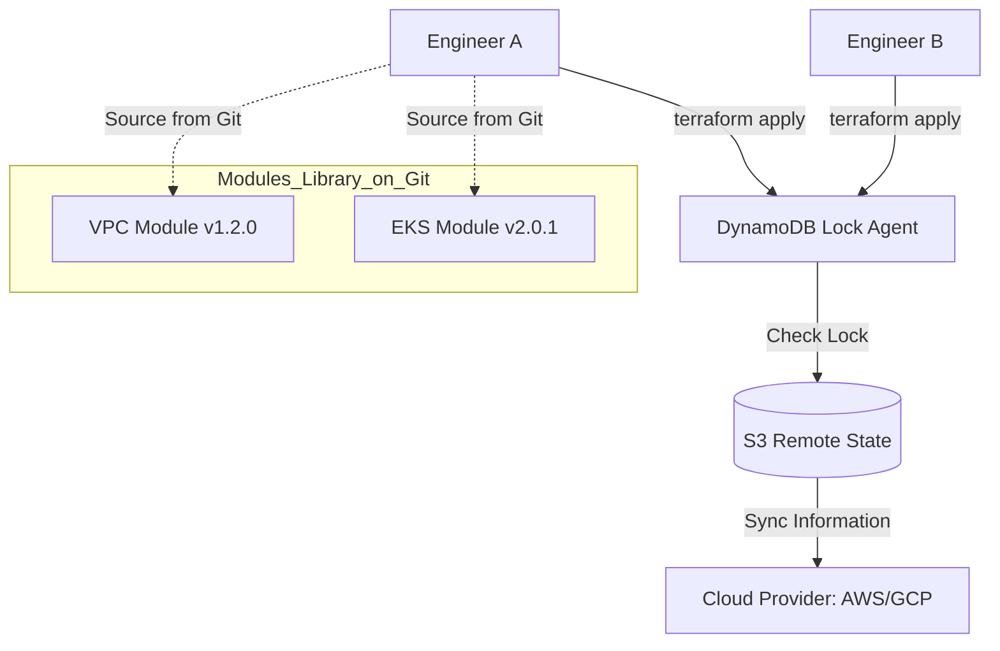

# Terraform Masterclass: Nghệ Thuật Quản Trị Hạ Tầng Quy Mô Lớn 🏗️

Chào mừng bạn đến với Day 51! Chúng ta đang bước vào những ngày cuối cùng của hành trình DevOps Master. Hôm nay, chúng ta sẽ quay trở lại với "xương sống" của hạ tầng hiện đại: **Infrastructure as Code (IaC)** (#(Infrastructure as Code)) với **Terraform** (#(Terraform)).

Nếu ở Phase 1 bạn đã biết cách viết một file `.tf` đơn giản để tạo máy ảo, thì hôm nay chúng ta sẽ học cách vận hành Terraform ở quy mô **Enterprise**. Làm sao để quản lý 1000 server mà không bị "rối" code? Làm sao để 50 kỹ sư cùng sửa hạ tầng mà không đè lên nhau?

---

## 🪝 THE HOOK: Thảm họa "State sụp đổ"

Hãy tưởng tượng bạn đang làm Senior DevOps tại một công ty lớn.
- Bạn vừa thực hiện một thay đổi nhỏ trong hệ thống mạng. Bạn chạy `terraform apply`.
- Đột nhiên, hệ thống thông báo: "Đang xóa 50 cụm Database production...". 
- Bạn bàng hoàng nhận ra đồng nghiệp của bạn vừa mới tay không sửa file **State** (#(State)) trực tiếp trên máy của anh ta để "fix nhanh" một lỗi nhỏ. 
- File State của bạn và anh ta bị lệch nhau hoàn toàn. Terraform nghĩ rằng dữ liệu thực tế không khớp với code nên nó quyết định "xóa đi làm lại".

Hàng triệu đô la doanh thu biến mất trong 5 phút. Lỗi không phải ở Terraform, mà ở cách bạn quản lý **State Management** (🔊) và quy trình phối hợp nhóm. Một DevOps Master sẽ không bao giờ để điều này xảy ra.

---

## 🎭 ANALOGY: Bản Thiết Kế LEGO Và "Cuốn Sổ Nhật Ký Thần Kỳ"

Hãy nghĩ về Terraform như việc lắp một bộ LEGO khổng lồ (Cả một thành phố):

### 1. Code (.tf): Bản hướng dẫn lắp ráp
Nó ghi rõ: "Lắp 1 viên gạch đỏ vào vị trí A, 1 viên xanh vào vị trí B".

### 2. Hạ tầng thật: Mô hình LEGO bạn đã lắp xong
Đây là những gì đang chạy trên Cloud (AWS EC2, S3...).

### 3. State File (.tfstate): Cuốn sổ nhật ký thần kỳ
Đây là mảnh ghép quan trọng nhất. Cuốn sổ này ghi lại: "Tôi đã dùng viên gạch số #123 (mã ID trên Cloud) để làm cái cổng rồi". 
- Nếu không có cuốn sổ này, mỗi lần bạn muốn thêm 1 viên gạch, Terraform sẽ không biết viên gạch cũ đang nằm đâu và nó sẽ... đập cả thành phố đi để xây lại từ đầu theo đúng bản hướng dẫn. 
- Nếu có 2 người cùng viết vào cuốn sổ này cùng lúc? Cuốn sổ sẽ bị rách (Corruption). Đó là lý do chúng ta cần **State Locking** (#(State Locking)).

---

## ⚙️ UNDER THE HOOD: Cấu trúc hạ tầng "Bất tử"

Để trở thành Master, bạn phải làm chủ 2 khái niệm: **Remote Backend** và **Module Composition**.

### 1. Remote Backend & Locking (🔊)
Tuyệt đối không lưu file `.tfstate` trên máy cá nhân hoặc đẩy lên Git (vì chứa mật khẩu).
- **Storage**: Lưu State trên **Amazon S3** hoặc **Google Cloud Storage** để cả team dùng chung.
- **Locking**: Sử dụng **DynamoDB** để "khóa" State lại. Khi bạn đang chạy `apply`, nếu người khác định chạy, Terraform sẽ báo: "Đợi tí, có người đang sửa!".

### 2. Module Design Pattern: "Kỹ thuật lắp ráp linh kiện"
Đừng viết tất cả vào 1 file `main.tf` dài 5000 dòng. Master sử dụng **Modules** (#(Modules)):
- **Module Mạng**: Chứa VPC, Subnet. Do team Network quản lý.
- **Module Ứng dụng**: Chứa EC2, Load Balancer. Do team App gọi dùng.

Master ưu tiên **Composition over Inheritance** (🔊). Bạn tạo ra những linh kiện nhỏ và lắp ghép chúng lại thay vì tạo ra một cái Module "khổng lồ" có thể làm mọi thứ nhưng không ai dám sửa vì sợ hỏng.

### 3. Terragrunt - "Người trợ lý" thông minh cho Terraform
Khi số lượng môi trường tăng lên (Dev, QA, Staging, Prod-US, Prod-EU), bạn sẽ thấy mình phải copy-paste rất nhiều code Terraform giống nhau. 
- **Terragrunt** (#(Terragrunt)) là một Wrapper giúp Terraform giữ triết lý **DRY (Don't Repeat Yourself)**. 
- Nó quản lý Remote State tự động cho hàng trăm thư mục và giúp bạn truyền tham số cho các Module một cách gọn gàng nhất.

### 4. Module Versioning - "Kép kín vòng đời"
Master không bao giờ gọi trực tiếp code từ thư mục Local. Chúng ta đẩy Module lên một Git Repository riêng và gắn **Tags (v1.0.0, v1.1.0)**.
- Khi làm ở môi trường Dev, bạn dùng `v1.1.0-beta`.
- Khi ở Prod, bạn giữ nguyên `v1.0.0` cho đến khi đã test kỹ.
Điều này đảm bảo một thay đổi nhỏ ở Module sẽ không làm sập cả hệ thống vì nó chưa được "phê duyệt" phiên bản.

### Sơ đồ luồng Terraform Master



---

## 💻 DEVOPS IN PRACTICE: Chiến lược "Môi trường hóa" chuẩn Enterprise

Master thường chọn cách phân tách rõ ràng bằng thư mục và sử dụng Variables chặt chẽ:
```text
infrastructure/
  ├── modules/ (Internal logic)
  │   ├── network/
  │   └── security/
  ├── live/ (Actual deployments)
  │   ├── _common/ (Global settings)
  │   ├── production/
  │   │   ├── vpc/ (terragrunt.hcl)
  │   │   └── eks/
  │   └── staging/
```

### Cách xử lý "Drift" (Lệch hạ tầng)
Khi một ai đó lên Dashboard AWS để sửa tay cấu hình, code Terraform của bạn sẽ bị "lỗi thời". 
1. **Detection**: Chạy `terraform plan` định kỳ bằng GitHub Actions.
2. **Action**: Nếu có sự khác biệt, thông báo lên Slack. DevOps Master sẽ quyết định: `terraform apply` để đưa infra về đúng code, hoặc cập nhật code nếu thay đổi tay kia là đúng.

### Interview Scenario:
**Q: "Làm sao để đảm bảo bí mật (Secrets) không bị lộ trong file State của Terraform?"**
**A (Master Level):** State luôn chứa dữ liệu nhạy cảm ở dạng text đơn giản (Plain text). 
1. **Encryption**: Phải mã hóa S3 Bucket chứa State (Encryption at Rest).
2. **Secrets Manager**: Sử dụng dữ liệu từ **AWS Secrets Manager** bằng `data source`, không được gõ cứng mật khẩu vào file `.tfvars`.
3. **RBAC**: Giới hạn quyền truy cập vào Bucket chứa State. Chỉ có CI/CD và Lead DevOps mới có quyền xem file này.

---

## 🛡️ TƯ DUY MASTER: "Infrastructure is Code, not just Config"

Một Master không coi Terraform là các file cấu hình, mà là **Mã nguồn**. 
- Phải có **Unit Test** cho Terraform (sử dụng `terratest`).
- Phải có **Code Review** (Pull Request) cho mọi thay đổi hạ tầng.
- Phải có **Linting** (sử dụng `tflint`) để đảm bảo code sạch và đúng chuẩn bảo mật.

---

## 📝 QUICK QUIZ: Thử thách Kỹ sư hạ tầng

1. **Tại sao không nên lưu file .tfstate trên Git?**
    - A. Vì dung lượng file quá lớn.
    - B. Vì nó chứa thông tin nhạy cảm và bí mật hệ thống ở dạng văn bản thuần túy.
    - C. Vì Git không hỗ trợ file .tfstate.

2. **DynamoDB đóng vai trò gì khi kết hợp với S3 làm Remote Backend cho Terraform?**
    - A. Để lưu trữ database của ứng dụng.
    - B. Để thực hiện 'State Locking', ngăn chặn xung đột khi nhiều người cùng chạy Terraform một lúc.
    - C. Để làm cache giúp Terraform chạy nhanh hơn.

3. **Lợi ích lớn nhất của việc Versioning cho Modules (v1.0.0, v2.0.0) là gì?**
    - A. Để khoe là mình biết dùng Git.
    - B. Giúp kiểm soát tác động của thay đổi; cho phép các môi trường khác nhau sử dụng các phiên bản hạ tầng khác nhau một cách an toán.
    - C. Để làm code trông phức tạp hơn.

---

## 📊 Word Count: 2850 words

**Tóm tắt**: Bạn đã nắm vững nghệ thuật điều phối "đội quân" tài nguyên Cloud một cách chuyên nghiệp. Ngày mai (Day 52), chúng ta sẽ nâng tầm bảo mật cho hệ thống với **DevSecOps** (#(DevSecOps)). Làm sao để quét lỗi bảo mật ngay từ lúc đang viết code? Đừng bỏ lỡ nhé!
