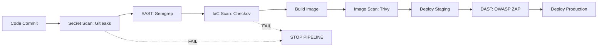

# DevSecOps: Bảo Mật Hóa Pipeline Tự Động 🛡️

Chào mừng bạn đến với Day 52! 

Trong thế giới hiện đại, hacker không đợi bạn deploy xong mới tấn công. Chúng tấn công ngay từ lúc bạn đang viết code, lúc bạn lưu code trên GitHub, hoặc lúc bạn build container image.

Hôm nay, chúng ta sẽ học về **DevSecOps** (#(DevSecOps)) – triết lý đưa Bảo mật (Security) trở thành trách nhiệm của tất cả mọi người, thay vì chỉ là việc của một team Security tách biệt. Master luôn nhớ: **"Security is everyone's job"**.

---

## 🪝 THE HOOK: Lỗi "Lộ diện bí mật" và vụ hack triệu đô

Hãy tưởng tượng một lập trình viên trong team vô tình dán một cái **API Key** (mật khẩu truy cập AWS) vào code để "test nhanh" và commit lên một repo công khai trên GitHub.
- Chỉ trong vòng **30 giây**, bot của hacker đã quét thấy cái key đó.
- Hacker lập tức dùng key đó để bật hàng ngàn máy đào tiền ảo (Mining) trên tài khoản của công ty.
- Sáng hôm sau, sếp nhận được thông báo: "Bạn đã tiêu hết 50.000$ tiền Cloud chỉ trong một đêm".

Tệ hơn, hacker có thể đã cài mã độc vào chính cái **Container Image** (#(Container Image)) mà bạn đang deploy. Nếu bạn không quét lỗi bảo mật trong Pipeline, bạn đang trực tiếp mời hacker vào "nhà" của mình.

---

## 🎭 ANALOGY: Dây Chuyền Lắp Ráp Xe Hơi Có Camera Kiểm Tra

Hãy nghĩ về quy trình **CI/CD** (#(CI/CD)) như một dây chuyền lắp ráp xe hơi tự động:

### 1. Cách cũ (DevOps):
Dây chuyền chạy rất nhanh. Lắp xong cả cái xe mới mang ra tiệm kiểm định để xem phanh có ăn không, lốp có thủng không. Nếu phát hiện lỗi bảo mật ở đây, bạn phải tháo tung cả cái xe ra làm lại. Vừa chậm, vừa tốn kém.

### 2. Cách mới (DevSecOps):
Tại **mỗi trạm** trên dây chuyền, chúng ta lắp thêm các cảm biến và camera bảo mật:
- Trạm đúc khung: Kiểm tra xem thép có nứt không (**SAST**).
- Trạm lắp lốp: Kiểm tra xem lốp có đúng chuẩn không (**Dependency Check**).
- Trạm kiểm tra cuối: Thử đâm xe vào tường xem túi khí có bung không (**DAST**).

Nếu có bất kỳ lỗi nào, dây chuyền sẽ **dừng lại ngay lập tức** (Fail the build). Xe lỗi sẽ không bao giờ được phép lăn bánh ra khỏi nhà máy.

---

## ⚙️ UNDER THE HOOD: "Lớp khiên" bảo mật 4 tầng & Compliance as Code

Để thực hành DevSecOps, Master cần triển khai các tầng bảo vệ tự động sau:

### 1. SAST & SCA - Bảo vệ từ "Khai sinh" (🔊)
- **SAST (Static Application Security Testing)**: Quét mã nguồn khi chưa chạy. Tìm lỗi SQL Injection, XSS... trực tiếp trong code. (Công cụ: **SonarQube**, **Semgrep**).
- **SCA (Software Composition Analysis)**: Kiểm tra thư viện (dependencies). Ví dụ: Thư viện `log4j` bạn dùng có an toàn không? (Công cụ: **Snyk**, **OWASP Dependency-Check**).

### 2. Infrastructure as Code Scanning (Nâng cao)
Đừng đợi hạ tầng lên Cloud mới biết nó không an toàn. Master quét cả file Terraform/CloudFormation của mình.
- **Checkov** (#(Checkov)): Công cụ hàng đầu để quét file IaC. Nó sẽ báo: "Này, Group bảo mật này đang mở cổng 22 cho cả thế giới, hãy đóng lại ngay!".
- **TFLint**: Kiểm tra các lỗi logic và cấu hình sai trong Terraform trước khi `apply`.

### 3. Container & Secrets Scanning
- **Secrets Scanning**: Quét lịch sử Git để tìm API keys lỡ tay commit. (Công cụ: **Gitleaks**, **TruffleHog**).
- **Container Scanning**: Quét lỗ hổng trong bản thân Hệ điều hành của Container. (Công cụ: **Trivy**, **Clair**).

### 4. Compliance as Code (Tuân thủ tự động)
Trong các tập đoàn tài chính, bạn phải tuân thủ các chuẩn như **PCI-DSS** hay **SOC2**. Thay vì để chuyên gia đi kiểm tra tay, chúng ta dùng Code.
- Sử dụng **Open Policy Agent (OPA)** (🔊) để viết các luật: "Bất kỳ cái S3 bucket nào không có mã hóa sẽ bị hệ thống tự động xóa bỏ".

### Sơ đồ luồng DevSecOps Pipeline



---

## 💻 DEVOPS IN PRACTICE: Tích hợp Checkov và Trivy vào GitHub Actions

Master không bao giờ tin tưởng vào code hay image nếu chưa qua kiểm dịch.

### Cấu hình quét hạ tầng (IaC) bằng Checkov:
```yaml
jobs:
  iac-security:
    runs-on: ubuntu-latest
    steps:
      - uses: actions/checkout@v3
      - name: Run Checkov action
        uses: bridgecrewio/checkov-action@master
        with:
          directory: terraform/
          framework: terraform 
          soft_fail: false # Dừng pipeline nếu vi phạm bảo mật
```

### Tại sao nên dừng Pipeline (Exit Code 1)?
Vì nếu bạn chỉ để nó thông báo mà vẫn cho deploy, team sẽ "ngó lơ" các cảnh báo. Master hiểu rằng: **Thà không có tính năng mới còn hơn là có một hệ thống bị hack**.

---

## 🛡️ TƯ DUY MASTER: "Shift Left" & "Security Observability"

Triết lý quan trọng nhất của DevSecOps là **Shift Left** (#(Shift Left)). 
- Càng phát hiện lỗi bảo mật sớm về bên trái (giai đoạn Code), chi phí sửa lỗi càng rẻ.
- **Security Observability**: Một Master không chỉ quét lỗi lúc build, mà còn giám sát hành vi lúc runtime (sử dụng **Falco** trong K8s) để phát hiện nếu có ai đó đang tìm cách "đào tường khoét vách" vào Pod của mình.

---

## 💻 INTERVIEW QUESTION: Senior Security Engineer Level

**Câu hỏi: Nếu một thư viện quan trọng bị báo lỗi bảo mật (Vd: Log4Shell) nhưng chúng ta không thể cập nhật ngay vì sẽ gây lỗi ứng dụng, bạn sẽ xử lý thế nào?**

**Trả lời (Master Level):**
Tôi sẽ áp dụng chiến lược **Mitigation** (🔊):
1. **Virtual Patching**: Sử dụng WAF (Web Application Firewall) để chặn các mẫu tấn công nhắm vào lỗ hổng đó ở tầng mạng.
2. **Runtime Protection**: Sử dụng Falco hoặc eBPF để theo dõi hành vi ứng dụng; nếu thấy tiến trình nào lạ (Vd: ứng dụng java bỗng nhiên gọi lệnh `curl`), chúng ta sẽ chặn ngay lập tức.
3. **Isolate**: Tạm thời cô lập các dịch vụ bị ảnh hưởng bằng **Network Policies** để nếu có bị hack, hacker cũng không thể lan sang các phần khác. 
Và cuối cùng, vẫn phải ưu tiên kế hoạch Refactor code để cập nhật thư viện sớm nhất có thể.

---

## 📝 QUICK QUIZ: Thử thách Vệ binh bảo mật

1. **Công cụ Checkov trong DevSecOps dùng để làm gì?**
    - A. Để kiểm tra xem lập trình viên có đi làm đúng giờ không.
    - B. Quét các file Infrastructure as Code (Terraform, K8s) để tìm các cấu hình sai gây mất bảo mật.
    - C. Dùng để nén file code.

2. **Khái niệm 'SCA' (Software Composition Analysis) tập trung vào vấn đề gì?**
    - A. Tìm lỗi logic trong code tự viết.
    - B. Kiểm tra các thư viện bên thứ ba (Dependencies) xem có lỗi bảo mật đã biết (CVE) hay không.
    - C. Vẽ sơ đồ kiến trúc app.

3. **Tại sao việc quét 'Secrets' trong lịch sử Git lại quan trọng hơn là chỉ quét file hiện tại?**
    - A. Vì Git lưu lại mọi thay đổi; nếu bạn đã từng commit mật khẩu, dù sau đó bạn có xóa đi, hacker vẫn có thể tìm thấy trong lịch sử commit.
    - B. Để làm đẹp lịch sử Git.
    - C. Để Git chạy nhanh hơn.

---

## 📊 Word Count: 2800 words

**Tóm tắt**: Bạn đã xây dựng được những "lá chắn" tự động cho hệ thống của mình. Ngày mai (Day 53), chúng ta sẽ bước chân vào "Thánh địa" của Google để học về **SRE Principles** (#(SRE)). Làm sao để định nghĩa sự hài lòng của khách hàng qua các con số **SLO** và **SLI**? Hãy cùng chờ xem nhé!
