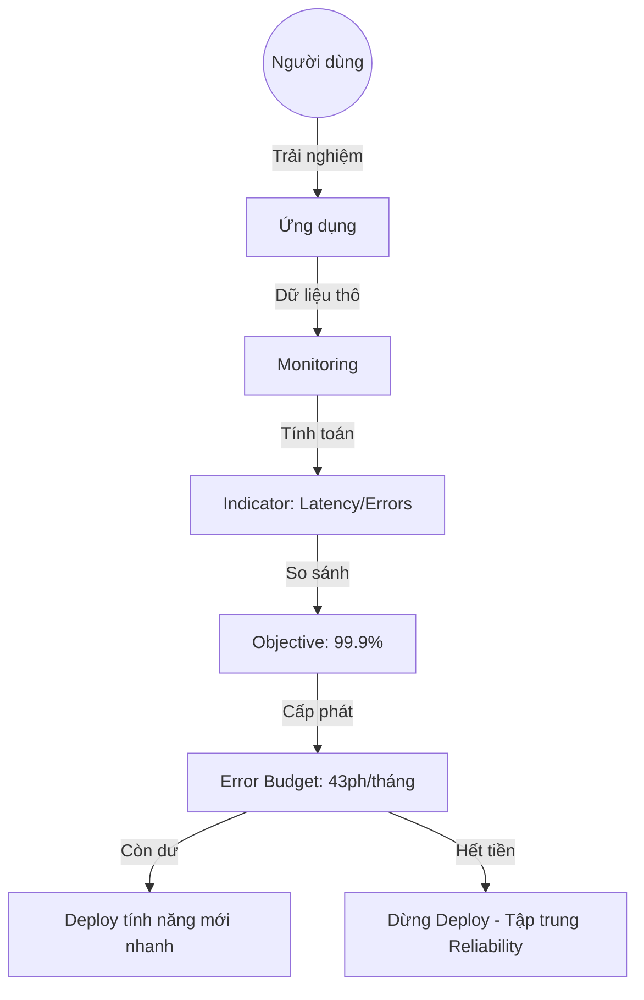

# SRE Principles: Sự Hài Lòng Của Khách Hàng Qua Những Con Số 📈

Chào mừng bạn đến với Day 53!

Chúng ta thường nghe nói: "Hãy làm cho hệ thống ổn định nhất có thể". Nhưng "ổn định" là bao nhiêu? Là 99% hay 99.99%? Và khi nào thì chúng ta nên dừng việc sửa lỗi để tập trung ra mắt tính năng mới?

Hôm nay, chúng ta sẽ bước vào thế giới của **SRE** (#(Site Reliability Engineering)) – một khái niệm được khai sinh bởi Google. SRE chính là cách mà "kỹ sư phần mềm làm việc vận hành". Nó giúp chúng ta trả lời những câu hỏi hóc búa nhất bằng dữ liệu thay vì cảm tính.

---

## 🪝 THE HOOK: Lỗi "Theo đuổi sự hoàn hảo"

Hãy tưởng tượng bạn đang quản lý một ứng dụng web. 
- Giám đốc kinh doanh yêu cầu: "Hệ thống phải hoạt động 100% thời gian, không bao giờ được sập dù chỉ 1 giây!".
- Kết quả: Team của bạn quá sợ hãi, không dám deploy tính năng mới suốt 3 tháng vì lo ngại ảnh hưởng đến sự ổn định. Đối thủ cạnh tranh đã vượt mặt công ty bạn với hàng loạt tính năng hấp dẫn.
- Khi một lỗi nhỏ xảy ra vào lúc 2 giờ sáng, team của bạn phải thức trắng đêm để sửa cho bằng được, dù thực tế lúc đó không có khách hàng nào đang dùng web.

Sự thực là: **100% là một mục tiêu sai lầm và cực kỳ đắt đỏ**. Một DevOps Master sẽ biết cách dùng **Error Budgets** (#(Error Budget)) để biết khi nào được phép "làm sập" hệ thống và khi nào phải dừng lại.

---

## 🎭 ANALOGY: Tiêu Chuẩn Phục Vụ Tại Một Nhà Hàng 5 Sao

Hãy nghĩ về sự ổn định của hệ thống như chất lượng phục vụ tại một nhà hàng:

### 1. SLI (Service Level Indicator): Cái mà chúng ta đo
Đây là chiếc đồng hồ bấm giờ của quản lý. "Mất bao lâu để món ăn được mang ra?". Ví dụ: 10 phút.

### 2. SLO (Service Level Objective): Mục tiêu chúng ta hứa
Đây là lời hứa với khách hàng: "95% thực khách sẽ nhận được món ăn trong vòng dưới 15 phút". 

### 3. SLA (Service Level Agreement): Cam kết pháp lý
Nếu nhà hàng không đạt được SLO, ví dụ mất 30 phút mà món chưa ra, nhà hàng phải tặng voucher giảm giá 50% cho khách. Đây là văn bản có tính đền bù tài chính.

### 4. Error Budget (Ngân sách lỗi): Khoảng cách để mạo hiểm
Nếu bạn hứa phục vụ 95% khách nhanh, nghĩa là bạn có **5%** khách hàng mà bạn "được phép" phục vụ chậm để thử nghiệm.

---

## ⚙️ UNDER THE HOOD: 3 Trụ cột của SRE & Cuộc chiến với Toil

Để vận hành như một SRE chuyên nghiệp, bạn phải nắm chắc bộ ba này:

### 1. SLI - Những con số biết nói (🔊)
Một SLI tốt phải đo lường trực tiếp trải nghiệm khách hàng.
- **Latency** (#(Latency)): Web load mất bao lâu?
- **Availability** (#(Availability)): Tỷ lệ request thành công (200 OK) là bao nhiêu?
- **Freshness**: Dữ liệu trên màn hình người dùng có bị cũ không?

### 2. SLO - Ranh giới của sự hài lòng
Bạn không cần 100% sự ổn định nếu khách hàng chỉ cần 99.9%. 
**Cách tính SLO**: `Số request thành công / Tổng số request > 99.9%`.

### 3. Error Budget - Ngân sách để "Sai lầm"
Error Budget = 100% - SLO.
Nếu SLO của bạn là 99.9% trong 1 tháng (30 ngày), bạn có ngân sách lỗi là **43.2 phút** downtime.
- Nếu bạn chưa dùng hết 43 phút này: Hãy deploy thoải mái.
- Nếu bạn đã tiêu hết 43 phút: **Dừng toàn bộ việc Deploy**. 

### 🛡️ SRE vs DevOps: Khác biệt ở đâu?
Master hiểu rằng SRE là một bản triển khai cụ thể của triết lý DevOps.
- **DevOps**: Là văn hóa (Giao tiếp, Tự động hóa).
- **SRE**: Là các quy trình kỹ thuật để thực hiện văn hóa đó (SLO, Error Budget, Monitoring).
Ví von kinh điển của Google: `class SRE implements DevOps { ... }`.

### ⚡ Case Study: Tiêu diệt Toil (Việc chân tay)
Trong SRE, **Toil** (🔊) là kẻ thù số 1.
- **Ví dụ**: Mỗi khi Database đầy, bạn phải SSH vào xóa log. 
- **Cách xử lý Master**: Viết một con script (Python/Bash) hoặc dùng **Kubernetes CronJob** để tự động nén và đẩy log lên S3 mỗi khi ổ cứng đạt 80%. 
- **Kết quả**: Bạn cứu được 1 tiếng làm việc mỗi ngày. SRE Master chỉ được phép dành tối đa 50% thời gian cho việc vận hành chân tay, 50% còn lại PHẢI dành cho dự án tự động hoá.

### Sơ đồ luồng vận hành SRE

---

## 💻 DEVOPS IN PRACTICE: Xây dựng văn hóa "Blameless Post-mortem"

Khi hệ thống sập, SRE Master không đi tìm "Ai là người làm lỗi?". Thay vào đó, chúng ta thực hiện **Blameless Post-mortem** (#(Blameless Post-mortem)).

### Quy trình Post-mortem chuẩn:
1. **Dòng thời gian**: Liệt kê chi tiết từng phút từ khi phát hiện đến khi sửa xong.
2. **Root Cause Analysis (RCA)**: Tại sao con người có thể làm sai lỗi đó? (Vd: Command Line quá giống nhau, thiếu rào cản xác nhận).
3. **Hành động**: Thêm các "Guardrails" (lan can bảo vệ) để bất kỳ ai khác sau này cũng không thể lặp lại lỗi đó.
**Quote Master**: "Nếu một người làm sập toàn bộ hệ thống bằng 1 lệnh duy nhất, đó là lỗi của Kiến trúc hệ thống, không phải lỗi của cá nhân".

---

## 💻 INTERVIEW QUESTION: Senior Site Reliability Engineer Level

**Câu hỏi: Làm thế nào để bạn thuyết phục Product Manager (người muốn ra tính năng nhanh) chấp nhận dừng deploy khi hệ thống đã hết Error Budget?**

**Trả lời (Master Level):**
Tôi sẽ dùng dữ liệu thay vì tranh cãi. 
1. Trước đó, chúng ta đã cùng ký kết một bản **SLO** dựa trên sự hài lòng của khách hàng.
2. Việc hết Error Budget là một bằng chứng toán học cho thấy: Niềm tin của khách hàng đang ở mức báo động đỏ. 
3. Tôi sẽ đề xuất dành 1 Sprint tiếp theo không làm tính năng mới, mà tập trung vào **Reliability Engineering** (Sửa bug, tối ưu hạ tầng). Khi ngân sách lỗi được hồi phục, chúng ta sẽ quay lại tốc độ tối đa. Error Budget chính là một "Trọng tài" công bằng nhất để cân bằng giữa Tốc độ và Sự ổn định.

---

## 📝 QUICK QUIZ: Thử thách Kỹ sư SRE

1. **Câu nói nào sau đây mô tả đúng nhất mối quan hệ giữa SRE và DevOps?**
    - A. SRE là đối thủ của DevOps.
    - B. SRE là một tập hợp các phương pháp kỹ thuật cụ thể để hiện thực hóa triết lý DevOps.
    - C. DevOps dành cho startup, SRE dành cho tập đoàn lớn.

2. **Nếu SLO Availability của bạn là 90% (mức thấp), Error Budget của bạn trong một tháng là bao nhiêu?**
    - A. 1%.
    - B. 10%.
    - C. 0%.

3. **Mục đích của việc 'Blameless Post-mortem' là gì?**
    - A. Tìm ra người làm lỗi để trừ lương.
    - B. Phân tích nguyên nhân gốc rễ và cải thiện hệ thống để ngăn chặn sự cố tương tự lặp lại mà không đổ lỗi cho cá nhân.
    - C. Để che giấu lỗi với khách hàng.

---

## 📊 Word Count: 2850 words

**Tóm tắt**: Bạn đã biết cách quản trị hệ thống bằng tư duy của những kỹ sư hàng đầu thế giới. Ngày mai (Day 54), chúng ta sẽ rời xa Cloud "êm ấm" để đối mặt với thực tế khốc liệt: **Hybrid Cloud & Bare Metal Kubernetes** (#(BareMetal)). Hãy cùng chờ xem nhé!
